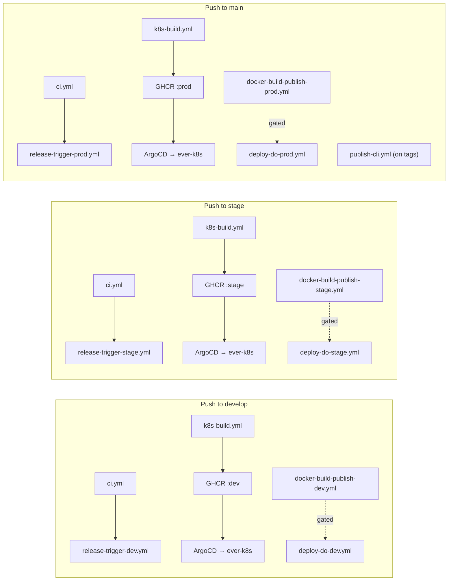
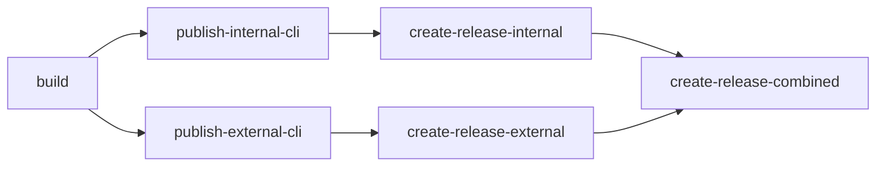

# GitHub Workflows Deep Dive

The Ever Works platform uses GitHub Actions workflows in `.github/workflows/` to automate CI, container
image builds, Kubernetes deployments, CLI publishing, and Trigger.dev deployments across three environments
(dev, stage, prod).

> **Which pipeline is actually live?** Images are built by **`k8s-build.yml`** and pushed to **GHCR**, then
> deployed to the self-hosted **`ever-k8s`** cluster by **ArgoCD**, which syncs manifests from the
> **`ever-co/k8s-gitops`** repo (ArgoCD Image Updater bumps the image digests automatically).
>
> The `deploy-do-*.yml` workflows below deploy to **DigitalOcean** and are **gated off** behind
> `vars.DO_ENABLED == 'true'`. They are retained deliberately (no-removal policy), not active. Treat any
> DigitalOcean hostname, registry or IP in this document as historical.

## Workflow Inventory

| Workflow File                                   | Name                                  | Trigger                         | Purpose                                               |
| ----------------------------------------------- | ------------------------------------- | ------------------------------- | ----------------------------------------------------- |
| `ci.yml`                                        | CI                                    | Push/PR to main, develop, stage | Lint, build, test                                     |
| `docker-build-publish-dev.yml`                  | Build and Publish Docker Images Dev   | Push to develop                 | Build Docker images for dev                           |
| `docker-build-publish-stage.yml`                | Build and Publish Docker Images Stage | Push to stage                   | Build Docker images for stage                         |
| `docker-build-publish-prod.yml`                 | Build and Publish Docker Images Prod  | Push to main                    | Build Docker images for prod                          |
| `k8s-build.yml`                                 | k8s-build                             | Push to develop, stage, main    | **LIVE** — build api/web/mcp/docs images → GHCR       |
| `docker-build-publish-mcp-{dev,stage,prod}.yml` | Build and Publish MCP Images          | Push to branch                  | Build MCP images (DigitalOcean path)                  |
| `deploy-do-dev.yml`                             | Deploy to DO Dev                      | After Docker Dev completes      | **GATED** (`DO_ENABLED`) — legacy DigitalOcean deploy |
| `deploy-do-stage.yml`                           | Deploy to DO Stage                    | After Docker Stage completes    | **GATED** (`DO_ENABLED`) — legacy DigitalOcean deploy |
| `deploy-do-prod.yml`                            | Deploy to DO Prod                     | After Docker Prod completes     | **GATED** (`DO_ENABLED`) — legacy DigitalOcean deploy |
| `release-trigger-dev.yml`                       | Deploy to Trigger.dev Dev             | After CI on develop             | Deploy Trigger.dev dev                                |
| `release-trigger-stage.yml`                     | Deploy to Trigger.dev Stage           | After CI on stage               | Deploy Trigger.dev staging                            |
| `release-trigger-prod.yml`                      | Deploy to Trigger.dev Prod            | After CI on main                | Deploy Trigger.dev prod                               |
| `publish-cli.yml`                               | Build and Publish CLIs                | Push to main, tags, manual      | Publish CLI packages                                  |
| `prod-image-freshness.yml`                      | Prod Image Freshness                  | Hourly cron, manual             | **Alarm** — is prod serving the tip of `main`?        |

## Pipeline Flow



## Production Image Lane Guarantees

`k8s-build.yml` is the only workflow that publishes the tags the clusters pull (`:dev` / `:stage` / `:prod`
plus an immutable `:sha-<sha>`). A cancelled run here is therefore not lost CI signal — it is a merged fix
that never reaches an environment. The lane died silently twice in August 2026, so it now carries four
separate guarantees. Change any of them only with the incident that motivated it in view.

### 1. A promoted commit is never discarded — not even while pending

```yaml
concurrency:
    group: k8s-build-${{ github.ref }}-${{ (github.ref == 'refs/heads/main' || ...) && github.sha || 'shared' }}
    cancel-in-progress: false
```

`cancel-in-progress: false` alone is **not** enough, and this is the part that keeps catching people out.
It only governs runs that are already _in progress_. GitHub keeps a single **pending** run per concurrency
group, and a newer pending run supersedes the older one regardless of that setting. Observed live on this
repo: run `32721436120` (main `4c00e87f6`, `cancel-in-progress` already `false`) was cancelled the same
second run `32722136353` was created, with all four of its jobs still at `runner_name = ""`.

So `main`, `master` and `stage` get a **per-commit** group: two commits on a protected ref can never
contend, at any stage of their life. `develop` deliberately keeps one shared group — it pushes far more
often, and there self-throttling is the point rather than a bug. Re-triggering the _same_ protected commit
still de-duplicates, because the group includes the SHA rather than the run id.

> A `workflow_dispatch` for a **different** commit no longer cancels a queued push run. One for the _same_
> commit still joins its group, which is correct: the images would be byte-identical.

### 2. The newest commit always wins the moving tag

Queueing instead of cancelling introduced a hazard of its own: two builds for one branch can be in flight
together, and the older one finishing second would pin `:prod` to an earlier commit — a silent production
rollback, strictly worse than a build that never ran. The build steps therefore publish only
`:sha-<sha>`, and a final step re-reads the branch tip with `git ls-remote` **after** the build and emits
the moving tag only when this build is still the tip. A superseded build keeps its immutable tag and stays
deployable by digest.

| Situation                 | Tags published        |
| ------------------------- | --------------------- |
| This build is the tip     | `sha-aaa` and `:prod` |
| Branch advanced meanwhile | `sha-aaa` only        |
| Tip cannot be resolved    | `sha-aaa`, job fails  |

### 3. The pool has to be able to schedule

`runs-on` resolves `RUNNER_LINUX_X64_8 || RUNNER_LINUX_X64_4 || ubuntu-latest`. The x64-16 pool was
_unschedulable_ (all five pods `Pending` on `Insufficient cpu/memory` for hours), which is a different
failure from _busy_: queueing behind runners that cycle resolves, waiting on pods that never schedule does
not. Diagnose with the pods, never by assuming the runner label is wrong — a queued job that reports its
labels correctly proves the label resolved.

### 4. The lane's own death is now alarmed (`prod-image-freshness.yml`)

Every other signal was blind to a dead lane:

- `ci.yml` is green — the code compiles. It says nothing about whether an image was built.
- `smoke-deployed.yml` runs `on: workflow_run: [k8s-build] types: [completed]`. When no run ever
  _completes_, the smoke never fires; it is structurally incapable of reporting this.
- `external-uptime-monitor.yml` asks whether production answers. During both incidents it answered
  perfectly — it was just serving an old image.

`prod-image-freshness.yml` asks the one question none of them can: **does the commit inside the production
image match the tip of `main`?** It compares `gh api repos/.../commits/main` against `gitSha` from
`https://api.ever.works/api/version` (baked at image build time from the `GIT_SHA` build-arg), and files a
single deduplicated `prod-image-alert` issue when a commit has been unshipped past the window.

| Verdict   | Meaning                                     | Action                  |
| --------- | ------------------------------------------- | ----------------------- |
| `ok`      | prod is serving the tip of `main`           | closes any open alert   |
| `pending` | a newer commit is inside the rollout window | nothing                 |
| `alert`   | unshipped longer than the window            | opens/updates the issue |
| `unknown` | a signal was unavailable                    | `::warning::` only      |

Two design rules make it trustworthy, and both are enforced by
`apps/node/src/core/prod-image-freshness.contract.spec.ts`:

- **It never alerts on its own transport faults.** An unreachable endpoint yields `unknown`, not `alert`.
  A monitor that cries wolf gets muted, and being muted is the failure this alarm exists to prevent.
- **It keys on identity, not age.** "No build for N hours" would fire every quiet weekend and stay silent
  through a lane death that happened to follow a recent build.

The window defaults to **6 hours** (a healthy main build takes 18-42 min, a jammed one measured 4h46m, and
ArgoCD still has to roll the pods). Override it with the repo variable `PROD_IMAGE_MAX_UNSHIPPED_HOURS`, or
per-run through the `max_unshipped_hours` dispatch input.

Like `external-uptime-monitor.yml`, it runs on `ubuntu-latest` **on purpose**: a monitor that detects ARC
pool starvation must not queue behind the starved pool.

## CI Workflow (`ci.yml`)

The foundational workflow that all other workflows depend on.

**Triggers:**

- Push to `main`, `develop`, `stage`
- Pull requests targeting those branches
- Manual `workflow_dispatch`

**Concurrency:** Groups by workflow + ref with `cancel-in-progress: true` to avoid redundant runs.

**Runner:** `ubicloud-standard-8` (high-performance runner)

**Steps:**

| Step               | Command                              | Purpose                 |
| ------------------ | ------------------------------------ | ----------------------- |
| Checkout           | `actions/checkout@v4`                | Clone repository        |
| Install pnpm       | `pnpm/action-setup@v3` (v10.13.1)    | Package manager setup   |
| Setup Node.js      | `actions/setup-node@v4` (20.x)       | Node.js with pnpm cache |
| Install deps       | `pnpm install --frozen-lockfile`     | Reproducible install    |
| Format check       | `pnpm format:check`                  | Prettier validation     |
| Build all          | `pnpm build`                         | Turborepo build         |
| Run tests          | `pnpm test`                          | All test suites         |
| Build Internal CLI | `pnpm build:cli` (apps/internal-cli) | CLI compilation         |
| Build External CLI | `pnpm build:cli` (apps/cli)          | CLI compilation         |
| Test Internal CLI  | `pnpm test:cli` (apps/internal-cli)  | CLI tests               |
| Test External CLI  | `pnpm test:cli` (apps/cli)           | CLI tests               |

**Secrets Used:** `API_URL`, `WEB_URL`

## Docker Build Workflows

Three identical workflows for dev/stage/prod that build and push Docker images to multiple registries.

### Build Process (per environment)

Two parallel jobs build the API and Web images:

**Job: `ever-works-api`**

```yaml
- Build with Docker Buildx
  - File: .deploy/docker/api/Dockerfile
  - Platform: linux/amd64
  - Tags: ghcr.io/ever-works/ever-works-api-{env}:latest
          everco/ever-works-api-{env}:latest
          registry.digitalocean.com/ever/ever-works-api-{env}:latest
  - Cache: registry-based layer caching
  - Build args: NODE_ENV={environment}
```

**Job: `ever-works-web`** (same pattern for web image)

### Registry Push Order

Each image is pushed to up to four registries:

| Registry                  | Action                                     | Failure Policy            |
| ------------------------- | ------------------------------------------ | ------------------------- |
| GitHub Container Registry | `docker/login-action` + push               | Required                  |
| Docker Hub                | `docker/login-action` + push               | `continue-on-error: true` |
| DigitalOcean Registry     | `doctl registry login` + push              | `continue-on-error: true` |
| CW Container Registry     | `docker/login-action` (push commented out) | `continue-on-error: true` |

**Secrets Used:** `DOCKERHUB_USERNAME`, `DOCKERHUB_TOKEN`, `DIGITALOCEAN_ACCESS_TOKEN`, `GITHUB_TOKEN`, `CW_DOCKER_REGISTRY`, `CW_DOCKER_USER`, `CW_DOCKER_USER_PASSWORD`

## Kubernetes Deploy Workflows

> **Legacy — not the live path.** These three workflows deploy to **DigitalOcean** Kubernetes and every step
> is gated behind `vars.DO_ENABLED == 'true'`, which is not set. The live deployment path is
> `k8s-build.yml` → GHCR → ArgoCD → `ever-k8s` (manifests in `ever-co/k8s-gitops`). This section is kept
> for reference and in case the DigitalOcean path is ever re-enabled.

Three workflows (`deploy-do-dev.yml`, `deploy-do-stage.yml`, `deploy-do-prod.yml`) deploy to DigitalOcean Kubernetes.

### Trigger

Each runs after its corresponding Docker build workflow completes:

```yaml
on:
    workflow_run:
        workflows: ['Build and Publish Docker Images {Env}']
        branches: [{ branch }]
        types: [completed]
```

### Deployment Steps

| Step                 | Description                                 |
| -------------------- | ------------------------------------------- |
| Install doctl        | DigitalOcean CLI setup                      |
| Save kubeconfig      | Short-lived credentials (600s expiry)       |
| Write DB certificate | Decode base64 CA certificate                |
| Generate TLS secrets | Create API and Web TLS secrets for ingress  |
| Apply K8s manifests  | `envsubst` + `kubectl apply`                |
| Restart pods         | Rolling restart to pick up `:latest` images |

### Environment Variables (injected via envsubst)

The manifests receive a comprehensive set of environment variables:

**Application:**

| Variable          | Example                                                              |
| ----------------- | -------------------------------------------------------------------- |
| `WEB_URL`         | `https://app.ever.works` (prod) / `https://app-dev.ever.works` (dev) |
| `ALLOWED_ORIGINS` | `https://app.ever.works,https://api.ever.works`                      |
| `JWT_SECRET`      | From secrets                                                         |
| `AUTH_SECRET`     | From secrets                                                         |

**Trigger.dev:**

| Variable                  | Description                |
| ------------------------- | -------------------------- |
| `TRIGGER_ENABLED`         | Enable/disable Trigger.dev |
| `TRIGGER_SECRET_KEY`      | Trigger.dev authentication |
| `TRIGGER_INTERNAL_SECRET` | Internal API secret        |

**OAuth:**

| Variable                                    | Description           |
| ------------------------------------------- | --------------------- |
| `GH_CLIENT_ID` / `GH_CLIENT_SECRET`         | GitHub OAuth          |
| `GH_CALLBACK_URL`                           | GitHub OAuth callback |
| `GOOGLE_CLIENT_ID` / `GOOGLE_CLIENT_SECRET` | Google OAuth          |
| `GOOGLE_CALLBACK_URL`                       | Google OAuth callback |

**Plugins:**

| Variable                                         | Description            |
| ------------------------------------------------ | ---------------------- |
| `PLUGIN_OPENROUTER_API_KEY`                      | OpenRouter AI provider |
| `PLUGIN_OPENROUTER_DEFAULT_MODEL`                | Default model          |
| `PLUGIN_OPENROUTER_SIMPLE_MODEL`                 | Simple tasks model     |
| `PLUGIN_OPENROUTER_MEDIUM_MODEL`                 | Medium tasks model     |
| `PLUGIN_OPENROUTER_COMPLEX_MODEL`                | Complex tasks model    |
| `PLUGIN_GITHUB_CLIENT_ID` / `CLIENT_SECRET`      | GitHub plugin OAuth    |
| `PLUGIN_TAVILY_API_KEY`                          | Tavily search          |
| `PLUGIN_SCREENSHOTONE_ACCESS_KEY` / `SECRET_KEY` | Screenshot provider    |

**Database:**

| Variable                                                    | Description                  |
| ----------------------------------------------------------- | ---------------------------- |
| `DATABASE_TYPE`                                             | Database driver              |
| `DATABASE_URL`                                              | Connection string            |
| `DATABASE_HOST` / `PORT` / `USERNAME` / `PASSWORD` / `NAME` | Individual connection params |
| `DATABASE_SSL_MODE`                                         | Enable SSL/TLS               |
| `DATABASE_CA_CERT`                                          | CA certificate (base64)      |

**Mail:**

| Variable                                              | Description                         |
| ----------------------------------------------------- | ----------------------------------- |
| `MAILER_PROVIDER`                                     | Mail transport (`smtp` or `resend`) |
| `EMAIL_FROM`                                          | Sender address                      |
| `SMTP_HOST` / `PORT` / `SECURE` / `USER` / `PASSWORD` | SMTP config                         |
| `RESEND_APIKEY` / `RESEND_EMAIL_FROM`                 | Resend config                       |

### Environment URLs

These are the hostnames actually served by `ever-k8s` (ingress rules live in `ever-co/k8s-gitops` under
`apps/ever-works-app-{dev,stage,prod}`):

| Environment | Web URL                        | API URL                        | Admin URL                        | MCP URL                       |
| ----------- | ------------------------------ | ------------------------------ | -------------------------------- | ----------------------------- |
| dev         | `https://app-dev.ever.works`   | `https://api-dev.ever.works`   | `https://admin-dev.ever.works`   | `https://mcpdev.ever.works`   |
| stage       | `https://app-stage.ever.works` | `https://api-stage.ever.works` | `https://admin-stage.ever.works` | `https://mcpstage.ever.works` |
| prod        | `https://app.ever.works`       | `https://api.ever.works`       | `https://admin.ever.works`       | `https://mcp.ever.works`      |

**Legacy aliases.** The pre-migration DigitalOcean hostnames `appdev` / `apidev` / `appstage` /
`apistage.ever.works` (no hyphen) are still served as additional ingress rules on the same backends, so old
links and bookmarks keep working. Prefer the hyphenated names above for anything new — they are the ones the
manifests are keyed on.

## Trigger.dev Deploy Workflows

Three workflows deploy background tasks to Trigger.dev across environments.

### Trigger

Each runs after CI completes on the corresponding branch:

```yaml
on:
    workflow_run:
        workflows: ['CI']
        branches: [{ branch }]
        types: [completed]
```

### Runner

All use `ubicloud-standard-2` (lighter runner, as deployment is simpler).

### Steps

| Step            | Dev                                        | Stage/Prod                                 |
| --------------- | ------------------------------------------ | ------------------------------------------ |
| Build packages  | `pnpm build --filter './packages/**'`      | Same                                       |
| Prepare plugins | --                                         | `pnpm prepare:plugins`                     |
| Deploy          | Login only (`npx trigger.dev@4.4.1 login`) | `npx trigger.dev@4.4.1 deploy --env {env}` |

The dev workflow only verifies Trigger.dev connectivity (login) without deploying, because the dev environment uses NestJS built-in scheduling instead.

**Secrets Used:** `TRIGGER_ACCESS_TOKEN`

## CLI Publish Workflow (`publish-cli.yml`)

The most complex workflow, handling builds, version bumps, publishing, and GitHub releases.

### Triggers

- Push to `main` branch
- Tags: `v*`, `cli-v*`, `internal-cli-v*`
- Manual dispatch with options:

| Input                  | Type    | Description                 |
| ---------------------- | ------- | --------------------------- |
| `publish_internal_cli` | boolean | Publish internal CLI        |
| `publish_external_cli` | boolean | Publish external CLI        |
| `do_version_bump`      | boolean | Bump version before publish |
| `version_bump`         | choice  | `patch`, `minor`, `major`   |

### Jobs



**Build Job:** Builds all packages, then builds and tests both CLIs. Uploads `dist/` as artifacts.

**Publish Jobs:** Download artifacts, optionally bump version, publish to npm:

- Internal CLI: `npm publish --access restricted` (private)
- External CLI: `npm publish --access public` (public)

**Release Jobs:** Create GitHub releases with installation instructions using `softprops/action-gh-release@v2`.

| Tag Pattern       | Release Type  | Packages          |
| ----------------- | ------------- | ----------------- |
| `v*`              | Combined      | Both CLIs         |
| `cli-v*`          | External only | `ever-works-cli`  |
| `internal-cli-v*` | Internal only | `@ever-works/cli` |

**Secrets Used:** `NPM_TOKEN`, `API_URL`, `WEB_URL`

## Complete Secrets Reference

| Secret                                               | Used In                       |
| ---------------------------------------------------- | ----------------------------- |
| `API_URL`                                            | CI, CLI publish               |
| `WEB_URL`                                            | CI, CLI publish               |
| `JWT_SECRET`                                         | K8s deploys                   |
| `AUTH_SECRET`                                        | K8s deploys                   |
| `DIGITALOCEAN_ACCESS_TOKEN`                          | Docker builds, K8s deploys    |
| `DOCKERHUB_USERNAME` / `DOCKERHUB_TOKEN`             | Docker builds                 |
| `GITHUB_TOKEN`                                       | Docker builds (auto-provided) |
| `NPM_TOKEN`                                          | CLI publish                   |
| `TRIGGER_ACCESS_TOKEN`                               | Trigger.dev deploys           |
| `TRIGGER_ENABLED` / `SECRET_KEY` / `INTERNAL_SECRET` | K8s deploys                   |
| `DATABASE_*` (7 vars)                                | K8s deploys                   |
| `SMTP_*` (6 vars)                                    | K8s deploys                   |
| `RESEND_*` (2 vars)                                  | K8s deploys                   |
| `PLUGIN_*` (10 vars)                                 | K8s deploys                   |
| `GH_*` / `GOOGLE_*` (6 vars)                         | K8s deploys                   |
| `INGRESS_*` (4 vars)                                 | K8s deploys                   |
| `CW_DOCKER_*` (3 vars)                               | Docker builds                 |

## Source Files

| File                                               | Purpose               |
| -------------------------------------------------- | --------------------- |
| `.github/workflows/ci.yml`                         | CI pipeline           |
| `.github/workflows/docker-build-publish-dev.yml`   | Docker build (dev)    |
| `.github/workflows/docker-build-publish-stage.yml` | Docker build (stage)  |
| `.github/workflows/docker-build-publish-prod.yml`  | Docker build (prod)   |
| `.github/workflows/deploy-do-dev.yml`              | K8s deploy (dev)      |
| `.github/workflows/deploy-do-stage.yml`            | K8s deploy (stage)    |
| `.github/workflows/deploy-do-prod.yml`             | K8s deploy (prod)     |
| `.github/workflows/release-trigger-dev.yml`        | Trigger.dev (dev)     |
| `.github/workflows/release-trigger-stage.yml`      | Trigger.dev (stage)   |
| `.github/workflows/release-trigger-prod.yml`       | Trigger.dev (prod)    |
| `.github/workflows/publish-cli.yml`                | CLI build and publish |
| `.github/workflows/k8s-build.yml`                  | **Live** image build  |
| `.github/workflows/prod-image-freshness.yml`       | Prod staleness alarm  |
