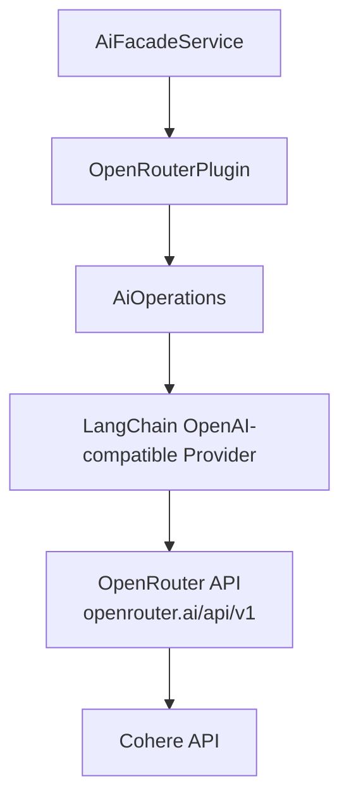
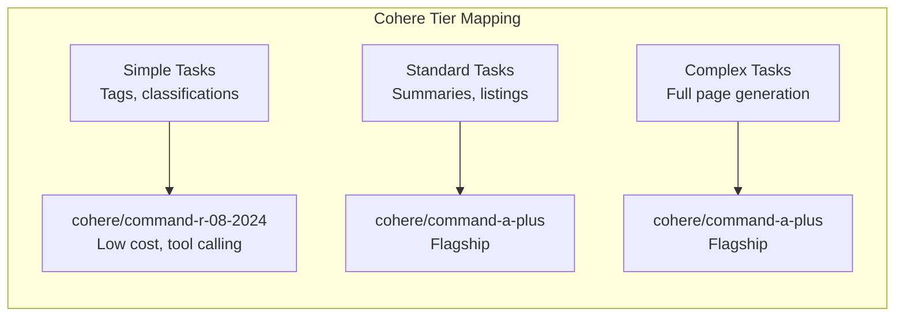

# Cohere Models via OpenRouter

Ever Works does not ship a Cohere plugin: there is no `cohere` package under `packages/plugins/`. Cohere's chat models -- the Command A and Command R families -- are available through the **OpenRouter** plugin, and Command A also through the **Vercel AI Gateway** plugin. This page describes how to configure and use Cohere models for work generation, content creation, and AI conversations.

**Related source files:**

| File                                                                 | Purpose                              |
| -------------------------------------------------------------------- | ------------------------------------ |
| `packages/plugins/openrouter/src/openrouter.plugin.ts`               | OpenRouter AI provider plugin        |
| `packages/plugins/vercel-ai-gateway/src/vercel-ai-gateway.plugin.ts` | Vercel AI Gateway AI provider plugin |
| `packages/plugin/src/ai/reasoning.utils.ts`                          | Reasoning configuration utilities    |

## What is Cohere?

Cohere is an enterprise AI platform that offers models optimized for business applications. Its Command models are designed for retrieval-augmented generation (RAG), multilingual content, agentic tool use and structured data extraction -- all capabilities that align well with work generation workflows.

## Available Cohere Models

Models as of 2026-11-06 — source: the live lists [openrouter.ai/api/v1/models](https://openrouter.ai/api/v1/models) and [ai-gateway.vercel.sh/v1/models](https://ai-gateway.vercel.sh/v1/models). Availability depends on your account/plan/region; the picker accepts a custom model id and keeps existing saved selections.

Cohere models are available on OpenRouter with the `cohere/` prefix. These are every `cohere/` chat id on OpenRouter's list on 2026-11-06 (prices per million input / output tokens):

| Model ID (OpenRouter)           | Description            | Context | Price           | Strengths                                                                                       |
| ------------------------------- | ---------------------- | ------- | --------------- | ----------------------------------------------------------------------------------------------- |
| `cohere/command-a-plus`         | Command A+             | 192,000 | $0.30 / $1.50   | Cohere's flagship for enterprise agentic workflows; text and image input, tool calling          |
| `cohere/command-a`              | Command A              | 256,000 | $2.50 / $10     | Open-weights 111B model for agentic, multilingual and coding use; no tool calling on OpenRouter |
| `cohere/command-r-plus-08-2024` | Command R+ (08-2024)   | 128,000 | $2.50 / $10     | RAG-optimized, tool calling                                                                     |
| `cohere/command-r-08-2024`      | Command R (08-2024)    | 128,000 | $0.15 / $0.60   | Balanced quality and cost, tool calling                                                         |
| `cohere/command-r7b-12-2024`    | Command R7B (12-2024)  | 128,000 | $0.0375 / $0.15 | Small and fast; no tool calling on OpenRouter                                                   |
| `cohere/north-mini-code:free`   | North Mini Code (free) | 256,000 | free            | Cohere's agentic coding model; no structured output on OpenRouter                               |

The ids this page used to list (`cohere/command-r-plus`, `cohere/command-r`, `cohere/command`, `cohere/command-light`) are not on OpenRouter's list any more; a configuration that saved one should move to a current id. The Vercel AI Gateway lists one Cohere chat model, `cohere/command-a`, next to Cohere's embedding and rerank models.

:::note
Model availability on OpenRouter changes over time. Check [openrouter.ai/models](https://openrouter.ai/models) for the current list of available Cohere models and pricing.
:::

## Why Consider Cohere for Works?

Cohere models have specific strengths relevant to work generation:

| Strength                 | Benefit for Ever Works                            |
| ------------------------ | ------------------------------------------------- |
| **RAG optimization**     | Excels at generating content from source material |
| **Multilingual support** | Strong performance across many languages          |
| **Structured output**    | Reliable JSON generation for item data            |
| **Grounding**            | Can cite sources when generating content          |
| **Enterprise focus**     | Consistent, reliable output quality               |

## Configuration

### Setting Up Cohere Models

1. Navigate to **Settings > Plugins** in the Ever Works dashboard.
2. Ensure the **OpenRouter** plugin is enabled (enabled by default).
3. Enter your OpenRouter API key.
4. Set model fields to Cohere model IDs:

| Setting              | Recommended Value          |
| -------------------- | -------------------------- |
| Default Model        | `cohere/command-a-plus`    |
| Simple Tasks Model   | `cohere/command-r-08-2024` |
| Standard Tasks Model | `cohere/command-a-plus`    |
| Complex Tasks Model  | `cohere/command-a-plus`    |

Command A+ is both Cohere's flagship and, on 2026-11-06, cheaper on OpenRouter than the older Command R+ and Command A, so it covers the standard and complex tiers. The OpenRouter plugin's own defaults are OpenAI models (see [OpenRouter Plugin](./openrouter-plugin.md)); Cohere is used only for the fields you set.

### Environment Variables

```bash
PLUGIN_OPENROUTER_API_KEY=sk-or-...
PLUGIN_OPENROUTER_DEFAULT_MODEL=cohere/command-a-plus
PLUGIN_OPENROUTER_SIMPLE_MODEL=cohere/command-r-08-2024
PLUGIN_OPENROUTER_MEDIUM_MODEL=cohere/command-a-plus
PLUGIN_OPENROUTER_COMPLEX_MODEL=cohere/command-a-plus
```

## Architecture

Cohere models follow the same access path as all other OpenRouter models:



The OpenRouter plugin uses an OpenAI-compatible API endpoint. OpenRouter translates requests to the Cohere-native format internally, so no special handling is needed in the plugin.

## Tiered Model Strategy

Cohere's model lineup maps naturally to the Ever Works tier system:



### Mixed-Provider Configuration

Combine Cohere with other providers for optimal cost-quality balance:

| Tier     | Model                      | Provider | Rationale                                           |
| -------- | -------------------------- | -------- | --------------------------------------------------- |
| Simple   | `openai/gpt-6-luna`        | OpenAI   | OpenAI's model for cost-sensitive, high-volume work |
| Standard | `cohere/command-r-08-2024` | Cohere   | Strong at structured content                        |
| Complex  | `cohere/command-a-plus`    | Cohere   | Cohere's flagship for source-based generation       |

## Capabilities

Per OpenRouter's list (2026-11-06):

| Capability        | Command A+          | Command A           | Command R+ / R (08-2024) | Command R7B |
| ----------------- | ------------------- | ------------------- | ------------------------ | ----------- |
| Structured output | Yes                 | Yes                 | Yes                      | Yes         |
| Streaming         | Yes                 | Yes                 | Yes                      | Yes         |
| Tool calling      | Yes                 | No                  | Yes                      | No          |
| Vision            | Image input         | No                  | No                       | No          |
| Embeddings        | No (via OpenRouter) | No (via OpenRouter) | No (via OpenRouter)      | No          |
| Multilingual      | Strong              | Strong              | Strong                   | Good        |

### Embedding Limitation

Cohere offers embedding models, but OpenRouter's list has none, and while the Vercel AI Gateway lists `cohere/embed-v4.0` and `cohere/embed-v5.0-*` (2026-11-06), neither gateway plugin in Ever Works has an embedding-model setting. If you need embeddings:

- Use the **OpenAI** plugin (`text-embedding-3-small`).
- Use the **Google Gemini** plugin (built-in embedding support).
- Use the **Ollama** plugin with a local embedding model.

## Comparison with Other Providers

| Aspect            | Cohere (via OpenRouter) | OpenAI (direct) | Anthropic (direct) |
| ----------------- | ----------------------- | --------------- | ------------------ |
| Setup             | OpenRouter key          | OpenAI key      | Anthropic key      |
| RAG optimization  | Strong                  | Good            | Good               |
| Multilingual      | Very strong             | Good            | Good               |
| Structured output | Reliable                | Very reliable   | Reliable           |
| Vision            | Command A+ only         | Yes             | Yes (Claude)       |
| Embeddings        | Not via OpenRouter      | Yes             | No                 |
| Cost              | Moderate                | Varies by model | Varies by model    |

## Use Cases for Cohere in Works

### Multilingual Works

Cohere's multilingual capabilities make it well-suited for works that serve content in multiple languages. Command models handle cross-language content generation without significant quality degradation.

### Source-Heavy Works

When works are built from extensive source material (web scraping, PDFs, Notion pages), Cohere's RAG optimization helps the model ground its output in the provided sources rather than hallucinating information.

### Structured Data Extraction

Cohere models reliably produce structured JSON output, which is critical for generating work item data (names, descriptions, categories, tags, metadata).

## Troubleshooting

| Issue                    | Cause                                                              | Solution                                                    |
| ------------------------ | ------------------------------------------------------------------ | ----------------------------------------------------------- |
| Model not found          | Model ID incorrect or model discontinued (e.g. `cohere/command-r`) | Verify at openrouter.ai/models; use `cohere/command-a-plus` |
| Authentication error     | Invalid OpenRouter API key                                         | Regenerate key at openrouter.ai                             |
| Rate limit exceeded      | Too many requests                                                  | Check OpenRouter plan limits                                |
| Poor multilingual output | Wrong model selected                                               | Use Command A+ or Command R+ for multilingual               |
| Embedding request fails  | Cohere embeddings not available via OpenRouter                     | Use OpenAI or Ollama for embeddings                         |
| JSON parsing errors      | Structured output not enforced                                     | Ensure pipeline uses structured output mode                 |

## Further Reading

- [OpenRouter Plugin](./openrouter-plugin.md) -- complete OpenRouter configuration
- [AI Provider Plugins](./ai-provider-plugins.md) -- all available AI providers
- [DeepSeek Models](./deepseek-plugin.md) -- another provider accessible via OpenRouter
- [xAI Grok Models](./xai-plugin.md) -- Grok models via OpenRouter and the dedicated `grok` plugin
- [Vercel AI Gateway Plugin](./vercel-ai-gateway-plugin.md) -- the other gateway route
- [Plugin Settings](./settings.md) -- settings resolution and configuration modes
