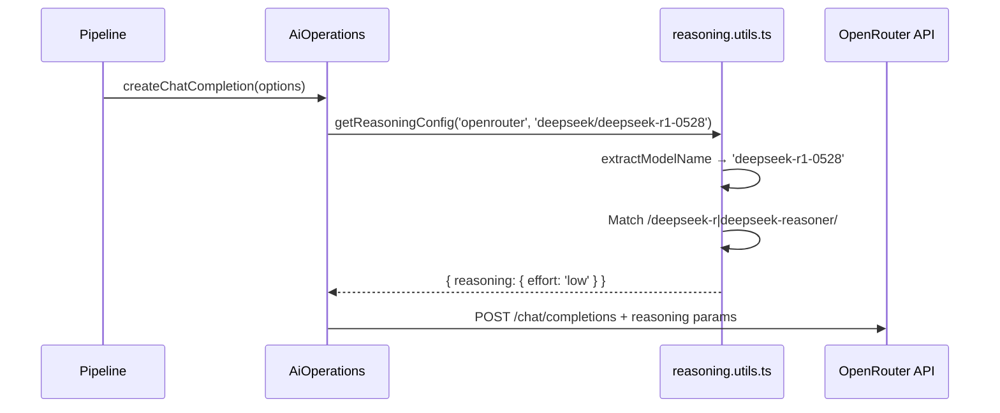
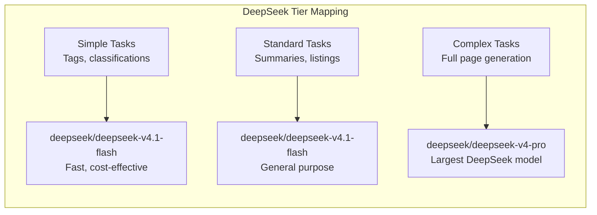

# DeepSeek Models via OpenRouter

DeepSeek is a Chinese AI lab that publishes open-weight models and runs its own API. Ever Works does not ship a DeepSeek plugin: there is no `deepseek` package under `packages/plugins/`. DeepSeek models are used through the **OpenRouter** plugin, which is the platform's default AI provider, or the **Vercel AI Gateway** plugin. This page explains how to configure them for work generation and AI conversations.

**Related source files:**

| File                                                                                 | Purpose                                     |
| ------------------------------------------------------------------------------------ | ------------------------------------------- |
| `packages/plugins/openrouter/src/openrouter.plugin.ts`                               | OpenRouter AI provider plugin               |
| `packages/plugins/vercel-ai-gateway/src/vercel-ai-gateway.plugin.ts`                 | Vercel AI Gateway AI provider plugin        |
| `packages/plugin/src/ai/reasoning.utils.ts`                                          | Reasoning configuration for DeepSeek models |
| `apps/internal-cli/src/commands/config/ai-providers/ai-provider-registry.service.ts` | AI provider registry with model lists       |

## Available DeepSeek Models

Models as of 2026-11-05 — source: [api-docs.deepseek.com/quick_start/pricing](https://api-docs.deepseek.com/quick_start/pricing), and for the gateway ids the live lists [openrouter.ai/api/v1/models](https://openrouter.ai/api/v1/models) and [ai-gateway.vercel.sh/v1/models](https://ai-gateway.vercel.sh/v1/models) (both read on 2026-11-06). Availability depends on your account/plan/region; the picker accepts a custom model id and keeps existing saved selections.

DeepSeek's own API serves two current models, `deepseek-flash` (DeepSeek V4.1 Flash) and `deepseek-v4-pro`, both with a 1M-token context and 384K output tokens. It retired the `deepseek-chat` and `deepseek-reasoner` API names on 2026-07-24.

### Via OpenRouter

OpenRouter lists DeepSeek models with the `deepseek/` prefix. The internal CLI's provider registry lists the two current ones:

| Model ID                       | Description                                                  | Best For                               |
| ------------------------------ | ------------------------------------------------------------ | -------------------------------------- |
| `deepseek/deepseek-v4.1-flash` | DeepSeek V4.1 Flash. 1,048,576 context, text and image input | Fast, low-cost content generation      |
| `deepseek/deepseek-v4-pro`     | DeepSeek V4 Pro. 1,048,576 context, text input               | Complex analysis, multi-step reasoning |

On 2026-11-06 OpenRouter priced `deepseek/deepseek-v4.1-flash` at $0.045 / $0.50 and `deepseek/deepseek-v4-pro` at $1.60 / $3.20 per million input / output tokens. The list also carries dated snapshots (`deepseek/deepseek-v4.1-flash-1017`, `deepseek/deepseek-v4-pro-0813`) and older models such as `deepseek/deepseek-v3.2` and `deepseek/deepseek-r1-0528`. `deepseek/deepseek-r1` and `deepseek/deepseek-coder`, which this page used to recommend, are no longer on the list.

### Via Vercel AI Gateway

The Vercel AI Gateway lists the same two models as `deepseek/deepseek-v4.1-flash` and `deepseek/deepseek-v4-pro` (2026-11-06). Use them with the **Vercel AI Gateway** plugin exactly as described for OpenRouter below.

### Via Ollama (Local)

DeepSeek models can also be run locally through the Ollama plugin. Both are in the [Ollama library](https://ollama.com/library) (2026-11-06):

| Model ID            | Description                                                                   |
| ------------------- | ----------------------------------------------------------------------------- |
| `deepseek-r1`       | Local DeepSeek R1 (various quantizations); tools and thinking badges          |
| `deepseek-coder-v2` | Local DeepSeek Coder V2; no tools badge, so a poor fit for tool-calling steps |

### Via Groq

Groq no longer serves a DeepSeek model: it retired `deepseek-r1-distill-qwen-32b` on 2025-04-14 (source: [console.groq.com/docs/deprecations](https://console.groq.com/docs/deprecations)). The Groq plugin's defaults are `openai/gpt-oss-120b` and `openai/gpt-oss-20b`; see [Groq Plugin](./groq-plugin.md).

## Reasoning Model Configuration

The platform's reasoning registry still has an entry for DeepSeek's older reasoning models. From `packages/plugin/src/ai/reasoning.utils.ts`:

```typescript
{
    pattern: /deepseek-r|deepseek-reasoner/,
    openrouter: { reasoning: { effort: 'low' } }
}
```

When a model whose name matches (for example `deepseek/deepseek-r1-0528`) is selected on OpenRouter, the platform sends `reasoning.effort: 'low'`. This instructs the model to minimize its internal reasoning tokens while still producing structured output. The entry has no slice for other providers, so Ollama's `deepseek-r1` gets no reasoning parameter.

The current V4 models do **not** match this pattern (`deepseek-v4-pro` and `deepseek-v4.1-flash` contain neither `deepseek-r` nor `deepseek-reasoner`), so Ever Works sends no reasoning effort for them. OpenRouter's list (2026-11-06) shows reasoning on by default for both with a default effort of `high`, so requests run at that default.

### How Reasoning Config Resolution Works



The `extractModelName` function strips the provider prefix (`deepseek/deepseek-r1-0528` becomes `deepseek-r1-0528`) before matching against the pattern list. For `deepseek/deepseek-v4-pro` the lookup finds no entry and returns `undefined`, so no reasoning parameter is added.

## Configuring DeepSeek as Your AI Provider

### Option 1: Through OpenRouter (Recommended)

1. Open the **Ever Works dashboard** and navigate to **Settings > Plugins**.
2. Ensure the **OpenRouter** plugin is enabled (it is by default).
3. Enter your OpenRouter API key if not already configured.
4. Set the model fields to DeepSeek models:

| Setting              | Recommended Value              |
| -------------------- | ------------------------------ |
| Default Model        | `deepseek/deepseek-v4.1-flash` |
| Simple Tasks Model   | `deepseek/deepseek-v4.1-flash` |
| Standard Tasks Model | `deepseek/deepseek-v4.1-flash` |
| Complex Tasks Model  | `deepseek/deepseek-v4-pro`     |

The OpenRouter plugin's own defaults are OpenAI models (see [OpenRouter Plugin](./openrouter-plugin.md)); DeepSeek is used only for the fields you set. With the Vercel AI Gateway plugin, use the same ids.

### Option 2: Through Ollama (Local, Free)

1. Install [Ollama](https://ollama.ai) on your machine.
2. Pull a DeepSeek model: `ollama pull deepseek-r1`
3. Enable the **Ollama** plugin in the Ever Works dashboard.
4. Set the default model to `deepseek-r1`.

### Option 3: Through Groq (Fast Inference)

Not available any more: Groq retired its only DeepSeek model, `deepseek-r1-distill-qwen-32b`, on 2025-04-14. For fast inference on Groq, use the Groq plugin's own defaults (`openai/gpt-oss-120b`, simple tier `openai/gpt-oss-20b`).

## Environment Variables

When using DeepSeek through OpenRouter, an operator can set deployment-wide defaults via environment variables:

```bash
PLUGIN_OPENROUTER_API_KEY=sk-or-...
PLUGIN_OPENROUTER_DEFAULT_MODEL=deepseek/deepseek-v4.1-flash
PLUGIN_OPENROUTER_SIMPLE_MODEL=deepseek/deepseek-v4.1-flash
PLUGIN_OPENROUTER_COMPLEX_MODEL=deepseek/deepseek-v4-pro
```

## Tiered Model Strategy

DeepSeek models work well in a tiered configuration that balances cost and quality:



| Tier     | Recommended Model              | Reasoning                                      |
| -------- | ------------------------------ | ---------------------------------------------- |
| Simple   | `deepseek/deepseek-v4.1-flash` | Fast responses for tags and short descriptions |
| Standard | `deepseek/deepseek-v4.1-flash` | Solid quality for summaries and listings       |
| Complex  | `deepseek/deepseek-v4-pro`     | Stronger reasoning for detailed pages          |

## Mixing DeepSeek with Other Providers

Because OpenRouter aggregates multiple providers, you can mix DeepSeek models with models from other providers across tiers:

| Tier     | Model                          | Provider |
| -------- | ------------------------------ | -------- |
| Simple   | `openai/gpt-6-luna`            | OpenAI   |
| Standard | `deepseek/deepseek-v4.1-flash` | DeepSeek |
| Complex  | `deepseek/deepseek-v4-pro`     | DeepSeek |

This is configured through the OpenRouter plugin settings -- no additional plugins are needed.

## Capabilities

DeepSeek models accessed through OpenRouter support (OpenRouter's list, 2026-11-06):

| Capability        | DeepSeek V4.1 Flash | DeepSeek V4 Pro |
| ----------------- | ------------------- | --------------- |
| Structured output | Yes                 | Yes             |
| Streaming         | Yes                 | Yes             |
| Tool calling      | Yes                 | Yes             |
| Vision            | Image input         | No              |
| Embeddings        | No                  | No              |

:::note
DeepSeek models do not support embeddings. If your workflow requires semantic search, pair DeepSeek with a provider that supports embeddings (OpenAI, Google Gemini, or Ollama). The OpenRouter plugin also reports `supportsVision: false` at the plugin level, whatever the model.
:::

## Troubleshooting

| Issue                     | Cause                                                    | Solution                                                                             |
| ------------------------- | -------------------------------------------------------- | ------------------------------------------------------------------------------------ |
| Verbose or slow reasoning | V4 models reason at their default effort (`high`)        | Use `deepseek/deepseek-v4.1-flash` for simple tasks; reserve V4 Pro for complex ones |
| Model not found           | Incorrect or retired model ID (`deepseek/deepseek-r1`)   | Use a current id with the `deepseek/` prefix, e.g. `deepseek/deepseek-v4-pro`        |
| Old ids stop answering    | DeepSeek retired `deepseek-chat` and `deepseek-reasoner` | Move a saved old id to `deepseek/deepseek-v4.1-flash` or `deepseek/deepseek-v4-pro`  |
| Rate limits               | OpenRouter rate limiting                                 | Check your OpenRouter plan; add billing credits if needed                            |
| Embedding error           | DeepSeek does not support embeddings                     | Switch to OpenAI or Ollama for embedding tasks                                       |

## Cost Considerations

DeepSeek models are generally more cost-effective than comparable flagship models. On OpenRouter (2026-11-06):

- **DeepSeek V4.1 Flash**: $0.045 / $0.50 per million input / output tokens
- **DeepSeek V4 Pro**: $1.60 / $3.20 per million input / output tokens

Check [openrouter.ai/models](https://openrouter.ai/models) for current pricing. OpenRouter displays per-token costs for every available model.

## Further Reading

- [OpenRouter Plugin](./openrouter-plugin.md) -- full OpenRouter configuration reference
- [Vercel AI Gateway Plugin](./vercel-ai-gateway-plugin.md) -- the other gateway route
- [Groq Plugin](./groq-plugin.md) -- fast inference (no DeepSeek model since 2025-04-14)
- [Ollama Plugin](./ollama-plugin.md) -- running DeepSeek models locally
- [AI Provider Plugins](./ai-provider-plugins.md) -- overview of all AI provider plugins
