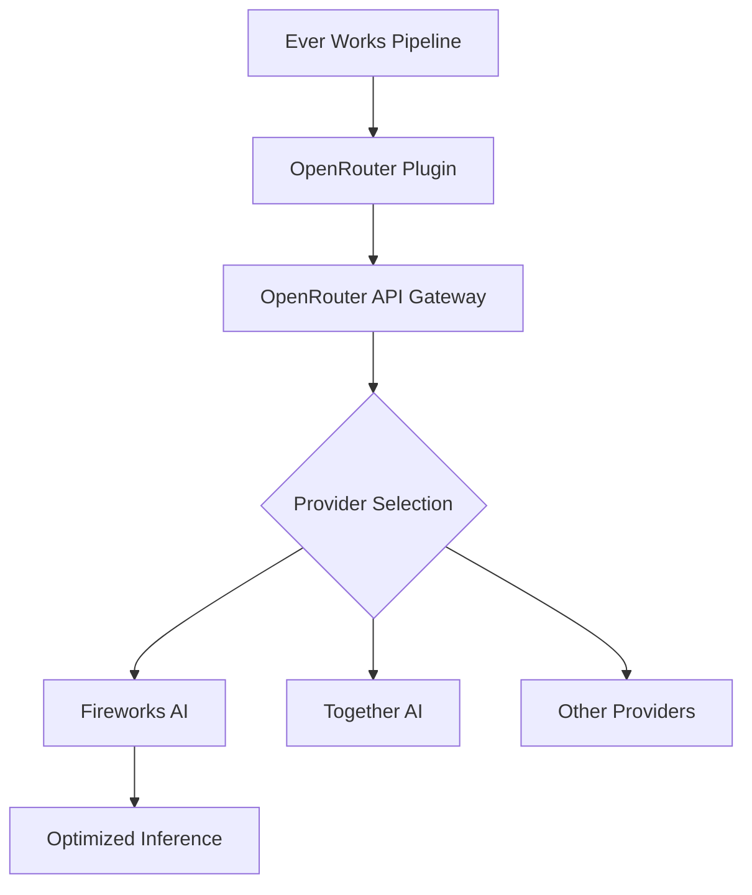
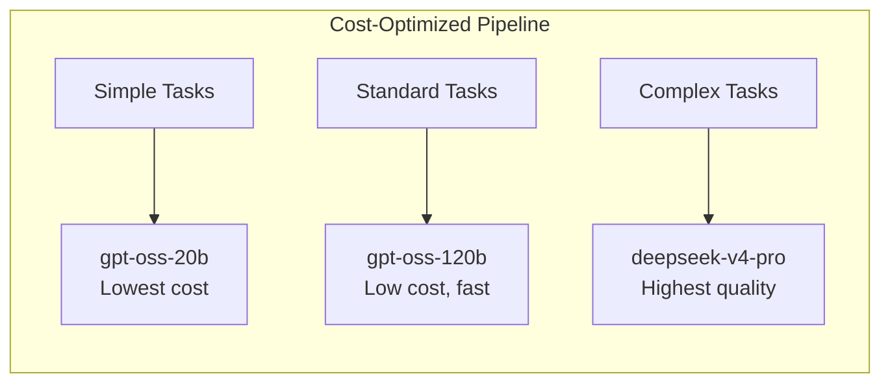

# Fireworks AI Models via OpenRouter

Ever Works does not ship a Fireworks AI plugin: there is no `fireworks` package under `packages/plugins/`. Fireworks AI is an inference host that OpenRouter can route requests to when you select open-weight models, and it also publishes one model of its own, `fireworks/ember-1`, which both the **OpenRouter** and the **Vercel AI Gateway** plugins can call. This page explains how Fireworks AI fits into the Ever Works AI pipeline.

**Related source files:**

| File                                                                 | Purpose                              |
| -------------------------------------------------------------------- | ------------------------------------ |
| `packages/plugins/openrouter/src/openrouter.plugin.ts`               | OpenRouter AI provider plugin        |
| `packages/plugins/vercel-ai-gateway/src/vercel-ai-gateway.plugin.ts` | Vercel AI Gateway AI provider plugin |
| `packages/plugin/src/ai/reasoning.utils.ts`                          | Reasoning configuration utilities    |

## What is Fireworks AI?

Fireworks AI is a fast-inference platform for open-weight AI models. It specializes in optimized serving of open-weight models, and its research team also publishes its own model, Ember-1. When you use open-weight models through OpenRouter in Ever Works, Fireworks AI may be one of the backend providers handling your requests.

## How OpenRouter Uses Fireworks AI

OpenRouter acts as a routing layer. When you select a model such as `openai/gpt-oss-120b`, OpenRouter can route the request to whichever provider offers the best combination of price, speed, and availability -- possibly Fireworks AI.



You do not choose Fireworks AI directly. Instead, you choose a model, and OpenRouter handles provider selection automatically. Ever Works' OpenRouter plugin has no setting to pin a host. The one exception is `fireworks/ember-1`, Fireworks' own model, which you select by its id.

### Provider Preferences

OpenRouter allows users to set provider preferences on their account. If you want to ensure requests are routed to Fireworks AI specifically:

1. Log in to your [OpenRouter account](https://openrouter.ai).
2. Navigate to account settings.
3. Set provider preferences for your preferred models.

These preferences are applied at the OpenRouter level, outside of Ever Works configuration.

## Models Commonly Served by Fireworks AI

Models as of 2026-11-05 — source: the live lists [openrouter.ai/api/v1/models](https://openrouter.ai/api/v1/models) and [ai-gateway.vercel.sh/v1/models](https://ai-gateway.vercel.sh/v1/models), read on 2026-11-06. Availability depends on your account/plan/region; the picker accepts a custom model id and keeps existing saved selections.

**Fireworks' own model.** Both lists carry exactly one Fireworks id:

| Model ID            | Description                                                                                                                                                                          |
| ------------------- | ------------------------------------------------------------------------------------------------------------------------------------------------------------------------------------ |
| `fireworks/ember-1` | Ember-1, a reasoning model from Fireworks Research built on Kimi K3. 1,048,576 context, text and image input, tool calling; $3 / $15 per million input / output tokens on OpenRouter |

Its reasoning is on by default (OpenRouter lists a default effort of `max`), and Ever Works' reasoning registry has no entry for it, so requests run at that default.

**Open-weight models Fireworks AI may serve.** OpenRouter's model list does not say which hosts serve a model; each model's page on [openrouter.ai/models](https://openrouter.ai/models) does. Open-weight models present on the list on 2026-11-06 include:

| Model ID (OpenRouter)         | Description           |
| ----------------------------- | --------------------- |
| `openai/gpt-oss-120b`         | OpenAI gpt-oss 120B   |
| `openai/gpt-oss-20b`          | OpenAI gpt-oss 20B    |
| `meta-llama/llama-4-maverick` | Meta Llama 4 Maverick |
| `meta-llama/llama-4-scout`    | Meta Llama 4 Scout    |
| `deepseek/deepseek-v4-pro`    | DeepSeek V4 Pro       |
| `moonshotai/kimi-k3`          | Moonshot Kimi K3      |

`meta-llama/llama-3.3-70b-instruct` is still listed but is an older model. `mistralai/mistral-large` and `qwen/qwen-2.5-72b-instruct`, which this page used to list, are older generations.

## Configuration in Ever Works

Since Fireworks AI is accessed transparently through OpenRouter, no special configuration is needed beyond setting up the OpenRouter plugin:

1. Enable the **OpenRouter** plugin (enabled by default).
2. Enter your OpenRouter API key.
3. Select the open-source models you want to use.

### Environment Variables

```bash
PLUGIN_OPENROUTER_API_KEY=sk-or-...
PLUGIN_OPENROUTER_DEFAULT_MODEL=openai/gpt-oss-120b
```

## Performance Characteristics

Fireworks AI is known for fast inference times. This benefits Ever Works in several ways:

| Benefit                    | Description                                                |
| -------------------------- | ---------------------------------------------------------- |
| **Faster work generation** | Items are processed more quickly during pipeline execution |
| **Lower latency AI chat**  | Conversational responses arrive faster                     |
| **Better throughput**      | More items can be processed in parallel                    |

### Speed Comparison

| Provider                      | Relative Speed              | Cost              |
| ----------------------------- | --------------------------- | ----------------- |
| Fireworks AI (via OpenRouter) | Fast                        | Per-token, varies |
| Groq (direct)                 | Very fast (custom hardware) | Free tier + paid  |
| Ollama (local)                | Depends on hardware         | Free              |
| OpenAI (direct)               | Standard                    | Per-token         |

If raw inference speed is your top priority and you want open-weight models, consider the **Groq** plugin as a direct alternative. Groq uses custom LPU hardware; its plugin defaults to `openai/gpt-oss-120b` (simple tier `openai/gpt-oss-20b`) as of 2026-11-05.

## Tiered Strategy with Fireworks-Served Models



| Tier     | Model                      | Why                                                           |
| -------- | -------------------------- | ------------------------------------------------------------- |
| Simple   | `openai/gpt-oss-20b`       | $0.03 / $0.13 per million tokens for tags and classifications |
| Standard | `openai/gpt-oss-120b`      | Good quality at $0.15 / $0.60                                 |
| Complex  | `deepseek/deepseek-v4-pro` | Strong open-weight quality for full pages ($1.60 / $3.20)     |

Prices are OpenRouter's on 2026-11-06. `meta-llama/llama-3.3-70b-instruct:free`, which this table used to recommend, is no longer listed. To use Fireworks' own model, set a tier to `fireworks/ember-1`.

## Capabilities

Models served by Fireworks AI through OpenRouter support standard capabilities (per model, see OpenRouter's list):

| Capability               | Supported       |
| ------------------------ | --------------- |
| Structured output (JSON) | Yes             |
| Streaming                | Yes             |
| Tool calling             | Model-dependent |
| Vision                   | Model-dependent |
| Embeddings               | Generally no    |

## Comparison: Fireworks AI vs Groq vs Ollama

| Aspect        | Fireworks AI (via OpenRouter) | Groq (direct plugin) | Ollama (direct plugin) |
| ------------- | ----------------------------- | -------------------- | ---------------------- |
| Access method | Transparent via OpenRouter    | Dedicated plugin     | Dedicated plugin       |
| API key       | OpenRouter key                | Groq key             | None required          |
| Speed         | Fast                          | Very fast            | Hardware-dependent     |
| Cost          | Per-token                     | Free tier available  | Free                   |
| Privacy       | Cloud-hosted                  | Cloud-hosted         | Local                  |
| Model control | OpenRouter selects provider   | Fixed to Groq        | Full local control     |
| Embeddings    | No                            | No                   | Yes                    |

## Troubleshooting

| Issue                            | Cause                                                          | Solution                                                |
| -------------------------------- | -------------------------------------------------------------- | ------------------------------------------------------- |
| Cannot select Fireworks directly | OpenRouter handles routing                                     | Use OpenRouter provider preferences for routing control |
| Slow response times              | Not routed to Fireworks AI                                     | Check OpenRouter provider preferences                   |
| Rate limit errors                | Provider-level rate limits                                     | Upgrade your OpenRouter plan or switch providers        |
| Model quality varies             | Different providers may serve slightly different quantizations | Pin provider preferences in your OpenRouter account     |

## Further Reading

- [OpenRouter Plugin](./openrouter-plugin.md) -- complete OpenRouter configuration
- [Groq Plugin](./groq-plugin.md) -- dedicated fast-inference plugin
- [Ollama Plugin](./ollama-plugin.md) -- local inference option
- [Together AI Models](./together-plugin.md) -- another open-source model provider
- [AI Provider Plugins](./ai-provider-plugins.md) -- overview of all providers
