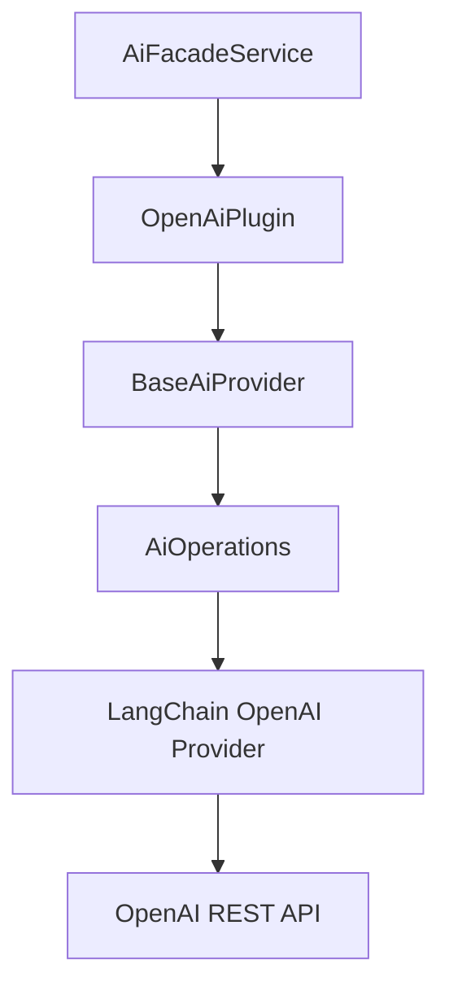
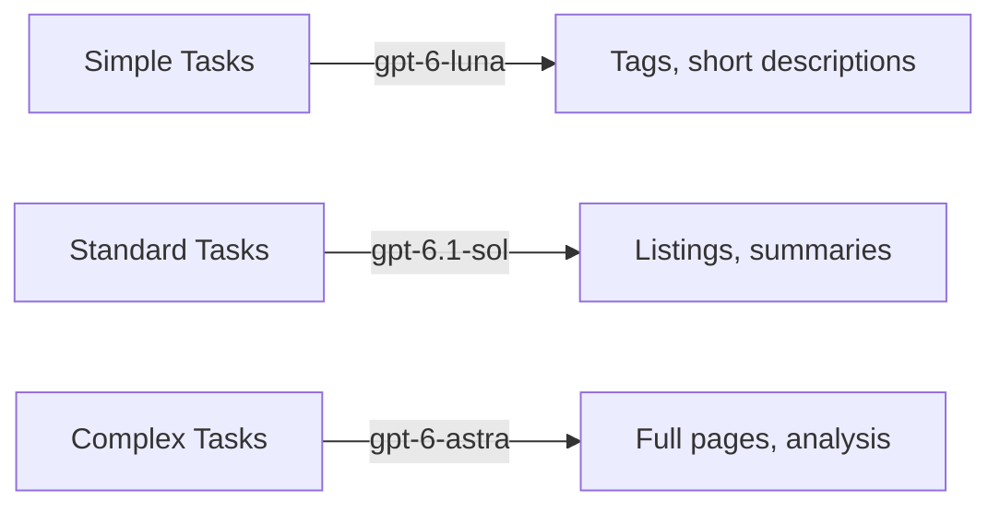
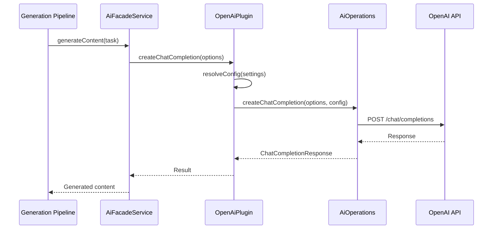

# OpenAI AI Provider Plugin

The OpenAI plugin connects Ever Works to OpenAI's API, providing access to models such as GPT-6 Astra, GPT-6.1 Sol and GPT-6 Luna, plus OpenAI's embedding and transcription models. It extends `BaseAiProvider` and uses the shared `AiOperations` layer that wraps LangChain under the hood.

**Source:** `packages/plugins/openai/src/openai.plugin.ts`

## Overview

| Property           | Value           |
| ------------------ | --------------- |
| Plugin ID          | `openai`        |
| Category           | `ai-provider`   |
| Capabilities       | `ai-provider`   |
| Version            | `1.0.0`         |
| Configuration Mode | `user-required` |
| Provider Type      | `openai`        |
| Auto-enable        | No              |
| Visibility         | `public`        |

The plugin extends `BaseAiProvider` from `@ever-works/plugin/abstract` and creates an `AiOperations` instance from `@ever-works/plugin/ai` to handle all AI operations through a unified LangChain-based abstraction.

## Architecture



## Configuration

### Settings Schema

| Setting              | Type     | Required | Default                     | Scope    | Widget         | Description                                                                              |
| -------------------- | -------- | -------- | --------------------------- | -------- | -------------- | ---------------------------------------------------------------------------------------- |
| `apiKey`             | `string` | Yes      | --                          | `user`   | --             | OpenAI API key. Secret.                                                                  |
| `defaultModel`       | `string` | Yes      | `gpt-6-astra`               | `global` | `model-select` | Default model for all AI tasks.                                                          |
| `simpleModel`        | `string` | No       | `gpt-6-luna`                | `global` | `model-select` | Model for tags, descriptions, classifications.                                           |
| `mediumModel`        | `string` | No       | `gpt-6.1-sol`               | `global` | `model-select` | Model for listings, summaries, reformatting.                                             |
| `complexModel`       | `string` | No       | `gpt-6-astra`               | `global` | `model-select` | Model for full page generation, multi-step analysis.                                     |
| `embeddingModel`     | `string` | No       | `text-embedding-3-small`    | `global` | `model-select` | Model for Knowledge Base semantic search.                                                |
| `transcriptionModel` | `string` | No       | `whisper-1`                 | `global` | `model-select` | Speech-to-text model for Knowledge Base media ingest (env `OPENAI_TRANSCRIPTION_MODEL`). |
| `temperature`        | `number` | No       | `0.7`                       | --       | --             | Sampling temperature (0--2). Hidden.                                                     |
| `maxTokens`          | `number` | No       | `4096`                      | --       | --             | Max tokens per response. Hidden.                                                         |
| `baseUrl`            | `string` | No       | `https://api.openai.com/v1` | --       | --             | API endpoint. Hidden.                                                                    |

Model defaults as of 2026-11-05 — source: [developers.openai.com/api/docs/models](https://developers.openai.com/api/docs/models) (shutdown dates: [developers.openai.com/api/docs/deprecations](https://developers.openai.com/api/docs/deprecations)). Availability depends on your account/plan/region; the picker accepts a custom model id and keeps existing saved selections.

**Default shift (2026-11-05):** configs that never saved a model use the new defaults; saved selections are kept. The defaults moved from `gpt-5.1` (default and complex, shuts down 2027-04-01), `gpt-5-nano` (simple, shuts down 2026-12-11) and `gpt-4o-mini` (standard, shuts down 2027-01-14) to `gpt-6-astra`, `gpt-6-luna` and `gpt-6.1-sol`. A saved deprecated id is still sent to OpenAI unchanged, so switch away from it before its shutdown date. The embedding (`text-embedding-3-small`) and transcription (`whisper-1`) defaults are unchanged.

### Model Tiers

The plugin supports a tiered model system that maps task complexity to appropriate models:



This allows cost optimization: fast, inexpensive models handle simple classification tasks while more capable models are reserved for complex generation. GPT-6 Luna is OpenAI's model for cost-sensitive, high-volume work, GPT-6.1 Sol balances intelligence and cost, and GPT-6 Astra is the flagship and the most expensive of the three ($10 / $50 per million input / output tokens on 2026-11-05); pick a cheaper id for the default and complex tiers if cost matters more than quality.

## Capabilities

```typescript
getCapabilities(): AiModelCapabilities {
  return {
    supportsStructuredOutput: true,
    supportsStreaming: true,
    supportsToolCalling: true,
    supportsVision: true,
    maxContextLength: FALLBACK_CONTEXT_WINDOW // 128000
  };
}
```

| Capability        | Supported | Description                                                                                                    |
| ----------------- | --------- | -------------------------------------------------------------------------------------------------------------- |
| Structured Output | Yes       | JSON mode and function calling for typed responses                                                             |
| Streaming         | Yes       | Server-sent events for real-time token delivery                                                                |
| Tool Calling      | Yes       | Function calling for agent-based workflows                                                                     |
| Vision            | Yes       | Image understanding (GPT-4o and later models)                                                                  |
| Max Context       | 128,000   | Plugin-wide fallback hint, used only when neither the live model list nor the catalogue knows a model's window |

`FALLBACK_CONTEXT_WINDOW` stays at 128,000, the smallest window of the models a config may still name (`gpt-4o` / `gpt-4o-mini`), because the AI facade also uses it as the output ceiling in its pre-flight cost check. The GPT-6 family's own 1,050,000-token window comes from the live model list.

## Core Methods

### Chat Completion

```typescript
async createChatCompletion(options: ChatCompletionOptions): Promise<ChatCompletionResponse>
```

Processes a chat completion request through the `AiOperations` layer. The `resolveConfig()` method (inherited from `BaseAiProvider`) merges user settings with defaults to produce the final configuration.

### Streaming Chat Completion

```typescript
async *createStreamingChatCompletion(options: ChatCompletionOptions): AsyncIterable<ChatCompletionChunk>
```

Returns an async iterable of `ChatCompletionChunk` objects for real-time token streaming. Used by the conversational AI assistant for responsive interactions.

### Embeddings

```typescript
async createEmbedding(options: EmbeddingOptions): Promise<EmbeddingResponse>
```

Generates vector embeddings using OpenAI's embedding models (e.g., `text-embedding-3-small`). Used for semantic search within works.

### Model Listing

```typescript
async listModels(settings?: PluginSettings): Promise<readonly AiModel[]>
```

Fetches available models from the OpenAI API. The CLI and web dashboard use this to populate model selection dropdowns.

### Availability Check

```typescript
async isAvailable(settings?: PluginSettings): Promise<boolean>
```

Tests the API connection by calling `aiOps.testConnection()` with the resolved configuration.

## Configuration Resolution

The `resolveConfig()` method (from `BaseAiProvider`) merges settings into a final configuration:

```typescript
// Conceptual flow
const resolvedConfig = {
	apiKey: settings.apiKey,
	model: options.model || settings.defaultModel || 'gpt-6-luna', // bootstrap model from onLoad
	temperature: settings.temperature || 0.7,
	maxTokens: settings.maxTokens || 4096,
	baseURL: settings.baseUrl || 'https://api.openai.com/v1',
	providerType: 'openai'
};
```

The tier-specific models (`simpleModel`, `mediumModel`, `complexModel`) are used by the generation pipeline to select the appropriate model based on task complexity.

## Lifecycle

| Method            | Behavior                                                                     |
| ----------------- | ---------------------------------------------------------------------------- |
| `onLoad(context)` | Calls `super.onLoad()`, creates `AiOperations` instance with default config. |
| `onUnload()`      | Sets `aiOps` to `null`, calls `super.onUnload()`.                            |
| `healthCheck()`   | Returns `healthy` (actual connectivity depends on API key).                  |

### Initial AiOperations Configuration

On load, the plugin creates an `AiOperations` instance with placeholder values:

```typescript
this.aiOps = new AiOperations({
	apiKey: '', // Provided per-request from user settings
	model: BOOTSTRAP_MODEL, // 'gpt-6-luna', also returned by getDefaultModelId()
	temperature: 0.7,
	baseURL: 'https://api.openai.com/v1',
	maxTokens: 4096,
	providerType: 'openai'
});
```

The actual API key and model selection come from user settings at call time through `resolveConfig()`.

## Error Handling

- Plugin not loaded: Throws `Error('OpenAI plugin not loaded')` if called before `onLoad()`.
- API errors: Propagated from `AiOperations` / LangChain to the caller.
- Connection test failure: `isAvailable()` returns `false`.

## Usage in the Platform

When OpenAI is selected as the AI provider:

1. **Content generation** -- Produces work item descriptions, summaries, and metadata during generation.
2. **Conversational AI** -- Powers the chat assistant in the web dashboard.
3. **Embeddings** -- Creates vector representations for semantic search.
4. **Structured extraction** -- Uses function calling to extract structured data from web content.



## Comparison with Other AI Providers

| Feature       | OpenAI                                                                 | Anthropic       |
| ------------- | ---------------------------------------------------------------------- | --------------- |
| Max Context   | 128K tokens (fallback hint; GPT-6 family 1,050,000 from the live list) | 200K tokens     |
| Embeddings    | Yes                                                                    | No              |
| Streaming     | Yes                                                                    | Yes             |
| Tool Calling  | Yes                                                                    | Yes             |
| Vision        | Yes                                                                    | Yes             |
| Default Model | gpt-6-astra                                                            | claude-opus-5-5 |
