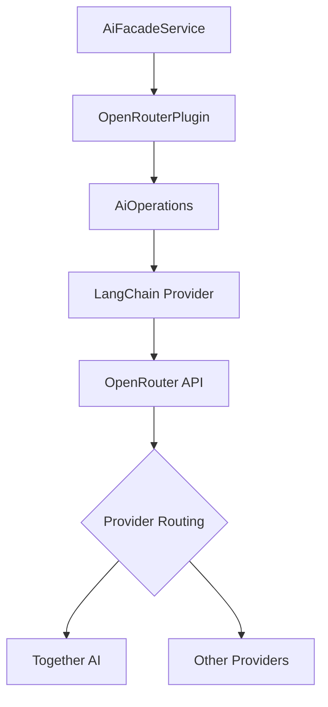

# Together AI Models via OpenRouter

Ever Works does not include a Together AI plugin: there is no `together` package under `packages/plugins/`. The open-weight models Together AI hosts -- Llama, Qwen, DeepSeek, gpt-oss and others -- are used through the **OpenRouter** plugin (or the **Vercel AI Gateway** plugin) under each model author's own id. This page explains how to configure them for work generation, and what you can and cannot control about which host serves them.

**Related source files:**

| File                                                                                 | Purpose                                 |
| ------------------------------------------------------------------------------------ | --------------------------------------- |
| `packages/plugins/openrouter/src/openrouter.plugin.ts`                               | OpenRouter AI provider plugin           |
| `packages/plugins/vercel-ai-gateway/src/vercel-ai-gateway.plugin.ts`                 | Vercel AI Gateway AI provider plugin    |
| `packages/plugin/src/ai/reasoning.utils.ts`                                          | Reasoning config for open-weight models |
| `apps/internal-cli/src/commands/config/ai-providers/ai-provider-registry.service.ts` | Provider registry with model lists      |

## What is Together AI?

Together AI is a cloud platform for running open-weight AI models. It is an inference host rather than a model vendor: it serves models published by Meta, Alibaba (Qwen), DeepSeek, OpenAI (gpt-oss) and others. Through OpenRouter, the same models are available in Ever Works without any additional plugin.

## Available Models

Models as of 2026-11-05 — source: the live lists [openrouter.ai/api/v1/models](https://openrouter.ai/api/v1/models) and [ai-gateway.vercel.sh/v1/models](https://ai-gateway.vercel.sh/v1/models), read on 2026-11-06. Availability depends on your account/plan/region; the picker accepts a custom model id and keeps existing saved selections.

**Neither list has Together AI model ids.** On 2026-11-06 OpenRouter's list (454 models) had no `together/` id, and neither did the Vercel AI Gateway's (495 models). OpenRouter lists models under their author's prefix and decides per request which host serves them, so you pick the model, not Together AI. The earlier version of this page said Together models use a `together/` prefix; no id on OpenRouter's list has that format.

Open-weight models present on OpenRouter's list on 2026-11-06 (the Vercel AI Gateway column shows the gateway's id where it lists the model; "open-weights" is the gateway's tag):

| Model ID (OpenRouter)               | Vercel AI Gateway id           | Base Model          | Context (OpenRouter) |
| ----------------------------------- | ------------------------------ | ------------------- | -------------------- |
| `openai/gpt-oss-120b`               | `openai/gpt-oss-120b`          | gpt-oss 120B        | 131,072              |
| `openai/gpt-oss-20b`                | `openai/gpt-oss-20b`           | gpt-oss 20B         | 131,072              |
| `meta-llama/llama-4-maverick`       | `meta/llama-4-maverick`        | Llama 4 Maverick    | 524,288              |
| `meta-llama/llama-4-scout`          | `meta/llama-4-scout`           | Llama 4 Scout       | 1,310,720            |
| `meta-llama/llama-3.3-70b-instruct` | `meta/llama-3.3-70b`           | Llama 3.3 70B       | 131,072              |
| `deepseek/deepseek-v4-pro`          | `deepseek/deepseek-v4-pro`     | DeepSeek V4 Pro     | 1,048,576            |
| `deepseek/deepseek-v4.1-flash`      | `deepseek/deepseek-v4.1-flash` | DeepSeek V4.1 Flash | 1,048,576            |
| `moonshotai/kimi-k3`                | `moonshotai/kimi-k3`           | Kimi K3             | 1,048,576            |

`meta-llama/llama-3.3-70b-instruct` is an older model that is still listed. `mistralai/mistral-large` and `qwen/qwen-2.5-72b-instruct`, which this page used to list, are older generations; for Mistral see the [Mistral Plugin](./mistral-plugin.md), and for Qwen the current ids on OpenRouter start at `qwen/qwen3.8-*`.

:::note
OpenRouter may route a request to Together AI or to another host serving the same model, based on availability and cost. Ever Works' OpenRouter plugin has no setting to pin the host, so you cannot force Together AI. Each model's page on [openrouter.ai/models](https://openrouter.ai/models) shows which hosts serve it.
:::

## Configuration

### Setting Up Open-Weight Models

1. Navigate to **Settings > Plugins** in the Ever Works dashboard.
2. Ensure the **OpenRouter** plugin is enabled.
3. Enter your OpenRouter API key.
4. Set model fields to open-weight model IDs:

| Setting              | Recommended Value          |
| -------------------- | -------------------------- |
| Default Model        | `openai/gpt-oss-120b`      |
| Simple Tasks Model   | `openai/gpt-oss-20b`       |
| Standard Tasks Model | `openai/gpt-oss-120b`      |
| Complex Tasks Model  | `deepseek/deepseek-v4-pro` |

The OpenRouter plugin's own defaults are OpenAI's hosted GPT-6 models (see [OpenRouter Plugin](./openrouter-plugin.md)); open-weight models are used only for the fields you set. With the Vercel AI Gateway plugin, use the gateway ids from the table above.

### Environment Variables

```bash
PLUGIN_OPENROUTER_API_KEY=sk-or-...
PLUGIN_OPENROUTER_DEFAULT_MODEL=openai/gpt-oss-120b
PLUGIN_OPENROUTER_SIMPLE_MODEL=openai/gpt-oss-20b
PLUGIN_OPENROUTER_COMPLEX_MODEL=deepseek/deepseek-v4-pro
```

These are deployment-wide defaults set by an operator; a user's saved settings take precedence.

### Free Models

OpenRouter offers some models with a `:free` suffix. These use donated compute and have strict rate limits, but cost nothing. `meta-llama/llama-3.3-70b-instruct:free`, which this page used to recommend, is no longer on the list (2026-11-06); current examples include `google/gemma-4-31b-it:free`. Free models suit simple pipeline tasks like tag generation and short descriptions, but they come and go, so check the list before saving one.

## Architecture



OpenRouter selects a host for each model request. When you specify a model like `openai/gpt-oss-120b`, OpenRouter may route to Together AI or to another host serving that model, depending on availability and cost.

## Tiered Model Strategy

Open-weight models work well in cost-optimized configurations (OpenRouter prices per million input / output tokens, 2026-11-06):

| Tier     | Use Case              | Recommended Model          | Cost          |
| -------- | --------------------- | -------------------------- | ------------- |
| Simple   | Tags, classifications | `openai/gpt-oss-20b`       | $0.03 / $0.13 |
| Standard | Summaries, listings   | `openai/gpt-oss-120b`      | $0.15 / $0.60 |
| Complex  | Full page generation  | `deepseek/deepseek-v4-pro` | $1.60 / $3.20 |

### Mixing with Commercial Models

You can combine open-weight models for cost-sensitive tasks with commercial models for quality-critical tasks:

| Tier     | Model                         | Provider             | Cost Level |
| -------- | ----------------------------- | -------------------- | ---------- |
| Simple   | `openai/gpt-oss-20b`          | OpenAI (open-weight) | Low        |
| Standard | `openai/gpt-6.1-sol`          | OpenAI               | Moderate   |
| Complex  | `anthropic/claude-sonnet-5.5` | Anthropic            | Higher     |

## Capabilities

Per OpenRouter's list (2026-11-06):

| Capability        | gpt-oss 120B / 20B | Llama 4 Scout / Maverick |
| ----------------- | ------------------ | ------------------------ |
| Structured output | Yes                | Yes                      |
| Streaming         | Yes                | Yes                      |
| Tool calling      | Yes                | Yes                      |
| Vision            | No                 | Image input              |
| Embeddings        | No                 | No                       |

### Embedding Limitation

Open-weight chat models reached through OpenRouter do not provide embeddings. If your workflow requires embeddings for semantic search:

- Use the **OpenAI** plugin for embeddings alongside open-weight models for generation.
- Or use the **Ollama** plugin with a local embedding model.
- Or use the **Google Gemini** plugin which includes embedding support.

## Alternative: Local Models via Ollama

If you prefer to run open-weight models locally instead of through a hosted provider, the **Ollama** plugin provides direct access (its default is `qwen3.5:4b`; `gpt-oss:20b` is also in the Ollama library):

| Approach         | Hosted (via OpenRouter)        | Ollama (Local)              |
| ---------------- | ------------------------------ | --------------------------- |
| Hosting          | Cloud (Together AI and others) | Self-hosted                 |
| API key          | OpenRouter API key required    | No API key needed           |
| Cost             | Per-token pricing (some free)  | Free (your hardware)        |
| Speed            | Fast (datacenter GPUs)         | Depends on local hardware   |
| Privacy          | Data sent to cloud             | Data stays local            |
| Available models | Wide selection                 | Any Ollama-compatible model |

## Troubleshooting

| Issue                      | Cause                                             | Solution                                                              |
| -------------------------- | ------------------------------------------------- | --------------------------------------------------------------------- |
| Model not available        | Model removed or renamed on OpenRouter            | Check current model list at openrouter.ai                             |
| `together/...` id rejected | OpenRouter has no `together/` ids                 | Use the model author's id, e.g. `openai/gpt-oss-120b`                 |
| Rate limited on free model | Free tier has strict rate limits                  | Switch to paid model or wait                                          |
| Poor output quality        | Model not suited for task                         | Try a larger model or commercial alternative                          |
| Timeout on large requests  | Open-weight models may be slower for long outputs | Reduce `maxTokens` or use a faster model                              |
| JSON parsing errors        | Some models have weaker structured output         | Enable structured output mode or use a model with better JSON support |

## Further Reading

- [OpenRouter Plugin](./openrouter-plugin.md) -- full OpenRouter configuration
- [Vercel AI Gateway Plugin](./vercel-ai-gateway-plugin.md) -- the other gateway route
- [Ollama Plugin](./ollama-plugin.md) -- running open-weight models locally
- [Groq Plugin](./groq-plugin.md) -- fast inference for open-weight models (defaults `openai/gpt-oss-120b` / `openai/gpt-oss-20b`)
- [AI Provider Plugins](./ai-provider-plugins.md) -- all AI provider options
