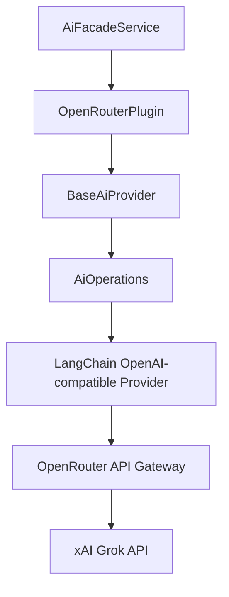
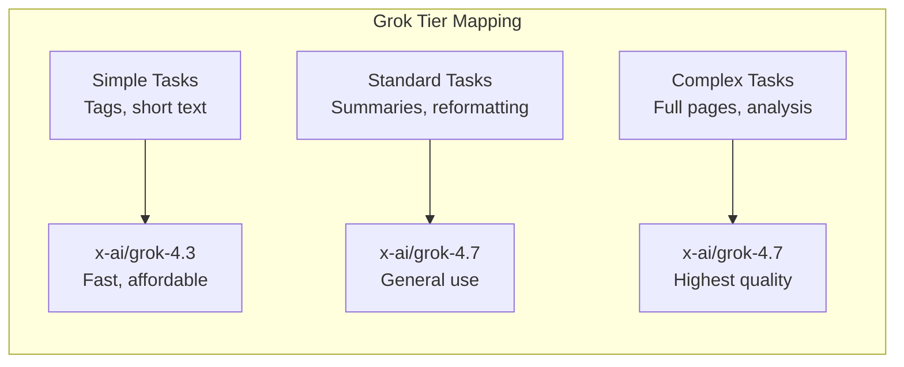

# xAI Grok Models

xAI builds the Grok family of models. Ever Works reaches them two ways:

- **The dedicated `grok` plugin** (plugin name "Grok (xAI)") calls the xAI API directly with your xAI API key. Use it when you have an xAI account. It is described in [Built-in Plugins → Grok (xAI)](./built-in-plugins.md#grok-xai) and the plugin's README (`packages/plugins/grok/README.md`).
- **The OpenRouter plugin** (and the Vercel AI Gateway plugin) route Grok requests through a gateway, so one gateway key covers Grok next to every other vendor. This page describes that route.

There is no separate plugin called `xai`; this page keeps its old address so existing links still work.

**Related source files:**

| File                                                                                 | Purpose                                       |
| ------------------------------------------------------------------------------------ | --------------------------------------------- |
| `packages/plugins/grok/src/grok.plugin.ts`                                           | Dedicated Grok (xAI) AI provider plugin       |
| `packages/plugins/openrouter/src/openrouter.plugin.ts`                               | OpenRouter AI provider plugin                 |
| `packages/plugins/vercel-ai-gateway/src/vercel-ai-gateway.plugin.ts`                 | Vercel AI Gateway AI provider plugin          |
| `apps/internal-cli/src/commands/config/ai-providers/ai-provider-registry.service.ts` | Provider registry listing Grok OpenRouter ids |

## Available Grok Models

Models as of 2026-11-06 — source: [docs.x.ai/developers/models](https://docs.x.ai/developers/models), and for the gateway ids the live lists [openrouter.ai/api/v1/models](https://openrouter.ai/api/v1/models) and [ai-gateway.vercel.sh/v1/models](https://ai-gateway.vercel.sh/v1/models). Availability depends on your account/plan/region; the picker accepts a custom model id and keeps existing saved selections.

The internal CLI's provider registry lists the two current Grok ids in its OpenRouter model list:

```typescript
// From ai-provider-registry.service.ts (OpenRouter entry)
models: [
	// ...
	'x-ai/grok-4.7',
	'x-ai/grok-4.3'
	// ...
];
```

| xAI API id (`grok` plugin) | OpenRouter id   | Vercel AI Gateway id | Description                                                                               |
| -------------------------- | --------------- | -------------------- | ----------------------------------------------------------------------------------------- |
| `grok-4.7`                 | `x-ai/grok-4.7` | `spacexai/grok-4.7`  | xAI's recommended model for general use, code included. 500K context, $2 / $6             |
| `grok-4.3`                 | `x-ai/grok-4.3` | `spacexai/grok-4.3`  | Fast and reliable; the redirect target for retired Grok models. 1M context, $1.25 / $2.50 |

Prices are per million input / output tokens on OpenRouter's list. Both lists also carry `grok-4.6`, `grok-4.5`, the `grok-4.20` variants and `grok-build-0.1` (early access). The Vercel AI Gateway lists xAI models under the `spacexai/` prefix.

xAI retired `grok-3`, `grok-4-0709`, `grok-4-fast-*`, `grok-4-1-fast-*` and `grok-code-fast-1` on 2026-05-15 (they redirect), and no longer documents `grok-2-latest`, `grok-3-mini` or `grok-3-mini-beta`. OpenRouter no longer lists `x-ai/grok-3-mini-beta`. The ids this page used to recommend (`x-ai/grok-3`, `x-ai/grok-3-mini`, `x-ai/grok-3-mini-beta`, `x-ai/grok-2`) are therefore replaced below; a configuration that saved one keeps it, but should move to a current id.

:::note
Model availability on OpenRouter changes over time. Check [openrouter.ai/models](https://openrouter.ai/models) for the current list of available Grok models and their pricing.
:::

## Configuration

### Setting Up Grok Models

**With the dedicated `grok` plugin:** enable **Grok (xAI)** at `/plugins`, paste your xAI API key (env fallback `XAI_API_KEY`), and keep its defaults or pick another Grok id. Its defaults as of 2026-11-06 are `grok-4.7` for the default, standard and complex tiers and `grok-4.3` for the simple tier (source: [docs.x.ai/developers/models](https://docs.x.ai/developers/models)). **Default shift (2026-11-05):** configs that never saved a model use the new defaults; saved selections are kept. Only the simple tier moved, from `grok-4.7` to `grok-4.3`.

**Through OpenRouter:**

1. Navigate to **Settings > Plugins** in the Ever Works dashboard.
2. Ensure the **OpenRouter** plugin is enabled (default).
3. Enter your OpenRouter API key.
4. Set model fields to Grok model IDs:

| Setting              | Value           |
| -------------------- | --------------- |
| Default Model        | `x-ai/grok-4.7` |
| Simple Tasks Model   | `x-ai/grok-4.3` |
| Standard Tasks Model | `x-ai/grok-4.7` |
| Complex Tasks Model  | `x-ai/grok-4.7` |

This mirrors the `grok` plugin's own tier shape. The OpenRouter plugin's built-in defaults are OpenAI models (see [OpenRouter Plugin](./openrouter-plugin.md)), so Grok is used only for the fields you set.

**Through the Vercel AI Gateway:** the same steps with the **Vercel AI Gateway** plugin and the `spacexai/grok-4.7` / `spacexai/grok-4.3` ids.

### Environment Variables

```bash
PLUGIN_OPENROUTER_API_KEY=sk-or-...
PLUGIN_OPENROUTER_DEFAULT_MODEL=x-ai/grok-4.7
PLUGIN_OPENROUTER_SIMPLE_MODEL=x-ai/grok-4.3
PLUGIN_OPENROUTER_MEDIUM_MODEL=x-ai/grok-4.7
PLUGIN_OPENROUTER_COMPLEX_MODEL=x-ai/grok-4.7
```

These are deployment-wide defaults set by an operator; a user's saved settings take precedence. The `grok` plugin reads its API key from `XAI_API_KEY` when none is saved.

## How It Works

Grok models are accessed through the same OpenRouter pipeline as every other provider:



OpenRouter's API is OpenAI-compatible, so the plugin uses LangChain's OpenAI provider with `baseURL` set to `https://openrouter.ai/api/v1`. The `x-ai/` prefix in the model ID tells OpenRouter to route the request to xAI's infrastructure. The dedicated `grok` plugin uses the same `AiOperations` path with `baseURL` `https://api.x.ai/v1`.

## Tiered Model Strategy

Grok models pair well in a tiered configuration:



You can also mix Grok with other providers across tiers:

| Tier     | Model               | Provider |
| -------- | ------------------- | -------- |
| Simple   | `openai/gpt-6-luna` | OpenAI   |
| Standard | `x-ai/grok-4.3`     | xAI      |
| Complex  | `x-ai/grok-4.7`     | xAI      |

## Capabilities

Per-model facts from OpenRouter's live list (2026-11-06):

| Capability         | Grok 4.7                        | Grok 4.3                           |
| ------------------ | ------------------------------- | ---------------------------------- |
| Structured output  | Yes                             | Yes                                |
| Streaming          | Yes                             | Yes                                |
| Tool calling       | Yes                             | Yes                                |
| Vision             | Image input                     | Image input                        |
| Max context length | 500,000 tokens                  | 1,000,000 tokens                   |
| Reasoning          | Always on (default effort high) | On by default (default effort low) |

:::note
The OpenRouter plugin reports `supportsVision: false` and a 128,000-token context hint at the plugin level, whatever the model; individual Grok models accept images and larger contexts. The `grok` plugin reports `supportsVision: true` and a 131,072-token hint.
:::

## Comparison with Other Providers

| Aspect          | Grok (via OpenRouter) | Grok (`grok` plugin) | OpenAI (direct)   | Groq                |
| --------------- | --------------------- | -------------------- | ----------------- | ------------------- |
| Setup           | OpenRouter API key    | xAI API key          | OpenAI API key    | Groq API key        |
| Model selection | `x-ai/grok-*`         | `grok-*`             | `gpt-*`           | `openai/gpt-oss-*`  |
| Embeddings      | Depends on model      | No                   | Yes               | No                  |
| Speed           | Standard              | Standard             | Standard          | Ultra-fast          |
| Cost            | Varies by model       | Per-token pricing    | Per-token pricing | Free tier available |

## Reasoning Model Handling

Grok models are not listed in the platform's reasoning model configuration (`packages/plugin/src/ai/reasoning.utils.ts`), so Ever Works sends no reasoning effort parameter for them, through OpenRouter or the `grok` plugin. OpenRouter's list (2026-11-06) shows reasoning as mandatory for `x-ai/grok-4.7` (default effort `high`) and on by default for `x-ai/grok-4.3` (default effort `low`), so requests run at those defaults. If the platform should lower the effort, it needs a pattern entry similar to:

```typescript
{
    pattern: /grok-4/,
    openrouter: { reasoning: { effort: 'low' } }
}
```

Until then, Grok models run at the vendor's default reasoning effort.

## Troubleshooting

| Issue                   | Cause                                               | Solution                                                                                  |
| ----------------------- | --------------------------------------------------- | ----------------------------------------------------------------------------------------- |
| Model not found         | Incorrect model ID or model removed from OpenRouter | Verify the model ID at [openrouter.ai/models](https://openrouter.ai/models)               |
| Authentication error    | Invalid or expired OpenRouter API key               | Regenerate your key at [openrouter.ai/settings/keys](https://openrouter.ai/settings/keys) |
| Rate limit exceeded     | Too many requests to xAI via OpenRouter             | Wait and retry; consider upgrading your OpenRouter plan                                   |
| Embedding not supported | Grok may not offer embedding models                 | Use OpenAI or Google Gemini for embeddings alongside Grok                                 |
| High costs              | Grok 4.7 costs more per token than Grok 4.3         | Use `x-ai/grok-4.3` for the simple (and, if quality allows, standard) tier                |
| Old Grok id redirected  | xAI retired `grok-3` and the `grok-4-fast` family   | Save `x-ai/grok-4.7` or `x-ai/grok-4.3` instead                                           |

## Cost Optimization

- Use `x-ai/grok-4.3` ($1.25 / $2.50 per million tokens on 2026-11-06) for simple tasks, and for standard tasks if its quality is enough.
- Reserve `x-ai/grok-4.7` ($2 / $6) for standard and complex content generation.
- Monitor usage through the [OpenRouter dashboard](https://openrouter.ai/activity).
- Compare per-token pricing against alternatives -- OpenRouter shows cost per model.

## Further Reading

- [Built-in Plugins → Grok (xAI)](./built-in-plugins.md#grok-xai) -- the dedicated `grok` plugin
- [OpenRouter Plugin](./openrouter-plugin.md) -- complete OpenRouter configuration reference
- [Vercel AI Gateway Plugin](./vercel-ai-gateway-plugin.md) -- the other gateway route
- [DeepSeek Models](./deepseek-plugin.md) -- using DeepSeek models via OpenRouter
- [AI Provider Plugins](./ai-provider-plugins.md) -- overview of all AI provider options
- [Plugin Settings](./settings.md) -- how plugin settings resolution works
