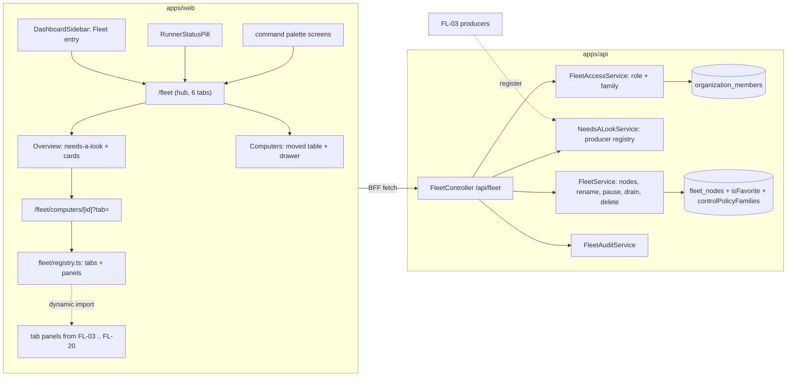

# FL-01 — Fleet hub & navigation · Implementation plan

> How [`spec.md`](./spec.md) gets built. Implementation detail belongs here, not in the spec
> (Constitution IX). Every path below was opened at `origin/develop` `e4334baf7` before it was cited.

**Epic ID:** `FL-01-fleet-hub`
**Spec:** [`./spec.md`](./spec.md) · **Tasks:** [`./tasks.md`](./tasks.md)
**Status:** `Draft`
**Created:** 2026-10-18
**Last updated:** 2026-10-18

---

## 1. Architecture summary

No node-side work and no link traffic: everything this epic does is platform registry state plus
web shell. Data flows back as `FleetNodeView` rows (now with `isFavorite`, `hostNodeId?`,
`controlPolicyFamilies`, `viewerRole`) and `NeedsALookItem[]`.

## 2. Current state in the codebase

| Piece                                                | Where (verified at HEAD)                                                                                                                                 | Reused as                                                                   |
| ---------------------------------------------------- | -------------------------------------------------------------------------------------------------------------------------------------------------------- | --------------------------------------------------------------------------- |
| Sidebar navigation array (Teams at the slot after Tasks; Memory below) | `apps/web/src/components/dashboard/DashboardSidebar.tsx:147-234`; props interface `:68`; mounted from `apps/web/src/app/[locale]/(dashboard)/layout-client.tsx:521` | Insert the Fleet entry between the Teams (`:186-197`) and Memory (`:205-210`) objects |
| Runner pill → Settings link                          | `apps/web/src/components/dashboard/RunnerStatusPill.tsx:262-263` (`ROUTES.DASHBOARD_SETTINGS_FLEET`)                                                     | Switch target on the hub flag                                               |
| Fleet flag helper (default ON)                       | `apps/web/src/lib/fleet-flags.ts:26-28` `isFleetEnabled()`                                                                                               | Add `isFleetHubEnabled()` beside it                                         |
| Routes                                               | `apps/web/src/lib/constants.ts:339` `DASHBOARD_SETTINGS_FLEET`, `:274` `DASHBOARD_TEAMS`, `:258` `DASHBOARD_AGENT_COMPUTER`                               | Add the §11.1 constants                                                     |
| Settings → Fleet page and client                     | `apps/web/src/app/[locale]/(dashboard)/settings/fleet/page.tsx` (Promise.allSettled of nodes/tokens/preferences/kill switch); `apps/web/src/components/settings/FleetSettings.tsx` (table `:488`, banner `:464`, Add flow `:137`, rename `:159`, remove `:163`, drain `:408`) | The table block moves; the page keeps policy sections                 |
| Enrol hand-off, QR, drawer                           | `apps/web/src/components/settings/FleetEnrollHandoff.tsx`, `FleetQrCode.tsx`, `FleetNodeDrawer.tsx` (+ `fleet-node-drawer.shared.ts`, `fleet-node-limits.shared.ts`) | Relocated under `components/fleet/computers/`, old paths re-export            |
| Settings tab registration                            | `apps/web/src/app/[locale]/(dashboard)/settings/settings-layout-client.tsx:147-150`                                                                       | Unchanged                                                                    |
| Hub-tab precedent (Teams hub: sub-routes, one tabs component) | `apps/web/src/components/agents/AgentsPageTabs.tsx:28-54`; `apps/web/src/app/[locale]/(dashboard)/teams/page.tsx:88`                              | Same shape for `FleetHubTabs`                                                |
| `?view=` precedent                                   | `apps/web/src/app/[locale]/(dashboard)/activity/page.tsx:49-59`                                                                                           | Same shape for the computer page's `?tab=`                                   |
| Palette screens registry                             | `apps/web/src/components/command-palette/registry/screens.ts:38-215` (`DASHBOARD_SCREENS`, `settings.fleet` at `:212`)                                     | Add hub screens; dynamic computers in `sections.ts`                          |
| Node entity, control policy, recording, lock columns | `packages/agent/src/entities/fleet-node.entity.ts:96-135` (scope), `:502` `controlPolicy`, `:506-532` recording + CAS lock                                 | Add `isFavorite`, `controlPolicyFamilies`                                    |
| Role derivation (owner \| stranger only)             | `packages/agent/src/computer/control-policy.ts:44-49`; callers `control-arbiter.service.ts:166,224,657`                                                   | Widened through `FleetAccessService`                                         |
| Viewer roles contract                                | `packages/contracts/src/computer/computer-control.types.ts:36-37` `COMPUTER_VIEWER_ROLES`                                                                 | Reused as the role union                                                     |
| Organization roles                                   | `packages/agent/src/entities/types.ts:137-147` (`owner · admin · member`; `ORGANIZATION_ADMIN_ROLES`); repository `packages/agent/src/database/repositories/organization-member.repository.ts:16` | Source of `org-admin` / `org-member`                               |
| Node list, rename, delete, PATCH DTO                 | `packages/agent/src/fleet/fleet.service.ts:958` `listForUser`, `:1321` `renameForUser`, `:1479` `deleteForUser`; `apps/api/src/fleet/fleet.controller.ts:267,293,501,562`; `apps/api/src/fleet/dto/fleet.dto.ts:97-145` (`name`, `disabled`, `paused`, `capabilities`) | PATCH gains `isFavorite`, `controlPolicyFamilies` |
| Audit writer and action union                        | `packages/agent/src/fleet/fleet-audit.service.ts`; `packages/contracts/src/fleet/fleet-panic.types.ts:60-131` (`node.rename`, `node.pause`, `node.disable`, `node.drain`, `node.delete` exist) | One new member for policy changes                                    |
| Kill switch state                                    | `packages/agent/src/fleet/fleet-kill-switch.service.ts` (fail-closed `state()`); web banner `FleetKillSwitchBanner.tsx`                                   | Banner mounted on the hub                                                    |
| Read-only Agent tool                                 | `packages/agent/src/fleet/agent-fleet-tools.ts:33-80` `list_fleet_nodes`                                                                                   | Unchanged; rows gain the new optional fields                                 |
| Web fleet API client                                 | `apps/web/src/lib/api/fleet.ts:134-` (`listNodes`, `updateNode`, `deleteNode`, `nodeDetail`, …)                                                            | Gains `needsALook`, `setFavorite`, `setPolicyFamilies`                      |
| e2e precedent                                        | `apps/web/e2e/flow-fleet-enrollment-contract.spec.ts`, `flow-fleet-panic-controls.spec.ts`, `flow-fleet-runner-pill.spec.ts`                                | Must stay green through the move                                              |

Missing today (each verified by grep over `apps/` and `packages/`): any `/fleet` route; `isFavorite`;
`hostNodeId`; a "needs a look" shape or registry; an Organization-aware role for a node; a per-family
policy.

## 3. Tech choices

| Concern                 | Choice                                                                                      | Why                                                                                                   |
| ----------------------- | ------------------------------------------------------------------------------------------- | ----------------------------------------------------------------------------------------------------- |
| Hub tabs                | Sub-routes `/fleet`, `/fleet/computers`, … with one `FleetHubTabs` component                 | Same shape as the Teams hub (`AgentsPageTabs.tsx`); each tab is a server component page                |
| Computer-page tabs      | One route `/fleet/computers/[id]` + `?tab=`; registry with `next/dynamic` loaders            | D9: epics register without touching each other; code-split per tab; `?view=` precedent in Activity   |
| Registry                | Plain TypeScript module `apps/web/src/components/fleet/registry.ts` with typed `registerComputerTab`, `registerHubTab`, `registerOverviewBlock` (the names CONTRACTS §11.1 fixes) | Internal, compile-time; no plugin UI (D9)                                                  |
| "Needs a look"          | API-side producer registry (`NeedsALookProducer` interface, Nest multi-provider token)       | Producers live where their facts live (FL-03 in the fleet package); one shape (CONTRACTS §4.6)        |
| Roles                   | `FleetAccessService` in `packages/agent/src/fleet/` wrapping a pure `resolveViewerRole`      | Pure truth table is testable; service owns the repository read; AW-11's `canControl` stays             |
| Policy storage          | New `controlPolicyFamilies` map; legacy `controlPolicy` stays as the `desktop` mirror (read through, written back) | CONTRACTS §2.1 / §4.1; Constitution V/X — the live column keeps its type          |
| Favourites              | `isFavorite` boolean on `fleet_nodes`                                                         | CONTRACTS §4.1; nodes are single-owner (D15)                                                           |
| Flags                   | `FLEET_HUB_ENABLED` read server-side, passed as a prop (same posture as `fleet-flags.ts`)    | Never `NEXT_PUBLIC_`; sidebar is a client component fed by the layout                                 |
| i18n                    | New top-level `fleet` namespace in `apps/web/messages/en.json`                               | CONTRACTS §11.4                                                                                        |
| Tests                   | Vitest (web unit, contracts), Jest (agent, api), Playwright (e2e)                            | Repo convention                                                                                        |

## 4. Data model

### 4.1 `FleetNode` additions (`packages/agent/src/entities/fleet-node.entity.ts`)

| Column                   | Type                                   | Notes                                                                                                 |
| ------------------------ | -------------------------------------- | ----------------------------------------------------------------------------------------------------- |
| `isFavorite`             | boolean, default `false`               | Owner's star (CONTRACTS §4.1)                                                                          |
| `controlPolicyFamilies`  | `simple-json` nullable (CONTRACTS "jsonb"; stored as text like `modelThrottles` so SQLite and Postgres share one migration) | `Partial<Record<FleetActionFamily, FleetAudience>>`; a missing key takes its default; a missing `desktop` key reads through to `controlPolicy` |
| `controlPolicy`          | existing `varchar(24)`                 | Unchanged type; written back whenever `families.desktop` is written (CONTRACTS §2.1)                  |

Reads go through one pure function `effectiveControlPolicy(node)` → full map with defaults
(`view: 'org-members'`, others `'owner'`, `desktop` from the legacy column when the map has no
`desktop` key).

### 4.2 Migrations (`apps/api/src/migrations/`, forward-only, per-step guards like `1795161700000-AddFleetModelUsageLimits.ts`)

| Slot                                               | Contents                                                                                                                                  |
| -------------------------------------------------- | ----------------------------------------------------------------------------------------------------------------------------------------- |
| `1796010000000-AddFleetNodeControlPolicyFamilies`  | `ADD COLUMN controlPolicyFamilies text NULL`, guarded by `findColumnByName`; **no backfill** — a row without a `desktop` key reads through to `controlPolicy` (CONTRACTS §2.1), so the migration touches no data |
| `1796010100000-AddFleetNodeFavorite`               | `ADD COLUMN isFavorite boolean NOT NULL DEFAULT false`                                                                                    |

`down` drops exactly what `up` added. Re-stamp before merge if `develop` moved (README rule 10).

### 4.3 Contracts (`packages/contracts/src/fleet/`)

- New `fleet-access.types.ts`: `FLEET_ACTION_FAMILIES` (the thirteen of CONTRACTS §2.1: `view ·
  sessions · desktop · logs · services · docker · processes · ports · files · commands · schedules ·
  checkouts · machines`), `FleetActionFamily`, `FLEET_AUDIENCES` (`owner · org-admins ·
  org-members`), `FleetAudience`, `FleetControlPolicyFamilies`, `FLEET_CONTROL_POLICY_DEFAULTS`,
  `effectiveControlPolicy()`, `audienceIncludes(audience, role)` (pure), re-export of
  `ComputerViewerRole` as `FleetViewerRole`.
- New `fleet-needs-a-look.types.ts`: `NEEDS_A_LOOK_KINDS` (the eleven kinds of CONTRACTS §4.6, incl.
  `node-upgrade-required`), `NeedsALookSeverity`, `NeedsALookItem` exactly as §4.6 —
  `{ id, nodeId, severity, kind, title, detail, action?: { label, route? | command? }, since }` (the
  web resolves the computer name from `nodeId` against the node list it already holds) —
  `sortNeedsALook()`.
- `fleet-node.types.ts` `FleetNodeView` gains optional `isFavorite`, `hostNodeId`, `virtualKind`
  (read-only here; FL-16 writes), `controlPolicyFamilies`, `viewerRole`, `consents` (read-only
  here; FL-02 writes).
- `fleet-panic.types.ts`: add `'node.policy.change'` (CONTRACTS §7) to `FleetAuditAction` /
  `FLEET_AUDIT_ACTIONS`.

## 5. API surface

All under the existing `@Controller('api/fleet')` with `FleetEnabledGuard`
(`apps/api/src/fleet/fleet.controller.ts:150-151`); authenticated; rate tier `medium`.

| Method | Path                                   | DTO / query                                   | Returns                   | Auth / errors                                                                                   |
| ------ | -------------------------------------- | --------------------------------------------- | ------------------------- | ----------------------------------------------------------------------------------------------- |
| GET    | `/nodes` (existing, widened)           | —                                             | `FleetNodeView[]`         | Owner's nodes **plus** Organization-bound nodes whose `view` audience includes the viewer; each row carries `viewerRole` |
| GET    | `/nodes/:id` (existing, widened)       | —                                             | node + history            | 404 when `viewerRole === 'stranger'` (identical to unknown)                                      |
| PATCH  | `/nodes/:id` (existing, widened)       | `UpdateFleetNodeDto` + `isFavorite?`, `controlPolicyFamilies?` | `FleetNodeView`  | `isFavorite`: owner only (403 `permission_denied`); `controlPolicyFamilies`: owner only, audited `node.policy.change`; `name/paused/disabled`: `machines` family |
| POST   | `/nodes/:id/drain` (existing)          | `{ drain }`                                   | `{ releasedJobs }`        | `machines` family                                                                               |
| DELETE | `/nodes/:id` (existing)                | `{ confirmName? }` (new, **optional**: existing callers keep working — Constitution X; the hub always sends it) | 204 | `machines` family; `invalid` when a supplied name does not match |
| GET    | `/needs-a-look`                        | —                                             | `NeedsALookItem[]`        | All nodes the viewer may see (CONTRACTS §11.2); one producer failing is logged and skipped (`partial: true` header) |
| GET    | `/nodes/:id/needs-a-look`              | —                                             | `NeedsALookItem[]`        | `view` family                                                                                   |

Error envelope on every refusal: `{ error: { code, hint, details } }` with the codes of CONTRACTS §8
(`not_found`, `invalid`, `permission_denied`, `confirmation_required`). `kill_switch` is never
returned here — registry acts are allowed while the switch is on.

DTOs under `apps/api/src/fleet/dto/fleet.dto.ts` (class-validator): `isFavorite @IsBoolean()`,
`controlPolicyFamilies @IsObject()` validated by a custom `IsControlPolicyFamilies` (keys ⊆ families,
values ⊆ audiences), `confirmName @IsString() @MaxLength(120)`.

## 6. Node side

None. This epic sends nothing to a machine and changes no heartbeat field. (`consents`,
`hostNodeId` and `health` are read when present and written by FL-02, FL-16 and FL-03.)

## 7. Plugin surface

None.

## 8. Web surface

### 8.1 Routes (`apps/web/src/app/[locale]/(dashboard)/fleet/`)

| Route                       | File                                   | Owner |
| --------------------------- | -------------------------------------- | ----- |
| `/fleet`                    | `page.tsx` (Overview)                  | FL-01 |
| `/fleet/computers`          | `computers/page.tsx`                   | FL-01 |
| `/fleet/computers/[id]`     | `computers/[id]/page.tsx` (`?tab=`)    | FL-01 shell |
| `/fleet/sessions`           | `sessions/page.tsx` → placeholder panel until FL-05 registers | FL-01 placeholder |
| `/fleet/checkouts`, `/fleet/commands`, `/fleet/usage` | same pattern                              | FL-01 placeholder |

`layout.tsx` under `fleet/` applies `notFound()` unless `isFleetEnabled() && isFleetHubEnabled()`
and renders `FleetHubTabs`. `ROUTES` additions in `apps/web/src/lib/constants.ts`: `DASHBOARD_FLEET`,
`DASHBOARD_FLEET_COMPUTERS`, `DASHBOARD_FLEET_COMPUTER(id, tab?)`, `DASHBOARD_FLEET_SESSIONS`,
`DASHBOARD_FLEET_CHECKOUTS`, `DASHBOARD_FLEET_COMMANDS`, `DASHBOARD_FLEET_USAGE` (CONTRACTS §11.1).
FL-01 creates every hub-tab route file and constant (each tab needs a route for FR-3); the epic
CONTRACTS §11.1 names for a tab (FL-05 Sessions, FL-14 Checkouts, FL-12 Commands, FL-20 Usage)
fills it by `registerHubTab` and reuses the constant — it never adds a second page file or
constant. `DASHBOARD_FLEET_SESSION` (detail) and `DASHBOARD_ACTIVITY_SESSIONS` stay FL-04's and
FL-05's.

### 8.2 Components (`apps/web/src/components/fleet/`)

| File                                      | Responsibility                                                                                           |
| ----------------------------------------- | -------------------------------------------------------------------------------------------------------- |
| `registry.ts`                             | `registerHubTab`, `registerComputerTab`, `registerOverviewBlock` (CONTRACTS §11.1), `getComputerTabs()`; entries carry `id`, `labelKey`, `order`, `epic`, `flag?`, `consent?`, `kinds?`, `load: () => import()` |
| `registry.unit.spec.ts`                   | Order, flag gating, consent gating, kind gating, placeholder resolution                                   |
| `fleet-hub.shared.ts`                     | Pure: card ordering, `groupNodesByHost`, state word resolution, relative/absolute time, staleness         |
| `FleetHubTabs.tsx`                        | Six tabs, same shape as `AgentsPageTabs`                                                                  |
| `FleetHubHeader.tsx`                      | Title, Add computer ▾, Fleet settings link                                                                 |
| `overview/NeedsALookList.tsx`             | The list; `role="region"` with count; row action → route or command                                       |
| `overview/ComputerCards.tsx`              | Cards with nesting; health cells read `node.health` when present                                           |
| `overview/FleetOverviewClient.tsx`        | Composes the two blocks; independent error boundaries                                                     |
| `computers/FleetComputersTable.tsx`       | The moved table (from `FleetSettings.tsx:488-`) + star column + Open page                                  |
| `computers/FleetEnrollHandoff.tsx`, `FleetQrCode.tsx`, `FleetNodeDrawer.tsx`, `fleet-node-drawer.shared.ts`, `fleet-node-limits.shared.ts` | Moved files; `apps/web/src/components/settings/<same>.tsx` becomes `export * from '../fleet/computers/<same>'` |
| `computer/ComputerPageShell.tsx`          | Header, tab strip from the registry, placeholder resolution                                                |
| `computer/ComputerHeader.tsx`             | Name, star, state word + dot, OS, checked, uptime, actions                                                 |
| `computer/ComputerActionsMenu.tsx`        | ⋯ menu with confirmations (drain count, typed remove)                                                      |
| `computer/ComputerTabPlaceholder.tsx`     | Not shipped / flag off / consent missing (with copyable command) / kind cannot                              |
| `computer/tabs/OverviewTab.tsx`           | Slot layout: metrics (FL-03), runs here (FL-16), sessions (FL-04), servers (FL-10), needs a look (FL-01), runners (FL-18) |
| `computer/tabs/SettingsTab.tsx`           | Policy family editor + the drawer's capability/limits/cost/lifecycle sections                               |
| `computer/PolicyFamiliesEditor.tsx`       | Thirteen selects (the `machines` family labelled "Lifecycle"); writes `controlPolicyFamilies`              |
| `FleetSettingsLinkCard.tsx`               | Mounted in `FleetSettings.tsx` when the hub flag is on                                                     |

Sidebar: insert the entry in `DashboardSidebar.tsx` between Teams and Memory; `fleetHubEnabled`
prop threaded from `layout.tsx` → `layout-client.tsx:521` → `DashboardSidebarProps` (`:68`).
Pill: `RunnerStatusPill.tsx:262` chooses `ROUTES.DASHBOARD_FLEET` when the prop says so.

### 8.3 BFF

`apps/web/src/lib/api/fleet.ts` gains `needsALook()`, `nodeNeedsALook(id)`, `setFavorite(id, on)`,
`setPolicyFamilies(id, map)`; server actions in `apps/web/src/lib/actions/fleet.ts` beside the
existing `updateFleetNodeAction` / `drainFleetNodeAction` (imported at `FleetSettings.tsx:42-46`).

### 8.4 i18n groups (`apps/web/messages/en.json`, namespace `fleet`)

`fleet.nav` (entry label) · `fleet.hub.title|addComputer|settings|tabs.*` · `fleet.overview.needsALook.*`
(heading, empty, failed, tryAgain, count) · `fleet.overview.computers.*` (heading, count, noTokens,
checked, lastSeen, nestedVm, nestedContainer) · `fleet.states.*` (online, busy, offline, enrolling,
paused, disabled, draining, quarantined, throttled, upgradeRequired, unknown) · `fleet.computer.header.*`
· `fleet.computer.tabs.*` (twelve labels) · `fleet.computer.menu.*` · `fleet.computer.placeholder.*`
(notShipped, flagOff, consentMissing, kindCannot, tracker) · `fleet.computer.settings.policy.*`
(families, audiences, agentsNote) · `fleet.confirm.*` (drain, remove, typeName) · `fleet.errors.*`
(permissionDenied, permissionDeniedFamily, notFound, removed) · `fleet.palette.*` · `fleet.empty.*` ·
`fleet.shortcuts.*`. Leaf keys camelCase, no literal `.`.

### 8.5 Playwright (`apps/web/e2e/`)

`flow-fleet-hub.spec.ts` (sidebar, tabs, placeholders, cards ordering, kill-switch banner),
`flow-fleet-computer-page.spec.ts` (header, tabs, placeholders by consent/kind, ⋯ menu acts,
favourite), `flow-fleet-roles-contract.spec.ts` (list/page visibility by role; 404 for strangers;
policy change audit). Existing `flow-fleet-enrollment-contract`, `flow-fleet-panic-controls`,
`flow-fleet-runner-pill` must pass with the hub flag on and off.

## 9. Agent / MCP / CLI surface

None new (FL-19). `list_fleet_nodes` (`agent-fleet-tools.ts:40`) keeps its shape; its rows gain the
optional fields. MCP whitelist (`apps/mcp/src/openapi-tools/whitelist.ts:489-519`) is untouched.

## 10. Background jobs

None.

## 11. Security & permissions

- **Role derivation** is the only new authority. `FleetAccessService.roleFor(node, userId)`:
  `node.userId === userId` → `owner`; else when `node.organizationId` is set, read the viewer's
  `OrganizationMember.role` (`owner|admin` → `org-admin`, `member` → `org-member`); else `stranger`.
  Cached per request only.
- **Family check** `FleetAccessService.assertFamily(node, userId, family)` → throws
  `permission_denied` with the hint of CONTRACTS §8, except `view`, which throws `not_found`
  (existence leak).
- **Listing** widens `FleetService.listForUser` with `listVisibleForUser(userId)` = owner's rows ∪
  Organization-bound rows whose effective `view` audience includes the viewer's role. The existing
  `listForUser` keeps its owner-only semantics for the runner pill and the lease path.
- **AW-11 compatibility**: `control-arbiter.service.ts:166,224,657` call
  `viewerRoleForNode(lock, actor)`; it becomes `this.access.roleFor(...)` and `canControl` reads
  `effectiveControlPolicy(node).desktop`. Behaviour for owner-only nodes is unchanged by test.
- **Agents** are a fourth audience (CONTRACTS §2.1): FL-19 wires it; this epic exposes
  `audienceIncludes` so the check is one function.
- **Redaction**: policy audit rows carry family and audiences only; no names of members.
- **Threats**: a member of Organization A reading a node of Organization B → 404 (list filter +
  page check share one function); IDOR on favourite → owner check before write; typed-name
  remove → compared server-side.

## 12. Observability

- Audit (existing writer): `node.rename`, `node.pause`, `node.disable`, `node.drain`, `node.delete`
  unchanged; new `node.policy.change` `{ family, from, to }` (CONTRACTS §7).
- Activity log: none new (policy changes are fleet-audit, as AW-11's control rows are).
- Analytics: `fleet_hub_opened`, `fleet_computer_opened { tab }`, `fleet_needs_a_look_acted
  { kind }`, `fleet_favorite_toggled`.
- Logs: one warning per failing producer per request, with the producer id.

## 13. Phased rollout

| Phase | Ships                                                                                                                                                   | Flag                 | Green means                                                                                             |
| ----- | ------------------------------------------------------------------------------------------------------------------------------------------------------- | -------------------- | ------------------------------------------------------------------------------------------------------- |
| P1    | Routes, sidebar entry, hub tabs + placeholders, Overview (needs-a-look renderer + registry + endpoints, cards with nesting over an optional field), Computers tab (moved), Settings link card, pill, palette screens, i18n | `FLEET_HUB_ENABLED` (prod off) | Existing fleet e2e green with the flag off and on; `flow-fleet-hub` green                       |
| P2    | Computer page shell + registry, header actions, ⋯ menu, favourites (migration 01), roles + families (migration 00), widened list/visibility, policy editor, AW-11 arbiter on the new role | same                  | `flow-fleet-computer-page`, `flow-fleet-roles-contract` green; AW-11 take-over specs unchanged |
| P3    | Palette "Go to computer", shortcuts, state audit, docs                                                                                                  | same                  | axe sweep clean; docs sidebar entry present                                                             |

## 14. Test plan

- **Contracts (Vitest)** `packages/contracts/src/fleet/__tests__/fleet-access.spec.ts` —
  `effectiveControlPolicy` with null map / legacy value / partial map; `audienceIncludes` truth
  table (3 audiences × 4 roles). `fleet-needs-a-look.spec.ts` — kinds closed set, sort order.
- **Agent (Jest)** `packages/agent/src/fleet/__tests__/fleet-access.service.spec.ts` — role for
  owner / org admin / org member / other org / no org; `assertFamily` codes and hints; `view`
  denial is `not_found`. `needs-a-look.service.spec.ts` — producer fan-out, one throwing producer
  skipped and logged, sorting. `fleet.service.favorite.spec.ts` — owner-only write.
  `packages/agent/src/computer/__tests__/control-policy.spec.ts` — extend: org-admin / org-member
  now reach `canControl` through the derived role.
- **API (Jest)** `apps/api/src/fleet/fleet.controller.spec.ts` — extend: `GET /nodes` includes a
  shared node for a member and excludes it for a stranger; `PATCH isFavorite` 403 for non-owner;
  `PATCH controlPolicyFamilies` validates keys/values and writes `node.policy.change`; `DELETE` with a
  wrong `confirmName` → `invalid`, without one → 204 as today; `GET /needs-a-look` partial on producer failure.
  `apps/api/src/fleet/__tests__/node-contract.conformance.spec.ts` — the heartbeat wire shape is
  byte-identical (this epic touches no node contract).
- **Web unit (Vitest)** `registry.unit.spec.ts`, `fleet-hub.shared.unit.spec.ts` (ordering,
  grouping by host, state words), `ComputerTabPlaceholder.unit.spec.tsx` (four variants),
  `ComputerActionsMenu.unit.spec.tsx` (family gating, typed remove), `PolicyFamiliesEditor.unit.spec.tsx`,
  `DashboardSidebar.unit.spec.tsx` (entry present/absent by flag, position below Teams).
- **Playwright** §8.5.

## 15. Risks

| Risk                                                                      | Likelihood | Impact | Mitigation                                                                                            |
| ------------------------------------------------------------------------- | ---------- | ------ | ----------------------------------------------------------------------------------------------------- |
| Moving the table breaks the Settings e2e specs                            | Medium     | Medium | Old import paths re-export; specs run with the flag off and on in CI                                  |
| Widened `GET /nodes` leaks a node to the wrong member                     | Low        | High   | One visibility function used by list and page; contract spec per role                                 |
| Legacy `controlPolicy` and the new map disagree after a partial deploy    | Medium     | Medium | Write both on every policy write; read map first, legacy second; AW-11 tests run on both shapes       |
| Placeholders rot ("arrives with FL-04" after FL-04 ships)                 | Medium     | Low    | Placeholder text derives from the registry: a registered tab can never show "arrives with"            |
| Fleet-wide needs-a-look fan-out slow for large fleets                     | Low        | Low    | Producers are given the node list once; 50-node budget in a perf test                                 |

## 16. Constitution reconciliation

- **I / II** — no external integration, no provider resolution.
- **III** — no work content in the database.
- **IV** — no background work.
- **V** — two additive migrations, neither touching data; the legacy column keeps its type and
  mirrors the `desktop` family (CONTRACTS §2.1).
- **VI** — tests in §14 land with each task.
- **VII** — no secrets touched; the hand-off's one-time token path is moved, not changed.
- **VIII** — no plugin.
- **IX** — spec names no file; this plan does.
- **X** — optional view fields, additive DTO fields, mirrored column.

## 17. References

- Spec [`./spec.md`](./spec.md) · Tasks [`./tasks.md`](./tasks.md)
- Program [README](../README.md) D1, D7, D9, D15 · [CONTRACTS](../CONTRACTS.md) §2, §4.1, §4.6, §8, §9, §11, §13
- AW-11 plan [`../../agent-workspace/AW-11-agent-computers/plan.md`](../../agent-workspace/AW-11-agent-computers/plan.md) §2.4 (control arbitration)
- Navigation consolidation spec: `docs/specs/features/navigation-consolidation/`
