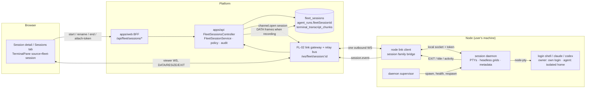

# FL-04 — Sessions on computers · Implementation plan

> How [`spec.md`](./spec.md) gets built. Implementation detail belongs here, not in the spec (Constitution IX). Every path below was opened at this branch's base (`origin/develop` `e4334baf7`) before it was cited; paths under `apps/web/src/components/fleet/` and `apps/api/src/fleet-link/` are created by FL-01 and FL-02 and are named as those plans name them.

**Epic ID:** `FL-04-sessions-on-computers`
**Spec:** [`./spec.md`](./spec.md) · **Tasks:** [`./tasks.md`](./tasks.md)
**Status:** `Draft`
**Created:** 2026-10-18
**Last updated:** 2026-10-18

---

## 1. Architecture summary



Data flows back the same way it went out: the daemon's frames ride the node's single outbound link (FL-02), the relay fans them to every viewer socket and, when recording is on, to the transcript store. Nothing connects into the machine (README D2).

## 2. Current state in the codebase

| Piece                                                                                                                                                  | Where                                                                                                                                                                                                                                                                                     | Reused as                                                                                                                  |
| ------------------------------------------------------------------------------------------------------------------------------------------------------ | ----------------------------------------------------------------------------------------------------------------------------------------------------------------------------------------------------------------------------------------------------------------------------------------- | -------------------------------------------------------------------------------------------------------------------------- |
| Node consents (`--work`, `--attend`) and the `start` verb                                                                                              | `apps/node/src/cli/program.ts:1548-1552`, `apps/node/src/core/runtime.ts:475-486`                                                                                                                                                                                                         | `--manage` arrives with FL-02; sessions read `manageEnabled` / `workEnabled` from the same options object                  |
| Closed job-kind union                                                                                                                                  | `packages/contracts/src/fleet/fleet-jobs.types.ts:117-125`; `FLEET_JOB_DEFAULT_QUEUED_MAX_AGE_SEC` record `:239`                                                                                                                                                                          | gains `agent-session` (+ a record entry, or it does not compile)                                                           |
| Executor registration per kind                                                                                                                         | `apps/node/src/core/runtime.ts:739-749` (`worker.register('acceptance-checks' …)`, `'agent-task'`), `:1062` (`'computer-session'` on the attended lane)                                                                                                                                   | `agent-session` registers on the work lane beside `agent-task`                                                             |
| Task-run isolation: relocated home, MCP strictness, scrub                                                                                              | `apps/node/src/core/model-execution/isolated-home.ts:109-238,322` (`isolatedHomeLayout`, `applyIsolatedHomeEnv`, `applyLocalSessionHomeEnv`), `apps/node/src/core/executors/agent-task.ts:1377-1392,1741-1752,1935-1945`, `apps/node/src/core/executors/model-cli.ts:100-116,563,655-672` | called unchanged by the Agent-session executor                                                                             |
| Loopback MCP bridge                                                                                                                                    | `apps/node/src/core/executors/mcp-bridge.ts:1-60`                                                                                                                                                                                                                                         | the Agent session's MCP configuration points at it exactly as a Task run's does                                            |
| Scrubbed child environment                                                                                                                             | `buildNodeCheckEnv` (`apps/node/src/core/executors/acceptance-checks.ts`, used by `apps/node/src/core/screen/terminal-channel.ts:75`)                                                                                                                                                     | the daemon's child env for Agent sessions                                                                                  |
| Per-Agent browser profile on the node                                                                                                                  | `apps/node/src/core/screen/agent-profile.ts`                                                                                                                                                                                                                                              | `ensure()` before an Agent session starts                                                                                  |
| Node-side PTY host (real PTY or pipe floor)                                                                                                            | `packages/plugins/pty-local/src/pty-local.plugin.ts:72-131`; dependency `@homebridge/node-pty-prebuilt-multiarch ^0.13.1` (`packages/plugins/pty-local/package.json:37-38`)                                                                                                               | the daemon imports the same prebuilt package directly (a session needs a real TTY; no pipe floor)                          |
| Read-only node shell for the Computer tab                                                                                                              | `apps/node/src/core/screen/terminal-channel.ts:51-98`                                                                                                                                                                                                                                     | untouched; the daemon is a second, persistent path                                                                         |
| Link framing and session family                                                                                                                        | CONTRACTS §3.2–3.3; FL-02 `apps/api/src/fleet-link/*`, `apps/node/src/core/link/*`                                                                                                                                                                                                        | the session family handler is this epic's; the gateway, relay bus and viewer attach (`FleetLinkAttachService`) are FL-02's |
| Codex owner-config isolation (shipped 2026-10-16)                                                                                                      | `apps/node/src/core/executors/model-cli.ts:104-113`, `:712-719`, `:845-853`; `agent-task.ts:1408`, `:1900-1918` (EXISTING-SUBSTRATE §1.7)                                                                                                                                                 | reused unchanged for Codex Agent sessions — not re-specified                                                               |
| Claude Code MCP isolation (`--mcp-config … --strict-mcp-config`, `ENABLE_CLAUDEAI_MCP_SERVERS=false`, refusal under a machine-wide `managed-mcp.json`) | `agent-task.ts:1374-1386`, `:1558-1594`; `model-cli-compat.ts:60-64` (EXISTING-SUBSTRATE §1.7)                                                                                                                                                                                            | reused unchanged for Claude Code Agent sessions                                                                            |
| Model usage limits (park, node throttle, lease skip)                                                                                                   | `packages/agent/src/fleet/fleet-job.service.ts:739-740`, `:784`, `:838-839`, `:1495` (`throttledProviders`); `apps/node/src/core/worker-loop.ts:107`; `runtime.ts:662-664` (EXISTING-SUBSTRATE §1.8, §2.6)                                                                                | `agent-session` participates exactly as `agent-task` does (spec FR-43a)                                                    |
| Viewer attach precedent (token in the first frame, `4001` after 5 s, 30 s ping)                                                                        | `apps/api/src/computer/computer-ws.service.ts:27-66`                                                                                                                                                                                                                                      | FL-02's `/ws/fleet/<family>/<id>` gateway follows it                                                                       |
| The one terminal renderer                                                                                                                              | `apps/web/src/components/terminal/TerminalPane.tsx:27-67`, `create-terminal-renderer.ts:13-71` (xterm 5.5, `scrollback: 5000`), `use-terminal-attach.ts:46-64,160-183`                                                                                                                    | gains a `source`; the Computer tab already reuses it (`apps/web/src/components/computer/ComputerStage.tsx:20-21,161`)      |
| Terminal transcript store, redaction, retention                                                                                                        | `packages/agent/src/entities/terminal-transcript-chunk.entity.ts:37-72`, `packages/agent/src/agents/terminal-transcript.service.ts:80-124,310`, `packages/tasks/src/tasks/trigger/terminal-transcript-gc.task.ts:32-34` (`17 3 * * *`)                                                    | recording path keyed by session (P3)                                                                                       |
| Run entity: trigger kinds, `fleetCliSession`, `awaitingInput`                                                                                          | `packages/agent/src/entities/agent-run.entity.ts:23-42,95-96,269,349-350`                                                                                                                                                                                                                 | gains `'session'` and `fleetSessionId`                                                                                     |
| Fleet audit writer with key-based redaction                                                                                                            | `packages/agent/src/fleet/fleet-audit.service.ts:55,105-127`; action union `packages/contracts/src/fleet/fleet-panic.types.ts:60-114,116-149`                                                                                                                                             | gains `node.session.*`                                                                                                     |
| Fleet enqueue through the node job-runtime plugin                                                                                                      | `packages/agent/src/computer/computer-session.dispatcher.ts:40-79`                                                                                                                                                                                                                        | `agent-session.dispatcher.ts` is its twin                                                                                  |
| Kill switch                                                                                                                                            | `packages/agent/src/fleet/fleet-kill-switch.service.ts`, `apps/api/src/fleet/fleet-kill-switch.controller.ts`, panic `apps/api/src/fleet/fleet-panic.service.ts`                                                                                                                          | refuse + `block-input` + drain warnings                                                                                    |
| Fleet controller root and API module                                                                                                                   | `apps/api/src/fleet/fleet.controller.ts:150` (`@Controller('api/fleet')`), `apps/api/src/fleet/fleet.module.ts:96-167`                                                                                                                                                                    | the sessions controller mounts in the same module                                                                          |
| Routes constants                                                                                                                                       | `apps/web/src/lib/constants.ts:115-140,256-258,339`                                                                                                                                                                                                                                       | gains `DASHBOARD_FLEET_SESSION`                                                                                            |
| CLI program                                                                                                                                            | `apps/cli/src/main.ts:17-26`, command pattern `apps/cli/src/commands/work/index.ts:16-30`                                                                                                                                                                                                 | gains `fleet session attach\|list`                                                                                         |
| Agent tool precedent                                                                                                                                   | `packages/agent/src/fleet/agent-fleet-tools.ts:40-56` (`list_fleet_nodes`)                                                                                                                                                                                                                | sibling file for the `sessions` family                                                                                     |
| Node config directory per OS                                                                                                                           | `apps/node/src/core/config-store.ts:78-97`                                                                                                                                                                                                                                                | the daemon's state dir is `<config dir>/sessions/`                                                                         |
| Windows service installer (NSSM / scheduled task)                                                                                                      | `apps/node/packaging/windows/install-service.ps1:40-48,98,133-140`                                                                                                                                                                                                                        | must not kill the daemon's process tree on service stop (§15)                                                              |

**What is missing** (spec §2.2): a process on the node that outlives the node; an interactive agent kind; a session row; a terminal source other than a Run; a transcript keyed by anything but a Run; a CLI fleet surface.

## 3. Tech choices

| Concern                | Choice                                                                                                                                                         | Why                                                                                                                                                                 |
| ---------------------- | -------------------------------------------------------------------------------------------------------------------------------------------------------------- | ------------------------------------------------------------------------------------------------------------------------------------------------------------------- |
| Daemon process model   | A hidden `ever-works-node session-daemon` subcommand spawned `detached` by the node, bundled in the same `cli.js`                                              | One installable (README D3); upgrading the node replaces the binary but not the running daemon; the daemon re-execs itself on the next idle exit, never mid-session |
| PTY                    | `@homebridge/node-pty-prebuilt-multiarch` `^0.13.1` imported directly by the daemon                                                                            | Already shipped through `pty-local`; prebuilds for win32/darwin/linux; an agent TUI needs a real TTY, so no pipe floor — `sessions` is withdrawn instead            |
| Headless grid + replay | `@xterm/headless` `^5.5.0` + `@xterm/addon-serialize` `^0.13.0`, `scrollback: 10000`, replay `serialize({ scrollback: 2000 })`                                 | Same emulator as the web pane, so replayed escape sequences render identically; serialize regenerates SGR/cursor state instead of replaying raw history             |
| Local socket           | Unix domain socket `<stateDir>/daemon.sock` (0700 dir) · Windows named pipe `\\.\pipe\ever-works-node-sessions-<sha256(stateDir)[:16]>` + token file           | Nothing listens on a network port (README rule 11); the token file is readable by the enrolling user only (`icacls` on Windows, the node's existing helper)         |
| Daemon ↔ node protocol | NDJSON control messages; attach upgrades the connection to the CONTRACTS §3.2 frame kinds `DATA=1 RESIZE=2 EXIT=3 JSON=10 CLOSE=11` without the channel prefix | The node bridges daemon frames onto the link by prepending `channel u32` — no re-encoding, no second codec                                                          |
| Platform persistence   | TypeORM entity `FleetSession` (CONTRACTS §4.2), string unions in `varchar`, `PortableDateColumn`                                                               | House conventions (`fleet-node.entity.ts`)                                                                                                                          |
| Agent-session delivery | Durable `agent-session` fleet job through the node job-runtime plugin's dispatcher factory                                                                     | CONTRACTS §12: survives restarts, queues under `--concurrency`, inherits lease/keep-alive/reclaim                                                                   |
| Owner-session delivery | Ephemeral `session.start` request on the link                                                                                                                  | CONTRACTS §12: fails `unreachable` when the node is offline; nothing to queue                                                                                       |
| Viewer transport       | FL-02 viewer gateway `/ws/fleet/session/:id`, attach token 60 s single-use, roles `viewer\|driver`                                                             | Same posture as the computer and terminal gateways                                                                                                                  |
| Recording              | Existing `TerminalTranscriptService` + GC, new session key                                                                                                     | R-9; redaction and plan-tier retention already exist                                                                                                                |
| Web renderer           | Existing `TerminalPane` with an additive `source` prop                                                                                                         | R-21                                                                                                                                                                |
| Background sweeps      | Trigger task via a `*_DISPATCHER`-style schedule (Constitution IV)                                                                                             | Same as `fleet-job-lease-sweeper.task.ts:35-37`                                                                                                                     |

## 4. Data model

### 4.1 `FleetSession` → `fleet_sessions` (CONTRACTS §4.2, verbatim columns)

`packages/agent/src/entities/fleet-session.entity.ts`: `id uuid PK` · `nodeId uuid` · `userId uuid` · `organizationId uuid?` · `kind varchar(8)` (`owner|agent`) · `provider varchar(64)` (`claude-code|codex|shell|other:<id>`) · `agentId uuid?` · `agentRunId uuid?` · `checkoutId uuid?` · `cwd text` · `title varchar(200)` · `state varchar(16)` (`starting|working|needs_you|done|idle|ended`) · `outcome varchar(16)?` · `daemonSessionId varchar(64)` · `providerSessionId varchar(128)?` · `firstMessage text?` (redacted) · `lastActivityAt` · `startedAt` · `endedAt?` · `endedReason varchar(16)?` (`user|agent|exit|node-restart|timeout|kill-switch|drain`) · `recordingState varchar(12)` (`off|recording|stored`) · `restartOfSessionId uuid?` (CONTRACTS §4.2; set by restart) · `lastScreen text?` (CONTRACTS §4.2: the last 2 000 lines the daemon kept when the session ended) · `createdAt` · `updatedAt`. The five FL-05 columns (`attention`, `stateChangedAt`, `hooks`, `lastEvidence`, `boundaryUntil`) are FL-05's slot; `costCents` and `tokens` (CONTRACTS §4.2, "filled by FL-20") are created by FL-20's slot `1796200000000-AddFleetSessionUsage`, so this migration does not add them — until then an Agent session's cost is read from its Run (spec FR-60).

Indexes: `(nodeId, state)`, `(userId, state, lastActivityAt)`, `(agentRunId)` unique where not null, `(organizationId, state)`.

Register in `packages/agent/src/database/_entities-inventory.ts` and `_entity-names.ts` beside `ComputerSession` (`:157,:436` / `:81`).

### 4.2 Existing entities — additions only

- `packages/agent/src/entities/agent-run.entity.ts`: `AgentRunTriggerKind` gains `'session'` (`:23-29`; column is `varchar(16)`, `:95`, no check constraint → union change); `fleetSessionId uuid?` column (R-1 reverse reference).
- `packages/agent/src/entities/terminal-transcript-chunk.entity.ts`: `fleetSessionId uuid?`; `runId` becomes nullable; unique `(fleetSessionId, seq)` where not null; a check `runId IS NOT NULL OR fleetSessionId IS NOT NULL` (CONTRACTS R-9).

### 4.3 Migrations (`apps/api/src/migrations/`, forward-only, FL-04 slots)

| Phase | File                                         | Contents                                                                                                                                                                                                                                   |
| ----- | -------------------------------------------- | ------------------------------------------------------------------------------------------------------------------------------------------------------------------------------------------------------------------------------------------ |
| P1    | `1796040000000-CreateFleetSessions.ts`       | `CREATE TABLE fleet_sessions`, its four indexes, FKs on `nodeId`/`agentId`/`agentRunId`; `ALTER terminal_transcript_chunks ADD fleetSessionId uuid NULL`, `ALTER … runId DROP NOT NULL`, the check constraint and the partial unique index |
| P2    | `1796040100000-AddAgentRunFleetSessionId.ts` | `ALTER agent_runs ADD fleetSessionId uuid NULL` + index `(fleetSessionId)`                                                                                                                                                                 |

Follow `1795162100000-AddAgentRunLogsPurgedAt.ts:24` for shape; `down` drops exactly what `up` added. Re-stamp before merge if `develop` moved.

### 4.4 Contracts (`packages/contracts/src/fleet/`)

- New `fleet-sessions.types.ts`: `FleetSessionKind`, `FleetSessionProvider`, `FleetSessionState`, `FleetSessionOutcome`, `FleetSessionEndedReason`, `FleetSessionRecordingState` (each with a `readonly` array + `isX` guard, the house pattern), `FleetSessionView`, `FleetSessionStartRequest { nodeId, kind, provider, cwd, title?, firstMessage?, agentId?, checkoutId? | newWorktreeOf?, restartOf? }`, `FleetSessionAttachTokenResponse { token, role, expiresInSec, wsPath }`, limits `FLEET_SESSION_MAX_OWNER_PER_NODE = 8`, `FLEET_SESSION_MAX_VIEWERS = 5`, `FLEET_SESSION_SCROLLBACK_LINES = 10_000`, `FLEET_SESSION_REPLAY_LINES = 2_000`, `FLEET_SESSION_DRAIN_WARNING_SEC = 60`, `FLEET_SESSION_END_GRACE_MS = 5_000`.
- `fleet-link.types.ts` (FL-02 file): the `session` family messages — `session.start`, `session.attach`, `session.input`, `session.resize`, `session.end`, `session.rename`, `session.restart` (CONTRACTS §3.3; `session.answer` is FL-05's) plus the node→platform channel-0 `session.event` and `session.list` (CONTRACTS §3.2–3.3; `session.status` / `session.attention` are FL-05's).
- `fleet-jobs.types.ts`: `'agent-session'` in `FleetJobKind` and `FLEET_JOB_KINDS` (`:117-125`) and in `FLEET_JOB_DEFAULT_QUEUED_MAX_AGE_SEC` (`:239`, value `600` — an Agent session waits for a slot; the card says so); `FleetAgentSessionPayload { fleetSessionId, agentRunId, agentId, provider, cwd, checkoutId?, firstMessage, permissionMode, mcp?, profileKey }`.
- `fleet-panic.types.ts`: all nine CONTRACTS §7 session actions — `node.session.start|attach|input|answer|rename|restart|end|recording.start|recording.stop` — appended to the union (`:60-114`) and the array (`:116-149`); FL-05 writes `answer`, it does not re-add it.
- `fleet-node.types.ts`: `sessions` in the known capability tags; heartbeat gains optional `daemon: { state: 'running'|'stopped'|'failed', reason?, sessions }` in the newest tier (spec §8b default until CONTRACTS §1.1 lists it).

## 5. API surface

All under `apps/api/src/fleet/sessions/fleet-sessions.controller.ts` (`@Controller('api/fleet')`, mounted in `fleet.module.ts`), `FleetEnabledGuard` + `FLEET_SESSIONS_ENABLED` guard, authenticated; authorization = Node visible to the caller **and** `sessions` family audience (FL-01's role derivation); a cross-user Node 404s identically to an unknown one.

| Method | Path                         | Body / query                                    | Returns                                                                                   | Auth / tier                               | Errors                                                                                                                   |
| ------ | ---------------------------- | ----------------------------------------------- | ----------------------------------------------------------------------------------------- | ----------------------------------------- | ------------------------------------------------------------------------------------------------------------------------ |
| GET    | `/nodes/:id/sessions`        | `?state=live\|ended&limit`                      | `FleetSessionView[]`                                                                      | audience `sessions`                       | `not_found`, `permission_denied`                                                                                         |
| POST   | `/nodes/:id/sessions`        | `FleetSessionStartRequest`                      | `201 FleetSessionView` (`202` when an Agent session queued)                               | audience `sessions`; throttle 10/min/user | `consent_missing`, `unreachable`, `unsupported_on_node`, `limit_exceeded`, `invalid`, `kill_switch`, `permission_denied` |
| GET    | `/sessions`                  | `?nodeId&agentId&state&kind&since&limit&cursor` | paged `FleetSessionView[]`                                                                | per-Node audience filter                  | —                                                                                                                        |
| GET    | `/sessions/:id`              | —                                               | `FleetSessionView` + `lastScreen` when ended                                              | audience                                  | `not_found`                                                                                                              |
| PATCH  | `/sessions/:id`              | `{ title }`                                     | `FleetSessionView`                                                                        | audience                                  | `invalid` (1–200 chars)                                                                                                  |
| POST   | `/sessions/:id/end`          | `{ reason?: 'user' }`                           | `202`                                                                                     | audience; `confirm`                       | `not_found`; `unreachable` ends platform-side and the node reconciles on return                                          |
| POST   | `/sessions/:id/restart`      | `{ cols?, rows? }`                              | `201 FleetSessionView` (new session, `restartOfSessionId` = `:id`)                        | audience; throttle as start               | as start; `invalid` when `:id` is not `ended`                                                                            |
| POST   | `/sessions/:id/attach-token` | `{ role: 'viewer'\|'driver', cols?, rows? }`    | `{ token, role, expiresInSec: 60, wsPath }`                                               | audience; throttle 30/min/user            | `limit_exceeded` (5 viewers), `kill_switch`, `unreachable`, `permission_denied` (driver outside audience)                |
| GET    | `/sessions/:id/recording`    | — → manifest; `?from=seq&limit` → chunk page    | `{ state, chunks, durationMs, driverSpans[] }` manifest, or a chunk page (text, redacted) | audience                                  | `not_found`                                                                                                              |
| POST   | `/sessions/:id/recording`    | `{ on: boolean }`                               | `FleetSessionView`                                                                        | audience                                  | `not_found`                                                                                                              |

Every path is a CONTRACTS §11.2 path (no `/recording/chunks` sub-route). DTOs under `apps/api/src/fleet/sessions/dto/` with `class-validator`; response DTOs `@Expose()` only. Every error is the CONTRACTS §8 envelope with `hint`. Restart is `POST /sessions/:id/restart` (CONTRACTS §11.2); the start route's `restartOf` field is the same act for the tools (`fleet_sessions_start` with `restartOf`). Throttles (10/min starts, 30/min attaches) are spec §8b defaults until CONTRACTS §10 lists them.

Request DTOs:

| DTO                          | Fields and validators                                                                                                                                                                                                                                                                                                                                                                                                                                                                                                                      |
| ---------------------------- | ------------------------------------------------------------------------------------------------------------------------------------------------------------------------------------------------------------------------------------------------------------------------------------------------------------------------------------------------------------------------------------------------------------------------------------------------------------------------------------------------------------------------------------------ |
| `StartFleetSessionDto`       | `kind @IsIn(['owner','agent'])` · `provider @IsIn(FLEET_SESSION_PROVIDERS)` · `cwd @IsString() @MaxLength(1024)` · `title? @MaxLength(200)` · `firstMessage? @MaxLength(4000)` (required `@MinLength(3)` when `kind='agent'` and provider is not `shell`, enforced in the service) · `agentId? @IsUUID()` (required when `kind='agent'`) · `checkoutId? @IsUUID()` · `newWorktreeOf? @IsUUID()` (mutually exclusive with `checkoutId`) · `restartOf? @IsUUID()` · `cols? @IsInt() @Min(20) @Max(500)` · `rows? @IsInt() @Min(5) @Max(200)` |
| `RenameFleetSessionDto`      | `title @IsString() @MinLength(1) @MaxLength(200)`                                                                                                                                                                                                                                                                                                                                                                                                                                                                                          |
| `EndFleetSessionDto`         | `reason? @IsIn(['user'])`                                                                                                                                                                                                                                                                                                                                                                                                                                                                                                                  |
| `FleetSessionAttachTokenDto` | `role @IsIn(['viewer','driver'])` · `cols?`, `rows?` as above                                                                                                                                                                                                                                                                                                                                                                                                                                                                              |
| `FleetSessionRecordingDto`   | `on @IsBoolean()`                                                                                                                                                                                                                                                                                                                                                                                                                                                                                                                          |
| `ListFleetSessionsQuery`     | `state? @IsIn(['live','ended'])` · `nodeId?`, `agentId? @IsUUID()` · `kind?` · `since? @IsISO8601()` · `limit? @Max(200)` · `cursor?`                                                                                                                                                                                                                                                                                                                                                                                                      |

Response: `FleetSessionViewDto` mirrors `FleetSessionView` and never exposes `firstMessage` unredacted, `daemonSessionId`, or the Node's paths beyond `cwd`.

Node-facing: no new HTTPS endpoint — the node reports through the link (`session.event`, `session.list`); the Agent-session job completes through the existing `POST /api/fleet/jobs/:id/complete`.

## 6. Node side

### 6.1 Modules

| Module                                                  | Responsibility                                                                                                                                                                                                                                                                                                                                                                                                                                                                   |
| ------------------------------------------------------- | -------------------------------------------------------------------------------------------------------------------------------------------------------------------------------------------------------------------------------------------------------------------------------------------------------------------------------------------------------------------------------------------------------------------------------------------------------------------------------- |
| `apps/node/src/core/sessions/daemon/daemon-main.ts`     | Entry of the `session-daemon` subcommand: parse `--socket --token-file --state-dir`, bind, load persisted sessions, idle timer (5 min with no sessions and no node connection), crash log                                                                                                                                                                                                                                                                                        |
| `…/daemon/daemon-server.ts`                             | Socket server, token check before reading any body, NDJSON control ops (`hello health list start attach resize rename end screen block-input warn ack-ended watch`), per-connection role (`control` / `attached`)                                                                                                                                                                                                                                                                |
| `…/daemon/session-process.ts`                           | One PTY per session (`node-pty`), `TERM=xterm-256color`, `COLORTERM=truecolor`, `EVER_WORKS_SESSION_ID`; terminate → kill after `FLEET_SESSION_END_GRACE_MS`; exit code capture                                                                                                                                                                                                                                                                                                  |
| `…/daemon/screen-grid.ts`                               | `@xterm/headless` grid per session (scrollback 10 000); `replay()` = serialize with 2 000 lines; answers terminal queries when no driver is attached; forwards only the newest driver's response-shaped bytes                                                                                                                                                                                                                                                                    |
| `…/daemon/attach-fanout.ts`                             | Viewer/driver set per session; newest driver dictates size; a viewer whose write buffer exceeds 1 MiB or stalls 5 s is closed with `CLOSE slow-viewer`; input blocked flag (kill switch)                                                                                                                                                                                                                                                                                         |
| `…/daemon/session-store.ts`                             | Atomic JSON per session (`<stateDir>/sessions/<id>.json`) + `<id>.screen` written ≤ 30 s after change and at exit; `ended` records kept until `ack-ended`                                                                                                                                                                                                                                                                                                                        |
| `apps/node/src/core/sessions/daemon-supervisor.ts`      | Started when `--manage` or `--work` is on: connect if alive (token file + health) else spawn detached (`process.execPath cli.js session-daemon …`, `stdio: 'ignore'`, `windowsHide`), health every 10 s, respawn with backoff 1 s → 30 s, advertise `sessions`                                                                                                                                                                                                                   |
| `apps/node/src/core/sessions/session-link-bridge.ts`    | The link `session` family handler: `channel.open {sessionId, mode}` → daemon `attach` → relay frames both ways (prepend channel u32); `session.start/end/rename/resize/input`; emits `session.event` on channel 0 from the daemon's `watch` stream                                                                                                                                                                                                                               |
| `apps/node/src/core/sessions/owner-session-launcher.ts` | Composes argv/env for owner sessions: login shell (`$SHELL -l`, `pwsh -NoLogo` else `powershell.exe -NoLogo`), `claude [<hook overlay args>] [prompt]`, `codex [<hook overlay args>] [prompt]`; refuses when `--manage` is off or the provider is not advertised                                                                                                                                                                                                                 |
| `apps/node/src/core/sessions/session-reconciler.ts`     | At node start: daemon alive → `session.list` to the platform; not alive → `session.event lost` for every session in the daemon's persisted store, carrying each `.screen`                                                                                                                                                                                                                                                                                                        |
| `apps/node/src/core/executors/agent-session.ts`         | `agent-session` job: `agentProfile.ensure`, `isolatedHomeLayout` + `applyIsolatedHomeEnv` + `claudeConfigRelocationLoss` gate (as `agent-task.ts:1741-1752`), MCP bridge or `MODEL_CLI_EMPTY_MCP_CONFIG` + `--strict-mcp-config`, `buildNodeCheckEnv`, `--permission-mode <acceptEdits>`, Codex `--ignore-user-config` + `CODEX_HOME` overlay; launches **interactively** (no `-p`, no `--output-format`) in the daemon; keep-alive while live; completes with the exit evidence |
| `apps/node/src/core/sessions/hook-overlay.port.ts`      | Seam FL-05 fills: `hookOverlayFor(kind, provider, sessionId) → { args, env, files } \| null`; FL-04 ships the no-op                                                                                                                                                                                                                                                                                                                                                              |

### 6.2 OS matrix

| Concern                  | Linux                                                                                             | macOS                                         | Windows                                                                                              |
| ------------------------ | ------------------------------------------------------------------------------------------------- | --------------------------------------------- | ---------------------------------------------------------------------------------------------------- |
| Socket                   | `$XDG_RUNTIME_DIR/ever-works-node/daemon.sock` else `<config dir>/sessions/daemon.sock`, dir 0700 | `<config dir>/sessions/daemon.sock`, dir 0700 | named pipe + `daemon.token` under `%APPDATA%\ever-works-node\sessions\`, `icacls` owner-only         |
| Login shell              | `$SHELL -l`, fallback `/bin/sh -l`                                                                | `$SHELL -l`, fallback `/bin/zsh -l`           | `pwsh -NoLogo` if on PATH, else `powershell.exe -NoLogo` (spec §8b)                                  |
| Detach                   | `spawn(..., { detached: true })` + `unref()`                                                      | same                                          | same + `windowsHide: true`; NSSM must not kill the tree (`AppKillProcessTree 0`, §15)                |
| PTY                      | node-pty prebuilt                                                                                 | node-pty prebuilt                             | node-pty ConPTY prebuilt                                                                             |
| Survives service restart | yes (new process group)                                                                           | yes                                           | yes once the installer sets the NSSM flag; the scheduled-task variant already leaves orphans running |

No shell-outs beyond spawning the session command itself. Consents: owner → `manage`; Agent → `work`. Capability tags: `sessions` (daemon healthy), existing `claude-code`/`codex` mark the dialog's choices.

### 6.3 Link channel, message by message (family `session`, CONTRACTS §3.3)

1. Platform `channel.open { channel, family: 'session', params: { sessionId, mode } }` → node checks consent + kill switch → daemon `attach` → `channel.ready` → daemon replay as `DATA` frames.
2. Platform `session.start { requestId, kind, provider, cwd, title, firstMessage?, agentRunId?, checkoutId?, cols, rows }` (owner sessions; Agent sessions arrive as a job and the executor calls the daemon directly) → `{ requestId, daemonSessionId }` or `{ error: { code, hint } }`.
3. Platform `session.input` (driver only) → `DATA` to the PTY (refused silently when input is blocked; the platform tells the viewer).
4. Platform `session.resize` → `RESIZE [cols u16][rows u16]` (ignored unless from a driver).
5. Platform `session.rename { title }` → daemon `rename` → `{ ok }`.
6. Platform `session.end { reason, graceMs }` → daemon `end` → `EXIT [code i32]` on every attached channel.
7. Platform `session.restart { requestId, restartOf, sessionId, cols, rows }` (CONTRACTS §3.3) → the node reads the ended session's kind, provider, folder and title from the daemon store and starts a new daemon session → `{ requestId, daemonSessionId }`; an Agent session's restart arrives as a new `agent-session` job instead.
8. Node → platform (channel 0, CONTRACTS §3.2–3.3): `session.event { sessionId, event: 'started'|'exited'|'title'|'activity'|'lost', exitCode?, title?, screen? }`; `session.list { sessions[] }` once after `link.ready` (reconnect resumes open channels where the daemon still has them — FL-02 §3.1). `session.status` and `session.attention` are FL-05's.
9. Kill switch: FL-02's channel-0 `link.pause` / `link.resume` (FL-02 spec §8b default) → the node's control module → daemon `block-input { on }`. Drain: FL-02's `link.drain { graceSec: 60 }` → the session module sends daemon `warn { seconds: 60 }` to every owner session, then `end { reason: 'drain' }`; Agent sessions end as their Runs are cancelled.

### 6.4 Daemon ↔ node protocol (local socket)

Every connection starts with one NDJSON line `{ "op": "hello", "token", "nodeVersion", "role": "control" | "attach" }`. The daemon closes a connection whose first line is not a valid `hello` or whose token mismatches, before reading anything else.

| Op (control role) | Request fields                                                                    | Reply                                                                                                                      |
| ----------------- | --------------------------------------------------------------------------------- | -------------------------------------------------------------------------------------------------------------------------- |
| `health`          | —                                                                                 | `{ ok, daemonVersion, pty: 'available'\|'missing', sessions: n, uptimeSec }`                                               |
| `list`            | —                                                                                 | `{ sessions: [{ id, kind, provider, cwd, title, startedAt, startedBy, alive, exitCode?, cols, rows, drivers, viewers }] }` |
| `start`           | `{ id, kind, provider, command[], cwd, env, cols, rows, title, startedBy, meta }` | `{ ok, pid }` or `{ error: { code: 'invalid'\|'unsupported_on_node'\|'operation_failed', hint } }`                         |
| `resize`          | `{ id, cols, rows }`                                                              | `{ ok }`                                                                                                                   |
| `rename`          | `{ id, title }`                                                                   | `{ ok }`                                                                                                                   |
| `end`             | `{ id, graceMs, reason }`                                                         | `{ ok }`; the `EXIT` frame follows on attached connections                                                                 |
| `screen`          | `{ id, lines }`                                                                   | `{ text, title, cols, rows }` (plain text, no escapes — for rules and `fleet_sessions_read`)                               |
| `block-input`     | `{ on: boolean }`                                                                 | `{ ok }`                                                                                                                   |
| `warn`            | `{ id, text, seconds }`                                                           | `{ ok }`; a `JSON { type: 'session.notice' }` frame reaches attached connections                                           |
| `ack-ended`       | `{ id }`                                                                          | `{ ok }`; the daemon forgets the ended session and its screen                                                              |
| `watch`           | —                                                                                 | a stream of `{ event: 'started'\|'exited'\|'title'\|'activity', id, exitCode?, title?, at }` lines                         |

An `attach` connection sends `{ "op": "attach", "id", "mode": "viewer" | "driver", "cols", "rows" }` once and is then a frame stream: daemon → node `DATA` (replay first, then live), `RESIZE`, `EXIT`, `JSON` notices, `CLOSE { reason }`; node → daemon `DATA` (drivers only), `RESIZE` (drivers only), `CLOSE`. Frame kinds and payloads are CONTRACTS §3.2 without the channel prefix.

### 6.5 Daemon lifecycle

```
 node start ──► token file + health? ──yes──► connect ──► list ──► session.list to platform
      │                                    no
      ▼
 spawn detached ──► health within 10 s? ──no──► backoff 1→30 s, withdraw `sessions`, retry
      │ yes
      ▼
 advertise `sessions` ──► health every 10 s ──► miss ×3 ──► withdraw tag, respawn
                                                  │
 daemon side: last session ended + no node connection for 5 min ──► exit 0 (state dir kept)
 machine reboot: daemon gone, store has sessions ──► node reports each `lost` with its .screen
```

The daemon never upgrades itself in place: a node whose version floor is above the daemon's `hello` version asks it to exit at its next idle, and spawns the new build then. A running session is never interrupted by an upgrade.

## 7. Plugin surface

None. No external integration is introduced; the Computer tab keeps `pty-local` as its `terminal-stream` provider. `docs/plugin-system/built-in-plugins.md` is untouched.

## 8. Web surface

- **Routes:** `apps/web/src/app/[locale]/(dashboard)/fleet/sessions/[id]/page.tsx` (server component: session, Node, Agent, recording manifest in parallel, each `.catch()`); `DASHBOARD_FLEET_SESSION: (id) => \`/fleet/sessions/${id}\``in`apps/web/src/lib/constants.ts`beside`DASHBOARD_AGENT_COMPUTER` (`:258`). `/fleet/sessions` (the list) is FL-05's.
- **Registry:** `apps/web/src/components/fleet/registry.ts` (FL-01) gains the `sessions` tab entry pointing at `SessionsTab`, code-split.
- **Components** under `apps/web/src/components/fleet/sessions/`: `SessionsTab.tsx` · `SessionStartDialog.tsx` · `SessionDetailClient.tsx` · `SessionHeader.tsx` · `SessionFooter.tsx` · `SessionComposer.tsx` · `SessionCard.tsx` (compact layout now; FL-05 completes the anatomy) · `SessionRowMenu.tsx` · `SessionEndDialog.tsx` · `SessionStateCard.tsx` (consent missing / daemon down / offline / limit) · `SessionReplayPlayer.tsx` (P3) · `SessionShortcutSheet.tsx` · `use-session-attach.ts` · `sessions.shared.ts` (pure: consent→copy, limits, state glyph, elapsed, role transitions, held-input policy).
- **Terminal pane:** `apps/web/src/components/terminal/TerminalPane.tsx` gains `source?: { kind: 'run'; agentId; runId } | { kind: 'fleet-session'; sessionId }` (default `run` from the existing props — nothing changes for callers); `use-terminal-attach.ts` resolves `/api/fleet/sessions/:id/attach-token` and `wsPath` from the response for the new source. `create-terminal-renderer.ts` is untouched.
- **BFF:** `apps/web/src/app/api/fleet/sessions/route.ts`, `…/[id]/route.ts`, `…/[id]/attach-token/route.ts`, `…/[id]/end/route.ts`, `…/[id]/recording/route.ts`, `apps/web/src/app/api/fleet/nodes/[id]/sessions/route.ts`, mirroring `apps/web/src/app/api/agents/[id]/computer/sessions/[sessionId]/attach-token/route.ts`; client `apps/web/src/lib/api/fleet-sessions.ts` beside `computer.ts:14`.
- **Agent page:** `apps/web/src/components/agents/AgentDetailTabs.tsx` is untouched; the Agent dashboard gains a "Sessions" block using `SessionCard`.
- **i18n groups** (`apps/web/messages/en.json`, `fleet.*`): `fleet.sessions.tab`, `fleet.sessions.start` (dialog), `fleet.sessions.detail` (header, footer, composer, shortcuts), `fleet.sessions.states`, `fleet.sessions.actions`, `fleet.sessions.confirm`, `fleet.sessions.replay`, `fleet.sessions.limits`, `fleet.sessions.cost`, `fleet.sessions.a11y`, `fleet.computer.tabs.sessions`, `fleet.errors.*` hints. Leaf keys camelCase, no literal `.`. The load-bearing strings:

```
fleet.sessions
  tab.live                 "Live"            tab.ended "Ended"            tab.empty "No sessions on {node} yet."
  tab.emptyBody            "Start a shell or an agent here and it keeps running when you close the tab."
  start.title              "New session"     start.who "Who"  start.you "You — runs as you, in your login"
  start.agent              "Agent — isolated, owns a Run"      start.what "What"   start.where "Where"
  start.recent             "Recent"          start.checkouts "Checkouts"  start.browse "Browse…"
  start.inFolder           "in this folder"  start.newWorktree "in a new worktree of {checkout}"
  start.worktreeLater      "New worktrees arrive with Checkouts"
  start.notInstalled       "not installed on {node}"
  start.firstMessage       "First message"   start.submit "Start session"
  start.costOwner          "This session uses your own {provider} login on {node}. Ever Works bills no tokens for it."
  start.costAgent          "{agent} runs isolated on {node} — its own configuration, never yours. The Run appears in Activity → Runs with its cost."
  detail.driving           "You are driving"            detail.watching "Watching · {name} is driving"
  detail.nobodyDriving     "Nobody is driving"          detail.watchers "{count} watching ({names})"
  detail.isolated          "Isolated — {agent}'s own configuration on {node}"
  detail.takeKeyboard      "Take the keyboard"          detail.watchOnly "Watch only"
  detail.reconnecting      "Reconnecting to {node}…"    detail.heldInput "You typed {count} lines while offline."
  detail.sendHeld          "Send them"                  detail.discardHeld "Discard"
  detail.endedExit         "Ended {time} · exited with code {code}"
  detail.endedUser         "Ended {time} · ended by you"
  detail.endedNodeRestart  "Ended {time} · {node} restarted — the screen above is the last one it kept"
  detail.endedDrain        "Ended {time} · fleet drain"   detail.endedKillSwitch "Ended {time} · fleet stop"
  detail.endedLost         "Ended {time} · the process was lost — exit code unknown"
  detail.killSwitch        "Paused by the fleet stop — {reason}"
  detail.drainWarning      "This session ends in {countdown} (fleet drain)"
  detail.notRecording      "Not recording — storage is unavailable"
  detail.sendTo            "Send to {who}"               detail.send "Send"
  states.consentManage     "Owner sessions need management switched on for this computer."
  states.consentCommand    "Run this on {node}:"         states.consentWork "Agents need work switched on for this computer — ever-works-node start --work"
  states.daemonDown        "The session daemon is not running on {node} — {reason}"
  states.offline           "{node} is offline — last seen {relative}. Sessions it had are listed below with their last screens."
  limits.sessions          "{node} already has {count} sessions. End one to start another."
  limits.viewers           "This session already has {count} watchers."
  confirm.endTitle         "End \"{title}\" on {node}?"
  confirm.endBody          "The process is stopped. Its screen is kept and you can restart it later."
  confirm.endRun           "{agent}'s Run ends with it."  confirm.end "End"
  replay.title             "Re-watch · {title} · {node} · {date}"
  replay.notRecorded       "This session was not recorded."
  replay.storageFailed     "Recording stopped — storage was unavailable."
  replay.expired           "The recording was removed after {days} days."
  replay.driverSpan        "{name} drove {from}–{to}"
  a11y.pane                "Terminal of {title} on {node}. {role}."
```

- **Playwright:** `apps/web/e2e/flow-fleet-sessions-owner.spec.ts`, `flow-fleet-sessions-agent.spec.ts`, `flow-fleet-sessions-contract.spec.ts`, `flow-fleet-sessions-replay.spec.ts`, `flow-fleet-sessions-a11y.spec.ts` (named like `flow-fleet-*` / `flow-terminal-attach-contract.spec.ts`).

## 9. Agent / MCP / CLI surface

- **Agent tools** `packages/agent/src/fleet/agent-fleet-session-tools.ts` (registered beside `agent-fleet-tools.ts`): `fleet_sessions_list` (`readOnly: true`), `fleet_sessions_read` (`readOnly: true`, last N screen lines via `GET /sessions/:id` + daemon `screen`), `fleet_sessions_start` (`destructive: false`, `confirmationClass: 'plain'`; always kind `agent`, `agentId` = caller), `fleet_sessions_send` (`destructive: false`, `plain` — FL-19 catalogue §9.1), `fleet_sessions_rename` (`destructive: false`, `plain`), `fleet_sessions_end` (`destructive: true`, `confirm`). Each checks AW-15 grants + the Node's `sessions` audience for the Agent's owner (CONTRACTS §2.1).
- **MCP:** the same six through `apps/mcp/src/openapi-tools/whitelist.ts` (beside the Fleet block at `:475-519`); full parity is FL-19.
- **CLI:** `apps/cli/src/commands/fleet/index.ts` (`fleet` command, added in `apps/cli/src/main.ts:23-26`), `commands/fleet/session/list.ts` (`--json`, exit `0/1/2`), `commands/fleet/session/attach.ts` (`--watch`, raw mode, `SIGWINCH` → resize, `Ctrl-]` `d` detaches, token from the attach-token endpoint, WS via `ws`). FL-19 adds the rest of `ever-works fleet session <verb>`.

## 10. Background jobs

| Task                                                             | When               | What                                                                                                                                                                                                                                                                                                                                                     | Idempotency                                    |
| ---------------------------------------------------------------- | ------------------ | -------------------------------------------------------------------------------------------------------------------------------------------------------------------------------------------------------------------------------------------------------------------------------------------------------------------------------------------------------- | ---------------------------------------------- |
| `packages/tasks/src/tasks/trigger/fleet-session-sweeper.task.ts` | cron `4/5 * * * *` | Sessions `starting` > 60 s with no `started` event → `ended (exit)` with `unconfirmed`; nothing is written for sessions on an offline Node (the daemon may hold them) — the "unknown — last seen …" label is derived on read from the Node's offline status, never stored, since `unknown` is not a §4.2 state; orphaned `agent-session` Runs reconciled | `UPDATE … WHERE state = …` CAS                 |
| `terminal-transcript-gc.task.ts` (existing, extended)            | `17 3 * * *`       | Also deletes session-keyed chunks past 14 days                                                                                                                                                                                                                                                                                                           | existing                                       |
| `agent-session` fleet job (node)                                 | leased             | §6.1                                                                                                                                                                                                                                                                                                                                                     | one job per `fleetSessionId` (idempotency key) |

## 11. Security & permissions

- **Threats specific to this epic.** (a) A local process on the machine attaching to the daemon — mitigated by the owner-only socket/pipe and the token file; the daemon authenticates before reading a body. (b) An Agent session reaching the owner's MCP servers or credentials — the Task-run isolation path is reused unchanged, and a test asserts the child env equals `agent-task`'s for the same inputs. (c) A viewer injecting input — refused in the hook, the relay (role) and the daemon (mode). (d) Terminal bytes leaking into audit or logs — audit rows carry ids and reasons only; the redacting logger protects the token.
- **What the node refuses:** owner sessions without `--manage`; Agent sessions without `--work`; a provider it does not advertise; a `cwd` outside the user's home for owner sessions unless it is a checkout path or an extra root the owner listed with `--files-root` (this epic's own rule — R-18 governs the Files tab and log files, where the home directory is never a root, not session folders); any request while the kill switch is on (`kill_switch`); a `session.start` pinned to another node id.
- **Platform checks:** Node visibility + `sessions` family audience for every route; driver tokens only for callers in the audience; rate limits 10/min starts, 30/min attaches.
- **Redaction:** recordings run through the transcript service's redaction; `firstMessage` through `redactSecrets` before storage; the audit writer's key-based redaction stays (name fields `sessionRef`, never `*Token`).
- **Audit:** `node.session.start` (kind, provider, nodeId, agentId?), `node.session.restart` (restartOf, new session id), `node.session.attach` (role), `node.session.input` (one row per driver span: start, end, bytes), `node.session.rename`, `node.session.end` (reason, exitCode), `node.session.recording.start|stop` — through `FleetAuditService.record()` with `family: 'sessions'`, `target: sessionId`, `requestedBy`, `confirmationClass`, `outcome`.
- **No `@Public()` endpoint is added.**

## 12. Observability

- Audit rows above; activity log `fleet.session.started|ended` via `apps/api/src/activity-log/activity-log.listener.ts`.
- Analytics: `fleet_session_started {kind, provider}`, `fleet_session_attached {role}`, `fleet_session_driver_changed`, `fleet_session_ended {reason}`, `fleet_session_replay_ms`, `fleet_session_daemon_restarted {reason}`, `fleet_session_recording_skipped {reason}`.
- Node health (heartbeat `daemon` block) shows daemon state and session count on the computer page's Overview (FL-03 renders).

Failure modes:

| Failure                                        | Behaviour                                                                                                                                                |
| ---------------------------------------------- | -------------------------------------------------------------------------------------------------------------------------------------------------------- |
| Daemon process dies                            | Supervisor respawns with backoff; every session it held is **lost**: reported `ended (node-restart)` with the last persisted screen; cards offer Restart |
| Node process dies or upgrades                  | Daemon keeps running; on return the node re-lists and the platform reconciles; no viewer is told anything                                                |
| Link drops                                     | Sessions untouched; viewers see the reconnecting state; held input offered on return; the daemon's scrollback covers the gap                             |
| API replica dies                               | Viewers reattach through the relay bus (R-7) and get a fresh replay; no state changes                                                                    |
| Machine reboots                                | Daemon and processes gone; the node reports `lost` with persisted screens; `outcome: unconfirmed` for sessions that were `working` (FL-05)               |
| Recording storage refuses writes               | Recording stops, `recordingState: off` with a reason, footer and detail say so; the session continues                                                    |
| Disk full on the node                          | Metadata persistence fails loudly in the card ("title may not survive a restart"); the session continues; health reports it                              |
| node-pty prebuild missing                      | Daemon reports `pty: missing`; `sessions` withdrawn; the tab names the fix; no silent pipe floor                                                         |
| `claudeConfigRelocationLoss` refuses isolation | Agent session refused `unsupported_on_node` with the Task-run hint; never downgraded to the owner's configuration                                        |
| Kill switch thrown                             | Link requests refused; daemon input blocked within one control message; processes keep running; clearing resumes input without a reconnect               |
| Clock skew node ↔ platform                     | `startedAt`/`endedAt` are platform-stamped on receipt; the daemon's timestamps are relative and only order events                                        |

## 13. Phased rollout (flag `FLEET_SESSIONS_ENABLED`, default off in production)

- **P1 — Owner sessions & daemon.** Contracts, `FleetSession` entity + migration A (+ transcript key), daemon, supervisor, link bridge, owner launcher, reconciler, controller (all routes but recording), viewer attach through the pane's new source, Sessions tab, start dialog (owner kinds), detail, end/rename/restart, limits, kill switch, drain, audit, sweeper, i18n, e2e `owner` + `contract`. Green = the fleet and terminal suites unchanged, new suites green.
- **P2 — Agent sessions.** `agent-session` kind + dispatcher + executor, migration B, Run trigger `session`, dialog Agent kind + first message + new-worktree (FL-14 present), Agent page block, Agent tools, MCP whitelist, CLI `attach`/`list`, e2e `agent`.
- **P3 — Recording & re-watch.** Transcript service session key, recording toggle, GC extension, manifest + chunks routes, player, Run receipt link, AW-11 tracker update, e2e `replay` + `a11y`.

## 14. Test plan

Runners: `packages/contracts` Vitest · `packages/agent` Jest · `apps/api` Jest · `apps/node` Vitest · `apps/web` unit Vitest, e2e Playwright · `apps/cli` Vitest.

- **Contracts:** `packages/contracts/src/fleet/__tests__/fleet-sessions.spec.ts` (unions, guards, limits), extend `fleet-jobs.spec.ts` (`agent-session` present with a queued-max-age entry), `fleet-panic.spec.ts` (the nine `node.session.*` actions of CONTRACTS §7).
- **Agent package:** `packages/agent/src/fleet/sessions/__tests__/fleet-session.policy.spec.ts` (kind→consent, limits ±1, state transitions, ended reasons), `fleet-session.service.spec.ts` (start owner/agent, refusals by code, rename, end idempotent, restart link, node-restart reconciliation marks `ended` with screen), `agent-session.dispatcher.spec.ts` (payload, `targetNodeId` always set, required capabilities `['sessions', provider tag]`, idempotency key), extend `fleet-audit.service.spec.ts`.
- **API:** `apps/api/src/fleet/sessions/fleet-sessions.controller.spec.ts` (every refusal and status code; audience matrix owner/org-admin/org-member/stranger; throttles), `session.family.spec.ts` (link messages, viewer role enforcement, held-input never auto-sent).
- **Node:** `apps/node/src/core/sessions/daemon/__tests__/daemon-server.spec.ts` (token before body, ops, attached role), `screen-grid.spec.ts` (10 000 scrollback, replay ≤ 2 000 lines, query answered only with no driver), `attach-fanout.spec.ts` (newest driver sizes, slow viewer dropped, input block), `session-store.spec.ts` (atomic write, screen persisted, ack-ended), `daemon-supervisor.spec.ts` (connect-or-spawn, respawn backoff, `sessions` tag only when healthy), `session-link-bridge.spec.ts` (frame prefixing, consent refusals, `session.event`), `owner-session-launcher.spec.ts` (login shell per OS, provider refusal, overlay seam), `session-reconciler.spec.ts` (alive → list, dead → lost with screens), `apps/node/src/core/executors/agent-session.spec.ts` (child env equals `agent-task`'s for the same plan — the isolation proof; no `-p`; MCP strictness; Codex `--ignore-user-config`).
- **Web unit:** `sessions.shared.unit.spec.ts`, `SessionStartDialog.unit.spec.tsx` (kinds by consent, providers by tag, worktree row by FL-14 presence, cost sentence), `SessionDetailClient.unit.spec.tsx` (roles, reconnecting, held input, kill-switch banner), `SessionCard.unit.spec.tsx`, `TerminalPane.unit.spec.tsx` extended (source `fleet-session` mints the right token URL; default unchanged).
- **CLI:** `apps/cli/src/commands/fleet/__tests__/session-attach.spec.ts` (detach chord, exit codes, `--json`).
- **E2E:** the five specs in §8.

## 15. Risks

| Risk                                                                    | Likelihood | Impact | Mitigation                                                                                                                                                   |
| ----------------------------------------------------------------------- | ---------- | ------ | ------------------------------------------------------------------------------------------------------------------------------------------------------------ |
| Windows service stop kills the detached daemon (NSSM tree kill default) | High       | High   | `install-service.ps1` sets `AppKillProcessTree 0`; doctor warns when the flag is missing; the scheduled-task install already leaves the daemon alive         |
| node-pty prebuild missing on an exotic platform                         | Medium     | Medium | `sessions` withdrawn with the diagnosis in the hint (U3); no silent pipe floor for interactive agents                                                        |
| Double terminal-query answers with several drivers                      | Medium     | Low    | Daemon answers only with no driver; only the newest driver's response-shaped bytes are forwarded; documented limitation                                      |
| Relocating `CLAUDE_CONFIG_DIR` is unsafe on a machine (existing gate)   | Medium     | Medium | Reuse `claudeConfigRelocationLoss`; when it refuses, the Agent session is refused `unsupported_on_node` with the same hint Task runs give — never downgraded |
| Daemon and node versions drift after an upgrade                         | Medium     | Low    | `hello` carries versions; a daemon older than the node's floor is asked to re-exec at its next idle; protocol is additive NDJSON                             |
| Owner-session `cwd` roots too narrow for real use                       | Medium     | Low    | Home + checkouts + `--files-root` extras (this epic's rule, not R-18's); the refusal names the path and the rule                                             |
| Recording owner sessions by default surprises people                    | Low        | High   | Off by default; inherits the Node's existing opt-in; footer always states the recording state                                                                |
| Transcript table key change (`runId` nullable)                          | Low        | Medium | Check constraint; existing queries filter by `runId` and are unaffected; the shape is CONTRACTS R-9's                                                        |

## 16. Constitution reconciliation

- **I — Plugin-first:** no external integration; in-core process ownership follows `browser-check.ts`/`terminal-channel.ts` precedent in an app with no plugin runtime.
- **II — Capability-driven:** no provider id hard-coded; model CLI resolution reuses the Task-run path.
- **III — Source-of-truth repos:** no content in the database; recordings are redacted bytes with retention.
- **IV — Job runtime:** Agent sessions are fleet jobs; the sweeper is a scheduled task; API returns `201/202` and never blocks on the node.
- **V — Forward-only migrations:** two additive migrations from the FL-04 slots.
- **VI — Tests:** §14, per package.
- **VII — Secrets:** platform hands no credential to the machine; redaction on node and platform; audit carries no input.
- **VIII — Plugin counts:** untouched.
- **IX — Behaviour-first:** spec has no implementation; this plan has it all.
- **X — Backwards compatibility:** additive unions, optional fields, optional `source` prop.

## 17. References

- Spec: [`./spec.md`](./spec.md) · Tasks: [`./tasks.md`](./tasks.md)
- Program: [Fleet README](../README.md) · [CONTRACTS](../CONTRACTS.md) · [CAPABILITY-MAP](../CAPABILITY-MAP.md)
- Sibling plans: [FL-02](../FL-02-node-link/plan.md) (link gateway, viewer attach, `--manage`), [FL-01](../FL-01-fleet-hub/plan.md) (registry, roles), [FL-05](../FL-05-session-status-board/plan.md), [FL-14](../FL-14-checkouts/plan.md), [FL-20](../FL-20-usage-and-cost/plan.md)
- Agent Workspace: [AW-11 plan](../../agent-workspace/AW-11-agent-computers/plan.md) §1.2 (the terminal template), [AW-11 tasks](../../agent-workspace/AW-11-agent-computers/tasks.md) T50–T55
- Constitution: `.specify/memory/constitution.md`
