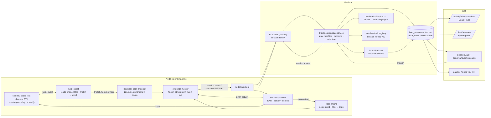

# FL-05 — Session status, attention & board · Implementation plan

> How [`spec.md`](./spec.md) gets built. Implementation detail belongs here, not in the spec (Constitution IX). Every path below was opened at this branch's base (`origin/develop` `e4334baf7`) before it was cited; paths under `apps/web/src/components/fleet/`, `packages/agent/src/fleet/needs-a-look/`, `apps/api/src/fleet-link/` and `apps/node/src/core/sessions/` are created by FL-01, FL-02 and FL-04 and are named as those plans name them.

**Epic ID:** `FL-05-session-status-board`
**Spec:** [`./spec.md`](./spec.md) · **Tasks:** [`./tasks.md`](./tasks.md)
**Status:** `Draft`
**Created:** 2026-10-18
**Last updated:** 2026-10-18

---

## 1. Architecture summary



## 2. Current state in the codebase

| Piece                                                                                     | Where                                                                                                                                                                                                                          | Reused as                                                                                                |
| ----------------------------------------------------------------------------------------- | ------------------------------------------------------------------------------------------------------------------------------------------------------------------------------------------------------------------------------ | -------------------------------------------------------------------------------------------------------- |
| Loopback server precedent (bind `127.0.0.1`, per-run nonce, peer re-check, limited paths) | `apps/node/src/core/executors/mcp-bridge.ts:1-60`                                                                                                                                                                              | the hook endpoint follows the same three defences                                                        |
| Fleet Claude Code argv (permission mode, MCP strictness, no hooks)                        | `apps/node/src/core/executors/model-cli.ts:563,634-672`                                                                                                                                                                        | the overlay is an additional `--settings` argument on the FL-04 launcher's argv                          |
| Codex `--ignore-user-config` and the private `CODEX_HOME`                                 | `apps/node/src/core/executors/model-cli.ts:100-116`, `apps/node/src/core/executors/agent-task.ts:1935-1945`, `apps/node/src/core/model-execution/isolated-home.ts:109-238`                                                     | Agent-session Codex notify lives in that overlay home; owner sessions use `-c notify=[…]`                |
| Fleet Run question file (headless only)                                                   | `apps/node/src/core/executors/agent-task-question.ts:15-25`                                                                                                                                                                    | untouched; sessions ask on screen                                                                        |
| Run row flags                                                                             | `packages/agent/src/entities/agent-run.entity.ts:52,349-350,361-378`                                                                                                                                                           | an Agent session's Run mirrors the session outcome; `attentionReason` stays lifecycle-only               |
| Inbox producer port and service (question filing, parking, `fleet-run` source)            | `packages/agent/src/inbox/inbox-producer.port.ts:108-152`, `packages/agent/src/inbox/inbox.service.ts:85-86,393-416,786-850`                                                                                                   | gains `sessionAttentionRaised` / `sessionAttentionCleared`; new source `fleet-session`                   |
| Inbox contracts (kinds, statuses, source types, decision kinds, source meta)              | `packages/contracts/src/inbox/inbox.types.ts:24-41,64,126`                                                                                                                                                                     | `InboxItemSourceType` gains `'fleet-session'`; source meta gains `sessionId`, `sessionTitle`, `provider` |
| Inbox entity (`options`, `sourceMeta`, `status`, unread)                                  | `packages/agent/src/entities/inbox-item.entity.ts:66-139` (`sourceType` is `varchar(24)`, `:93`)                                                                                                                               | no migration for the new source                                                                          |
| Inbox API (reply, read, archive) and My Decisions                                         | `apps/api/src/inbox/inbox.controller.ts:62-232`, `apps/web/src/components/inbox/InboxDecisionsClient.tsx:85-101`, `InboxFleetSource.tsx:17-53`                                                                                 | reply routes an answer to the session; a `fleet-session` provenance chip beside the `fleet-run` one      |
| HITL question shapes                                                                      | `packages/contracts/src/hitl/hitl-question.types.ts:32-105`                                                                                                                                                                    | the attention prompt/options reuse `HitlChoiceOption` and the kinds `choice · text · approval`           |
| Notification service, fanout event, channel facade                                        | `packages/agent/src/notifications/notification.service.ts:40,65,1002`, `apps/api/src/notifications/notification-fanout.listener.ts:30-76`, `packages/plugin/src/contracts/capabilities/notification-channel.interface.ts:5-21` | `notifyFleetSession*` producers; fanout unchanged                                                        |
| Core event catalogue (append-only)                                                        | `packages/agent/src/notifications/core-event-catalogue.ts:121-199`                                                                                                                                                             | three new keys                                                                                           |
| Attention budgets (AW-13)                                                                 | `packages/contracts/src/notifications/attention.types.ts:11-29`                                                                                                                                                                | reused as-is                                                                                             |
| Activity views and page                                                                   | `apps/web/src/app/[locale]/(dashboard)/activity/activity-views.ts:20-41`, `page.tsx:54-128`, `activity-client.tsx:229-246,630,755`                                                                                             | `sessions` view with key `n`; server-renders the board's first page                                      |
| Runs view state and grouping                                                              | `apps/web/src/components/runs/runs.shared.ts:27-30,63-101,146-157`, `RunsClient.tsx:40-72`                                                                                                                                     | the Sessions list reuses granularity parsing and `RUNS_POLL_INTERVAL_MS`                                 |
| Runs filter for attention                                                                 | `apps/api/src/agents/agents.controller.ts:432-500`                                                                                                                                                                             | precedent for the `attention=1` union; sessions filter by `state`                                        |
| Needs-a-look registry (FL-01), shape §4.6                                                 | `packages/agent/src/fleet/needs-a-look/` (FL-01 plan T-05: `NEEDS_A_LOOK_PRODUCERS`)                                                                                                                                           | `producers/session-needs-you.producer.ts`                                                                |
| Palette registry (screens, commands, sections)                                            | `apps/web/src/components/command-palette/registry/sections.ts:26-36,61-87,401-411`, `kinds.ts`, `types.ts:15-61`                                                                                                               | a `fleet-session` record kind and a "Needs you" section first                                            |
| Audit writer                                                                              | `packages/agent/src/fleet/fleet-audit.service.ts:55,105-127`                                                                                                                                                                   | `node.session.answer`                                                                                    |
| Session detail composer slot, card compact layout, link family                            | FL-04 plan §8, §6.3                                                                                                                                                                                                            | cards replace the composer; `SessionCard` completed here                                                 |

**What is missing** (spec §2.2): any mid-run status channel from a CLI; a state model with an evidence order; an attention identity; a board; a session-shaped notification; a producer for sessions on the hub.

## 3. Tech choices

| Concern               | Choice                                                                                                                                                                                                     | Why                                                                                                           |
| --------------------- | ---------------------------------------------------------------------------------------------------------------------------------------------------------------------------------------------------------- | ------------------------------------------------------------------------------------------------------------- |
| Hook endpoint         | Node `http.createServer` bound to `127.0.0.1:0`, token in `X-Ever-Works-Hook-Token`, peer address re-checked, body ≤ 64 KiB, always `204`                                                                  | Same three defences as the MCP bridge; never returns a decision, so a CLI cannot be steered by a bad response |
| Endpoint file         | `<config dir>/sessions/hook-endpoint.env` (`PORT=` / `TOKEN=`) and `hook-endpoint.cmd` on Windows, atomic rename, owner-only                                                                               | A hook script that re-reads it per invocation survives a node restart (spec FR-2)                             |
| Hook scripts          | `<config dir>/sessions/hooks/claude-hook.sh` / `.cmd`, `codex-notify.sh` / `.cmd`; `curl` with `--connect-timeout 0.5 --max-time 1.5`, fallback to `node -e` fetch when `curl` is absent; spool on failure | Portable, no dependency on the CLI's language; exits 0 within 2 s                                             |
| Claude Code injection | `--settings <overlay.json>` with `hooks` for `SessionStart UserPromptSubmit PermissionRequest PreToolUse(matcher AskUserQuestion) Stop SessionEnd Notification`, version-gated                             | R-6: a settings layer, never the user's file; the question tool's pre-use hook carries the question JSON      |
| Codex injection       | Owner: `-c notify=["<script>"]`; Agent: `notify` in the overlay home's `config.toml` (already private)                                                                                                     | R-6; Codex reports turn completion through notify                                                             |
| Rules engine          | JSON per provider validated with the contracts' zod-free guards; regex rules over screen / tail / title; evaluated on the daemon's `screen` op                                                             | Data, not code; each rule has a `why`; shipped inside the node package (spec §8b default)                     |
| Evidence merge        | Pure function `mergeEvidence(prev, evidence)` on the node and the same function on the platform (contracts)                                                                                                | Both sides agree; the platform is authoritative for the row                                                   |
| Attention identity    | `fleet-session:<sessionId>:<reason>:<promptId\|turnId>` string; `promptId` from the hook payload, else a per-session turn counter                                                                          | CONTRACTS §5.2                                                                                                |
| Decision              | Inbox item kind `approval` / `question`, `sourceType: 'fleet-session'`, `options` from `HitlChoiceOption[]`                                                                                                | R-12; My Decisions already renders Inbox items of those kinds                                                 |
| Notifications         | `NotificationService.notifyFleetSession*` → `NOTIFICATION_FANOUT_EVENT` → channel facade                                                                                                                   | Existing path; AW-13 budgets apply                                                                            |
| Board                 | Server-rendered first page in `activity/page.tsx`, client polling at `RUNS_POLL_INTERVAL_MS` plus the FL-02 relay bus's `fleet.session.changed` event when available                                       | Same posture as the Runs view; no new transport                                                               |
| Board move animation  | CSS view transitions keyed by session id                                                                                                                                                                   | No library                                                                                                    |

## 4. Data model

### 4.1 `FleetSession` additions (FL-05 slot)

`packages/agent/src/entities/fleet-session.entity.ts` gains exactly the five CONTRACTS §4.2 columns: `attention simple-json?` (`{ key, reason, prompt, options[], raisedAt, acknowledgedAt }` — the prompt id lives in the key; whether the prompt came from a hook or a rule is `lastEvidence.source`), `stateChangedAt PortableDate`, `hooks simple-json?` (`{ provider, injected: boolean, events[] }`; the full / partial / none label of spec FR-11 is derived from it), `lastEvidence simple-json?` (`{ source: 'hook'|'structured'|'rules'|'exit', at, detail }`, `detail` carrying the event name and sequence), `boundaryUntil PortableDate?` (the 5 s window after start/resume). The `simple-json` text type stands in for CONTRACTS "jsonb" as `modelThrottles` does, for SQLite. Indexes: `(userId, state, stateChangedAt)`, `(organizationId, state, stateChangedAt)`.

Migration `apps/api/src/migrations/1796050000000-AddFleetSessionAttention.ts`: five `ADD COLUMN`, two indexes, no drops; `down` reverses.

### 4.2 Existing entities — additions only

- `packages/contracts/src/inbox/inbox.types.ts`: `InboxItemSourceType` gains `'fleet-session'` (`:32-41`); `INBOX_SOURCE_META_FIELDS` gains `sessionId`, `sessionTitle`, `provider`, `attentionKey` (`:64`). The column is `varchar(24)` with no check (`inbox-item.entity.ts:93`) → no migration.
- `packages/agent/src/notifications/core-event-catalogue.ts`: append `fleet_session_needs_you`, `fleet_session_finished`, `fleet_session_failed` with their default channels and categories.
- `AgentRun`: no column; `FleetSessionStateService` mirrors `outcome` into the Run's status on `ended`.

### 4.3 Contracts

- `packages/contracts/src/fleet/fleet-sessions.types.ts` (FL-04 file) gains: `FleetSessionAttention`, `FleetSessionAttentionReason` (`question · permission · blocked · failed · finished`), `FleetSessionEvidence { source: 'hook'|'structured'|'rules'|'exit'; event; seq; at; payload? }` (source values as CONTRACTS §4.2 `lastEvidence`), `FleetSessionHookEvent` (the normalised hook shapes per provider), `mergeEvidence(prev, evidence): FleetSessionStateUpdate` (pure, shared by node and platform), `attentionKey(sessionId, reason, promptId)`, `FLEET_SESSION_IDLE_AFTER_MS = 30 * 60_000`, `FLEET_SESSION_RULE_QUIET_MS = 10_000`, `FLEET_SESSION_BOUNDARY_MS = 5_000`, `FLEET_SESSION_NOTIFY_DEDUPE_MS = 5_000`, `FLEET_SESSION_DONE_BOARD_HOURS = 24`.
- `packages/contracts/src/fleet/fleet-link.types.ts` (FL-02): node → platform `session.status { sessionId, evidence, state, outcome?, hooks }`, `session.attention { sessionId, attention | null }`; platform → node `session.answer { requestId, key, answer: { optionId? , text? } }` (CONTRACTS §3.3 already lists `session.answer`).
- `packages/contracts/src/fleet/fleet-session-rules.types.ts`: `FleetSessionRulesFile { version, provider, anchors, rules: [{ id, when: { region: 'screen'|'tail'|'title', match, quietMs? }, then: { state, reason?, options?: 'numbered'|'yes-no'|'allow-deny', answerKeys }, why }] }` + guard.

## 5. API surface

All in `apps/api/src/fleet/sessions/fleet-sessions.controller.ts` (FL-04's controller), same guards and audience rule.

| Method | Path                             | Body / query                                                          | Returns                                                                                | Auth / tier                                                                              | Errors                                                                                                                                                                                             |
| ------ | -------------------------------- | --------------------------------------------------------------------- | -------------------------------------------------------------------------------------- | ---------------------------------------------------------------------------------------- | -------------------------------------------------------------------------------------------------------------------------------------------------------------------------------------------------- |
| GET    | `/sessions`                      | `?view=board\|list&state&agentId&nodeId&kind&g=day\|week&date&cursor` | `{ columns: { needs_you[], working[], done[], idle[] } }` or paged list grouped        | audience filter                                                                          | —                                                                                                                                                                                                  |
| GET    | `/sessions/:id` (FL-04, widened) | —                                                                     | `FleetSessionView` now carrying `attention`, `stateChangedAt`, `hooks`, `lastEvidence` | audience                                                                                 | `not_found`                                                                                                                                                                                        |
| PATCH  | `/sessions/:id` (FL-04, widened) | `{ acknowledge: key }` (beside FL-04's `{ title }`)                   | `FleetSessionView`                                                                     | audience                                                                                 | `not_found`, `invalid` (key not current)                                                                                                                                                           |
| POST   | `/sessions/:id/answer`           | `{ key, optionId? , text? }`                                          | `202`                                                                                  | audience; throttle 60/min/user (default until CONTRACTS §10 lists API rates — FL-04 §8b) | `not_found`, `invalid` (unknown option / already answered / text where not allowed), `unreachable`, `kill_switch`, `permission_denied` (incl. Agents on permission prompts and R-32's setting off) |

Every path is a CONTRACTS §11.2 path: the attention rides the session view rather than its own
route, acknowledgement is a `PATCH` of the session, and hook health (bad tokens, spool depth,
endpoint up/down) reaches the computer page through the heartbeat's `daemon.hooks` counters on the
node view (`GET /nodes/:id`), not a route of its own.

The Inbox reply (`POST /api/inbox/:id/reply`, `inbox.controller.ts:178`) routes a `fleet-session` item's answer to `FleetSessionService.answer` through a new `InboxReplyRouter` branch beside the `fleet-run` one. DTOs under `apps/api/src/fleet/sessions/dto/`. No node-facing HTTPS endpoint: status rides the link.

## 6. Node side

### 6.1 Modules (`apps/node/src/core/sessions/`)

| Module                                     | Responsibility                                                                                                                                                                                                                                                                                                                                                                              |
| ------------------------------------------ | ------------------------------------------------------------------------------------------------------------------------------------------------------------------------------------------------------------------------------------------------------------------------------------------------------------------------------------------------------------------------------------------- |
| `hook-endpoint.ts`                         | `http` server on `127.0.0.1:0`; token minted per start; routes `POST /hook/claude`, `/hook/codex`; auth before body; peer re-check; body cap 64 KiB; always `204`; counters (ok, bad-token, unknown-session, malformed); emits normalised `FleetSessionHookEvent`                                                                                                                           |
| `hook-endpoint-file.ts`                    | Writes `hook-endpoint.env` / `.cmd` atomically (owner-only); rewritten at every start; removed at clean shutdown? **No** — kept, so scripts spool rather than fail when the node is down                                                                                                                                                                                                    |
| `hook-scripts.ts`                          | Materialises `hooks/claude-hook.sh\|.cmd`, `hooks/codex-notify.sh\|.cmd` (0700) once per start if content changed; the script sources the endpoint file, posts stdin with `X-Ever-Works-Hook-Token`, `X-Ever-Works-Session` (from `EVER_WORKS_SESSION_ID`), `X-Ever-Works-Provider`, and on failure appends `{ts, seq, body}` to `spool/<sessionId>.jsonl`, exiting 0 within 2 s            |
| `hook-spool.ts`                            | Drains `spool/*.jsonl` in order when the endpoint is up; caps 5 MB/file, 1 024 files, 7 days                                                                                                                                                                                                                                                                                                |
| `hook-overlay.ts`                          | Implements FL-04's `hookOverlayFor(kind, provider, sessionId)`: Claude → writes `overlays/<sessionId>/settings.json` (hooks block, version-gated through `model-cli-compat.ts`) and returns `args: ['--settings', path]`; Codex owner → `args: ['-c', 'notify=["<script>"]']`; Codex Agent → `files: { 'config.toml': notify }` into the overlay home; returns `hooks: full\|partial\|none` |
| `rules/<provider>.json`, `rules-engine.ts` | Loads and validates rules at start; every 2 s per session without hook evidence in 10 s, asks the daemon `screen { lines: 40 }` + title, evaluates regions, emits `FleetSessionEvidence { source: 'rules' }` with the rule id and answer keys                                                                                                                                               |
| `evidence-merger.ts`                       | `mergeEvidence` from contracts over hook, rule and daemon (`EXIT`, activity) evidence; 30 min idle timer per session; sends `session.status` / `session.attention` on channel 0 through FL-04's bridge                                                                                                                                                                                      |
| `answer-typist.ts`                         | `session.answer` → keys per provider and prompt kind (Claude permission: option digit + `\r`, Deny = `\x1b`; question: digit + `\r` or text + `\r`; Codex approval: `y`/`n` + `\r`; rule-raised: `answerKeys` from the rule) → daemon input; refuses `invalid` when the attention is no longer current                                                                                      |

### 6.2 OS matrix

| Concern       | Linux / macOS                                   | Windows                                                                 |
| ------------- | ----------------------------------------------- | ----------------------------------------------------------------------- |
| Endpoint file | `hook-endpoint.env` (`PORT=…`, `TOKEN=…`), 0600 | `hook-endpoint.cmd` (`set PORT=…`), `icacls` owner-only                 |
| Hook script   | `#!/bin/sh`, `curl` → `node -e` fallback        | `.cmd` calling `curl.exe` (present on Windows 10+) → `node -e` fallback |
| Spool         | `spool/<sessionId>.jsonl`                       | same                                                                    |
| Codex notify  | `-c notify=["/path/codex-notify.sh"]`           | `-c notify=["C:\\…\\codex-notify.cmd"]`                                 |

No shell-outs beyond the hook scripts the CLIs run. Consents: inherited from the session (owner `manage`, Agent `work`); the endpoint itself needs none (loopback, token). Capability tags: none new; the heartbeat `daemon` block (FL-04) gains `hooks: { badTokenLastMinute, spooled }`.

### 6.3 Hook event → evidence mapping

| Provider    | Event (as the CLI names it)                                                        | Evidence → state / reason / outcome                                                                                      | Payload kept (redacted)                              |
| ----------- | ---------------------------------------------------------------------------------- | ------------------------------------------------------------------------------------------------------------------------ | ---------------------------------------------------- |
| Claude Code | `SessionStart`                                                                     | `working`; `providerSessionId` set; `boundaryUntil = now + 5 s`                                                          | `session_id`, `source` (startup / resume / clear)    |
| Claude Code | `UserPromptSubmit`                                                                 | `working`; clears any open attention; marks a prompt inside the turn                                                     | first 200 chars of the prompt (card body "You:")     |
| Claude Code | `PermissionRequest`                                                                | `needs_you · permission`; options from the payload (Allow / Deny / allow for session when present)                       | `tool_name`, one-line `tool_input` summary           |
| Claude Code | `PreToolUse` (matcher `AskUserQuestion`)                                           | `needs_you · question`; numbered options and free-text allowance from the question JSON                                  | questions, options                                   |
| Claude Code | `Notification` (`permission_prompt`, `idle_prompt`)                                | confirms `needs_you` when no `PermissionRequest` arrived (older CLIs); `idle_prompt` → `done` if a turn ended            | `message`                                            |
| Claude Code | `Stop`                                                                             | `done · success` (unless inside `boundaryUntil` with no prompt → boundary done, no notification); last agent line        | `last_assistant_message` first 200 chars (card body) |
| Claude Code | `SessionEnd`                                                                       | `ended`; reason from the daemon's exit                                                                                   | `reason`                                             |
| Codex       | notify `agent-turn-complete`                                                       | `done · success`; last agent line                                                                                        | `last-assistant-message` first 200 chars             |
| Codex       | (no hook) approval / plan / trust prompt                                           | rules file → `needs_you · permission\|question\|blocked` with `answerKeys`                                               | the matched screen line                              |
| any         | daemon `activity` (output bytes)                                                   | `working` only when the previous state was `idle`; never changes `needs_you`/`done`                                      | —                                                    |
| any         | daemon `EXIT`                                                                      | outcome by exit evidence (`success` 0 after a stop or clean exit, `failure` ≠ 0, `unconfirmed` no code) → `ended (exit)` | exit code                                            |
| any         | platform `end`                                                                     | outcome `cancelled` (Agent sessions) → `ended (user)`                                                                    | —                                                    |
| any         | SIGINT seen by the CLI (`Stop` with interrupt flag / daemon sees `^C` then prompt) | outcome `interrupted`; no notification                                                                                   | —                                                    |

### 6.4 Answer key map (`answer-typist.ts`)

| Prompt                        | Allow / option               | Deny / cancel | Free text                |
| ----------------------------- | ---------------------------- | ------------- | ------------------------ |
| Claude Code permission (hook) | option digit + `\r`          | `\x1b`        | —                        |
| Claude Code question (hook)   | option digit + `\r`          | — (Esc keeps) | text + `\r` when allowed |
| Codex approval (rule)         | `y` + `\r`                   | `n` + `\r`    | —                        |
| Codex plan / menu (rule)      | digit + `\r`                 | `\x1b`        | —                        |
| Rule-raised, generic          | from the rule's `answerKeys` | from the rule | from the rule            |

Keys are typed only when the attention key is still current on the node; otherwise `invalid "Already answered"`.

### 6.5 Link messages

1. Node → platform `session.status { sessionId, evidence, state, outcome?, hooks }` on every merged change (channel 0).
2. Node → platform `session.attention { sessionId, attention | null }` when attention is raised or cleared on the node (a prompt answered in the terminal clears it there first).
3. Platform → node `session.answer { requestId, key, answer }` → `answer-typist` → `{ requestId }` or `{ error: { code: 'invalid', hint: 'Already answered' } }`.
4. Kill switch: FL-04's `block-input` also blocks answers (`kill_switch` is raised platform-side first).

## 7. Plugin surface

None. Notifications go through the existing `notification-channel` capability and facade; no new channel plugin, no plugin doc change.

## 8. Web surface

- **Routes:** `apps/web/src/app/[locale]/(dashboard)/activity/activity-views.ts` — `ACTIVITY_VIEWS` gains `'sessions'` (`:20`), `ACTIVITY_VIEW_KEYS` gains `n` (`:36-41`); `page.tsx` server-renders the board/list first page (`:84-128` batch) through `fleetSessionsAPI.board|list`; `activity-client.tsx` gains the toggle entry (`:630`) and mounts `SessionsBoardClient`. Fleet → Sessions: `SessionsByComputer` is registered with FL-01's `registerHubTab('sessions', …)` — FL-01 owns the route file `fleet/sessions/page.tsx` and the constant `DASHBOARD_FLEET_SESSIONS`, which this epic reuses and does not redefine. This epic adds `DASHBOARD_ACTIVITY_SESSIONS = '/activity?view=sessions'` in `apps/web/src/lib/constants.ts` (beside `:119-123`; CONTRACTS §11.1).
- **Components** under `apps/web/src/components/fleet/sessions/`: `SessionCard.tsx` (completed anatomy: body lines, attention box, tint, glyph, unread bold, status-source note), `SessionStateGlyph.tsx`, `SessionAttentionBox.tsx` (card-embedded approval/question), `SessionApprovalCard.tsx` and `SessionQuestionCard.tsx` (detail; replace `SessionComposer`), `SessionsBoardClient.tsx`, `SessionsBoard.tsx` (four columns, view transitions), `SessionsList.tsx` (groups by Agent × day/week via `runs.shared.ts` parsers), `SessionsFilters.tsx`, `SessionsByComputer.tsx`, `SessionsEmptyState.tsx`, `sessions-status.shared.ts` (pure: glyph map, tint rule, elapsed rule, wording, dedupe window, boundary rule, option key hints).
- **Inbox:** `apps/web/src/components/inbox/InboxSessionSource.tsx` (the "From a session" chip + provenance, beside `InboxFleetSource.tsx`); `apps/web/src/lib/api/inbox.shared.ts` gains `isSessionAttention(item)`.
- **Needs a look:** FL-01's renderer shows the producer's rows; **Answer** deep-links to the detail with the card focused.
- **Palette:** `apps/web/src/components/command-palette/registry/kinds.ts` gains the `fleet-session` record kind; `sections.ts` gains a "Needs you" section built first when any session is waiting (digit shortcuts 1–6), then recents ordered done → idle.
- **BFF:** `apps/web/src/app/api/fleet/sessions/[id]/answer/route.ts`; acknowledgement goes through FL-04's `…/[id]/route.ts` (`PATCH`), the board through FL-04's `…/sessions/route.ts` with `?view=board`; client `apps/web/src/lib/api/fleet-sessions.ts` (FL-04 file) gains `board`, `list`, `answer`, `acknowledge`.
- **i18n groups** (`fleet.*`): `fleet.sessions.states`, `fleet.sessions.card`, `fleet.sessions.attention` (approval/question cards, Esc hints), `fleet.sessions.board` (columns, empties, toggle), `fleet.sessions.list`, `fleet.sessions.byComputer`, `fleet.sessions.statusSource`, `fleet.sessions.hookHealth`, `fleet.sessions.notifications` (wording templates), `fleet.sessions.palette`, `dashboard.inbox.sessionSource`, `dashboard.activity.viewToggle.sessions`, `fleet.errors.*`. The load-bearing strings:

```
fleet.sessions
  states.working           "working"        states.needsYou "needs you"     states.done "done"
  states.idle              "idle"           states.ended "ended"            states.waiting "waiting {duration}"
  states.outcomeSuccess    "success"        states.outcomeFailure "failed"  states.outcomeCancelled "cancelled"
  states.outcomeInterrupted "stopped"       states.outcomeUnconfirmed "no result"
  card.you                 "You: {text}"    card.agent "{agent}: {text}"    card.exited "exited with code {code}"
  card.unconfirmed         "{node} restarted before this finished"
  card.doneAgo             "done {relative}" card.fromScreen "from the screen"
  attention.permission     "Allow {tool}?"  attention.allow "Allow"  attention.deny "Deny"  attention.escDeny "Esc = Deny"
  attention.question       "{who} asks: {question}"   attention.orType "or type an answer"   attention.escKeep "Esc keeps the prompt"
  attention.alreadyAnswered "Already answered in the terminal"
  attention.unreachable    "{node} is unreachable — the answer will not be sent"
  attention.killSwitch     "Paused by the fleet stop — answers are not sent"
  attention.peopleOnly     "Permission prompts are answered by people"
  board.needsYou           "Needs you"      board.working "Working"   board.done "Done"   board.idle "Idle"
  board.emptyNeedsYou      "Nothing needs you"   board.emptyWorking "Nothing working"
  board.emptyDone          "Nothing finished today"  board.emptyIdle "Nothing idle"
  board.empty              "No sessions yet. Start one on a computer and it shows up here with what it needs from you."
  board.toggleBoard        "Board"          board.toggleList "List"
  byComputer.manageOnly    "Agents need work switched on here"
  byComputer.sessions      "{count} sessions"
  statusSource.hooks       "Status from {provider}'s hooks"
  statusSource.partial     "Status from the screen for permission prompts — update {provider} on {node} for exact status"
  statusSource.codex       "Status from the screen — Codex reports only when a turn ends"
  statusSource.notifyReplaced "Your own Codex notify command is not run in this session"
  statusSource.shell       "Shell — no agent status"
  statusSource.noTokens    "Status spends no model tokens"
  hookHealth.badToken      "Something on {node} is posting to the hook endpoint with a bad token ({count} in the last minute)"
  hookHealth.spooled       "{count} hook events are spooled on {node} and will be applied when the node is up"
  notifications.needsYou   "{who} needs you on {node} — {prompt}"
  notifications.finished   "{who} finished on {node} — {title}"
  notifications.failed     "{who} failed on {node} — {reason}"
  notifications.open       "Open session"
  needsALook.waiting       "{who} waiting for you on {node} · \"{prompt}\""
  needsALook.unconfirmed   "{node} restarted — {count} sessions ended without a result"
  needsALook.answer        "Answer"
  palette.needsYou         "Needs you"      palette.recent "Recent sessions"
  a11y.card                "{who}, {title}, {state}, on {node}"
```

- **Playwright:** `apps/web/e2e/flow-fleet-sessions-status.spec.ts`, `flow-fleet-sessions-attention.spec.ts`, `flow-fleet-sessions-board.spec.ts`, `flow-fleet-sessions-decisions.spec.ts` (My Decisions ↔ session), `flow-fleet-sessions-a11y-board.spec.ts`.

## 9. Agent / MCP / CLI surface

- **Agent tools** (`packages/agent/src/fleet/agent-fleet-session-tools.ts`, FL-04 file): `fleet_sessions_question` (`readOnly: true` — prompt, options, reason, source), `fleet_sessions_answer` (`destructive: false`, `confirmationClass: 'confirm'` — FL-19 catalogue §9.1, so a tool call carries `confirm: true` per CONTRACTS §2.2; refuses `permission` reasons with `permission_denied` and the hint "permission prompts are answered by people"; answers another session's question only when the calling Agent's "may answer other sessions" setting is on (CONTRACTS R-32); requires the AW-15 grant and the Node's `sessions` audience for the Agent's owner).
- **MCP:** both added to `apps/mcp/src/openapi-tools/whitelist.ts` beside FL-04's entries; full parity FL-19.
- **CLI:** `apps/cli/src/commands/fleet/session/question.ts` and `answer.ts` (`ever-works fleet session question <id> [--json]`, `ever-works fleet session answer <id> <option|--text "…">`, exit `0/1/2`).

## 10. Background jobs

| Task                                                                    | When               | What                                                                                                                                                                                                                                                                                                                                                                           | Idempotency                                       |
| ----------------------------------------------------------------------- | ------------------ | ------------------------------------------------------------------------------------------------------------------------------------------------------------------------------------------------------------------------------------------------------------------------------------------------------------------------------------------------------------------------------ | ------------------------------------------------- |
| `packages/tasks/src/tasks/trigger/fleet-session-status-sweeper.task.ts` | cron `6/5 * * * *` | Platform-side floor for idle decay (node timers are primary): `working\|done` with `lastActivityAt` > 30 min → `idle`; `needs_you` with a cleared node-side attention → reconcile; done cards older than 24 h leave the board query; a session's Decision expires when the session is `ended` and is marked stale after 24 h unanswered — never auto-answered (CONTRACTS R-12) | `UPDATE … WHERE state = … AND lastActivityAt < …` |
| `notification-channel-delivery.task.ts` (existing)                      | existing           | delivers the new events                                                                                                                                                                                                                                                                                                                                                        | existing                                          |

## 11. Security & permissions

- **Threats.** (a) Another local process posting fake status — token per start, loopback + peer check, unknown-session drop; fake status can at worst mislabel a card, never type into a session (answers originate platform-side and are audience-checked). (b) A malicious hook response steering the CLI — the endpoint returns `204` with an empty body, never a decision. (c) An Agent approving its own or another Agent's tool permission — `fleet_sessions_answer` refuses `permission` reasons unconditionally. (d) Prompt text leaking secrets — hook payloads and screen text pass `redactSecrets` on the node before any card, Inbox item or notification sees them; free-text answers are typed into the PTY and never persisted.
- **What the node refuses:** hook events without a valid token or for unknown sessions; `session.answer` for a key that is not current; answers while input is blocked (kill switch).
- **Platform checks:** audience on every route; Agents additionally AW-15 grants; rate limit 60/min answers.
- **Audit:** `node.session.answer` (key, reason, optionId, requester, source `card|detail|inbox|decisions|tool|cli`); acknowledgements are not audited (reads).
- **No `@Public()` endpoint is added.**

## 12. Observability

- Counters (node health → heartbeat `daemon.hooks`): hook events by provider/event, bad tokens, unknown sessions, spooled, rule hits by rule id, idle decays.
- Platform analytics: `fleet_session_state_changed {from, to, source}`, `fleet_session_attention_raised {reason, source}`, `fleet_session_answered {source}`, `fleet_session_notification {event, delivered|deduped|suppressed|boundary}`.
- Activity log: `fleet.session.needs_you`, `fleet.session.answered`.

Failure modes:

| Failure                              | Behaviour                                                                                         |
| ------------------------------------ | ------------------------------------------------------------------------------------------------- |
| Hook endpoint down (node restarting) | Script exits 0 in ≤ 2 s and spools; events applied in order on return; no state changes meanwhile |
| Endpoint port/token changed          | Scripts re-read the endpoint file per invocation; nothing to do                                   |
| Bad token flood                      | Counted; surfaced on the computer page after 20/min; never affects sessions                       |
| Rules file invalid                   | Node start fails validation naming the rule id; a release fixes it                                |
| CLI version lacks a hook             | Overlay omits it; `hooks: partial`; status-source note; rules cover the prompt                    |
| Hook payload shape unknown           | Event ignored and counted; nothing inferred                                                       |
| Link down                            | Attention stays visible; answers refused `unreachable`; prompt kept; state unchanged              |
| Answer races a terminal answer       | Node-side attention already cleared → `invalid "Already answered"`; nothing typed twice           |
| Platform and node disagree           | Platform re-derives from the node's next `session.status`; sequence numbers settle duplicates     |
| Notification facade not configured   | In-app record written; channel fanout skipped (as today)                                          |
| AW-13 budget exhausted               | In-app written; email/channel held as AW-13 does; the card still shows the prompt                 |
| Machine reboot                       | FL-04 reports `lost`; outcome `unconfirmed`; dashed glyph; needs-a-look row for the Node          |

## 13. Phased rollout (flag `FLEET_SESSIONS_ENABLED`, shared with FL-04; default off in production)

- **P1 — Status pipeline.** Contracts (evidence, merge, attention types, rules schema), migration, endpoint + file + scripts + spool, overlay for Claude and Codex, evidence merger, platform state service, mirrored Run outcome, completed `SessionCard`, status-source notes, hook-health on the computer page, sweeper. Green = FL-04 suites unchanged; `status` e2e green.
- **P2 — Attention.** Attention keys and ack, Inbox producer additions and reply routing, approval/question cards, answer typist, rules engine with Codex and Claude fixtures, notifications (three events, wording, dedupe, boundary, focus suppression), `session-needs-you` producer, Agent tools + MCP + CLI verbs. Green = `attention` + `decisions` e2e.
- **P3 — Board and lists.** Activity view `sessions` (board + list), Fleet → Sessions by computer, palette "Needs you" section, board housekeeping. Green = `board` + `a11y-board` e2e.

## 14. Test plan

- **Contracts (Vitest):** `packages/contracts/src/fleet/__tests__/fleet-session-evidence.spec.ts` — `mergeEvidence` truth table (precedence, 10 s override guard, idle at 30 min ± 1 ms, boundary window, every transition in CONTRACTS §5.1, shell never `needs_you|done`); `fleet-session-rules.spec.ts` — schema guard rejects a rule without `why` or with `then.state: 'done'`; `inbox.spec.ts` extended for the new source.
- **Agent package (Jest):** `packages/agent/src/fleet/sessions/__tests__/fleet-session-state.service.spec.ts` (apply status/attention events idempotently by seq; Run mirroring; Decision/notice creation by reason; ack semantics; answer refusals), `packages/agent/src/inbox/__tests__/inbox.service.session.spec.ts` (item per key, update not duplicate, close on clear, reply routing), `packages/agent/src/notifications/__tests__/notification.service.fleet-session.spec.ts` (wording, 5 s dedupe, boundary, interrupted/cancelled silent, shell silent), `packages/agent/src/fleet/__tests__/agent-fleet-session-tools.spec.ts` (permission refusal).
- **API (Jest):** `fleet-sessions.controller.spec.ts` extended (answer codes, audience, throttle, Agent on permission), `packages/agent/src/fleet/needs-a-look/producers/__tests__/session-needs-you.producer.spec.ts`, `apps/api/src/inbox/inbox.controller.spec.ts` extended (reply to a `fleet-session` item).
- **Node (Vitest):** `apps/node/src/core/sessions/__tests__/hook-endpoint.spec.ts` (loopback only, token before body, 204 always, counters, body cap), `hook-endpoint-file.spec.ts` (atomic, owner-only, rewritten per start), `hook-scripts.spec.ts` (script content per OS; a run with the endpoint down exits 0 ≤ 2 s and spools), `hook-spool.spec.ts` (order, caps, drain), `hook-overlay.spec.ts` (Claude overlay JSON per version; Codex owner argv; Codex Agent file; user files never written — a sentinel file assertion), `rules-engine.spec.ts` (fixtures `__fixtures__/transcripts/{claude,codex}-*.txt`: permission, question, update prompt, trust prompt; never `done`), `evidence-merger.spec.ts`, `answer-typist.spec.ts` (keys per provider/kind; stale key refused).
- **Web unit (Vitest):** `sessions-status.shared.unit.spec.ts`, `SessionCard.unit.spec.tsx` (anatomy, glyphs, tint, unread bold, status note), `SessionApprovalCard.unit.spec.tsx` / `SessionQuestionCard.unit.spec.tsx` (primary option, Esc behaviour, composer swap), `SessionsBoard.unit.spec.tsx` (columns, order, counts, empties), `SessionsList.unit.spec.tsx` (grouping), `activity-views.unit.spec.ts` (new view and key), palette `sections.unit.spec.ts` extended ("Needs you" first).
- **E2E (Playwright):** the five specs in §8.

## 15. Risks

| Risk                                                      | Likelihood | Impact | Mitigation                                                                                                                                   |
| --------------------------------------------------------- | ---------- | ------ | -------------------------------------------------------------------------------------------------------------------------------------------- |
| CLI hook events change names or payloads between releases | High       | Medium | Version-gated overlay via `model-cli-compat.ts`; unknown events ignored; rules file covers gaps; status-source note tells the user to update |
| Codex permission prompts visible only on screen           | High       | Medium | Rules file with captured fixtures; the card says "from the screen"; answer keys from the rule                                                |
| Double answers (terminal + card)                          | Medium     | Low    | Attention cleared on node first; stale key → `invalid "Already answered"`                                                                    |
| Hook script blocking a CLI when the node is slow          | Medium     | High   | `--max-time 1.5`, spool, exit 0 always; tested with the endpoint down                                                                        |
| Notification noise                                        | Medium     | Medium | 5 s dedupe, boundary rule, interrupted/cancelled silent, shell silent, focus suppression, AW-13 budgets                                      |
| Platform and node disagree on state                       | Low        | Medium | One pure `mergeEvidence` in contracts used by both; platform authoritative; sequence numbers                                                 |
| Overlay path with spaces/Unicode on Windows               | Low        | Low    | Quoted argv; overlay under the node config dir, not the user's folder                                                                        |
| Agents approving tool permissions                         | Low        | High   | Unconditional refusal in the tool and the controller                                                                                         |

## 16. Constitution reconciliation

- **I — Plugin-first:** no external integration; channel plugins reused through the facade.
- **II — Capability-driven:** channels resolved by the notification facade; no channel id in core.
- **III — Source-of-truth repos:** nothing but redacted previews and option ids stored.
- **IV — Job runtime:** sweeper is a scheduled task; API answers `202` and never blocks on the node.
- **V — Forward-only migrations:** one additive migration from the FL-05 slot.
- **VI — Tests:** §14, with transcript fixtures for rules.
- **VII — Secrets:** redaction on the node; free text never persisted; endpoint token never leaves the machine.
- **VIII — Plugin counts:** untouched.
- **IX — Behaviour-first:** spec has no implementation.
- **X — Backwards compatibility:** additive unions and one nullable column set.

## 17. References

- Spec: [`./spec.md`](./spec.md) · Tasks: [`./tasks.md`](./tasks.md)
- Program: [Fleet README](../README.md) · [CONTRACTS](../CONTRACTS.md) · [CAPABILITY-MAP](../CAPABILITY-MAP.md)
- Sibling plans: [FL-04](../FL-04-sessions-on-computers/plan.md) (daemon, launcher seam, link bridge, detail, card compact layout), [FL-02](../FL-02-node-link/plan.md), [FL-01](../FL-01-fleet-hub/plan.md) (needs-a-look registry, hub tabs)
- Agent Workspace: [AW-03 plan](../../agent-workspace/AW-03-decision-queue/plan.md), [AW-13 plan](../../agent-workspace/AW-13-attention-controls/plan.md), [AW-09 plan](../../agent-workspace/AW-09-runs-receipts/plan.md)
- Constitution: `.specify/memory/constitution.md`
