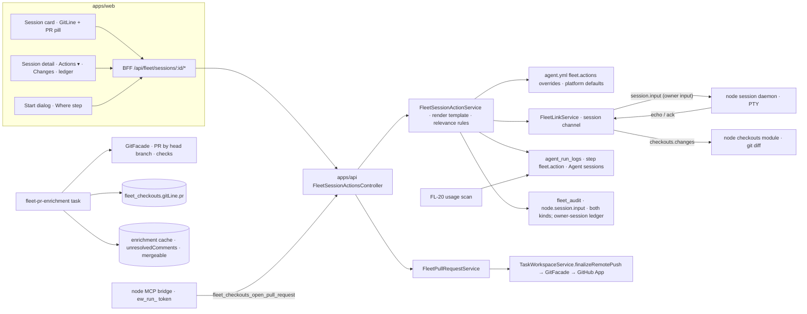

# FL-06 — Session git & actions · Implementation plan

> How [`spec.md`](./spec.md) gets built. Implementation detail belongs here, not in the spec
> (Constitution IX). Every path below was opened at `origin/develop` `e4334baf7` before it was cited.

**Epic ID:** `FL-06-session-git-actions`
**Spec:** [`./spec.md`](./spec.md) · **Tasks:** [`./tasks.md`](./tasks.md)
**Status:** `Draft`
**Created:** 2026-10-18
**Last updated:** 2026-10-18

---

## 1. Architecture summary



Back-flow: the daemon echoes the typed prompt on the session channel (FL-04's `DATA` frames), the
action service marks the ledger row `delivered` when the echo arrives within 5 s, else
`undelivered`; FL-14's git-line refresh (every 60 s while `working`, once on stop) updates the
checkout row, the enrichment task adds `pr`, and the card re-renders from the stored snapshot.

## 2. Current state in the codebase

| Piece                                                                             | Where (verified at HEAD)                                                                                                                                              | Reused how                                                                                                                                                            |
| --------------------------------------------------------------------------------- | --------------------------------------------------------------------------------------------------------------------------------------------------------------------- | --------------------------------------------------------------------------------------------------------------------------------------------------------------------- |
| PR + merge-policy tail every finalize uses                                        | `packages/agent/src/tasks-domain/task-workspace.service.ts:1842` (`finalizeRemotePush`), `:1993` (`recordRemotePush`)                                                 | `FleetPullRequestService` calls `finalizeRemotePush` for a Task-bound session and a sibling `openForBranch` for a free session; nothing new talks to GitHub directly. |
| Reconciler: how a node run's branch becomes a PR; `agentCanOpenPullRequests` gate | `apps/api/src/fleet/fleet-agent-task-reconciler.service.ts:100-135, :457, :528`                                                                                       | Same permission read (`agent.permissions.canOpenPullRequests`) and same Task bookkeeping (`in_review`, chat post).                                                    |
| Steering appends to `pendingInput` that no node reads                             | `apps/api/src/fleet/fleet-agent-task-reconciler.service.ts:725-728`; `packages/agent/src/agents/run-steering.service.ts:207`                                          | Untouched; sessions use FL-04's `session.input` instead.                                                                                                              |
| Merge policy contract (`allowAgentMerge`, `protectedBranches`, scopes)            | `packages/contracts/src/policy/merge-policy.types.ts:18-57`; `packages/agent/src/policy/merge-policy.service.ts`                                                      | `protectedBranches` feeds the relevance rules; FL-06 never merges.                                                                                                    |
| Task branch rule and columns                                                      | `packages/agent/src/tasks-domain/task-isolation.ts:43-56` (`taskBranchName`); `packages/agent/src/entities/task.entity.ts:212-232`                                    | Task-born sessions reuse `task.branchRef`; FR-4.                                                                                                                      |
| Run ↔ fleet CLI session (`sessionId`, `nodeId`, `provider`), `workspaceMeta`      | `packages/agent/src/entities/agent-run.entity.ts:33-44, :269, :283-300`                                                                                               | An Agent session's ledger lives on its Run; `fleetSessionId` (FL-04) joins Run ↔ Session. Owner sessions have no Run (CONTRACTS R-1).                                 |
| Per-run structured log rows                                                       | `packages/agent/src/entities/agent-run-log.entity.ts:21-34` (`runId` uuid not null; `level` `'INFO' \| 'WARN' \| 'ERROR'`; `step` varchar 80; `metadata` simple-json) | Agent-session ledger rows `step: 'fleet.action'` — no new table. Owner-session ledger = `fleet_audit` rows (spec §8b default).                                        |
| Agent files (`agent.yml` among five) and their service                            | `packages/agent/src/entities/agent.entity.ts:204-209`; `packages/agent/src/agents/agent-file.service.ts`; `packages/agent/src/agents/types.ts`                        | Additive optional `fleet` block in the `agent.yml` schema; editor pill already exists (`apps/web/src/app/[locale]/(dashboard)/agents/[id]/instructions/page.tsx:5`).  |
| Run-scoped MCP token accepted by the API                                          | `packages/agent/src/fleet/fleet-run-credential.service.ts:34-71` (`ew_run_…`); `apps/api/src/auth/guards/auth-session.guard.ts`                                       | The Agent session's bridge call to open a PR authenticates with the run token it already holds.                                                                       |
| Node MCP bridge (loopback proxy, `tools/call` counting)                           | `apps/node/src/core/executors/mcp-bridge.ts:68-95, :315-328`                                                                                                          | Unchanged; the new tool is an API route the bridge already proxies.                                                                                                   |
| Diff rendering rules (text only, `<pre>`, link out)                               | `apps/web/src/components/tasks/TaskDiffSheet.tsx:11-24`                                                                                                               | `ChangesPanel` follows the same rules over a node-supplied diff.                                                                                                      |
| PR pill tones and URL validation                                                  | `apps/web/src/components/tasks/TaskPrPill.tsx:17-30` (`safePrUrl`)                                                                                                    | `PrPill` reuses `safePrUrl` and the tone map.                                                                                                                         |
| Git line renderer                                                                 | FL-14 `apps/web/src/components/fleet/checkouts/GitLine.tsx`                                                                                                           | Gains the `pr` slot.                                                                                                                                                  |
| Session card anatomy                                                              | FL-05 (R-22) `apps/web/src/components/fleet/sessions/SessionCard.tsx`                                                                                                 | Footer slots `gitLine`, `prPill`, `cleanUp`.                                                                                                                          |
| Git facade (PR reviews, review comments, merge)                                   | `packages/agent/src/facades/git.facade.ts:172, :328-355`                                                                                                              | Unresolved review-comment count and PR lookup for enrichment.                                                                                                         |

Missing today: see spec §2.2 — no git line on sessions, no action prompts, no PR outside a run's
end, no uncommitted view, no per-action cost, no clean-up affordance.

## 3. Tech choices

| Concern           | Choice                                                                                                                                                 | Why                                                                                                           |
| ----------------- | ------------------------------------------------------------------------------------------------------------------------------------------------------ | ------------------------------------------------------------------------------------------------------------- |
| Template storage  | Code defaults in `packages/contracts/src/fleet/fleet-session-actions.types.ts`; overrides in `agent.yml` `fleet.actions.<id>` and `fleet.branchPrefix` | Part of how the Agent works; no table, no slot (CONTRACTS §13 has none for FL-06); owner sessions edit inline |
| Rendering         | Pure `renderActionPrompt(template, ctx)`; placeholders `{branch} {base} {pull} {task}`; unknown placeholders left verbatim                             | Testable; no template engine                                                                                  |
| Delivery          | FL-04 `session.input` with `source: 'action'` and `actionId`; echo confirms within 5 s                                                                 | Same pipe a person types through; the agent's own permission prompts stay in force                            |
| Relevance         | Pure `availableActions(ctx)` over `{ hasCheckout, provider, branch, defaultBranch, protected[], pr, unresolvedComments, mergeable, behind, state }`    | One truth table; UI and API share it                                                                          |
| PR enrichment     | Scheduled task + `github.pr` ingest nudge; `GitFacade` lookup by head; 60 s cache per checkout                                                         | No webhooks on the node; bounded GitHub calls                                                                 |
| PR opening        | `finalizeRemotePush` (Task-bound) / new `openForBranch` beside it (free session), both via `GitFacade`                                                 | One tail, same permission and merge policy                                                                    |
| Changes view      | `checkouts.changes` on the machine channel → `git status --porcelain=v2` + `git diff` (staged + unstaged) capped                                       | Read-only; text-only render                                                                                   |
| Cost              | Ledger row per action; FL-20 attributes tokens between consecutive `fleet.action` marks (by `providerSessionId`)                                       | No new table; honest "unknown" until the scan                                                                 |
| Branch uniqueness | Platform check over `fleet_checkouts.branch` for the remote (incl. archived) + node `git ls-remote --heads` at create                                  | No retired-names table                                                                                        |

## 4. Data model

**No migration.** CONTRACTS §13 reserves no slot for FL-06 and none is needed.

- `FleetSession.checkoutId` (FL-04/§4.2) — set at start from the Where step.
- `FleetCheckout.gitLine.pr` (FL-14/§4.7) — written by the enrichment task.
- `FleetCheckout.gitLine.pr` carries only the CONTRACTS §4.7 fields (`number, state, checks, url`).
  `unresolvedComments` and `mergeable`, which the relevance rules need, are **not** written into the
  stored snapshot: the enrichment service keeps them in its per-checkout cache (Valkey when
  `REDIS_URL` is set, else per process; 60 s TTL) and `availableActions` reads the cache, fetching
  once through the git facade on a miss.
- `agent_run_logs` rows (Agent sessions only — `runId` is not nullable): `step = 'fleet.action'`,
  `level = 'INFO'`, `metadata = { actionId, sessionId, checkoutId, sentAt, deliveredAt?,
undelivered?, prNumber?, tokens?, costCents? }` — written by the action service;
  `tokens`/`costCents` patched by FL-20.
- Owner sessions (no Run): the ledger is read from the session's `node.session.input` audit rows
  (`details.action`, `details.promptPreview`, `outcome: 'sent'`); delivery is shown live from the
  echo and not persisted; cost reads "session total only" (`FleetSession.costCents`, FL-20). See
  spec §8b.
- `agent.yml` additive block (Zod, all optional):

    ```yaml
    fleet:
        branchPrefix: nina # default: agent slug
        actions:
            commit: '…{branch}…'
            commitPush: '…'
            pullRequest: '…{base}…{pull}…'
            review: '…'
            fixComments: '…{pull}…'
            resolveConflicts: '…{base}…{branch}…'
            recap: '…'
    ```

- Contracts `packages/contracts/src/fleet/fleet-session-actions.types.ts`: `FleetSessionActionId`
  (`commit · commitPush · pullRequest · review · fixComments · resolveConflicts · recap`),
  `FLEET_SESSION_ACTION_IDS`, `FLEET_SESSION_ACTION_DEFAULTS` (the seven texts from spec §1/§5),
  `FleetSessionActionContext`, `FleetSessionActionAvailability { id, available, reason? }`,
  `FleetSessionActionLedgerEntry`, `FleetSessionActionSendRequest { actionId, prompt }`,
  `FleetCheckoutChangesRequest { checkoutId, maxBytes }` / `…Reply { files[], truncated, omittedFiles, omittedBytes }`,
  `FleetOpenPullRequestRequest { checkoutId?, title, body, draft? }`,
  `FLEET_SESSION_ACTION_RATE = { perMinute: 10, minSpacingMs: 2000 }`, `FLEET_CHANGES_MAX_BYTES = 1_048_576`,
  `FLEET_CHANGES_MAX_FILE_BYTES = 65_536`. Additive `pr` resolution types for the git line.

## 5. API surface

All under `/api/fleet`, `FleetEnabledGuard` + `FLEET_SESSIONS_ENABLED`; errors per CONTRACTS §8.

| Method | Path                                     | Body / query                                                                                                                                     | Returns                                    | Family / class                                | Errors                                                                                                                                                  |
| ------ | ---------------------------------------- | ------------------------------------------------------------------------------------------------------------------------------------------------ | ------------------------------------------ | --------------------------------------------- | ------------------------------------------------------------------------------------------------------------------------------------------------------- |
| GET    | `/sessions/:id/actions`                  | —                                                                                                                                                | `{ actions: Availability[], templates }`   | `view`                                        | `not_found`                                                                                                                                             |
| POST   | `/sessions/:id/actions`                  | `{ actionId, prompt }`                                                                                                                           | `202 { ledgerId }`                         | `sessions` · `plain`                          | `invalid` (not relevant), `busy` (2 s), `limit_exceeded` (10/min), `unreachable`, `consent_missing`, `permission_denied`, `kill_switch`                 |
| GET    | `/sessions/:id/actions/ledger`           | —                                                                                                                                                | `FleetSessionActionLedgerEntry[]`          | `view`                                        |                                                                                                                                                         |
| POST   | `/sessions/:id/actions/:ledgerId/resend` | —                                                                                                                                                | `202`                                      | `sessions` · `plain`                          | `invalid` (was delivered)                                                                                                                               |
| GET    | `/checkouts/:id/changes`                 | `?maxBytes`                                                                                                                                      | `FleetCheckoutChangesReply`                | `checkouts` · `plain` (read)                  | `unreachable`, `consent_missing`, `kill_switch`                                                                                                         |
| POST   | `/checkouts/:id/pull-request`            | `FleetOpenPullRequestRequest`                                                                                                                    | `{ number, url, state, updated: boolean }` | `checkouts` · `plain`                         | `permission_denied` (Agent permission or audience), `invalid` (default branch / not pushed), `operation_failed` (provider), `kill_switch`               |
| GET    | `/checkouts/:id/pull-request`            | —                                                                                                                                                | `pr \| null` (fresh enrichment)            | `view`                                        |                                                                                                                                                         |
| DELETE | `/checkouts/:id` (FL-14's route, reused) | `{ confirm: true }` or `{ confirmName }` (CONTRACTS §2.2); a first call without them returns `confirmation_required` with FL-14's delete preview | `202 { operationId }`                      | `checkouts` · `confirm`/`confirm-destructive` | FL-14 delete codes; FL-06 adds `invalid` "the pull request is not merged or closed yet" when called as Clean up (`?cleanUp=1`) and the FR-25 gate fails |
| GET    | `/sessions/branch-proposal`              | `?nodeId&checkoutId&agentId&firstMessage&taskId`                                                                                                 | `{ branch, suffixed, reason }`             | `view`                                        | `unreachable` (ls-remote)                                                                                                                               |

Clean up adds no route: the button calls FL-14's delete preview and `DELETE /checkouts/:id` with
`cleanUp=1`, which makes FL-14's handler apply the FR-25 gate first (worktree, PR merged/closed,
no live session); the branch is always kept (FL-14 deletes the worktree folder, never the
branch). The paths in this table that CONTRACTS §11.2 does not list (`/sessions/:id/actions*`,
`/checkouts/:id/pull-request`, `/sessions/branch-proposal`) are the CONTRACTS change raised in
spec §8b; the builder adds them to §11.2 in the same PR.

`POST /checkouts/:id/pull-request` accepts the run-scoped `ew_run_…` bearer the Agent session's
MCP bridge holds (the same auth path the run token already passes in
`apps/api/src/auth/guards/auth-session.guard.ts`), scoped to the session's own checkout. Rate tier
`long` 30/min for a person; 10/min per run token.

DTOs: `apps/api/src/fleet/dto/fleet-session-actions.dto.ts`, `fleet-pull-request.dto.ts`
(title ≤ 70, body ≤ 20 000, both passed through `redactSecrets` before use).

## 6. Node side

- **Session channel (FL-04):** `session.input { data, source: 'action', actionId }` — the daemon
  writes the prompt followed by a newline to the PTY and the normal `DATA` echo confirms delivery.
  No node change beyond honouring the optional `source`/`actionId` fields for its own log line.
- **Machine channel (FL-14 module, extended):** `checkouts.changes { checkoutId, maxBytes }` →
  `{ files: [{ path, status, added, removed, patch?, truncated }], truncated, omittedFiles,
omittedBytes }` from `git status --porcelain=v2 -z` + `git diff --no-color --no-ext-diff
HEAD` (staged + unstaged); binary files reported without a patch; `.ever-works/` and `.mounts/`
  excluded. `checkouts.changes` is in the CONTRACTS §3.3 `machine` vocabulary (rev 2).
- **Remote heads for branch uniqueness:** FL-14's `checkouts.list` reply carries no remote branch
  list, so FL-06 adds one optional request flag `remoteHeads: true` → reply field
  `remoteBranches: string[]` (from `git ls-remote --heads origin`) to FL-14's handler — additive;
  FL-14's existing callers are unchanged.
- **Git line cadence:** the node reports state changes as `session.status` on channel 0 (CONTRACTS
  §3.3, FL-04/FL-05); the platform's session service calls FL-14's refresh
  (`checkouts.list { refresh: true, checkoutIds }`) every 60 s while `working` and once on
  `done`/`ended`. Owned here, executed by FL-14's module.
- **Credential inside the session:** the Agent session's process gets a `GIT_ASKPASS`-free
  credential helper the node installs **per session environment** (`GIT_CONFIG_COUNT` /
  `GIT_CONFIG_KEY_n=credential.helper` pointing at a node-local helper script) that answers
  `git credential fill` with the run-scoped push credential while the lease is alive — the same
  token `push-credential.ts` already mints, now served to the live process instead of one finalize.
  Owner sessions get nothing: their own git configuration applies (D14).
- **Codex worktrees:** FL-04's Task-run isolation is used unchanged (CONTRACTS R-5) — no writable
  root is added for the parent repository's git dir; the default Commit / Commit and push templates
  tell the agent to say so and ask when a write is refused (spec §8b default). Adding the parent git
  dir to the sandbox's writable roots is the alternative, built only if the owner chooses it.
- **OS matrix:** no OS-specific behaviour beyond FL-14's git handling; the credential helper is a
  Node script invoked through `node`, so it works unchanged on win32.
- **Consents:** actions on owner sessions need `--manage`; on Agent sessions `--work`; the Changes
  view and clean up need `--manage` (or `--work` for a Task-created worktree).
- **Kill switch:** the platform sends `link.pause` (CONTRACTS §3.2) and the link host refuses
  `session.input` and `checkouts.*` with `kill_switch`; the daemon blocks input and leaves the
  process running (R-24).

## 7. Plugin surface

None. The git provider is reached through `GitFacadeService` (`packages/agent/src/facades/git.facade.ts`).

## 8. Web surface

- Components `apps/web/src/components/fleet/sessions/`: `SessionActionsMenu.tsx`,
  `SessionActionSheet.tsx` (rendered prompt, editable, cost note), `SessionActionsLedger.tsx`,
  `ChangesPanel.tsx`, `OpenPullRequestDialog.tsx`, `CleanUpButton.tsx`, `BranchProposalField.tsx`
  (start dialog Where step), `PrPill.tsx` (reuses `safePrUrl`), `session-git.shared.ts` (pure:
  `availableActions`, `renderActionPrompt` re-exported from contracts, ledger formatting, git-line
  staleness, protected-branch warning).
- Extends: `apps/web/src/components/fleet/checkouts/GitLine.tsx` (`pr` slot), FL-05
  `SessionCard.tsx` (footer slots), FL-04 `SessionDetailClient.tsx` and `SessionStartDialog.tsx` (Where
  step), FL-14 `CheckoutRow.tsx` (PR pill, Clean up), `apps/web/src/components/agents/AgentInstructionsEditor.tsx`
  (Fleet actions section over the `agent.yml` pill).
- BFF: `apps/web/src/app/api/fleet/sessions/[id]/actions/**`, `apps/web/src/app/api/fleet/checkouts/[id]/{changes,pull-request}/route.ts` (Clean up reuses FL-14's delete BFF routes),
  `apps/web/src/app/api/fleet/sessions/branch-proposal/route.ts`.
- i18n (`fleet.sessionGit.*`): `gitLine`, `prPill`, `actions` (labels, hidden reasons),
  `sheet`, `pullRequestDialog`, `changes`, `ledger`, `cleanUp`, `branch`, `instructionsSection`.
- Playwright: `apps/web/e2e/flow-fleet-session-git.spec.ts` (git line on card and detail, Where
  step default and suffix, Changes panel, Actions menu relevance, send → echo → ledger, PR dialog,
  Clean up gating), `apps/web/e2e/flow-fleet-session-actions-contract.spec.ts`.

## 9. Agent / MCP / CLI surface

| Tool                                                                          | Annotation                                                    | Maps to                            |
| ----------------------------------------------------------------------------- | ------------------------------------------------------------- | ---------------------------------- |
| `fleet_sessions_actions_list`                                                 | `readOnly: true`                                              | `GET /sessions/:id/actions`        |
| `fleet_sessions_action`                                                       | `destructive: false`, `confirmationClass: 'plain'`            | `POST /sessions/:id/actions`       |
| `fleet_checkouts_changes`                                                     | `readOnly: true`                                              | `GET /checkouts/:id/changes`       |
| `fleet_checkouts_open_pull_request`                                           | `destructive: false`, `plain`; gated by `canOpenPullRequests` | `POST /checkouts/:id/pull-request` |
| FL-14's `fleet_checkouts_delete` (reused for Clean up; no second delete tool) | `destructive: true`, `confirm`/`confirm-destructive`          | `DELETE /checkouts/:id?cleanUp=1`  |

Builder in `packages/agent/src/fleet/agent-fleet-tools.ts`; MCP whitelist entries in
`apps/mcp/src/openapi-tools/whitelist.ts`; the bridge-reachable `open_pull_request` is the only
tool a running Agent session is expected to call about itself. CLI:
`apps/cli/src/commands/fleet/sessions.ts` — `ever-works fleet sessions action <id> <actionId>
[--prompt-file] [--json]`, `… changes <checkoutId>`, `… pull-request <checkoutId> --title --body`,
and Clean up through FL-14's `ever-works fleet checkouts delete <checkoutId> --clean-up` (no
second delete verb).

## 10. Background jobs

| Task                             | File                                                                      | When                                           | Does                                                                                                                                                                                                                                  | Idempotency                                    |
| -------------------------------- | ------------------------------------------------------------------------- | ---------------------------------------------- | ------------------------------------------------------------------------------------------------------------------------------------------------------------------------------------------------------------------------------------- | ---------------------------------------------- |
| `fleet-pr-enrichment`            | `packages/tasks/src/tasks/trigger/fleet-pr-enrichment.task.ts`            | cron `* * * * *` + nudge on `github.pr` ingest | For checkouts with a live session or a `pr` younger than 7 d: PR by head branch, state, checks roll-up, unresolved review comments, mergeable; writes `gitLine.pr` (§4.7 fields only) and caches the other two; ≤ 1 call/min/checkout | CAS on `gitLine.at`; per-checkout cache key    |
| `fleet-action-undelivered-sweep` | `packages/tasks/src/tasks/trigger/fleet-action-undelivered-sweep.task.ts` | every 2 min                                    | Marks Agent-session ledger rows (`agent_run_logs`) without echo after 5 s as `undelivered`; owner sessions have no ledger row to mark                                                                                                 | Row-level `UPDATE … WHERE deliveredAt IS NULL` |

Dispatched through `FLEET_PR_ENRICHMENT_DISPATCHER` bound in `apps/api/src/fleet/fleet.module.ts`.

## 11. Security & permissions

- **Threats:** prompt injection through a template (templates come only from the Agent's own file
  or the platform defaults; the sheet shows the final text; the agent's permission prompts stay);
  a PR body carrying a secret (`redactSecrets` server-side before the GitHub call); an Agent
  opening PRs it may not (`canOpenPullRequests` + the Node's `checkouts` audience + run-token scope
  to its own checkout); merging by accident (no merge code path; `protectedBranches` hides push/PR
  for Agent sessions); diff exfiltration (Changes is `--manage`/`--work` gated, audience `checkouts`,
  capped, text-only).
- **What the node refuses:** `checkouts.changes` without consent; input while kill switch is on;
  a credential helper request after the lease lapsed.
- **Redaction:** ledger `metadata` stores `actionId` and counts, never the prompt text (the audit
  row stores a redacted 200-char preview under `promptPreview`).
- **Audit:** `node.session.input` with `details.action`, `node.checkout.delete` for clean up; PR
  open/update lands in the activity log and the Task trail through `finalizeRemotePush`.

## 12. Observability

Metrics `fleet_session_actions_total{action,delivered}`, `fleet_pull_requests_opened_total{kind}`,
`fleet_pr_enrichment_calls_total`, `fleet_changes_bytes`; activity log sentences
`fleet.session.action` ("You asked Nina to commit and push"), `fleet.checkout.cleanedUp`.

## 13. Phased rollout

- **P1** (`FLEET_SESSIONS_ENABLED`): contracts, Where step + branch proposal, Task-branch reuse,
  `pr` enrichment task, `GitLine` pr slot + `PrPill`, card and detail wiring, `checkouts.changes`
  on the node and the Changes panel.
- **P2**: action service, relevance rules, sheet, ledger, `session.input` source field,
  per-session credential helper, PR opening (tool + dialog), audit, i18n, Playwright.
- **P3**: Clean up, Agent tools/MCP/CLI, instructions-editor section.

## 14. Test plan

- **Contracts (Vitest):** `packages/contracts/src/fleet/__tests__/fleet-session-actions.spec.ts` —
  `renderActionPrompt` placeholder matrix, defaults contain each placeholder they need, rate constants.
- **Agent (Jest):** `packages/agent/src/fleet/__tests__/fleet-session-action.service.spec.ts` —
  `availableActions` truth table (checkout × provider × default/protected branch × pr state ×
  unresolved × mergeable × session state), send → ledger + audit, 10/min and 2 s refusals,
  undelivered marking, resend; `fleet-pull-request.service.spec.ts` — Task-bound uses
  `finalizeRemotePush`, free session uses `openForBranch`, existing PR updated, permission and
  default-branch refusals, body redacted; `branch-proposal.spec.ts` — prefix/slug/suffix rules,
  Task branch reuse; `agent-file.service.spec.ts` extended — `fleet` block parses and is optional.
- **API (Jest):** `apps/api/src/fleet/fleet-session-actions.controller.spec.ts` — every code; run-token
  auth on `pull-request` scoped to own checkout; cross-user 404.
- **Node (Vitest):** `apps/node/src/core/checkouts/checkout-changes.spec.ts` (caps, binary, excluded
  dirs, text only), `apps/node/src/core/sessions/session-credential-helper.spec.ts` (answers only
  while the lease is alive; never for owner sessions), daemon spec extended for `source: 'action'`.
- **Web unit (Vitest):** `session-git.shared.unit.spec.ts`, `SessionActionsMenu.unit.spec.tsx`
  (hidden reasons), `ChangesPanel.unit.spec.tsx` (text-only), `PrPill.unit.spec.tsx`, `BranchProposalField.unit.spec.tsx`.
- **Tasks (Jest):** `packages/tasks/src/__tests__/fleet-pr-enrichment.task.spec.ts` — cache, nudge, unresolved count.
- **E2E (Playwright):** `apps/web/e2e/flow-fleet-session-git.spec.ts`, `flow-fleet-session-actions-contract.spec.ts`.

## 15. Risks

| Risk                                                        | L   | I   | Mitigation                                                               |
| ----------------------------------------------------------- | --- | --- | ------------------------------------------------------------------------ |
| Prompt lands mid-permission-prompt and is read as an answer | M   | M   | Sheet warning in `needs_you`; the prompt is shown before sending         |
| GitHub rate limits from enrichment                          | M   | M   | 1 call/min/checkout, only live or recent checkouts, conditional requests |
| Codex sandbox refuses worktree commits                      | M   | M   | Clarification raised; template default asks the agent to say so          |
| Agent opens PRs on the wrong checkout                       | L   | H   | Run token scoped to the session's checkout; server refuses others        |
| Ledger cost shows "unknown" for a long time                 | M   | L   | Honest label; FL-20 cadence documented beside it                         |
| FL-04/FL-05 card and start dialog not yet landed            | M   | M   | Components are slot-based; P1 can ship on the checkout row first         |

## 16. Constitution reconciliation

- **I** no new integration (GitHub via the App and git facade). **II** facade resolution. **III**
  content stays in repos. **IV** enrichment and sweep via dispatcher symbols. **V** no schema change
  (no slot). **VI** tests §14. **VII** prompt/PR redaction; no provider credential in sessions.
  **VIII** no plugin. **IX** spec behaviour-only. **X** optional `agent.yml` block, additive routes.

## 17. References

- Spec: [`./spec.md`](./spec.md) · Tasks: [`./tasks.md`](./tasks.md)
- Program: [README](../README.md) · [CONTRACTS](../CONTRACTS.md) · [CAPABILITY-MAP](../CAPABILITY-MAP.md) §B
- Precedents: `packages/agent/src/tasks-domain/task-workspace.service.ts`, `apps/api/src/fleet/fleet-agent-task-reconciler.service.ts`, `apps/web/src/components/tasks/TaskDiffSheet.tsx`, `apps/web/src/components/tasks/TaskPrPill.tsx`, `apps/node/src/core/workspaces/push-credential.ts`
- Constitution: `.specify/memory/constitution.md`
