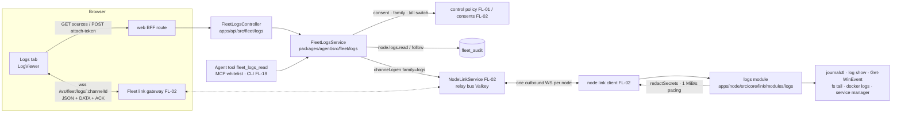

# FL-08 — Logs · Implementation plan

> How [`spec.md`](./spec.md) gets built. Implementation detail belongs here, not in the spec
> (Constitution IX). Every path cited as existing was opened at `origin/develop` `e4334baf7`.

**Epic ID:** `FL-08-logs`
**Spec:** [`./spec.md`](./spec.md) · **Tasks:** [`./tasks.md`](./tasks.md)
**Status:** `Draft`
**Created:** 2026-10-18
**Last updated:** 2026-10-18

---

## 1. Architecture summary



Data flows back the same way: the module emits NDJSON lines as `DATA` frames on the `logs` channel,
the node link carries them to the API relay, the gateway fans them out to the viewer socket(s);
`ACK` credits flow browser → gateway → node so the node never sends more than the viewer can take.
Nothing is written on the platform except audit rows.

## 2. Current state in the codebase

| Piece                                                                    | Where (verified at HEAD)                                                                                                                                     | Reused as                                                                                    |
| ------------------------------------------------------------------------ | ------------------------------------------------------------------------------------------------------------------------------------------------------------ | -------------------------------------------------------------------------------------------- |
| Secret scanner shared by node and server                                 | `packages/contracts/src/secret/secret-patterns.ts:1-11` (`redactSecrets`)                                                                                   | every log line is scanned with it on the node                                                |
| Outbox discipline: nothing leaves unscanned, newest wins under pressure  | `apps/node/src/core/screen/frame-outbox.ts:14-38`, `scrubOutboundComputerFrame` `:61-83`                                                                   | the same shape, generalised to a line outbox with byte pacing                                |
| Capability tags re-detected per heartbeat; `docker` from `docker --version` | `apps/node/src/core/capabilities.ts:277-328`                                                                                                              | the `logs` tag joins the list under `--manage`                                               |
| Injected `CommandRunner` abstraction                                     | `apps/node/src/core/capabilities.ts:36-51`                                                                                                                  | every shell-out in the module goes through it (testable without a host)                      |
| Shell resolution per OS                                                  | `apps/node/src/core/screen/terminal-channel.ts:27-34`                                                                                                        | not used (no shell is spawned for logs); cited to show the OS matrix convention              |
| Scrubbed child environment                                               | `buildNodeCheckEnv` (`apps/node/src/core/executors/acceptance-checks.ts`, used by `terminal-channel.ts:75`)                                                 | env for `journalctl` / `docker` / PowerShell children                                        |
| Fleet audit: one writer, redaction belt (`REDACTED_KEY_RE`)              | `packages/agent/src/fleet/fleet-audit.service.ts:55`, `:96-137`; entity `packages/agent/src/entities/fleet-audit.entity.ts:33-65`                           | `node.logs.read` / `node.logs.follow` rows via `tryRecord`                                   |
| Audit action union                                                       | `packages/contracts/src/fleet/fleet-panic.types.ts:60-148`                                                                                                   | two new members                                                                              |
| Owner-scoped node lookup                                                 | `packages/agent/src/fleet/fleet.service.ts:958` `listForUser`, `:995` `getForUser`                                                                          | the node resolution every route starts with                                                  |
| Kill switch read                                                         | `packages/agent/src/fleet/fleet-kill-switch.service.ts:119` `isStopped()`                                                                                   | refused with `kill_switch` before any link request                                           |
| Fleet controller root and gate                                           | `apps/api/src/fleet/fleet.controller.ts:150` `@Controller('api/fleet')`; `apps/api/src/fleet/guards/fleet-enabled.guard.ts:23-31` (404, not 403)             | new controller mounted under the same root, same guard                                       |
| WebSocket gateway pattern (token in first frame, 4001 after 5 s, 30 s ping) | `apps/api/src/computer/computer-ws.service.ts:26-69`                                                                                                     | FL-02's generic `/ws/fleet/<family>/<id>` gateway follows it; FL-08 only registers a family  |
| Viewer attach hook                                                       | `apps/web/src/components/computer/use-computer-attach.ts`                                                                                                   | shape for `use-log-follow.ts`                                                                |
| Existing Agent fleet tool factory                                        | `packages/agent/src/fleet/agent-fleet-tools.ts:32-80` (`buildFleetTools`, `TaskToolDescriptor`)                                                            | same factory pattern for `fleet_logs_*`                                                      |
| MCP whitelist (OpenAPI → tools, `readOnlyHint`)                          | `apps/mcp/src/openapi-tools/whitelist.ts:1-21`, fleet block `:475-530`                                                                                      | two new entries                                                                              |
| Command palette screens registry                                         | `apps/web/src/components/command-palette/registry/screens.ts:211-217`                                                                                       | "Logs on <computer>" entries                                                                  |
| Node CLI `start` options (`--work`, `--attend`; no `--manage`)           | `apps/node/src/cli/program.ts:1545-1577`                                                                                                                    | `--manage` is FL-02's; this plan only consumes `consents.manage`                             |
| Allowed roots today: Task worktrees under `--workspace-root`             | `apps/node/src/cli/program.ts:1574-1577`; descriptor lookup rule in `apps/node/src/core/executors/command-roots.ts:29-48`                                   | the roots resolver below follows the "look it up, never join" rule                           |
| Playwright naming                                                        | `apps/web/e2e/flow-fleet-runner-pill.spec.ts:1-27` (fresh account per test, enrol via public protocol)                                                       | `flow-fleet-logs.spec.ts`                                                                    |

**What does not exist** (and this plan adds): any log source reader on the node, a `logs` channel
handler, a `logs` tag, `node.logs.*` audit members, a Logs tab, `fleet_logs_*` tools, a top-level
`fleet` i18n namespace (`apps/web/messages/en.json` has only nested `fleet` keys at `:1014`,
`:2104`, `:4998`).

**Depends on FL-02 and FL-01 (names used below are theirs; paths per their plans):** the node link
client and `machine`/`logs` channel dispatch (`apps/node/src/core/link/…`), the node-module
registration contract (`apps/node/src/core/link/modules/…`), `NodeLinkService` on the API, the generic
viewer gateway `/ws/fleet/<family>/<id>` with attach tokens, `consents` on `FleetNode`, and FL-01's
role derivation plus the computer-page tab registry `apps/web/src/components/fleet/registry.ts`.

## 3. Tech choices

| Concern                     | Choice                                                                                                     | Why                                                                                                             |
| --------------------------- | ---------------------------------------------------------------------------------------------------------- | --------------------------------------------------------------------------------------------------------------- |
| Linux system log            | `journalctl -o json --no-pager -n 500 [-k] [-u <unit>] [--user]` then `-f --since=<cursor>`               | JSON gives `PRIORITY`, `_SYSTEMD_UNIT`, `__CURSOR` for exact resume; no library                                |
| macOS system log            | `log show --style ndjson --last 1h` (bounded to 500 lines) then `log stream --style ndjson [--predicate]` | ndjson carries `messageType` for level and `processImagePath` for service attribution                           |
| Windows event logs          | PowerShell `-NoProfile -NonInteractive -EncodedCommand` running `Get-WinEvent -FilterHashtable` → JSON; follow by polling every 2 s with `StartTime` of the last record | no native tail for event logs; the encoded command avoids quoting hazards (`fleet-audit` names the same hazard) |
| File tail                   | Node `fs` + `fs.watch`/polling fallback, own rotation detection (inode/size regression → reopen)           | original implementation; no external tail binary dependency                                                    |
| Container logs              | `docker logs --tail 500 --timestamps -f <id>` through the CLI only                                         | README D8 / spec FR-8: never the daemon socket                                                                   |
| Service → log mapping       | Linux `journalctl -u`; macOS launchd `StandardOutPath`/`StandardErrorPath` via `launchctl print` and Homebrew `$(brew --prefix)/var/log/<name>.log`; Windows `Get-WinEvent -FilterHashtable @{ProviderName=…}` | each service manager has one honest attribution                                                   |
| Line format on the wire     | NDJSON `{ ts, level, text, src, redactions }` in `DATA` frames, ≤ 64 KiB per frame                        | self-describing, merge-friendly, no second codec                                                                |
| Flow control                | `ACK` credits (CONTRACTS §3.2 kind 30); node emits ≤ 1 MiB/s and ≤ 1 MiB outstanding                     | §10 limit; the viewer sets the pace, the node drops oldest beyond the window                                     |
| Secret scan                 | `redactSecrets` from `@ever-works/contracts` on the node, per line, before framing                        | identical definition server-side (`secret-patterns.ts:4-9`)                                                     |
| Level classification        | pure `classifyLogLevel(source level, text)` in contracts                                                  | shared by node (tagging) and web (colouring); one truth table                                                   |
| Viewer list                 | windowed list (virtualised) holding ≤ 5 000 lines                                                          | spec FR-21 / NFR fps                                                                                              |
| Platform persistence        | none                                                                                                       | README §1 machine facts are not rows                                                                             |

Libraries: none new. `ws` (API, existing), `commander` (node, existing).

## 4. Data model

**No entity and no migration** — CONTRACTS §13 reserves no slot for FL-08. Platform state is
limited to `fleet_audit` rows written through the existing writer.

### 4.1 Contracts — `packages/contracts/src/fleet/fleet-logs.types.ts` (new, exported from `fleet/index.ts`)

```ts
export const FLEET_LOG_SOURCE_KINDS = ['system', 'file', 'container', 'service'] as const;
export type FleetLogSourceKind = (typeof FLEET_LOG_SOURCE_KINDS)[number];
export interface FleetLogSource {
  id: string;            // opaque, stable per node: `system:journal`, `file:<sha1(path)>`, `container:<id>`, `service:<unit>`
  kind: FleetLogSourceKind;
  label: string;         // "System journal", "/var/log/syslog", "acme-api", "nginx"
  group: string;         // tree group label (root path for files; "System", "Containers", "Services")
  readable: boolean;
  unreadableReason?: 'root-only' | 'needs-admin' | 'group-membership' | 'gone';
  hint?: string;         // exact command or sentence for the reason
  state?: string;        // container/service state for the row
  lastWrittenAt?: string;
  supportsEarlier: boolean;
}
export const FLEET_LOG_LEVELS = ['error', 'warning', 'info'] as const;
export interface FleetLogLine { ts: string; level: FleetLogLevel; text: string; src: number; redactions: number }
export interface FleetLogsOpenParams { source: string; lines?: number; sources?: string[] /* P2 */ }
export const FLEET_LOGS_INITIAL_LINES = 500;                 // CONTRACTS §10
export const FLEET_LOGS_FOLLOW_BYTES_PER_SEC = 1024 * 1024;  // CONTRACTS §10
export const FLEET_LOGS_VIEWER_MAX_LINES = 5000;
export const FLEET_LOGS_MAX_MERGED_SOURCES = 12;
export const FLEET_LOGS_MAX_FILES_PER_ROOT = 200;
export function classifyLogLevel(explicit: string | number | null, text: string): FleetLogLevel;
```

Additive changes: `FleetAuditAction` + `FLEET_AUDIT_ACTIONS` gain `'node.logs.read'`,
`'node.logs.follow'` (`fleet-panic.types.ts:60-148`); the known-tag list gains `logs` (FL-02 adds
`managed`; both are additive).

## 5. API surface

All under the existing `@Controller('api/fleet')` root, new controller
`apps/api/src/fleet/logs/fleet-logs.controller.ts`, guarded by `FleetEnabledGuard` plus a
`FleetMachineFactsEnabledGuard` (new, same 404 posture, reads `FLEET_MACHINE_FACTS_ENABLED`).

| Method | Path                               | DTO (`apps/api/src/fleet/logs/dto/fleet-logs.dto.ts`)             | Auth                                   | Tier       | Returns / errors                                                                                                      |
| ------ | ---------------------------------- | ------------------------------------------------------------------ | -------------------------------------- | ---------- | --------------------------------------------------------------------------------------------------------------------- |
| GET    | `/nodes/:id/logs/sources`          | —                                                                  | session / API key; node via `getForUser`; family `logs` | 60/min/user | `FleetLogSource[]`; `unreachable`, `consent_missing`, `permission_denied`, `kill_switch`, `not_found`               |
| POST   | `/nodes/:id/logs/attach-token`     | `OpenLogsDto { source: string; sources?: string[]; lines?: 1..500; follow: boolean }` | same                      | 30/min/user | `{ token, wsPath, channelId, expiresInSec: 60 }` — opens the node channel, writes `node.logs.read` (+ `follow`); `limit_exceeded` when the viewer already holds 8 channels on that node |
| POST   | `/nodes/:id/logs/read`             | `ReadLogsDto { source: string; lines?: 1..500; filter?: string }` | same; Agents through the tool           | 30/min/user | `{ lines: FleetLogLine[], truncated, redactions }` one-shot (no follow) — the MCP/CLI/Agent path; writes `node.logs.read` |

All three paths are listed in CONTRACTS §11.2. The 8-channel per-viewer cap is the §10 row raised
in spec §8b (b). Every error body is
`{ error: { code, hint, details } }` (CONTRACTS §8). Rate tiers reuse the existing `@Throttle`
decorators as `computer.controller.ts` does.

Viewer socket: `wss://<api>/ws/fleet/logs/<channelId>` — FL-02's gateway; FL-08 registers the
`logs` family with: inbound JSON allowed `logs.pause | logs.resume | logs.follow | logs.earlier`,
inbound `ACK` forwarded to the node, outbound `DATA` + `JSON` (`logs.notice` for dropped/gone/
redaction counters). Role is always `viewer`.

## 6. Node side

**Module:** `apps/node/src/core/link/modules/logs/` — a `NodeModule` (FL-02 plan §6) appended to the
compile-time array in `apps/node/src/core/link/modules/index.ts`; advertises `logs` when
`consents.manage` is true and at least one source kind is readable (CONTRACTS §1.2).

| File                                   | Responsibility                                                                                                                                                           |
| -------------------------------------- | ------------------------------------------------------------------------------------------------------------------------------------------------------------------------ |
| `index.ts`                             | `createLogsModule({ runner, env, fs, roots, docker, services })` → `{ id: 'logs', tags(), handle(channel) }`                                                             |
| `log-sources.ts`                       | `listSources()` — composes the four groups per OS; marks `root-only` / `needs-admin` / `group-membership` with the exact hint                                              |
| `journal-source.ts`                    | Linux: `journalctl` JSON read + follow with `__CURSOR` resume; detects the "not seeing other users' messages" hint and reports `group-membership`                        |
| `unified-log-source.ts`                | macOS `log show` / `log stream` ndjson                                                                                                                                   |
| `event-log-source.ts`                  | Windows `Get-WinEvent` encoded-command read; polling follow; `needs-admin` for Security                                                                                   |
| `file-source.ts`                       | Tail by bytes (last 500 lines by backward scan ≤ 8 MiB), follow with rotation/truncation detection, `earlier` by backward scan                                            |
| `container-source.ts`                  | `docker logs` read/follow; `gone` when the container disappears                                                                                                           |
| `service-source.ts`                    | Service → source mapping per OS (table in §3), delegating to the three readers above                                                                                     |
| `allowed-roots.ts` (`link/modules/shared/`) | R-18 resolver: Checkout paths + workspace root + `--files-root` extras; canonicalise with `realpath`, refuse escapes; FL-08 lands first (Wave 1), so FL-11 and FL-14 reuse this one file rather than adding their own resolver |
| `log-channel.ts`                       | One open channel: initial 500, `redactSecrets` per line, NDJSON framing ≤ 64 KiB, `ACK` window 1 MiB, 1 MiB/s token bucket, oldest-drop with counter, pause/resume/follow, `earlier` |
| `line-classifier.ts`                   | thin adapter over `classifyLogLevel` for each source's native level                                                                                                     |

**OS matrix**

| Source     | Linux                                   | macOS                                             | Windows                                                        |
| ---------- | --------------------------------------- | ------------------------------------------------- | -------------------------------------------------------------- |
| System     | journal (system + user), kernel          | unified log                                        | System, Application, Security (admin)                           |
| Files      | `/var/log` + roots                       | `/var/log`, `~/Library/Logs` + roots               | node's own log dir + roots (spec §8b)                           |
| Containers | `docker logs`                            | `docker logs`                                      | `docker logs` (Docker Desktop)                                  |
| Services   | `journalctl -u` / `--user -u`            | launchd Standard*Path, Homebrew `var/log/<name>.log` | event logs filtered by `ProviderName`                        |

**Link usage, message by message** (`logs` family, CONTRACTS §3.3):

1. Platform `channel.open { channel, family: 'logs', params: { source, lines, sources? } }` →
   module validates (source exists, readable, roots) → `channel.ready` or
   `channel.refused { code, hint }` (`invalid`, `unsupported_on_node`, `operation_failed`).
2. Node streams the initial lines as `DATA` frames, then `JSON { type: 'logs.initial-done', count }`.
   A one-shot read (`POST /nodes/:id/logs/read`, the Agent tool) sends §3.3's `logs.read { lines }`
   and closes after `logs.initial-done`; a follow sends `logs.follow { on: true }`.
3. Follow: `DATA` frames paced by credits; viewer sends `ACK [bytes]` as it consumes;
   `JSON logs.pause` → node buffers up to 1 MiB then drops oldest and counts; `logs.resume` flushes;
   `logs.follow { on: false }` stops the reader but keeps the channel; `logs.earlier { before }` →
   one batch of 500 older lines as `DATA` then `JSON logs.earlier-done { count, hasMore }`.
4. Notices: `JSON logs.notice { kind: 'dropped' | 'gone' | 'redactions' | 'group-membership', count?, hint? }`.
5. Close: either side `CLOSE`; node kills the reader child within 3 s. Kill switch → the platform
   sends `link.pause` (CONTRACTS §3.2), the link refuses new opens and the node closes open channels
   with `kill_switch` (R-24).
6. `logs.sources` is answered on the `machine` channel (one per link) so the list never opens a
   channel of its own. CONTRACTS §3.3 lists `logs.sources` under the `logs` family and does not
   list `logs.initial-done`, `logs.earlier`, `logs.earlier-done` or `logs.notice`; both are the
   §3.3 addition raised in spec §8b (a), made in the same PR.

Children run with `buildNodeCheckEnv` (scrubbed env), `windowsHide: true`, and a 10 s read
timeout for the initial batch; a timeout is `operation_failed` with the child's first stderr line
as the hint.

## 7. Plugin surface

None. Reading a machine's own logs is a node module (README D8). No capability, facade or plugin
package is added; `docs/plugin-system/built-in-plugins.md` is untouched.

## 8. Web surface

- **Route:** `/fleet/computers/[id]?tab=logs` (FL-01 page; this epic registers the tab).
- **Registry:** `apps/web/src/components/fleet/logs/logs-tab.registry.ts` calls FL-01's
  `registerComputerTab({ id: 'logs', labelKey: 'fleet.computer.tabs.logs', order: 40, epic: 'FL-08', flag: 'FLEET_MACHINE_FACTS_ENABLED', consent: 'manage', load: () => import('./LogsTab') })`
  (the entry shape FL-01's plan §6 fixes; the `logs` family audience is checked server-side and
  rendered by the tab's own permission state). The "Logs on <computer>" palette entries are added
  to the per-computer dynamic section FL-01 builds in
  `apps/web/src/components/command-palette/registry/sections.ts` — no second palette registry.
- **Components** under `apps/web/src/components/fleet/logs/`: `LogsTab.tsx` (layout, source
  selection, state card), `LogSourceTree.tsx`, `LogViewer.tsx` (windowed list, follow/pause
  state, selection), `LogViewerToolbar.tsx`, `LogViewerFooter.tsx`, `LogOpenPathField.tsx`,
  `LogSourceChip.tsx` (P2), `use-log-follow.ts` (attach token → socket; first frame auth; `ACK`
  on consume; reconnect with resume), `logs.shared.ts` (pure: filter, follow-state machine,
  footer text, byte/number formatting, `classifyLogLevel` re-export), `LogsTab.unit.spec.tsx`,
  `logs.shared.unit.spec.ts`, `use-log-follow.unit.spec.tsx`.
- **BFF:** `apps/web/src/app/api/fleet/nodes/[id]/logs/sources/route.ts`,
  `.../logs/attach-token/route.ts` — thin proxies as `apps/web/src/lib/api/computer-bff.ts`
  documents; the token never reaches client code before the socket opens.
- **i18n groups** (`apps/web/messages/en.json`, namespace `fleet.*`, CONTRACTS §11.4):
  `fleet.computer.tabs.logs`; `fleet.logs.groups.{system,files,containers,services}`;
  `fleet.logs.sources.{journal,kernel,unified,eventSystem,eventApplication,eventSecurity,needsAdmin,rootOnly,openFile,gone}`;
  `fleet.logs.viewer.{live,reconnecting,pause,resume,following,notFollowing,jumpToLatest,copy,copySelection,copyAllShown,download,filterPlaceholder,footerFollowing,footerPaused,footerFiltered,footerHeld,footerBytes,footerRedactions,footerDropped,loadEarlier,noEarlier}`;
  `fleet.logs.notices.{groupMembership,groupMembershipCommand,gone,fastLog}`;
  `fleet.logs.states.{loading,loadingSlow,loadingAbandoned,empty,emptyBody,offline,consentMissing,consentCommand,permissionDenied,desktopNode,killSwitch,error}`;
  `fleet.logs.palette`; `fleet.logs.a11y.{region,following,paused}`; `fleet.logs.shortcuts.*`;
  `fleet.errors.{unreachable,consentMissing,permissionDenied,killSwitch,limitExceeded,unsupportedOnNode,invalid,notFound,operationFailed}` (shared with sibling epics; first writer creates).
- **Playwright:** `apps/web/e2e/flow-fleet-logs.spec.ts` (sources listed, open, follow, pause,
  filter, consent-missing state, kill switch), `apps/web/e2e/flow-fleet-logs-contract.spec.ts`
  (route authz: 401 anonymous, 404 flag off, `consent_missing` shape).

## 9. Agent / MCP / CLI surface

| Tool (CONTRACTS §11.3)   | Annotation                               | Backing                                                                       |
| ------------------------ | ---------------------------------------- | ----------------------------------------------------------------------------- |
| `fleet_logs_sources`     | `readOnly: true`                         | Agent: `packages/agent/src/fleet/logs/agent-fleet-logs-tools.ts` (descriptor factory next to `buildFleetTools`); MCP: whitelist `GET /api/fleet/nodes/{id}/logs/sources` |
| `fleet_logs_read`        | `readOnly: true`                         | Agent: same file, calls `FleetLogsService.readOnce`; MCP: whitelist `POST /api/fleet/nodes/{id}/logs/read` with `omitArgs: ['follow']` |

Both tools are gated as CONTRACTS §2.1: the Agent's grants (AW-15/AW-24) **and** the Node's `logs`
audience must include the Agent's owner. Errors return `{ error: { code, hint, details } }`
unchanged. CLI verbs `ever-works fleet logs sources|read --node <id> --source <id> [-n 500] [--json]`
are registered by FL-19 over the same two routes; this epic ships the route shapes and the exit
codes they imply (0/1/2).

## 10. Background jobs

None. Every read is an ephemeral link request (CONTRACTS §12). Audit retention is the existing
fleet audit retention. The 30-second source refresh is browser-driven while the tab is visible.

## 11. Security & permissions

- **Threats specific to logs:** (a) a log line carrying a credential — scanned on the node before
  framing, counted, never stored; (b) a path escape through a symlink or `..` — `allowed-roots.ts`
  canonicalises and refuses, following `command-roots.ts`'s "look it up, never join" rule;
  (c) command injection through a unit/container name — names are validated against a strict
  pattern and passed as argv, never through a shell string; PowerShell runs an encoded command;
  (d) a viewer flooding the node — `ACK` window and 1 MiB/s cap, 8 channels per viewer per node;
  (e) reading another Agent's isolated profile — profile roots are never allowed roots (AW-11).
- **What the node refuses:** opening without `manage`; a path outside roots/standard dirs; the
  Security log without elevation (`unsupported_on_node`); a source id it did not list; any request
  while the kill switch is on.
- **Redaction:** line scan on the node; audit `details` through the writer's belt
  (`fleet-audit.service.ts:55`) — field names avoid `token|secret|…`; audit rows carry source id,
  kind, requester, counts, never text or absolute paths beyond the source label.
- **Audit:** `node.logs.read` on every open and one-shot read; `node.logs.follow` when a follow
  starts; `requestedBy` `user:<id>` | `agent:<id>`; `confirmationClass: 'plain'`; `outcome`.
- **Permissions:** family `logs` (CONTRACTS §2.1, default audience `owner`); role derivation from
  FL-01; `getForUser` for owner scope; Organization members via the audience only.
- **Kill switch / drain:** refused with `kill_switch`; open channels closed; drain-all does not
  touch log channels (they are not sessions) but the link's drain closes them with the node.
- **Nothing listens, nothing inbound** (README D2); Docker only through the CLI.

## 12. Observability

- Audit rows (above) are the Activity Log's source of truth for reads.
- API metrics: `fleet_logs_channels_open{nodeId}`, `fleet_logs_lines_total`,
  `fleet_logs_dropped_total`, `fleet_logs_redactions_total`, `fleet_logs_refusals_total{code}`.
- Node log (redacting logger): one warning per unreadable source class per hour, one per
  channel refusal, one per child timeout.
- Sentry breadcrumb on channel refusal with `code` only.

## 13. Phased rollout

| Phase  | Flag                                | Contents                                                                                                                                                 |
| ------ | ----------------------------------- | -------------------------------------------------------------------------------------------------------------------------------------------------------- |
| **P1** | `FLEET_MACHINE_FACTS_ENABLED` (off) | contracts; node module (sources, four readers, channel, roots); API controller + service + audit; gateway family registration; Logs tab; tools; palette; i18n; tests |
| **P2** | same                                | merged sources (`sources[]`), `logs.earlier`, Services/Docker row hand-offs (FL-09 hooks), Compose **Logs** entry                                       |
| **P3** | same                                | "Open the log" positioned at the failure from the Services tab's failed rows (the "needs a look" action waits for a CONTRACTS §4.6 kind — spec §8b (c)), download of shown lines |

Default off in production until ACC-FL08-01…16 are green on `develop`; flags gate behaviour, not
merges (README D12).

## 14. Test plan

| Package                 | Runner     | Tests                                                                                                                                                                                                                                                                                                                                                 |
| ----------------------- | ---------- | ----------------------------------------------------------------------------------------------------------------------------------------------------------------------------------------------------------------------------------------------------------------------------------------------------------------------------------------------------- |
| `packages/contracts`    | Vitest     | `src/fleet/__tests__/fleet-logs.types.spec.ts` — guards, constants, `classifyLogLevel` truth table (journal priorities 0–7, event levels 1–5, text heuristics, no false `error` on "errors: 0")                                                                                                                                                       |
| `apps/node`             | Vitest     | `modules/logs/log-sources.spec.ts` (four OS fixtures; root-only, needs-admin, group-membership hints), `journal-source.spec.ts` (cursor resume, hint detection), `event-log-source.spec.ts`, `file-source.spec.ts` (backward 500-line scan, rotation, truncation, CRLF), `container-source.spec.ts` (gone), `service-source.spec.ts`, `allowed-roots.spec.ts` (symlink escape refused, canonical compare, win32 case), `log-channel.spec.ts` (1 MiB/s bucket, ACK window, oldest-drop count, pause buffer, redaction count, 64 KiB frames) |
| `packages/agent`        | Jest       | `fleet/logs/__tests__/fleet-logs.service.spec.ts` (consent → `consent_missing` + hint, family → `permission_denied`, kill switch → `kill_switch`, audit row shape has no line text, 8-channel cap → `limit_exceeded`), `agent-fleet-logs-tools.spec.ts` (readOnly, ≤ 500, follow refused, error envelope)                                             |
| `apps/api`              | Jest       | `fleet/logs/fleet-logs.controller.spec.ts` (DTO validation, 404 under flag off, throttles, error envelope), `apps/api/test/fleet-logs.e2e-spec.ts` (enrol node fixture, sources, attach-token, read — using a fake link peer from FL-02's test kit)                                                                                                     |
| `apps/mcp`              | Vitest     | whitelist spec: both tools present, `readOnlyHint`, `follow` omitted                                                                                                                                                                                                                                                                                  |
| `apps/web` unit         | Vitest     | `logs.shared.unit.spec.ts` (filter, follow state, footer strings), `LogViewer.unit.spec.tsx` (scroll-up stops follow, pause counter, 5 000 cap), `use-log-follow.unit.spec.tsx` (auth-first frame, ACK emission, resume)                                                                                                                              |
| `apps/web` e2e          | Playwright | `flow-fleet-logs.spec.ts`, `flow-fleet-logs-contract.spec.ts`                                                                                                                                                                                                                                                                                         |

## 15. Risks

| Risk                                                                 | Likelihood | Impact | Mitigation                                                                                                   |
| -------------------------------------------------------------------- | ---------- | ------ | ------------------------------------------------------------------------------------------------------------ |
| FL-02 link/module contract lands with different names                | medium     | medium | §2 names FL-02 pieces by role; the module's public surface is one factory, adapted in one file               |
| `journalctl` JSON output differs across distros/versions             | medium     | low    | parse defensively; fixtures from three distros; fall back to `short-iso` text with heuristic levels           |
| Windows event-log polling misses bursts between polls                | low        | low    | poll by `RecordId > last` not time; 2 s cadence; cap 500 per poll with a `dropped` notice                     |
| Secret scanner false positives redact useful text                    | medium     | low    | conservative patterns (`secret-patterns.ts:37-39`); footer shows the count so the operator knows               |
| Backward 500-line scan on a multi-GB file is slow                    | low        | low    | scan at most 8 MiB from the end; say "showing the last 8 MiB" when fewer than 500 lines fit                   |
| Viewer holds many channels (tabs) and exhausts the link's 64 channels | low       | medium | 8 per viewer per node; closing the tab closes channels within 15 s                                             |

## 16. Constitution reconciliation

- **I Plugin-first:** no external integration; node module per README D8.
- **II Capability-driven:** no plugin id; `logs` tag advertised by the module.
- **III Source-of-truth repos:** untouched.
- **IV Job runtime:** no background work; ephemeral link requests.
- **V Migrations:** none.
- **VI Tests:** §14, per package, before the surface.
- **VII Secrets:** scan on node, audit belt, no persistence of lines.
- **VIII Plugin counts:** untouched.
- **IX Behaviour-first:** spec carries behaviour; this plan carries paths.
- **X Compatibility:** additive contracts, new routes under the existing root, new tool names.

## 17. References

- Spec: [`./spec.md`](./spec.md) · Tasks: [`./tasks.md`](./tasks.md)
- Program: [README](../README.md), [CONTRACTS](../CONTRACTS.md) §1–3, §7–11, R-18, R-24
- Siblings: [FL-02](../FL-02-node-link/plan.md) (link, modules, gateway), [FL-01](../FL-01-fleet-hub/plan.md)
  (registry, roles), [FL-09](../FL-09-services-docker/plan.md), [FL-11](../FL-11-files/plan.md),
  [FL-03](../FL-03-computer-health/plan.md), [FL-19](../FL-19-agent-mcp-cli/plan.md)
- AW-11 plan for the outbox and gateway precedents:
  [`../../agent-workspace/AW-11-agent-computers/plan.md`](../../agent-workspace/AW-11-agent-computers/plan.md)
