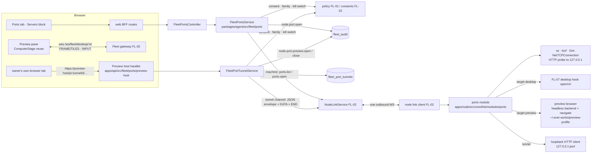

# FL-10 — Servers & ports · Implementation plan

> How [`spec.md`](./spec.md) gets built. Implementation detail belongs here, not in the spec
> (Constitution IX). Every path cited as existing was opened at `origin/develop` `e4334baf7`.

**Epic ID:** `FL-10-ports`
**Spec:** [`./spec.md`](./spec.md) · **Tasks:** [`./tasks.md`](./tasks.md)
**Status:** `Draft`
**Created:** 2026-10-18
**Last updated:** 2026-10-18

---

## 1. Architecture summary



Back: `ports.list` is a JSON reply; the preview picture rides the `desktop` family
(`source: 'browser', profile: 'preview'`) exactly like an Agent-browser capture; tunnel responses
come back as a JSON envelope + `DATA` body + `END` per request, bridged by the preview host handler
to the owner's browser.

## 2. Current state in the codebase

| Piece                                                               | Where (verified at HEAD)                                                                                                             | Reused as                                                                                       |
| ------------------------------------------------------------------- | ------------------------------------------------------------------------------------------------------------------------------------ | ----------------------------------------------------------------------------------------------- |
| Capture-backend seam; `start` takes exactly one profile dir         | `apps/node/src/core/screen/capture-backend.ts:4-33`, `:53-61`                                                                        | the preview browser is a second **caller** of the same backend with the preview profile dir     |
| Headless browser backend: attach-or-launch, `about:blank`, pictures only | `apps/node/src/core/screen/headless-browser-backend.ts:18-41`, `buildHeadlessCaptureArgs` `:119-131`, `BrowserPageSource` `:403-497` | extended with a narrow `navigate(url)` on a new `PreviewPageSource` (same CDP connection)   |
| Browser probe (the binary the `browser` tag stands on)              | `apps/node/src/core/browser-probe.ts:1-32`                                                                                           | the preview browser launches the probed binary                                                  |
| Input injection into the captured surface                           | `apps/node/src/core/screen/input-injector.ts`, `inputToProtocolCall` `headless-browser-backend.ts:247-304`                           | preview input for the opener                                                                    |
| Agent profile manager (root dir, owner-only ACL)                    | `apps/node/src/core/screen/agent-profile.ts:6-32`; `runtime.ts:487-494`                                                              | the preview profile sits **beside** `agent-profiles`, same ACL helper, never inside             |
| Outbound-only leg; nothing inbound                                  | `apps/node/src/core/screen/node-leg.ts:12-35`                                                                                        | the tunnel is one more outbound channel                                                         |
| Picture stage in the browser                                        | `apps/web/src/components/computer/ComputerStage.tsx`, `use-computer-attach.ts`                                                       | the preview pane renders through the same stage and attach hook (FL-02/07 generalise the socket) |
| `CommandRunner`, scrubbed env, tags per heartbeat                   | `apps/node/src/core/capabilities.ts:36-51`, `:277-328`                                                                                | `ss`/`lsof`/PowerShell shell-outs; `ports` tag                                                  |
| Fleet audit writer, action union                                    | `packages/agent/src/fleet/fleet-audit.service.ts:96-137`; `packages/contracts/src/fleet/fleet-panic.types.ts:60-148`                 | three new members                                                                               |
| `FleetNode` entity (where `previewProfileEnabled` lands)            | `packages/agent/src/entities/fleet-node.entity.ts:96`, control columns `:502-532`                                                    | read by the service                                                                             |
| Owner-scoped lookups; kill switch                                   | `packages/agent/src/fleet/fleet.service.ts:958,995`; `fleet-kill-switch.service.ts:119`                                              | guard steps                                                                                     |
| Fleet controller root / guards                                      | `apps/api/src/fleet/fleet.controller.ts:150`; `apps/api/src/fleet/guards/fleet-enabled.guard.ts`                                     | new controller                                                                                  |
| Migration shape (portable `TableColumn`, per-step guards)           | `apps/api/src/migrations/1795161700000-AddFleetModelUsageLimits.ts:24-40`                                                            | `1796100000000-CreateFleetPortTunnels.ts`                                                       |
| Agent tool factory; MCP whitelist                                   | `packages/agent/src/fleet/agent-fleet-tools.ts:32-80`; `apps/mcp/src/openapi-tools/whitelist.ts:475-530`                             | `fleet_ports_*`                                                                                 |
| Palette registry                                                    | `apps/web/src/components/command-palette/registry/screens.ts:211-217`                                                                | "Ports on <computer>"                                                                           |

**Missing today:** port discovery, HTTP probing from the machine, program/container join, any
"open on the machine", a preview profile, a tunnel, the tab, the tools. **Depends on** FL-02
(link, modules, `NodeLinkService`, gateway, `consents`, `previewProfileEnabled` column), FL-07
(desktop hook `openUrl`, `screen:desktop` tag), FL-01 (tab/block registry, roles), FL-09 (container
and process joins — optional, degrade to PID/name).

## 3. Tech choices

| Concern                 | Choice                                                                                                                                                       | Why                                                                                                   |
| ----------------------- | ------------------------------------------------------------------------------------------------------------------------------------------------------------ | ----------------------------------------------------------------------------------------------------- |
| Discovery               | Linux `ss -tlnpH` (fallback `ss -tlnH` without `-p` when not permitted → PID unknown); macOS `lsof -nP -iTCP -sTCP:LISTEN -F pcnL`; Windows `Get-NetTCPConnection -State Listen` + `Get-Process -Id` via encoded command → JSON | one call per OS; TCP only (spec §8)                                                             |
| Program / container join | PID → process name (+ cwd from `/proc/<pid>/cwd`, `lsof -p`, Windows `Path`); `docker-proxy`/published ports → container via FL-09's docker module (`docker ps` port mappings); degrade gracefully | the join is what makes a port legible                                                       |
| HTTP probe              | Node `http`/`https` from the node to `127.0.0.1:<port>/`, `GET`, `Accept: text/html`, 2 s timeout, 64 KiB cap, `rejectUnauthorized: false`; `<title>` by regex on the cap; result scanned | from the machine only; never another host                                                     |
| Classification          | `web` when any HTTP response; `other` with well-known names from a small table (22 ssh, 5432 postgres, 3306 mysql, 6379 redis, 27017 mongo, 9092 kafka, 5672 amqp, 11211 memcached, 2375/2376 docker, 53 dns); `noise` from a Windows table (135, 137–139, 445, 5040, 5357, 5985, 5986, 7680, 49664–49690; programs `svchost`, `lsass`, `wininit`, `services`, `spoolsv`, `System`; responses with `Server: Microsoft-HTTPAPI/2.0` and the built-in error page) and a Unix table (111 rpcbind, 631 cupsd, 53 on 127.0.0.53) | a documented data table, not heuristics in code       |
| Live refresh            | browser re-requests `ports.list` every 5 s while visible; node caches 2 s; probes ≤ 32 concurrent                                                           | simple, bounded                                                                                       |
| Open on desktop         | `ports.open { target: 'desktop' }` → FL-07 desktop hook `openUrl(url)` (runs `xdg-open` / `open` / `Start-Process` inside the interactive session the helper owns) | the helper already owns the desktop session; no second mechanism                                 |
| Preview profile         | `~/.ever-works/preview-profile/browser` (env `EVER_WORKS_NODE_PREVIEW_PROFILE_ROOT`), created lazily with the same owner-only ACL as Agent profiles; `PreviewBrowserSession` = headless backend `start({ profileDir })` + `navigate(url)` + capture/input via the existing pump | R-3; one profile for the owner, never an Agent's                                      |
| Preview picture         | `desktop` channel `channel.open { family: 'desktop', params: { source: 'browser', profile: 'preview', display: null } }` (`profile` is in CONTRACTS §3.3); frames through the existing capture pump and outbox; input `INPUT` frames from the opener only | reuses FL-07's channel and the AW-11 stage                                                 |
| Tunnel (P2)             | `tunnel` channel `{ tunnelId, port }`; per request: `JSON { type: 'tunnel.request', requestId, method, path, query, headers }` → `DATA` body chunks (≤ 64 KiB) → `END`; reply `JSON { type: 'tunnel.response', requestId, status, headers }` → `DATA` → `END`; `ACK` credits per CONTRACTS §3.2; node uses Node `http.request` to `127.0.0.1:<port>` | CONTRACTS §3.3 shape; streaming; no buffering of whole bodies                                   |
| Preview host            | Nest middleware mounted when `FLEET_PREVIEW_HOST` is set, matching `Host` header; `/p/<tunnelId>/<rest>` → tunnel; root-absolute requests (`/_next/…`, `/assets/…`) routed by a sticky `ew_tunnel` cookie set at `/p/<tunnelId>/` (HttpOnly, SameSite=Lax, Path=/); `Location` rewrite for `http(s)://127.0.0.1:<port>/…` and `localhost:<port>`; strips `cookie` entries named `ew_*`/the session cookie and `authorization` before forwarding | R-17 path prefix without rewriting page content                                        |
| Auth on preview host    | platform session cookie verified via the existing auth session store; user must equal `tunnel.ownerUserId`; where the cookie domain differs, the R-17 one-time hand-off `?t=<60 s single-use token>` → sets `ew_tunnel_auth_<id>` cookie scoped to the preview host | R-17                                                                                       |
| Tunnel lifecycle        | `fleet_port_tunnels` row; in-memory channel map per API replica keyed by `tunnelId` + relay bus (R-7) so any replica serves any request; the serving relay keeps the request count; sweeper every minute closes idle/expired | survives restarts; multi-replica                                                            |
| WebSocket (P3)          | `JSON tunnel.ws-open { requestId, path, headers }` → node opens a WS client to loopback; frames as `DATA` with a 1-byte opcode prefix; `END` closes                                     | HMR; same caps                                                                                       |

Libraries: none new (`ws` exists in the API).

## 4. Data model

### 4.1 `FleetPortTunnel` → `fleet_port_tunnels` (P2; CONTRACTS slot `1796100000000-CreateFleetPortTunnels`)

Entity `packages/agent/src/entities/fleet-port-tunnel.entity.ts` (house conventions: plain
`varchar` unions, `PortableDateColumn`, raw uuid columns, FKs in the migration; register in
`packages/agent/src/entities/index.ts` beside the fleet block at `:166-179` and in
`database/_entities-inventory.ts`).

Columns are exactly CONTRACTS §4.9 plus the house conventions:

| Column           | Type                       | Notes                                                                                   |
| ---------------- | -------------------------- | --------------------------------------------------------------------------------------- |
| `id`             | uuid PK                    | the `<tunnelId>` in the URL                                                             |
| `ownerUserId`    | uuid                       | the owner who may use it                                                                |
| `nodeId`         | uuid → `fleet_nodes`       |                                                                                         |
| `port`           | int                        | 1–65535; always reached on `127.0.0.1` in this epic                                     |
| `previewHost`    | varchar(255)               | the dedicated preview hostname the tunnel was minted for (`FLEET_PREVIEW_HOST`)         |
| `state`          | varchar(8)                 | `open · closed` (validated in code — CONTRACTS §4 storage note)                         |
| `openedAt`       | PortableDate               | the hard cap is `openedAt + 60 min` (no stored expiry)                                  |
| `lastRequestAt`  | PortableDate null          | idle clock                                                                              |
| `closedAt`       | PortableDate null          |                                                                                         |
| `closedReason`   | varchar(16) null           | `idle · hard · user · node-offline · kill-switch` (a lost link and a drained node record `node-offline`; the close audit row names the precise trigger) |
| `bytesIn` / `bytesOut` | bigint default 0     | toward the machine / toward the browser                                                 |
| `auditOpenId`    | uuid null                  | the `node.port.preview.open` row                                                        |
| `auditCloseId`   | uuid null                  | the `node.port.preview.close` row                                                       |
| `createdAt` / `updatedAt` | PortableDate      |                                                                                         |

Not stored (CONTRACTS §4.9 has no column for them): the live request count is kept by the relay
that serves the tunnel and written into the close audit row; the requester (`user:<id>` or
`agent:<id>`, for the _"opened by Nina for you"_ line) is read from the open audit row via
`auditOpenId`; the WebSocket upgrade count (P3) goes into the close audit row.

Indexes: `idx_fleet_port_tunnels_owner_state(ownerUserId, state)`, `idx_fleet_port_tunnels_node_state(nodeId, state)`,
`idx_fleet_port_tunnels_opened(openedAt)`. Migration `apps/api/src/migrations/1796100000000-CreateFleetPortTunnels.ts`:
one portable `CREATE TABLE` (runs on SQLite and Postgres), three indexes, FK `nodeId` → `fleet_nodes`
`ON DELETE CASCADE` (a tunnel is a grant, not history — the audit rows keep the history) and FK
`ownerUserId`; `down` drops exactly that. **Re-stamp before merge if `develop` moved** (README rule 10).

`FleetNode.previewProfileEnabled` (CONTRACTS §4.1) is read here and written from the computer
Settings tab (FL-01); it lands in FL-02's `1796020000000-AddFleetNodeConsents` (CONTRACTS §13).

### 4.2 Contracts — `packages/contracts/src/fleet/fleet-ports.types.ts` (new; exported)

```ts
export type FleetPortKind = 'web' | 'other' | 'noise' | 'waiting';
export interface FleetListeningPort {
  port: number; proto: 'tcp'; bind: string; localOnly: boolean; kind: FleetPortKind;
  program?: { name: string; pid: number | null; cwd?: string };
  container?: { id: string; name: string };
  web?: { scheme: 'http' | 'https'; status: number; title: string | null; probedAt: string };
  wellKnown?: string;            // 'postgres', 'ssh', …
  stopped?: boolean;             // seen last refresh, gone now
}
export interface FleetPortsList { ports: FleetListeningPort[]; sampledAt: string; discovery: 'ss' | 'lsof' | 'powershell' }
export type FleetPortOpenTarget = 'desktop' | 'preview-profile';
export interface FleetPortOpenResult { target: FleetPortOpenTarget; url: string; previewChannelId?: string }
export type FleetPortTunnelClosedReason = 'idle' | 'hard' | 'user' | 'node-offline' | 'kill-switch'; // CONTRACTS §4.9
export interface FleetPortTunnelView {
  id, nodeId, port, url, state, openedAt, lastRequestAt, closedAt, closedReason, bytesIn, bytesOut, // stored (§4.9)
  endsAt,                                  // derived: openedAt + 60 min
  requestCount?, requestedBy?              // live (relay) / from the open audit row — not columns
}
export const FLEET_PORT_TUNNEL_IDLE_MS = 10 * 60_000;  // CONTRACTS §10
export const FLEET_PORT_TUNNEL_HARD_MS = 60 * 60_000;  // CONTRACTS §10
export const FLEET_PORT_TUNNELS_PER_OWNER = 4;          // CONTRACTS §10
export const FLEET_PORT_PROBE_TIMEOUT_MS = 2000;
export const FLEET_PORT_PROBE_BODY_CAP = 64 * 1024;
export const FLEET_PORT_TITLE_MAX = 120;
```

Additive: `FleetAuditAction` gains `node.port.open`, `node.port.preview.open`, `node.port.preview.close`;
`FLEET_PORTS_CAPABILITY = 'ports'` in `fleet-jobs.types.ts`.

## 5. API surface

Controller `apps/api/src/fleet/ports/fleet-ports.controller.ts` under `@Controller('api/fleet')`,
guards `FleetEnabledGuard` + FL-08's `FleetMachineFactsEnabledGuard`; tunnel routes additionally
`FleetPortTunnelEnabledGuard` (`FLEET_PORT_TUNNEL_ENABLED`, 404 posture).

| Method | Path                                      | DTO (`apps/api/src/fleet/ports/dto/fleet-ports.dto.ts`)         | Family                         | Tier    | Returns / errors                                                                                                            |
| ------ | ----------------------------------------- | -------------------------------------------------------------- | ------------------------------ | ------- | --------------------------------------------------------------------------------------------------------------------------- |
| GET    | `/nodes/:id/ports`                        | `?watch=4000,4001`                                             | `view`                         | 60/min  | `FleetPortsList` (watched ports appear as `waiting`); `unreachable`, `consent_missing`, `unsupported_on_node`, `kill_switch` |
| POST   | `/nodes/:id/ports/:port/open`             | `OpenPortDto { target?: 'desktop'\|'preview-profile' }`         | `ports` (+ `desktop` for desktop target) | 30/min | `FleetPortOpenResult` (preview: also an attach token for `/ws/fleet/desktop/<channelId>` role `driver`); `busy`, `consent_missing` (names `attend` for desktop), `unsupported_on_node` (no browser), `permission_denied`, `operation_failed` |
| POST   | `/nodes/:id/ports/:port/preview`          | `OpenPreviewDto {}`                                             | `ports`                        | 10/min  | `201 FleetPortTunnelView` with `url`; `limit_exceeded` (4), `kill_switch`                                                   |
| GET    | `/nodes/:id/ports/:port/preview`          | —                                                              | `view`                         | 60/min  | current tunnel for this port (or 404)                                                                                       |
| DELETE | `/nodes/:id/ports/:port/preview`          | —                                                              | `ports`                        | 30/min  | `204`; closes with `closedReason: user`                                                                                      |
| GET    | `/usage` (FL-20 owns; a `tunnels` block only if FL-20 adds one — spec §8b) | —                              | `view`                         | —       | open tunnels with bytes                                                                                                     |

Preview host (not under `/api`): `GET|POST|PUT|PATCH|DELETE|HEAD|OPTIONS https://<FLEET_PREVIEW_HOST>/p/:tunnelId/*`
and root-absolute paths by sticky cookie — `apps/api/src/fleet/ports/preview-host.middleware.ts`,
registered in `apps/api/src/main.ts` before the Nest router, matching the `Host` header exactly.
Responses: 401 → redirect to sign-in with `return=` (same-site), 403 "belongs to someone else", 404
unknown/closed tunnel page, 502 node did not answer, 504 60 s per-request timeout.

## 6. Node side

**Module:** `apps/node/src/core/link/modules/ports/`, advertising `ports` under `consents.manage` when a
discovery tool exists.

| File                         | Responsibility                                                                                                                          |
| ---------------------------- | --------------------------------------------------------------------------------------------------------------------------------------- |
| `index.ts`                   | `createPortsModule({ runner, env, platform, probe, docker?, processes?, desktopHooks?, previewBrowser })`; handles `ports.list`, `ports.open`, `ports.preview` (tunnel accept) |
| `discover.ts`                | `ss` / `lsof` / PowerShell parsers → raw listeners (port, bind, pid)                                                                     |
| `classify.ts`                | well-known table, Windows/Unix noise tables (data), `localOnly`, Microsoft-HTTPAPI detection                                             |
| `http-probe.ts`              | loopback HTTP/HTTPS probe with timeout, body cap, `<title>` extraction, `redactSecrets` on the title                                     |
| `join.ts`                    | PID → program/cwd; published port → container (via FL-09 module when present)                                                           |
| `watch-list.ts`              | waiting ports from `watch=` → probed each `ports.list`                                                                                   |
| `open-desktop.ts`            | `target: 'desktop'` → FL-07 `desktopHooks.openUrl(url)`; refuses when the hook is absent (`consent_missing` hint `--attend`, or `unsupported_on_node`) |
| `preview-browser.ts`         | preview profile dir (lazy, ACL), `PreviewBrowserSession`: headless backend `start` + `PreviewPageSource.navigate(url)` + capture pump + input; one per node (`busy`); ends on viewer leave (15 s) / 60 min / kill switch |
| `tunnel.ts` (P2)             | `tunnel` channel handler: envelope → `http.request` to `127.0.0.1:<port>` → envelope back; `DATA` streaming with `ACK` credits; per-request 60 s timeout; counts bytes; P3 WS client |

`apps/node/src/core/screen/headless-browser-backend.ts` gains an **exported** `PreviewPageSource`
(subclass of the page source with `navigate(url)` restricted to `http(s)://127.0.0.1:<port>/…`) —
the existing `BrowserPageSource` stays picture-only. The preview profile root is
`~/.ever-works/preview-profile` (R-3), beside `agent-profiles` (`runtime.ts:487`), never inside.

**OS matrix**

| Area       | Linux                              | macOS                        | Windows                                                  |
| ---------- | ---------------------------------- | ---------------------------- | -------------------------------------------------------- |
| Discovery  | `ss -tlnpH`                         | `lsof -nP -iTCP -sTCP:LISTEN` | `Get-NetTCPConnection -State Listen`                      |
| cwd        | `/proc/<pid>/cwd`                   | `lsof -p <pid> -Fn` (`cwd`)   | `(Get-Process).Path` directory                           |
| Noise      | rpcbind, cupsd, resolved            | mDNSResponder, cupsd          | the Windows table + Microsoft-HTTPAPI pages              |
| Desktop open | `xdg-open` via FL-07 hook         | `open` via hook               | `Start-Process` in the interactive session via hook      |
| Preview browser | probed Chromium/Chrome/Edge/Brave | same                      | same                                                     |

**Link usage, message by message:**

1. `machine` channel: `ports.list { watch?: number[] }` → `{ ports, sampledAt, discovery }`.
2. `ports.open { port, target }` → desktop: `{ target, url }` after the hook returns; preview:
   starts the preview browser, then the platform opens `channel.open { family: 'desktop', params: { source: 'browser', profile: 'preview' } }`
   → `channel.ready`; frames `FRAME`/`TILES`, input `INPUT` (opener only, enforced by the gateway
   role `driver` = opener); `CLOSE` ends the browser.
3. P2: platform `channel.open { family: 'tunnel', params: { tunnelId, port } }` → `channel.ready`
   (node checks the port is listening and loopback-reachable; else `channel.refused { code: 'not_found', hint }`);
   per request `JSON tunnel.request` + `DATA`* + `END` → `JSON tunnel.response` + `DATA`* + `END`;
   `ACK` credits both ways; `CLOSE` with reason on expiry.
4. Kill switch: the platform sends `link.pause` (CONTRACTS §3.2); the link refuses new opens; node
   closes preview and tunnel channels (R-24) and the tunnel rows close with `kill-switch`.

## 7. Plugin surface

None (README D8). The tunnel is platform transport, not an integration.

## 8. Web surface

- **Route:** `/fleet/computers/[id]?tab=ports[&port=3000]`.
- **Registry:** `apps/web/src/components/fleet/ports/ports-tab.registry.ts` — FL-01's
  `registerComputerTab({ id: 'ports', labelKey: 'fleet.computer.tabs.ports', order, epic: 'FL-10',
  flag: 'FLEET_MACHINE_FACTS_ENABLED', consent: 'manage', load })`, the Overview **Servers** block
  through `registerOverviewBlock` (CONTRACTS §11.1), and "Ports on <computer>" in FL-01's per-computer
  palette section `apps/web/src/components/command-palette/registry/sections.ts`.
- **Components** under `apps/web/src/components/fleet/ports/`: `PortsTab.tsx`, `PortRow.tsx`,
  `OtherPortsFold.tsx`, `SystemPortsFold.tsx`, `OpenPortField.tsx`, `OpenMenu.tsx` (desktop /
  preview with disabled reasons), `PreviewPane.tsx` (wraps `apps/web/src/components/computer/ComputerStage.tsx`
  through FL-07's generalised attach hook; watermark `EVER WORKS · PREVIEW · <computer> · :<port>`),
  `ServersBlock.tsx`, `TunnelRowState.tsx` (P2: time left, requests, Close), `ports.shared.ts`
  (pure: ordering web → other → noise, folding text, time-left formatting, well-known names),
  `use-ports-live.ts` (5 s polling while visible, watch list in URL state).
- **Preview host pages** (served by the API, plain HTML templates under
  `apps/api/src/fleet/ports/pages/`): ended, not-yours, sign-in redirect, 502, 504.
- **Computer Settings tab (FL-01):** this epic adds the **Preview browser** switch
  (`previewProfileEnabled`) with the sentence _"Lets Open show a page in a browser profile on this
  computer that no agent uses."_
- **BFF:** `apps/web/src/app/api/fleet/nodes/[id]/ports/route.ts`, `.../ports/[port]/open/route.ts`,
  `.../ports/[port]/preview/route.ts`.
- **i18n groups** (`fleet.*`): `fleet.computer.tabs.ports`; `fleet.ports.{title,live,openAPort,waiting,stopped,localOnly,noTitle,https,otherPorts,systemPorts,show,hide,open,openOnDesktop,openInPreview,openOnDesktopDisabledAttend,openOnDesktopDisabledFamily,previewDisabled,copyAddress,showInProcesses,showInDocker,watch,watchStopped,columns.*}`;
  `fleet.ports.preview.{title,driving,endsIn,ended,busy,watchInstead,noBrowser}`;
  `fleet.ports.tunnel.{button,previewing,timeLeft,requests,close,copyLink,limit,limitBody,pageEnded,pageNotYours,pageNodeDidNotAnswer,openedByAgent,egressBilled}`;
  `fleet.ports.servers.{title,otherPorts}`; `fleet.ports.states.*`; `fleet.ports.a11y.*`; `fleet.errors.*` (shared).
- **Playwright:** `apps/web/e2e/flow-fleet-ports.spec.ts` (list ordering with a fake peer serving
  two web ports and two others; open preview shows the stage; waiting row; consent-missing),
  `flow-fleet-ports-tunnel.spec.ts` (P2: tunnel URL serves a page from the fake peer; 403 for another
  user; close), `flow-fleet-ports-contract.spec.ts` (authz, flag 404s, error envelopes).

## 9. Agent / MCP / CLI surface

| Tool                        | Annotations                                 | Backing                                           |
| --------------------------- | ------------------------------------------- | ------------------------------------------------- |
| `fleet_ports_list`          | `readOnly: true`                            | GET ports                                         |
| `fleet_ports_open`          | `destructive: false`, class `plain`, audited | POST open (default target per R-3)                |
| `fleet_ports_preview_open` (P2) | `destructive: false`, class `plain`, audited | POST preview → returns `url` for a person       |
| `fleet_ports_preview_close` (P2) | `destructive: false`                   | DELETE preview                                    |

Files: `packages/agent/src/fleet/ports/agent-fleet-ports-tools.ts`; MCP whitelist entries with
`readOnlyHint` on the list. CLI (FL-19): `ever-works fleet ports list|open|preview|preview-close --node <id> --port <n> [--json]`.

## 10. Background jobs

| Task                      | File                                                              | Trigger                     | Purpose                                                                                                    | Idempotency                                   |
| ------------------------- | ----------------------------------------------------------------- | --------------------------- | ---------------------------------------------------------------------------------------------------------- | --------------------------------------------- |
| `fleet-port-tunnel-sweeper` (P2) | `packages/tasks/src/tasks/trigger/fleet-port-tunnel-sweeper.task.ts` | cron `1/1 * * * *` (every minute, off the boundary like `fleet-job-lease-sweeper.task.ts`) | closes `open` tunnels with `lastRequestAt + 10 min < now` (`idle`) or `openedAt + 60 min < now` (`hard`), nodes offline or drained (`node-offline`), kill switch (`kill-switch`); writes the close audit row (with the precise trigger and the request count) and stamps `auditCloseId` | `UPDATE … WHERE state='open' AND id=:id` CAS; a tick that loses the race writes nothing |

Dispatched through the `*_DISPATCHER` DI symbol pattern (Constitution IV); the live channel also
enforces caps inline so the sweeper is the floor, as the AW-11 reaper is.

## 11. Security & permissions

- **Threats:** a probe or open aimed at another host (URLs restricted to `127.0.0.1:<port>`;
  `navigate` refuses anything else); a tunnel leaking Ever Works credentials to a local server
  (dedicated preview hostname; platform cookies and `authorization` stripped; `ew_*` cookies never
  forwarded); a local server reading Ever Works' storage (different origin by construction);
  someone else using a tunnel (session user must equal `tunnel.ownerUserId`; 403; nothing forwarded);
  a tunnel kept alive forever (idle/hard caps, sweeper, per-owner limit); an Agent opening a
  preview of an internal admin page (`ports` family gate + grant; audited with `agent:<id>`);
  input into the preview browser by a non-opener (gateway `driver` role bound to the opener's
  user); the preview profile touching Agent state (separate root, never an Agent profile dir).
- **What the node refuses:** without `manage`; desktop open without the FL-07 hook; a non-loopback
  URL; a second preview (`busy`); a tunnel to a port not listening (`not_found`); requests under
  the kill switch; request bodies beyond the link frame cap are streamed, never buffered whole.
- **Redaction:** titles scanned; audit rows carry port, target, program name, counts — no URLs
  with query strings, no page content.
- **Audit:** `node.port.open` per open (a desktop-target open writes only this, never FL-07's
  `node.desktop.openUrl`); `node.port.preview.open|close` per tunnel (R-17); `requestedBy`, class
  `plain`, outcome.
- **Permissions:** `view` list; `ports` open/preview (CONTRACTS §2.1, default `owner`);
  `desktop` additionally for desktop target; FL-01 roles.
- **Kill switch / drain:** refused; previews and tunnels closed with the reason; drain closes
  tunnels of the draining node with `closedReason: node-offline` and `details.trigger: 'drain'` in
  the close audit row.

## 12. Observability

- Audit rows; Activity Log sentences.
- Metrics: `fleet_ports_probes_total{outcome}`, `fleet_ports_open_total{target,outcome}`,
  `fleet_port_tunnels_open`, `fleet_port_tunnels_closed_total{reason}`,
  `fleet_port_tunnel_requests_total{status_class}`, `fleet_port_tunnel_bytes_total{direction}`,
  `fleet_port_tunnel_request_duration_seconds`.
- Node logger: discovery tool missing (once per hour), preview browser start failures, tunnel
  request timeouts (count).
- Sentry breadcrumbs with `code` only; preview host 5xx with `tunnelId`.

## 13. Phased rollout

| Phase  | Flags                                                        | Contents                                                                                                                                                     |
| ------ | ------------------------------------------------------------ | ------------------------------------------------------------------------------------------------------------------------------------------------------------ |
| **P1** | `FLEET_MACHINE_FACTS_ENABLED` (off)                          | contracts; ports module (discover, classify, probe, join, watch, open-desktop, preview-browser); `PreviewPageSource`; service + controller (list/open); desktop-channel `profile` param; Ports tab, preview pane, Servers block, Settings switch; tools; palette; i18n; tests |
| **P2** | + `FLEET_PORT_TUNNEL_ENABLED` (off)                          | `FleetPortTunnel` entity + migration `1796100000000`; tunnel channel on node; `FleetPortTunnelService`; preview host middleware + pages; sweeper; routes; row state; `fleet_ports_preview_*`; Usage block; tests |
| **P3** | same                                                         | WebSocket passthrough (node WS client, opcode-prefixed `DATA`); watched-port stop notice + Inbox item                                                           |

Default off in production until ACC-FL10-01…15 (P1) / 16–20 (P2) are green on `develop`.

## 14. Test plan

| Package              | Runner     | Tests                                                                                                                                                                                                                                                                                                                                                                                 |
| -------------------- | ---------- | ------------------------------------------------------------------------------------------------------------------------------------------------------------------------------------------------------------------------------------------------------------------------------------------------------------------------------------------------------------------------------------- |
| `packages/contracts` | Vitest     | `src/fleet/__tests__/fleet-ports.types.spec.ts` (guards, constants = CONTRACTS §10), `fleet-panic.spec.ts` (3 members)                                                                                                                                                                                                                                                                 |
| `apps/node`          | Vitest     | `modules/ports/discover.spec.ts` (ss/lsof/PowerShell fixtures incl. no `-p` permission), `classify.spec.ts` (web/other/noise; Microsoft-HTTPAPI page; localOnly for 127.0.0.1/::1), `http-probe.spec.ts` (timeout, cap, title extraction, redaction, https self-signed), `join.spec.ts`, `watch-list.spec.ts`, `open-desktop.spec.ts` (hook absent → consent hint), `preview-browser.spec.ts` (profile dir beside agent-profiles; navigate refuses non-loopback; busy; 15 s leave / 60 min caps), `tunnel.spec.ts` (envelope round trip, streaming with ACK, 60 s timeout, bytes counted, P3 ws); `screen/headless-browser-backend.spec.ts` extended for `PreviewPageSource.navigate` |
| `packages/agent`     | Jest       | `fleet/ports/__tests__/fleet-ports.service.spec.ts` (every §8 code; desktop target needs `attend` + `desktop`; preview disabled), `fleet-port-tunnel.service.spec.ts` (limit 4, idle/hard close reasons, CAS close, two audit rows exactly, owner check), `agent-fleet-ports-tools.spec.ts`; `entities/__tests__/fleet-port-tunnel.entity.spec.ts`                                                                   |
| `apps/api`           | Jest       | `fleet/ports/fleet-ports.controller.spec.ts`, `preview-host.middleware.spec.ts` (Host match, 401 redirect, 403 other user, cookie strip, `Location` rewrite, sticky cookie routing, 404 flag off), `apps/api/test/fleet-ports.e2e-spec.ts` (fake peer; list; open preview returns attach token; tunnel serves a body end-to-end; restart keeps the row), migration spec applies on empty and populated DBs |
| `packages/tasks`     | Jest       | `__tests__/fleet-port-tunnel-sweeper.task.spec.ts` (idle, hard, offline, kill switch; idempotent overlap)                                                                                                                                                                                                                                                                              |
| `apps/mcp`           | Vitest     | whitelist spec                                                                                                                                                                                                                                                                                                                                                                        |
| `apps/web` unit      | Vitest     | `ports.shared.unit.spec.ts` (ordering, folding text, time left), `PortsTab.unit.spec.tsx` (states; open menu disabled reasons), `PreviewPane.unit.spec.tsx` (watermark, ends-in), `ServersBlock.unit.spec.tsx`, `use-ports-live.unit.spec.tsx` (5 s only while visible)                                                                                                             |
| `apps/web` e2e       | Playwright | the three specs in §8                                                                                                                                                                                                                                                                                                                                                                 |

## 15. Risks

| Risk                                                                      | Likelihood | Impact | Mitigation                                                                                                     |
| ------------------------------------------------------------------------- | ---------- | ------ | -------------------------------------------------------------------------------------------------------------- |
| Preview hostname cannot share the session cookie domain in some deployments | medium   | medium | one-time hand-off token fallback (CONTRACTS R-17); documented in `fleet-ports.md`                               |
| Root-absolute assets break under the `/p/<id>/` prefix                    | high       | medium | sticky `ew_tunnel` cookie routes them; one tunnel per preview host per browser at a time, stated in the UI     |
| HTTP probe wakes or perturbs a fragile dev server                         | low        | low    | `GET /` only, with `Accept: text/html`, body capped, once per 5 s and only while the tab is open     |
| `ss -p` needs privileges for other users' PIDs                            | medium     | low    | degrade to PID unknown; row shows `—` program; no `sudo`                                                        |
| FL-07 hook lands later than this epic                                     | medium     | low    | desktop target refuses with the attend hint until the hook exists; preview path is independent                  |
| A tunnel used as a general proxy                                          | low        | high   | loopback only, one port per tunnel, owner-only, caps, audit, Agent tools gated and audited                       |
| Multi-replica tunnel routing                                              | medium     | medium | relay bus (R-7) keyed by `tunnelId`; without Redis single-replica is reported in health as FL-02 does           |

## 16. Constitution reconciliation

- **I / II:** node module + platform transport; no plugin id. **III:** untouched.
- **IV:** sweeper via the configured job runtime; everything else ephemeral. **V:** one additive
  migration in the reserved slot. **VI:** §14. **VII:** cookies stripped, titles scanned, nothing
  stored from pages. **VIII:** untouched. **IX:** spec behaviour-only. **X:** additive.

## 17. References

- Spec: [`./spec.md`](./spec.md) · Tasks: [`./tasks.md`](./tasks.md)
- Program: [README](../README.md) D2, D7, D8, D10, §8 #4 · [CONTRACTS](../CONTRACTS.md) R-3, R-7, R-17,
  R-19, R-24, §1–3, §4.1, §7–11, §13
- Siblings: [FL-02](../FL-02-node-link/plan.md), [FL-07](../FL-07-desktop/plan.md), [FL-01](../FL-01-fleet-hub/plan.md),
  [FL-09](../FL-09-services-docker/plan.md), [FL-20](../FL-20-usage-and-cost/plan.md), [FL-19](../FL-19-agent-mcp-cli/plan.md)
- AW-11 plan (capture backend, stage, reaper precedent): [`../../agent-workspace/AW-11-agent-computers/plan.md`](../../agent-workspace/AW-11-agent-computers/plan.md)
