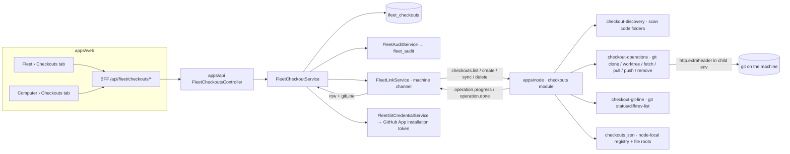

# FL-14 — Checkouts on computers · Implementation plan

> How [`spec.md`](./spec.md) gets built. Implementation detail belongs here, not in the spec
> (Constitution IX). Every path below was opened at `origin/develop` `e4334baf7` before it was cited.

**Epic ID:** `FL-14-checkouts`
**Spec:** [`./spec.md`](./spec.md) · **Tasks:** [`./tasks.md`](./tasks.md)
**Status:** `Draft`
**Created:** 2026-10-18
**Last updated:** 2026-10-18

---

## 1. Architecture summary

Data flows back the same way: the node answers every request on the `machine` channel with a
`requestId`, long operations reply `{ operationId }` and stream `operation.progress` /
`operation.done` on channel 0 (CONTRACTS §3.3); the service upserts the row, stores the git line
snapshot and writes the audit row; the web tab polls the row list (10 s while any row is
`creating`, else 60 s) and reads operations through `GET /api/fleet/operations/:id` (FL-02).

## 2. Current state in the codebase

| Piece                                                                                                                                                                 | Where (verified at HEAD)                                                                                                                                                   | Reused how                                                                                   |
| --------------------------------------------------------------------------------------------------------------------------------------------------------------------- | -------------------------------------------------------------------------------------------------------------------------------------------------------------------------- | -------------------------------------------------------------------------------------------- |
| Node pool layout: `<root>/repositories/<key>/repos/<repo key>/` one bare clone, `worktrees/fleet-<binding>/` one checkout per (task, repo), `.mounts/<dir>` links      | `apps/node/src/core/workspaces/workspace-inventory.ts:17-37`                                                                                                                | The inventory's `WorkspaceRecord` (`:51-80`: path, poolPath, branch, headSha, dirty, hasLocks, sizeBytes, lastUsedAt) is the source for FR-7 rows and for the delete changes-check. |
| Provisioner over the local-workspace plugin (bare cache, fetch-first branch resolution, per-repo mutex, stamps)                                                       | `apps/node/src/core/workspaces/fleet-task-workspace.ts:584-600`; error codes `:30-60`                                                                                      | Untouched. Task worktrees keep provisioning through it; FL-14 reads them.                    |
| Reaper safety rules 1–8 (ownership, intent, lease, dirty, locks, unreachable commits, remote state, age)                                                               | `apps/node/src/core/workspaces/workspace-reaper.ts:30-60`                                                                                                                   | Rules 5–6 are extracted into a shared `checkout-evidence.ts` so delete and reaper agree.     |
| Cancellable git exec                                                                                                                                                  | `execFileWithVerifiedCancellation` from `@ever-works/local-workspace-plugin` (imported at `fleet-task-workspace.ts:16`)                                                     | Every git shell-out in the new module.                                                       |
| Scoped push credential: installation token per job, `contents: write`, repository-narrowed, `http.<url>.extraheader` in the child env, revoked at run end             | `packages/contracts/src/fleet/fleet-push-credential.types.ts:1-40`; `apps/api/src/fleet/fleet-push-credential.service.ts:1-70` (`FleetPushScope`, `requestGitHubAppInstallationAccessTokenDetails`); node side `apps/node/src/core/workspaces/push-credential.ts` | Generalised to an **operation-scoped git credential** (read for clone/fetch/pull, write for push) keyed by `operationId` instead of a job lease. |
| Capability tags `git`, `git-push`, `docker` and the "a tag is a promise" rule                                                                                         | `apps/node/src/core/capabilities.ts:264-310`; constants `packages/contracts/src/fleet/fleet-jobs.types.ts:131-151`                                                          | `git` gates every checkout action; `git-push` gates push on platform-created checkouts; `docker` gates container isolation. |
| `--workspace-root` parsing and persistence in `node-config.json`                                                                                                      | `apps/node/src/cli/program.ts:383-421, :439`                                                                                                                                | `--code-folder <dir>` (repeatable) follows the same parse-and-persist shape.                 |
| Workspace spec contract (`repositoryId`, token-free `repoUrl`, `baseRef`, `branch`, mounts)                                                                           | `packages/contracts/src/fleet/fleet-task-workspace.types.ts:9-40`                                                                                                           | `FleetCheckoutCreateRequest` reuses its URL/branch validators.                               |
| Work ↔ repository: `sourceRepository.auth { mode:'github_app_installation', installationId, repoFullName }`; installation repositories `owner`, `repo`, `fullName`    | `packages/agent/src/entities/work.entity.ts:399, 988-998`; `packages/agent/src/entities/github-app-installation-repository.entity.ts:10-30`                                 | Remote → Work matching (R-16).                                                               |
| Fleet audit writer with key-based redaction                                                                                                                           | `packages/agent/src/fleet/fleet-audit.service.ts`; action union `packages/contracts/src/fleet/fleet-panic.types.ts:60-112`                                                 | Adds `node.checkout.create|delete|sync|archive`.                                             |
| Fleet controller root and guard                                                                                                                                       | `apps/api/src/fleet/fleet.controller.ts:150-151` (`@Controller('api/fleet')`, `FleetEnabledGuard`)                                                                         | New controller mounted beside it.                                                            |
| Agent fleet tool precedent (`list_fleet_nodes`)                                                                                                                        | `packages/agent/src/fleet/agent-fleet-tools.ts:32-56`                                                                                                                       | Tool builder pattern for `fleet_checkouts_*`.                                                |
| MCP whitelist Fleet block; CLI has no fleet                                                                                                                           | `apps/mcp/src/openapi-tools/whitelist.ts:475-530`; `apps/cli/src/commands/` (`auth`, `kb`, `plugins`, `work`)                                                               | Whitelist entries; first `fleet` command group (FL-19 completes).                            |
| Routes constants                                                                                                                                                      | `apps/web/src/lib/constants.ts:339` (`DASHBOARD_SETTINGS_FLEET`)                                                                                                            | `DASHBOARD_FLEET_CHECKOUTS` beside the FL-01 constants.                                      |
| Module registry for computer-page tabs (FL-01)                                                                                                                        | `apps/web/src/components/fleet/registry.ts` (does not exist at HEAD; FL-01 creates it — `apps/web/src/components/` has no `fleet/`)                                         | Registers the `checkouts` tab.                                                               |

Missing today (spec §2.2): no checkout entity, no discovery, no person-initiated clone/worktree,
no fetch/pull/push from the platform, no delete with a changes-check, no git line, no file roots.

## 3. Tech choices

| Concern                 | Choice                                                                                                                    | Why                                                                                                                        |
| ----------------------- | ------------------------------------------------------------------------------------------------------------------------- | -------------------------------------------------------------------------------------------------------------------------- |
| Persistence             | TypeORM entity `FleetCheckout` (`fleet_checkouts`), string unions in `varchar`, `PortableDateColumn`                      | House conventions (`fleet-node.entity.ts`); sqlite e2e stack needs portable dates                                          |
| Node ↔ platform         | `machine` channel of the node link, `checkouts.*` requests; operations for long git work                                   | CONTRACTS §3.3; nothing durable — a clone that misses the link is retried by a person, not queued (§12)                     |
| Git on the node         | `git` binary via `execFileWithVerifiedCancellation`; no libgit                                                             | Same tool the pool uses; cancellation proven; Windows `core.longpaths=true` passed per command                              |
| Clone credential        | GitHub App installation token minted per operation, `http.<origin>.extraheader` in the child env only                      | Exactly the push-credential posture (`fleet-push-credential.types.ts:16-23`); never argv, never config, never the remote URL |
| Discovery               | Depth-3 walk, prune at `.git`, skip list (`node_modules`, `.pnpm-store`, `dist`, `build`, `target`, `.venv`, `vendor`), 300 cap | Bounded cost on a laptop; CONTRACTS §10 limit                                                                              |
| Git line                | `git status --porcelain=v2 --branch`, `git diff --numstat`, `git rev-list --left-right --count @{u}...HEAD`                 | Local only (FR-10); porcelain v2 is stable and gives ahead/behind in one call                                               |
| Remote matching         | Pure function `matchRemote(remoteUrl) → { host, fullName }`; github.com only links to installations/Works                  | Host-awareness lesson from `fleet-push-credential.service.ts:58-70`                                                        |
| Web                     | Server component + client table under `apps/web/src/components/fleet/checkouts/`; pure policy in `checkouts.shared.ts`     | Same split as `agent-fleet.shared.ts` / `computer-session.shared.ts`                                                       |
| Container isolation (P3)| `docker run --rm -v <path>:/workspace -w /workspace <image>` wrapper the daemon (FL-04) spawns sessions through            | Reuses the `docker` tag; Windows refused (`os:win32` → `unsupported_on_node`)                                               |

## 4. Data model

### 4.1 `FleetCheckout` — `packages/agent/src/entities/fleet-checkout.entity.ts` → `fleet_checkouts`

Columns exactly as CONTRACTS §4.3: `id`, `nodeId`, `userId`, `organizationId` (null; the Node's
binding at creation, for R-19), `path`, `kind` (`clone|worktree|discovered`), `parentCheckoutId`,
`remoteUrl` (token-free), `remoteHadCredential boolean default false` (FR-5 flag — a boolean
beside the contract column, additive), `workId`, `branch`, `baseRef`, `isolation`
(`host|container`), `state` (`creating|ready|missing|archived`), `createdBy`
(`user|agent|task|discovery`), `gitLine` (simple-json, §4.7), `lastCommand` (simple-json
`{ command, exitCode, at }`), `sizeBytes bigint null`, `lastSeenAt`, `archivedAt`, `createdAt`,
`updatedAt`. Indexes: `(nodeId, state)`, `(userId, state)`, `(workId)`, unique `(nodeId, path)`.

`[NEEDS CLARIFICATION: CONTRACTS change — §4.3 has no size or last-seen column; this plan adds
`sizeBytes` and `lastSeenAt` (FR-14, FR-11) and `remoteHadCredential` (FR-5) as additive columns.]`

### 4.2 Migration

`apps/api/src/migrations/1796140000000-CreateFleetCheckouts.ts` — one `CREATE TABLE`, four
indexes, FKs on `nodeId → fleet_nodes`, `parentCheckoutId → fleet_checkouts`, `workId → works`
(nullable). Forward-only; `down` drops exactly what `up` added. Authored from `apps/api/` with
`pnpm typeorm migration:generate -d typeorm.config.ts src/migrations/CreateFleetCheckouts`,
re-stamped if `develop` moved. Same PR as the entity.

### 4.3 Contracts — `packages/contracts/src/fleet/fleet-checkout.types.ts`

`FleetCheckoutKind`, `FleetCheckoutState`, `FleetCheckoutIsolation`, `FleetCheckoutCreatedBy`
(each with a `readonly` array + `isX` guard, as `fleet-jobs.types.ts` does), `FleetGitLine`
(§4.7), `FleetCheckoutView`, `FleetCheckoutCreateRequest` (`nodeId`, `source: { kind:'clone',
repositoryId?, repoUrl } | { kind:'worktree', parentCheckoutId } | { kind:'container', … }`,
`branch?`, `baseRef?`, `isolation`), `FleetCheckoutSyncOp = 'fetch'|'pull'|'push'`, link messages
`CheckoutsListRequest { rescan?, refresh?, checkoutIds? }`, `CheckoutsCreateRequest`,
`CheckoutsSyncRequest`, `CheckoutsDeleteRequest { checkoutId, confirmationToken }`,
`CheckoutsListReply { checkouts: NodeCheckoutRecord[], truncated, codeFolders[] }`,
`FLEET_CHECKOUTS_DISCOVERY_CAP = 300`, `FLEET_CHECKOUT_GIT_LINE_REFRESH_MS = 60_000`,
`FLEET_CHECKOUT_MANUAL_REFRESH_MIN_MS = 10_000`, `FLEET_CHECKOUT_RECONCILE_MS = 600_000`.
Additive to `fleet-panic.types.ts`: `node.checkout.create|delete|sync|archive`. Additive to
`fleet-node.types.ts`: `codeFolders: string[]` in the heartbeat inventory (so the tab can show
them before the link opens).

### 4.4 Git credential request — `packages/contracts/src/fleet/fleet-git-credential.types.ts`

`FleetGitCredentialRequest { operationId, repositoryId, remoteUrl, access: 'read'|'write' }` and
the reply shape of the existing `FleetJobPushCredentialResponse` (same username constant, same
expiry, same `repositories[]`), so the node's `push-credential.ts` consumer needs one new caller.

## 5. API surface

All under `/api/fleet` (CONTRACTS §11.2), `FleetEnabledGuard` + `FLEET_CHECKOUTS_ENABLED` guard,
authenticated; every refusal is `{ error: { code, hint, details } }` (§8).

| Method | Path                                      | Body / query                                   | Returns                               | Family / class                       | Errors                                                                          |
| ------ | ----------------------------------------- | ---------------------------------------------- | ------------------------------------- | ------------------------------------ | ------------------------------------------------------------------------------- |
| GET    | `/checkouts`                              | `?nodeId&workId&state&kind&limit&cursor`       | `{ data: FleetCheckoutView[], meta }` | `view`                               | `permission_denied`                                                             |
| GET    | `/nodes/:id/checkouts`                    | `?rescan=true` (triggers discovery)            | same + `codeFolders`, `scannedAt`     | `view` (rescan: `checkouts`, `plain`) | `unreachable`, `consent_missing`, `kill_switch`, `limit_exceeded`              |
| POST   | `/checkouts`                              | `FleetCheckoutCreateRequest`                   | `202 { checkout, operationId }`       | `checkouts` · `plain`                | `invalid`, `unreachable`, `consent_missing`, `permission_denied`, `limit_exceeded`, `unsupported_on_node`, `busy`, `kill_switch` |
| GET    | `/checkouts/:id`                          | —                                              | `FleetCheckoutView`                   | `view`                               | `not_found`                                                                     |
| POST   | `/checkouts/:id/refresh`                  | —                                              | `FleetCheckoutView` (new gitLine)     | `checkouts` · `plain`                | `unreachable`, `limit_exceeded` (1/10 s)                                        |
| POST   | `/checkouts/:id/sync`                     | `{ op: 'fetch'|'pull'|'push', confirmationToken? }` | `202 { operationId }`            | `checkouts` · fetch `plain`, pull/push `confirm` | `busy`, `operation_failed`, `confirmation_required`, `consent_missing`, `unreachable`, `kill_switch` |
| POST   | `/checkouts/:id/archive`                  | —                                              | `FleetCheckoutView`                   | `checkouts` · `confirm`              | `busy`                                                                          |
| POST   | `/checkouts/:id/restore`                  | —                                              | `FleetCheckoutView`                   | `checkouts` · `plain`                | `operation_failed` (folder gone)                                                |
| POST   | `/checkouts/:id/delete-preview`           | —                                              | `{ uncommitted, unpushedCommits, class }` | `checkouts` · `plain`            | `unreachable`                                                                   |
| DELETE | `/checkouts/:id`                          | `{ confirmationToken, mode: 'delete'|'forget' }` | `202 { operationId }`               | `checkouts` · `confirm` / `confirm-destructive` | `confirmation_required`, `busy`, `unreachable`, `kill_switch`         |
| POST   | `/internal/fleet/checkouts/credential`    | `FleetGitCredentialRequest` (node credential)  | installation token response           | node-authenticated (`FleetNodeAuthGuard`) | undifferentiated 401; `operation_failed` with stable reason                |

Confirmation tokens: `POST …/delete-preview` returns the class and a one-time token bound to
(checkoutId, class, counts); the `DELETE` must present it — the same two-step the other families
use for `confirm-destructive` (FL-01 defines the token helper; this plan consumes it). Rate tier:
`long` 30/min per user on create/sync/delete; `refresh` 6/min per checkout.

DTOs in `apps/api/src/fleet/dto/fleet-checkout.dto.ts` (`class-validator`; `repoUrl` validated by
the existing token-free URL rule from `fleet-task-workspace.types.ts`).

## 6. Node side

New module `apps/node/src/core/checkouts/` (TypeScript, no plugin — README D8):

| File                      | Responsibility                                                                                                                                                                                     |
| ------------------------- | -------------------------------------------------------------------------------------------------------------------------------------------------------------------------------------------------- |
| `checkout-registry.ts`    | Node-local registry `checkouts.json` in the config dir: id, path, kind, parent, remote, branch, isolation, origin (`platform`/`discovery`/`task`). Source of FL-11 roots via `allowedRoots()`.      |
| `checkout-discovery.ts`   | Walk code folders (depth 3, skip list, prune at `.git`), read `git remote get-url origin`, strip userinfo, flag it; honours the 300 cap; emits `truncated`.                                           |
| `checkout-git-line.ts`    | `status --porcelain=v2 --branch`, `diff --numstat`, `rev-list --left-right --count`, `worktree list --porcelain` (isWorktree), base ref from `branch.<b>.base` config else upstream; never fetches. |
| `checkout-evidence.ts`    | Shared with the reaper: dirty count, lock files, commits unreachable from any remote ref; returns `{ uncommitted, unpushedCommits, class }`.                                                        |
| `checkout-operations.ts`  | `clone`, `worktreeAdd`, `fetch`, `pull`, `push`, `remove`, `forget`; every command cancellable; progress parsed from git's stderr meter; partial folder removed on failure.                           |
| `checkout-credential.ts`  | Asks `/api/internal/fleet/checkouts/credential` for an operation token; injects `http.<origin>.extraheader` into the child env for one command; never writes config.                               |
| `checkout-task-import.ts` | Maps `workspace-inventory` records to `discovered`-origin rows of kind `worktree`, `createdBy: task`.                                                                                              |
| `checkout-container.ts`   | P3: builds the `docker run` wrapper for sessions/commands in a `container` checkout.                                                                                                                 |
| `checkouts-handler.ts`    | Registers `checkouts.list|create|sync|delete` on the `machine` channel (FL-02's channel host).                                                                                                      |

**Messages (machine channel, JSON, `requestId` on every frame):**

- `checkouts.list { rescan?, refresh?, checkoutIds? }` → `{ checkouts[], truncated, codeFolders, scannedAt }`.
  `rescan` runs discovery and the Task import; `refresh` recomputes git lines for `checkoutIds`.
- `checkouts.create { checkoutId, source, path?, branch, baseRef, isolation }` → `{ operationId }`;
  then `operation.progress { percent, phase: 'credential'|'clone'|'checkout'|'worktree' }` and
  `operation.done { ok, path, branch, headSha, gitLine } | { error }`.
- `checkouts.sync { checkoutId, op }` → `{ operationId }` → `operation.done { exitCode, stderrHead, gitLine }`.
- `checkouts.delete { checkoutId, mode, expected: { uncommitted, unpushedCommits } }` →
  `{ operationId }`; the node **re-computes** the evidence and refuses with `busy`/`invalid` when
  it exceeds `expected` (the confirmation was given for smaller counts).
- Refusals: `consent_missing` (no `--manage` for a person-initiated request; `--work` suffices for
  `createdBy: task`), `busy` (lease file alive, reaper intent pending, or a daemon session has
  the path as cwd), `unsupported_on_node`, `limit_exceeded`, `operation_failed`.

**Consents and tags:** person-initiated → `--manage` (`managed` tag); Task-initiated → `--work`.
Requires `git`; push on platform-created checkouts requires `git-push`; `container` requires
`docker` and not `os:win32`.

**OS matrix:** Linux/macOS: paths canonicalised with `realpath`; symlinks escaping a code folder
are not followed. Windows: `-c core.longpaths=true` on every git command, `icacls` not needed (the
owner's own folders), junctions treated like symlinks (not followed), PowerShell not involved.
Default checkouts root: `<workspace-root>/checkouts/<repo key>/<slug>` (same volume and disk
floor as the pool — `effectiveMinFreeDiskBytes` check before clone).

**Code folders:** `ever-works-node start --code-folder <dir>` (repeatable; persisted in
`node-config.json` like `--workspace-root`, `program.ts:439`); reported in the heartbeat inventory
and in `checkouts.list`. Home directory as a whole is refused at parse time.

**Kill switch:** the link host (FL-02) refuses every `checkouts.*` request with `kill_switch`;
the handler aborts in-flight operations via their `AbortSignal` and removes partial clones.

## 7. Plugin surface

None. The node keeps its compile-time dependency on `@ever-works/local-workspace-plugin` for the
Task pool; FL-14 does not add a plugin or a capability. (A future "git hosting provider" plugin
for non-GitHub credentials is out of scope and would hang off the credential endpoint.)

## 8. Web surface

- Routes: `/fleet/checkouts` → `DASHBOARD_FLEET_CHECKOUTS` in `apps/web/src/lib/constants.ts`;
  computer tab `?tab=checkouts` through FL-01's registry (`apps/web/src/components/fleet/registry.ts`
  entry `{ id: 'checkouts', consent: 'manage', flag: 'FLEET_CHECKOUTS_ENABLED', load: () => import(…) }`).
- Pages: `apps/web/src/app/[locale]/(dashboard)/fleet/checkouts/page.tsx` (server component:
  fetches the list and kill-switch state, hands to the client).
- Components `apps/web/src/components/fleet/checkouts/`: `CheckoutsHubTab.tsx`,
  `ComputerCheckoutsTab.tsx`, `CheckoutRow.tsx`, `GitLine.tsx` (shared renderer; FL-06 adds the
  PR pill slot), `CodeFoldersCard.tsx`, `NewCheckoutDialog.tsx`, `DeleteCheckoutDialog.tsx`,
  `CheckoutsBin.tsx`, `CheckoutStateCard.tsx` (empty / offline / consent-missing / error),
  `checkouts.shared.ts` (pure: grouping by repository, row ordering, action availability per
  state × consent × audience × busy, size formatting, reaper-note text).
- BFF: `apps/web/src/app/api/fleet/checkouts/route.ts`, `.../[id]/{refresh,sync,archive,restore,delete-preview}/route.ts`,
  `apps/web/src/app/api/fleet/nodes/[id]/checkouts/route.ts` — thin `bffProxy` like
  `apps/web/src/lib/api/computer-bff.ts`.
- i18n groups (`apps/web/messages/en.json`, namespace `fleet.*`, camelCase leaves, no literal `.`):
  `fleet.checkouts.{tab,hub,row,gitLine,codeFolders,newDialog,deleteDialog,bin,states,actions,activity}`,
  `fleet.errors.{unreachable,consentMissing,permissionDenied,limitExceeded,busy,unsupportedOnNode,operationFailed,killSwitch}`
  (shared hints, owned by FL-01, extended here).
- Palette: `fleet.checkouts` screen entry in `apps/web/src/components/command-palette/registry/screens.ts`
  beside the `settings.fleet` entry (`:212-218`).
- Playwright: `apps/web/e2e/flow-fleet-checkouts.spec.ts` (hub tab, computer tab, scan, new
  worktree, fetch, archive/restore, delete dialog classes, consent-missing and offline states),
  `apps/web/e2e/flow-fleet-checkouts-contract.spec.ts` (API shapes and error codes, in the style of
  `flow-fleet-enrollment-contract.spec.ts`).

## 9. Agent / MCP / CLI surface

Tools (`packages/agent/src/fleet/agent-fleet-tools.ts` builder, extended):

| Tool                        | Annotation                                             | Maps to                          |
| --------------------------- | ------------------------------------------------------ | -------------------------------- |
| `fleet_checkouts_list`      | `readOnly: true`                                       | `GET /checkouts`                 |
| `fleet_checkouts_get`       | `readOnly: true`                                       | `GET /checkouts/:id`             |
| `fleet_checkouts_create`    | `destructive: false`, `confirmationClass: 'plain'`     | `POST /checkouts`                |
| `fleet_checkouts_sync`      | fetch `plain`; pull/push `confirm`; `destructive: false` | `POST /checkouts/:id/sync`     |
| `fleet_checkouts_archive`   | `destructive: false`, `confirm`                        | `POST /checkouts/:id/archive`    |
| `fleet_checkouts_delete`    | `destructive: true`, `confirm` / `confirm-destructive` | `DELETE /checkouts/:id`          |

Agent gating: AW-15 grant + AW-24 trust **and** the Node's `checkouts` audience includes the
Agent's owner (CONTRACTS §2.1). MCP: the same six routes added to the Fleet block of
`apps/mcp/src/openapi-tools/whitelist.ts`. CLI: `apps/cli/src/commands/fleet/checkouts.ts` —
`ever-works fleet checkouts list|get|create|sync|archive|delete [--json]`, exit `0/1/2`; FL-19
finishes the family.

## 10. Background jobs

| Task                           | File                                                              | When          | Does                                                                                                 | Idempotency                      |
| ------------------------------ | ----------------------------------------------------------------- | ------------- | ---------------------------------------------------------------------------------------------------- | -------------------------------- |
| `fleet-checkout-reconcile`     | `packages/tasks/src/tasks/trigger/fleet-checkout-reconcile.task.ts` | cron `7/10 * * * *` | Rows `creating` > 10 min → `missing` with `lastCommand.exitCode = -1`; asks online nodes for `checkouts.list` when their last list is > 10 min old | CAS on `updatedAt`               |
| `fleet-checkout-bin-purge` (P3)| `packages/tasks/src/tasks/trigger/fleet-checkout-bin-purge.task.ts` | daily         | Deletes `archived` rows with `archivedAt` > 30 d whose `lastCommand.command = 'delete'`              | Row-level `DELETE … WHERE`       |

Dispatched through `*_DISPATCHER` symbols bound in `apps/api/src/fleet/fleet.module.ts`
(Constitution IV); never imports a job-runtime SDK.

## 11. Security & permissions

- **Threats:** a crafted remote URL carrying a token (stripped on the node before it leaves; the
  platform re-strips before insert); a path outside the Node's roots (refused by canonicalisation
  and the registry); a delete racing a session or the reaper (`busy`, re-computed evidence on the
  node); a credential minted for one repository used on another remote (operation token is
  repository-narrowed and the node verifies the remote's `owner/repo` **and host** before use —
  `fleet-push-credential.service.ts:58-70` lesson); a `discovered` checkout never receives a
  platform credential.
- **What the node refuses:** requests without the right consent; paths not under a code folder
  or the checkouts root; `container` without `docker` or on Windows; deletes whose evidence grew.
- **Redaction:** audit `details` carry `path`, `kind`, `op`, `exitCode`, `branch`, `repositoryId`;
  never `remoteUrl` with userinfo, never the credential (the audit writer's key redaction drops
  anything named `token|credential|secret`; fields are named for meaning, e.g. `credentialScope`
  is avoided in favour of `access`).
- **Audit:** `node.checkout.create|delete|sync|archive` with `family: 'checkouts'`, `target: path`,
  `requestedBy`, `confirmationClass`, `outcome`.

## 12. Observability

Audit rows as above; Activity log sentences `fleet.checkout.created|deleted|archived`; metrics
`fleet_checkouts_discovered_total{node}`, `fleet_checkouts_created_total{kind}`,
`fleet_checkout_operation_seconds{op}`, `fleet_checkouts_missing{node}`; the link host's existing
per-family request counters cover `checkouts.*`.

## 13. Phased rollout

- **P1** (flag `FLEET_CHECKOUTS_ENABLED`, default off): entity + migration, contracts, node
  registry/discovery/git line/Task import, `checkouts.list`, hub and computer tabs, fetch,
  archive/restore, reconcile task, audit, i18n, Playwright.
- **P2**: create (clone + worktree), credential endpoint, pull/push, delete with changes-check,
  file roots for FL-11, Agent tools + MCP + CLI.
- **P3**: container isolation, shared folders, bin purge.
- **Default-on**: after ACC-FL14-01…21 pass on `develop` and FL-02 is on.

## 14. Test plan

- **Contracts (Vitest):** `packages/contracts/src/fleet/__tests__/fleet-checkout.types.spec.ts` —
  guards, URL validation, `remoteHadCredential` flagging, cap constants.
- **Agent (Jest):** `packages/agent/src/fleet/__tests__/fleet-checkout.service.spec.ts` — state
  machine, archive/restore, 300 cap, busy refusals, kill switch, consent and audience checks,
  audit rows per action; `checkout-remote-match.spec.ts` — host-aware matching truth table;
  `fleet-checkout.repository.integration.spec.ts` — unique `(nodeId, path)`.
- **API (Jest):** `apps/api/src/fleet/fleet-checkouts.controller.spec.ts` — every error code and
  status, confirmation token round trip, cross-user 404; `fleet-git-credential.service.spec.ts` —
  read vs write scope, repository narrowing, revoke on done, host mismatch refused.
- **Node (Vitest):** `apps/node/src/core/checkouts/checkout-discovery.spec.ts` (depth, prune, skip,
  cap, token strip), `checkout-git-line.spec.ts` (fixtures for ahead/behind/dirty/worktree; no
  network), `checkout-evidence.spec.ts` (agrees with the reaper on the same fixtures),
  `checkout-operations.spec.ts` (clone/worktree/fetch/pull/push/remove argv, cancellation, partial
  cleanup, Windows longpaths), `checkout-credential.spec.ts` (header only in child env),
  `checkouts-handler.spec.ts` (consent matrix, busy, kill switch), `checkout-task-import.spec.ts`.
- **Web unit (Vitest):** `apps/web/src/components/fleet/checkouts/checkouts.shared.unit.spec.ts`
  (grouping, action availability matrix), `GitLine.unit.spec.tsx`, `DeleteCheckoutDialog.unit.spec.tsx`.
- **E2E (Playwright):** `apps/web/e2e/flow-fleet-checkouts.spec.ts`, `flow-fleet-checkouts-contract.spec.ts`.

## 15. Risks

| Risk                                                       | L   | I   | Mitigation                                                                                   |
| ---------------------------------------------------------- | --- | --- | -------------------------------------------------------------------------------------------- |
| Discovery walks a huge tree                                | M   | M   | Depth 3, prune at `.git`, skip list, 300 cap, 30 s budget per scan                            |
| Delete loses work                                          | L   | H   | Evidence computed on the node twice (preview and execute); typed confirmation; branch kept   |
| Credential leaks into git config or logs                   | L   | H   | Header in child env only; redacting logger; audit key redaction; tests assert absence        |
| Reaper and person-initiated ops race                       | M   | M   | Shared evidence module; `busy` on intent/lease; reaper note shown on rows                    |
| Windows path/junction quirks                               | M   | M   | `core.longpaths`, junction detection from `.mounts` precedent, Windows node in CI matrix     |
| FL-01 registry not landed when P1 is ready                 | M   | L   | Tab component is standalone; registration is one line                                        |

## 16. Constitution reconciliation

- **I** no new external integration (GitHub reached via the existing App path). **II** capability
  tags drive eligibility; no provider id. **III** content stays in user repos/on the machine.
  **IV** reconcile and purge via dispatcher symbols. **V** one additive migration. **VI** tests in
  §14. **VII** token-free storage, per-operation credentials, redaction. **VIII** no plugin.
  **IX** spec behaviour-only. **X** additive entity/routes/tags/tools.

## 17. References

- Spec: [`./spec.md`](./spec.md) · Tasks: [`./tasks.md`](./tasks.md)
- Program: [README](../README.md) D2, D5, D7, D8 · [CONTRACTS](../CONTRACTS.md) · [CAPABILITY-MAP](../CAPABILITY-MAP.md) §E
- Precedents: `apps/node/src/core/workspaces/*`, `apps/api/src/fleet/fleet-push-credential.service.ts`, `apps/web/src/components/agents/agent-fleet.shared.ts`, `apps/web/src/lib/api/computer-bff.ts`
- Constitution: `.specify/memory/constitution.md`
