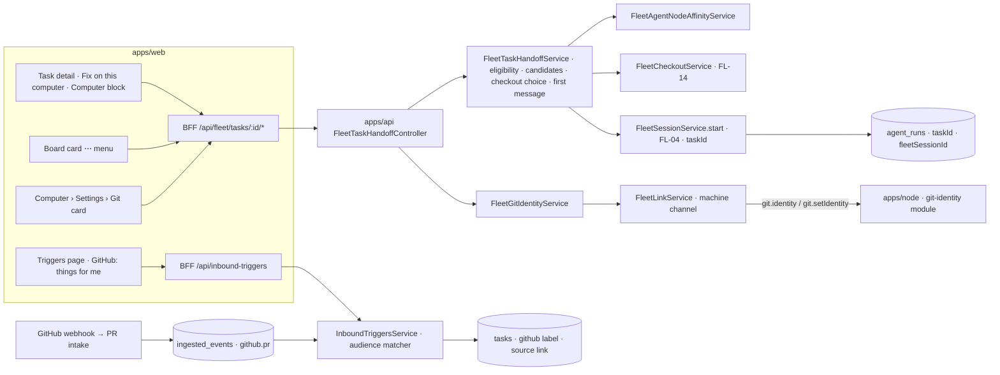

# FL-15 — Tasks & GitHub on the fleet · Implementation plan

> How [`spec.md`](./spec.md) gets built. Implementation detail belongs here, not in the spec
> (Constitution IX). Every path below was opened at `origin/develop` `e4334baf7` before it was cited.

**Epic ID:** `FL-15-tasks-and-github`
**Spec:** [`./spec.md`](./spec.md) · **Tasks:** [`./tasks.md`](./tasks.md)
**Status:** `Draft`
**Created:** 2026-10-18
**Last updated:** 2026-10-18

---

## 1. Architecture summary

Back-flow: the session start returns `202 { sessionId, runId, operationId }`; the dialog polls the
operation (FL-02) until the daemon acknowledges; the Task page reads the latest session for the
Task through the Run (`agent_runs.taskId` → `fleetSessionId`) and the session's `checkoutId` →
git line (FL-14/FL-06). The identity card reads the node's reply and caches it 60 s.

## 2. Current state in the codebase

| Piece                                                                      | Where (verified at HEAD)                                                                                                                                                        | Reused how                                                                                                     |
| -------------------------------------------------------------------------- | ------------------------------------------------------------------------------------------------------------------------------------------------------------------------------- | -------------------------------------------------------------------------------------------------------------- |
| Run-with-agent menu, three entry points, candidate sources                 | `apps/web/src/components/tasks/RunWithAgentMenu.tsx:20-50`; action `runTaskAction` in `apps/web/src/app/actions/tasks.ts:433`                                                     | `FixOnComputerDialog` reuses the candidate resolver and `SOURCE_LABELS`; sits beside the menu.                |
| Assign-task endpoint (`taskId` only; concurrency valve; in-flight dedup)   | `apps/api/src/agents/agents.controller.ts:1886-1935`                                                                                                                             | Untouched. Sessions go through FL-04's start with `taskId`, which reuses the same valve (`createQueued`).      |
| Affinity resolution and service                                            | `apps/api/src/fleet/fleet-run-router.service.ts:294, 326-340`; `packages/agent/src/fleet/fleet-agent-node-affinity.service.ts:26-78`                                             | `getAffinity` constrains the computer list; never `setAffinity`.                                               |
| Affinity UI semantics                                                      | `apps/web/src/components/agents/AgentFleetSection.tsx:33-55`; `agent-fleet.shared.ts`                                                                                            | Node-row reasons and ordering helpers reused for the dialog's computer list.                                   |
| Task detail sections; branch cockpit; PR pill; run chip                    | `apps/web/src/components/tasks/TaskDetailClient.tsx:26-32, 541, 810`; `TaskBranchSection.tsx:27-33`; `TaskPrPill.tsx:17-30`; `TaskRunChip.tsx`                                   | New `TaskFleetSection.tsx` mounted after `TaskRunControls` (`:541`); `TaskPrPill` reused.                       |
| Task branch rule and columns                                               | `packages/agent/src/tasks-domain/task-isolation.ts:43-56`; `packages/agent/src/entities/task.entity.ts:212-232`                                                                  | The session's worktree branch = `task.branchRef` (FL-06 FR-4).                                                 |
| Inbound Triggers: kinds, source types, matcher, mode, auto-start           | `packages/agent/src/entities/inbound-trigger.entity.ts:12-69`; `packages/agent/src/triggers/inbound-triggers.service.ts:112-120`; `trigger-event-matcher.ts`; `trigger-prompt.ts` | Matcher gains `audience`; preset through the existing create path; Task built by the existing prompt/template. |
| Triggers UI                                                                | `apps/web/src/components/tasks/TaskTriggersClient.tsx:84-106`                                                                                                                    | **About me** group + preset button.                                                                             |
| GitHub issue intake (`github.issue`, actions incl. `assigned`, `workHint`) | `apps/api/src/ingest/github/github-issue-intake.service.ts:31, 40-48, 160`                                                                                                        | Pattern for the PR intake; `workHint { kind:'repo' }` resolves the Work.                                        |
| PR review bridge emits `github.pr`                                         | `apps/api/src/ingest/github/github-pr-review-bridge.service.ts:1298`; dispatcher `github-webhook-dispatcher.service.ts:111`                                                       | A sibling `github-pr-intake.service.ts` registers for `pull_request` actions the bridge ignores.               |
| GitHub user link (`githubUserId`, `githubLogin`)                           | `packages/agent/src/entities/github-app-user-link.entity.ts:11-35`                                                                                                                | "me" = `githubLogin`; no-reply email = `<githubUserId>+<githubLogin>@users.noreply.github.com`.                |
| Node capability probe (git version only)                                   | `apps/node/src/core/capabilities.ts:264-310`                                                                                                                                      | New `git-identity.ts` module reads/sets global config; `git-push` tag + installation coverage → "can push".    |
| Push credential attribution (author = Agent, committer = node)             | `packages/contracts/src/fleet/fleet-push-credential.types.ts:33-39`                                                                                                              | Unchanged; the identity card concerns the person's own commits.                                                |
| Fleet audit action union                                                   | `packages/contracts/src/fleet/fleet-panic.types.ts:60-112`                                                                                                                       | Proposed `node.git.identity.set` (CONTRACTS §7 change).                                                        |
| MCP whitelist Fleet block; CLI has no fleet                                | `apps/mcp/src/openapi-tools/whitelist.ts:475-530`; `apps/cli/src/commands/`                                                                                                       | New entries; `fleet tasks` and `fleet git` command files.                                                      |
| Routes                                                                     | `apps/web/src/lib/constants.ts:284` (`DASHBOARD_TASK`), `:339` (`DASHBOARD_SETTINGS_FLEET`)                                                                                       | No new route; dialog and block live on Task detail; Git card on the computer Settings tab (FL-01 registry).    |

Missing today: spec §2.2 — no per-session machine choice, no Task ↔ session/checkout links, no
`review_requested` ingest, no "me" notion in Triggers, no git identity read or fix.

## 3. Tech choices

| Concern              | Choice                                                                                                               | Why                                                                                              |
| -------------------- | -------------------------------------------------------------------------------------------------------------------- | ------------------------------------------------------------------------------------------------ |
| Session start        | FL-04 `POST /api/fleet/sessions` with `taskId`, `nodeId`, `agentId`, `checkout: { mode, parentCheckoutId?, branch }`, `firstMessage` | One start path; the Run gets `taskId` so board/history/chat follow the Task-run bookkeeping       |
| Eligibility          | Pure `eligibleComputers(nodes, agent, affinity, killSwitch)` → closed-set reasons                                     | Mirrors `agent-fleet.shared.ts`; UI and API share it                                             |
| First message        | Pure `buildFirstMessage(task, source)` (title, ≤ 2 000-char excerpt, checks summary, source link, "commit and open a PR" line) | Deterministic; testable; FL-06's `{task}` placeholder uses the same summary                       |
| Links on Task detail | Query by `agent_runs.taskId` → latest Run with `fleetSessionId` → `fleet_sessions` → `fleet_checkouts`                | No new columns                                                                                   |
| Trigger audience     | Additive `audience?: { me: ('review-requested'|'assigned'|'authored')[] }` on `InboundTriggerEventMatcher`; evaluated in `trigger-event-matcher.ts` against the owner's `githubLogin` | JSON field, no migration (verified in T-12); pure matcher stays pure (login passed in)            |
| PR intake            | `github-pr-intake.service.ts` beside the issue intake, same envelope shape, `kind: 'github.pr'`, subject = PR         | Coalescing by subject already exists                                                             |
| Identity read/set    | Machine channel `git.identity` / `git.setIdentity` (CONTRACTS change); node runs `git config --global`               | Nothing on a machine without the node; `confirm` class                                           |
| "Can push for agents"| `git-push` tag ∧ ≥ 1 installation repository for the owner                                                           | Same facts the push credential mint needs                                                        |

## 4. Data model

**No migration** (no FL-15 slot). Additive shapes only:

- `InboundTriggerEventMatcher.audience?: { me: FleetGithubAudience[] }` in
  `packages/agent/src/entities/inbound-trigger.entity.ts` (JSON column; T-12 verifies the column
  type and adds a guard that an older row without the key behaves as today).
- Trigger-created Tasks already store the source link in the description; the PR source adds a
  structured `source` entry (`{ provider:'github', kind:'pr'|'issue', repo, number, headRef?, headRepo?, maintainerCanModify? }`)
  to the Task's existing JSON `metadata` — additive key, no column.
- Contracts `packages/contracts/src/fleet/fleet-task-handoff.types.ts`: `FleetHandoffComputer
  { nodeId, name, online, os, clis[], selectable, reason? }`, `FLEET_HANDOFF_REASONS` (`offline ·
  needs-work · missing-cli · no-slot · not-pinned · kill-switch`), `FleetHandoffCandidateAgent`,
  `FleetHandoffCheckoutChoice`, `FleetTaskHandoffRequest`, `FleetTaskComputerBlock { session?,
  checkout?, pr? }`, `FleetGitIdentity { name: {set, value?}, email: {set, value?}, helper: {present,
  value?}, canPushForAgents: { ok, reason?, repositories? } }`, `FleetGithubAudience`.

## 5. API surface

Under `/api/fleet`, `FleetEnabledGuard` + `FLEET_CHECKOUTS_ENABLED`; errors per CONTRACTS §8.

| Method | Path                                  | Body / query                         | Returns                                | Family / class            | Errors                                                                                                   |
| ------ | ------------------------------------- | ------------------------------------ | -------------------------------------- | ------------------------- | -------------------------------------------------------------------------------------------------------- |
| GET    | `/tasks/:taskId/handoff-options`      | `?agentId`                           | `{ computers[], agents[], checkouts[], firstMessage, identity? }` | `view`      | `not_found`                                                                                              |
| POST   | `/tasks/:taskId/handoff`              | `FleetTaskHandoffRequest`            | `202 { sessionId, runId, operationId }` | `sessions` · `plain`      | `invalid` (reason named), `consent_missing`, `permission_denied`, `limit_exceeded`, `unsupported_on_node`, `unreachable`, `busy`, `kill_switch` |
| GET    | `/tasks/:taskId/computer`             | —                                    | `FleetTaskComputerBlock`               | `view`                    | `not_found`                                                                                              |
| GET    | `/nodes/:id/git-identity`             | —                                    | `FleetGitIdentity`                     | `view` (values owner-only) | `unreachable`, `consent_missing` (`--manage`)                                                           |
| POST   | `/nodes/:id/git-identity`             | `{ confirmationToken }`              | `FleetGitIdentity`                     | `commands` · `confirm`    | `confirmation_required`, `operation_failed`, `permission_denied`, `kill_switch`                          |
| POST   | `/api/inbound-triggers/presets/github-for-me` | `{ audience[], agentId?, autoStart }` | `InboundTriggerView`           | existing Triggers auth    | `invalid` (no GitHub link)                                                                               |

DTOs in `apps/api/src/fleet/dto/fleet-task-handoff.dto.ts`, `fleet-git-identity.dto.ts`; the preset
DTO beside the existing trigger DTOs. Rate: `long` 30/min on handoff; identity set 5/min per node.

## 6. Node side

New module `apps/node/src/core/git-identity/`:

- `git-identity.ts` — `read()`: `git config --global --get user.name|user.email|credential.helper`
  (exit 1 = unset, never an error); `set({ name, email })`: two `git config --global` writes, each
  value passed as a single argv element (never a shell string), refuse control characters and
  lengths > 200; reports exit code and first stderr line.
- `git-identity-handler.ts` — registers `git.identity` (read, `--manage`) and `git.setIdentity`
  (write, `--manage`, confirmation token echoed from the platform) on the machine channel. **Both
  need the CONTRACTS §3.3 addition flagged in spec §8b.**
- "Can push for agents": computed platform-side from the `git-push` tag and installation coverage;
  the node reports only facts.

OS matrix: identical argv on Linux/macOS/Windows (`git config --global` writes `~/.gitconfig` or
`%USERPROFILE%\.gitconfig`); the node runs as the enrolling user (`packaging/windows/install-service.ps1`
precedent), so the global config is that person's. Kill switch: the link host refuses both
requests. Audit: `node.git.identity.set` (proposed) with `details: { fields: ['user.name','user.email'] }`
— never the values.

Session start itself is FL-04's; this epic adds nothing to the daemon.

## 7. Plugin surface

None. GitHub is reached through the existing App, ingest spine and git facade.

## 8. Web surface

- Task detail: `apps/web/src/components/tasks/FixOnComputerButton.tsx` beside `RunWithAgentMenu`
  (`TaskDetailClient.tsx` button row), `apps/web/src/components/tasks/TaskFleetSection.tsx` mounted
  after `TaskRunControls` (`:541`); board card menu item in `apps/web/src/components/tasks/TasksKanbanView.tsx`
  (⋯ menu) opening the same dialog.
- Dialog `apps/web/src/components/fleet/tasks/FixOnComputerDialog.tsx` with
  `ComputerPicker.tsx` (reuses `runnerDotClass` and node-state strings from
  `apps/web/src/components/dashboard/runner-status.shared.ts`), `CheckoutChoice.tsx`,
  `FirstMessageField.tsx`, `IdentityLine.tsx`, `task-handoff.shared.ts` (pure: eligibility reasons,
  default checkout choice, first-message builder mirror for preview).
- Computer page → Settings tab: `apps/web/src/components/fleet/git/GitIdentityCard.tsx` registered
  as a settings card in `apps/web/src/components/fleet/registry.ts` (FL-01), `confirm` dialog.
- Session card: `taskChip` slot filled in FL-05's `SessionCard.tsx` (`apps/web/src/components/fleet/sessions/`).
- Triggers: `apps/web/src/components/tasks/TaskTriggersClient.tsx` gains the **About me** group and
  the preset button (`GithubForMePreset.tsx`).
- BFF: `apps/web/src/app/api/fleet/tasks/[id]/{handoff-options,handoff,computer}/route.ts`,
  `apps/web/src/app/api/fleet/nodes/[id]/git-identity/route.ts`, preset route under the existing
  inbound-triggers BFF.
- i18n: `fleet.taskHandoff.{button,dialog,reasons,checkout,firstMessage,cost,block,chip}`,
  `fleet.gitIdentity.{card,confirm,warnings,errors}`, `fleet.githubTrigger.{preset,aboutMe,badge}`.
- Palette: "Fix {task} with an agent on a computer" contextual entry in
  `apps/web/src/components/command-palette/registry/screens.ts`.
- Playwright: `apps/web/e2e/flow-fleet-task-handoff.spec.ts` (button, dialog states, pin respected,
  start → Computer block → card chip), `flow-fleet-git-identity.spec.ts`,
  `flow-fleet-github-for-me-trigger.spec.ts` (preset → event → Task, coalescing), named like
  `flow-inbound-trigger-task-agent-chain.spec.ts`.

## 9. Agent / MCP / CLI surface

| Tool                           | Annotation                                         | Maps to                             |
| ------------------------------ | -------------------------------------------------- | ----------------------------------- |
| `fleet_tasks_handoff_options`  | `readOnly: true`                                   | `GET /tasks/:id/handoff-options`    |
| `fleet_tasks_fix_on_computer`  | `destructive: false`, `confirmationClass: 'plain'` | `POST /tasks/:id/handoff`           |
| `fleet_git_identity_get`       | `readOnly: true`                                   | `GET /nodes/:id/git-identity`       |
| `fleet_git_identity_set`       | `destructive: false`, `confirm`                    | `POST /nodes/:id/git-identity`      |

Builder in `packages/agent/src/fleet/agent-fleet-tools.ts`; MCP whitelist entries; CLI
`apps/cli/src/commands/fleet/tasks.ts` (`ever-works fleet tasks fix <taskId> --node <id> [--agent]
[--worktree|--clone|--checkout <id>] [--message-file] [--json]`) and `apps/cli/src/commands/fleet/git.ts`
(`ever-works fleet git identity <nodeId> [--set] [--json]`), exit codes `0/1/2`.

## 10. Background jobs

None new. Trigger fires ride the existing ingest drain (`EventIngestService.processBatch` →
`InboundTriggersService.fireForEvent`); the identity read is cached in memory for 60 s per node.

## 11. Security & permissions

- **Threats:** a crafted Task description injecting into the first message (shown and editable;
  the agent's permission prompts stay); an Agent handing itself to a machine its owner may not use
  (Node `sessions` audience + AW-15 grant + affinity); identity set with a shell-metacharacter
  value (argv-only, validated); email exposure (owner-only values; audit stores field names);
  "me" spoofing (login taken from the platform's own GitHub link, never from the event).
- **What the node refuses:** `git.*` without `--manage`; values with control characters; writes
  while the kill switch is on.
- **Redaction:** audit `details` for identity set = field names; handoff audit = Task id, node,
  agent, checkout mode (never the first message text — a 200-char redacted preview at most).
- **Audit:** `node.session.start` (FL-04) with `details.taskId`; `node.git.identity.set` (proposed).

## 12. Observability

Metrics `fleet_task_handoffs_total{checkoutMode,outcome}`, `fleet_git_identity_sets_total`,
`fleet_github_for_me_fires_total{audience}`; activity sentences `fleet.task.handedOff` ("Dana
started Nina on build-01 for T-42"), `fleet.git.identitySet`.

## 13. Phased rollout

- **P1** (`FLEET_CHECKOUTS_ENABLED` + FL-04's flag): contracts, handoff service and endpoints,
  dialog, Computer block, card chip, Playwright.
- **P2**: node git-identity module and handler, identity endpoints, card, dialog line.
- **P3**: PR intake, audience matcher, preset, PR-branch checkout, tools/MCP/CLI.

## 14. Test plan

- **Contracts (Vitest):** `packages/contracts/src/fleet/__tests__/fleet-task-handoff.types.spec.ts` — reasons closed set, guards.
- **Agent (Jest):** `packages/agent/src/fleet/__tests__/fleet-task-handoff.service.spec.ts` —
  eligibility truth table (online × consent × CLI × slot × pin × kill switch), candidates equal
  `RunWithAgentMenu`'s resolver, checkout default, first-message builder, `busy` dedup, audit;
  `packages/agent/src/triggers/__tests__/trigger-event-matcher.spec.ts` extended — audience × login,
  older rows unchanged; `inbound-triggers.service.spec.ts` extended — preset refuses without link,
  coalescing on PR subject; `fleet-git-identity.service.spec.ts` — owner-only values, can-push
  computation.
- **API (Jest):** `apps/api/src/fleet/fleet-task-handoff.controller.spec.ts` — every code; pin
  unchanged after start; `apps/api/src/ingest/github/github-pr-intake.service.spec.ts` — actions →
  envelopes with reviewer/assignee/author logins; `fleet-git-identity.controller.spec.ts`.
- **Node (Vitest):** `apps/node/src/core/git-identity/git-identity.spec.ts` (unset = exit 1 not
  error; argv-only; control chars refused), `git-identity-handler.spec.ts` (consent, kill switch).
- **Web unit (Vitest):** `task-handoff.shared.unit.spec.ts`, `FixOnComputerDialog.unit.spec.tsx`
  (pin note, reasons, start disabled), `TaskFleetSection.unit.spec.tsx` (empty/live/ended),
  `GitIdentityCard.unit.spec.tsx`, `TaskTriggersClient.unit.spec.tsx` extended (About me group).
- **E2E (Playwright):** the three specs in §8.

## 15. Risks

| Risk                                                            | L   | I   | Mitigation                                                                        |
| --------------------------------------------------------------- | --- | --- | --------------------------------------------------------------------------------- |
| Dialog and Run-with-agent disagree on candidates                | M   | M   | One resolver reused; unit test asserts equality                                  |
| Starting a session bypasses the Task concurrency valve          | L   | H   | FL-04 start goes through `createQueued` with `taskId`; test asserts parked state  |
| `review_requested` deliveries flood Tasks                       | M   | M   | Subject coalescing; park in Backlog; per-trigger existing fire cap                |
| Global git identity set on a shared machine                     | L   | M   | Owner-only, `confirm` names the machine; audit; node runs as the enrolling user  |
| CONTRACTS additions not accepted                                | M   | M   | P2 blocked on them; P1 and P3 ship without                                       |

## 16. Constitution reconciliation

- **I** no new integration. **II** facade/tags. **III** no repo content stored. **IV** no new
  long-running work. **V** no schema change (JSON additive key verified). **VI** tests §14.
  **VII** no tokens to machines; owner-only values; field-name audit. **VIII** no plugin. **IX**
  spec behaviour-only. **X** additive button, section, matcher key, events, tools.

## 17. References

- Spec: [`./spec.md`](./spec.md) · Tasks: [`./tasks.md`](./tasks.md)
- Program: [README](../README.md) · [CONTRACTS](../CONTRACTS.md) · [CAPABILITY-MAP](../CAPABILITY-MAP.md) §E
- Precedents: `apps/web/src/components/tasks/RunWithAgentMenu.tsx`, `apps/api/src/ingest/github/github-issue-intake.service.ts`, `packages/agent/src/triggers/trigger-event-matcher.ts`, `apps/web/src/components/agents/agent-fleet.shared.ts`
- Constitution: `.specify/memory/constitution.md`
