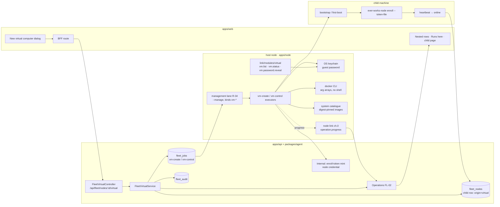

# FL-16 — Virtual computers · Implementation plan

> How [`spec.md`](./spec.md) gets built. Implementation detail belongs here (Constitution IX).
> Every path below was opened at the program's base commit (`origin/develop` `e4334baf7`).

**Epic ID:** `FL-16-virtual-computers`
**Spec:** [`./spec.md`](./spec.md) · **Tasks:** [`./tasks.md`](./tasks.md)
**Status:** `Draft`
**Created:** 2026-10-18
**Last updated:** 2026-10-18

---

## 1. Architecture summary

Data flows back three ways: operation progress over the node link (FL-02 channel 0), job
heartbeats/completion over the existing job endpoints (durable backstop), and the child's own
heartbeat, which is what turns the row `online`. The platform never connects into the host or the
child (README D2).

## 2. Current state in the codebase

| Piece                                                                                                | Where (verified at base)                                                                                 | Reused as                                                                                                                                                                 |
| ---------------------------------------------------------------------------------------------------- | -------------------------------------------------------------------------------------------------------- | ------------------------------------------------------------------------------------------------------------------------------------------------------------------------- |
| Node kinds `desktop-node · node · k8s`, enrollable kinds                                             | `packages/contracts/src/fleet/fleet-node.types.ts:46-59`                                                 | child rows are `kind: 'node'` (R-4)                                                                                                                                       |
| `FleetNode` entity (no parent/origin columns)                                                        | `packages/agent/src/entities/fleet-node.entity.ts:96-115`                                                | gains `origin`, `hostNodeId`, `virtualKind`                                                                                                                               |
| One-time token minting (creates the `enrolling` row; TTL from config, default 15 min)                | `packages/agent/src/fleet/fleet.service.ts:79,349-394`                                                   | `createEnrollmentToken` gains an optional `origin/host/virtualKind` input (row first at Create); the guest's token is (re-)minted when the guest signals readiness (R-35) |
| Enrol consumption, undifferentiated 401                                                              | `packages/agent/src/fleet/fleet.service.ts:402`; `apps/node/src/core/fleet-client.ts:17-20,222-226`      | unchanged; the child calls it                                                                                                                                             |
| Job kinds (closed union) + queued-max-age record that fails to compile on a missing kind             | `packages/contracts/src/fleet/fleet-jobs.types.ts:117-125,239-248`                                       | `vm-create`, `vm-control` appended                                                                                                                                        |
| Job entity: `targetNodeId`, `payload`, `requiredCapabilities`                                        | `packages/agent/src/entities/fleet-job.entity.ts:66-105`                                                 | jobs pinned to the host                                                                                                                                                   |
| Lease matcher requires every tag                                                                     | `packages/contracts/src/fleet/fleet-jobs.types.ts:292-294`                                               | `requiredCapabilities: ['managed','docker'(,'kvm')]`                                                                                                                      |
| Conditional executor registration; attended lane (second `WorkerLoop`, `kinds:[…]`)                  | `apps/node/src/core/runtime.ts:940-953,1049-1062`                                                        | the **management lane** copies the attended-lane shape                                                                                                                    |
| Capability detection (`docker` via `hasTool`; no `kvm`)                                              | `apps/node/src/core/capabilities.ts:277-294`                                                             | `kvm` probe added                                                                                                                                                         |
| Shell-out executor with injected `spawn`, scrubbed env, throwaway profile                            | `apps/node/src/core/executors/browser-check.ts:1-70`                                                     | template for `docker` calls                                                                                                                                               |
| OS keychain store with loud file fallback                                                            | `apps/node/src/core/secret-store.ts:34-44`                                                               | guest password storage                                                                                                                                                    |
| Node Dockerfile (`node:26-bookworm-slim`, git, corepack)                                             | `.deploy/docker/node/Dockerfile:1-16`                                                                    | reference for the Container bootstrap's Node install                                                                                                                      |
| Windows service installer that refuses built-in accounts                                             | `apps/node/packaging/windows/install-service.ps1`; `apps/node/packaging/README.md:58-101`                | the guest first-boot step reuses its logic                                                                                                                                |
| Audit action union                                                                                   | `packages/contracts/src/fleet/fleet-panic.types.ts:60-148`                                               | `node.vm.*` appended                                                                                                                                                      |
| Delete registration route                                                                            | `apps/api/src/fleet/fleet.controller.ts:562-571`                                                         | gains the host/child guards (FR-29)                                                                                                                                       |
| Add-node dialog, remove handler                                                                      | `apps/web/src/components/settings/FleetSettings.tsx:826-891,257-271`                                     | untouched; the hub's Add computer menu (FL-01 `FleetHubHeader.tsx`) gains one item                                                                                        |
| Read-only Agent tool and MCP whitelist                                                               | `packages/agent/src/fleet/agent-fleet-tools.ts:32-80`; `apps/mcp/src/openapi-tools/whitelist.ts:475-530` | new tools follow the descriptor-factory pattern                                                                                                                           |
| **Runs here** Overview block (FL-09 FR-30, `apps/web/src/components/fleet/docker/RunsHereBlock.tsx`) | FL-09 plan §8                                                                                            | FL-16 adds the nested-Node rows and the reserved-memory line; no second block                                                                                             |
| Hub nesting by host (`groupNodesByHost`, `fleet.computers.nestedVm\|nestedContainer`)                | FL-01 plan §8.2 (`fleet-hub.shared.ts`, `ComputerCards.tsx`)                                             | FL-16 supplies `hostNodeId` / `virtualKind` on the view; FL-01 renders the nesting                                                                                        |

What does not exist: any VM/container concept, a `kvm` tag, a management lane, a late token
re-issue, host/child guards on delete. FL-02 (link, operations, `managed` tag, the link module
registry `apps/node/src/core/link/modules/index.ts`) and FL-09 (Docker module, `docker.*` link
vocabulary) are assumed landed; FL-16 reuses FL-09's `apps/node/src/core/link/modules/docker/docker-cli.ts`
wrapper rather than shipping a second one.

## 3. Tech choices

| Concern                 | Choice                                                                                                                                          | Why                                                                                                          |
| ----------------------- | ----------------------------------------------------------------------------------------------------------------------------------------------- | ------------------------------------------------------------------------------------------------------------ |
| Windows virtualisation  | Docker container running a KVM-backed Windows installer image (OCI, digest-pinned, `--device /dev/kvm`)                                         | Installs Windows unattended from Microsoft media; needs only Docker + KVM on the host; no hypervisor install |
| Linux machines          | Plain Docker containers from pinned distro images; `--init`, `--cpus`, `--memory`, named volume for `/home`                                     | Ready in a minute; honest naming (Container, shares the kernel)                                              |
| Node runtime inside     | `npm install -g ever-works-node@<host version>` (Node 26 from the distro or official tarball); Windows via the published package                | One runtime (README D3); same version as the host so contracts match                                         |
| Token hand-off          | New `enroll --token-file <path>` CLI option; file 0600, deleted after read                                                                      | Keeps the token off argv and out of job payloads (FR-14, R-35)                                               |
| Late token (both kinds) | Node-credential internal endpoint `POST /api/internal/fleet/virtual/:childId/enroll-token`, called by the host when the guest signals readiness | Same posture as `push-credential` minting; TTL preserved (FR-14, FR-24, R-35)                                |
| Job delivery            | Durable `vm-create` / `vm-control` jobs leased by the management lane under `--manage` (R-34)                                                   | Survives link drops (U9); C §12                                                                              |
| Progress                | FL-02 operations on link channel 0; job heartbeat `progress` field as backstop                                                                  | One progress model for the program                                                                           |
| Password storage        | Host OS keychain via `secret-store.ts` (`account = virtual:<childId>`)                                                                          | Existing, audited pattern; file fallback warns loudly                                                        |
| Watching the install    | Installer image's loopback web viewer, surfaced as a port by FL-10, opened on the host (R-3)                                                    | Nothing new listens beyond loopback                                                                          |
| Shell-outs              | `spawn` with argument arrays only; no shell; timeouts; stderr first line as hint                                                                | Same rule as `browser-check`                                                                                 |

## 4. Data model

### 4.1 `FleetNode` additions (C §4.1) — `packages/agent/src/entities/fleet-node.entity.ts`

| Column        | Type                                     | Default    | Notes                                                                                                             |
| ------------- | ---------------------------------------- | ---------- | ----------------------------------------------------------------------------------------------------------------- |
| `origin`      | `varchar(16)` (`enrolled·virtual·cloud`) | `enrolled` | owned by this slot (R-35); FL-17's migration adds it too when it lands first — both guard with `findColumnByName` |
| `hostNodeId`  | `uuid` null                              | null       | index `idx_fleet_nodes_host`; not an FK (history survives host deletion, same rule as `fleet_jobs.nodeId`)        |
| `virtualKind` | `varchar(16)` null (`vm·container`)      | null       |                                                                                                                   |

String unions in `varchar` validated in code, `PortableDateColumn` for dates, no DB enums, structured
values as `simple-json` text (CONTRACTS §4 preamble).

System, size and activation are **not** columns (CONTRACTS §4.1 has none for them): the view's
`virtual` block reads them from the host's `vm.list` reply when the host is online and otherwise
from the child's `vm-create` job payload (kept with job history); once job bodies are purged by
retention the row shows the kind only. A `virtualMeta` column is proposed to the CONTRACTS
maintainer (audit report); nothing here depends on it.

### 4.2 Migration — slot 00 (C §13)

`apps/api/src/migrations/1796160000000-AddFleetNodeVirtualFields.ts`: three `ADD COLUMN`, each
guarded with `findColumnByName` so FL-17's slot can land first (R-35), one index. `down` drops the
index and `hostNodeId`/`virtualKind`; it drops `origin` only when FL-17's provider columns are absent
(`findColumnByName` on `providerPluginId`). Authored from `apps/api/` with
`pnpm typeorm migration:generate`, hand-reviewed; re-stamp if `develop` moved.

### 4.3 Contracts — `packages/contracts/src/fleet/fleet-virtual.types.ts` (exported from `fleet/index.ts`)

- `FleetVirtualKind = 'vm' | 'container'`; `FleetNodeOrigin = 'enrolled' | 'virtual' | 'cloud'`.
- `FleetVirtualSystemId` union: `windows-11 · windows-10 · windows-server-2025 · windows-server-2022 ·
ubuntu-26.04 · ubuntu-24.04 · debian-13 · fedora · alpine · arch`; `FLEET_VIRTUAL_SYSTEMS` with
  `{ id, kind, label, arch: ('x64'|'arm64')[], windowsEdition? }`.
- `FleetVirtualOptionsView { hosts: FleetVirtualHostOption[]; systems; limits }` where a host option
  carries `freeMemoryMiB`, `freeDiskMiB`, `kvm`, `eligible`, `reason: FleetVirtualHostReason | null`
  (`offline · consent-missing · no-docker · no-kvm · windows-host · is-virtual · limit`).
- `FleetVirtualCreateRequest { name, systemId, hostNodeId?: string | null, cpus: 2|4|8,
memoryGiB: 4|8|16, diskGiB?: 64|128|256 }` → `FleetVirtualCreateResponse { childNodeId,
operationId, jobId, hostNodeId }`.
- Job payloads: `FleetVmCreatePayload { childNodeId, name, systemId, image: { ref, digest },
cpus, memoryGiB, diskGiB?, apiUrl, hostNodeId }` (no token, no password);
  `FleetVmControlPayload { childNodeId, action: 'start'|'stop'|'destroy'|'resize'|'rebuild', … }`.
- Constants: `FLEET_VIRTUAL_MAX_PER_HOST = 4`, `FLEET_VIRTUAL_WINDOWS_MIN_FREE_DISK_GIB = 30`,
  `FLEET_VIRTUAL_WINDOWS_STOP_GRACE_SEC = 120`, `FLEET_VIRTUAL_CONTAINER_STOP_GRACE_SEC = 10`,
  `FLEET_VIRTUAL_NAME_PATTERN`.
- `fleet-jobs.types.ts`: add `'vm-create' | 'vm-control'` to `FleetJobKind`, `FLEET_JOB_KINDS`,
  and `FLEET_JOB_DEFAULT_QUEUED_MAX_AGE_SEC` (`vm-create: 60*60`, `vm-control: 10*60`) — the
  record is `Readonly<Record<FleetJobKind, number>>` and will not compile otherwise; add
  `FLEET_KVM_CAPABILITY = 'kvm'`.
- `fleet-node.types.ts`: `FleetNodeView` gains optional `origin`, `hostNodeId`, `virtualKind`,
  `virtual?: { state: FleetVirtualState, systemId, cpus, memoryGiB, diskGiB, activated? }` with
  `FleetVirtualState = 'creating' | 'installing' | 'enrolling' | 'starting' | 'running' | 'stopping' |
'stopped' | 'failed' | 'not-enrolled' | 'gone'` — a view-only union derived from the operation,
  the host's `vm.list` and the child's heartbeat (FleetNode `status` keeps its existing values).
- `fleet-panic.types.ts`: `node.vm.create|start|stop|destroy|resize|rebuild` and
  `node.vm.password.reveal` (C §7).

### 4.4 DTOs — `apps/api/src/fleet/dto/fleet-virtual.dto.ts`

`class-validator` DTOs mirroring the contracts; response DTOs `@Exclude()`/`@Expose()`.

## 5. API surface

All under the existing `@Controller('api/fleet')` family, authenticated, `FleetEnabledGuard`, plus
`FLEET_VIRTUAL_ENABLED` (C §9). New file `apps/api/src/fleet/fleet-virtual.controller.ts`.

| Method | Path                                                     | Body / query                                                           | Returns                                             | Auth / rate                                                                                                                  | Errors (C §8)                                                                                                            |
| ------ | -------------------------------------------------------- | ---------------------------------------------------------------------- | --------------------------------------------------- | ---------------------------------------------------------------------------------------------------------------------------- | ------------------------------------------------------------------------------------------------------------------------ |
| GET    | `/api/fleet/nodes/:id/virtual`                           | —                                                                      | `{ children: FleetNodeView[] }`                     | `view` audience; 60/min                                                                                                      | `not_found`                                                                                                              |
| GET    | `/api/fleet/nodes/:id/virtual/options`                   | `?system=`                                                             | `FleetVirtualOptionsView`                           | `view`; 60/min                                                                                                               | `not_found`                                                                                                              |
| POST   | `/api/fleet/nodes/:id/virtual`                           | `FleetVirtualCreateRequest` (`:id` may be `auto`)                      | `202 FleetVirtualCreateResponse`                    | `machines`; 10/min                                                                                                           | `invalid`, `unreachable`, `consent_missing`, `permission_denied`, `unsupported_on_node`, `limit_exceeded`, `kill_switch` |
| POST   | `/api/fleet/nodes/:id/virtual/:childId/power`            | `{ action: 'start'\|'stop', confirm? }` (`stop` needs `confirm: true`) | `202 { operationId }`                               | `machines`; 30/min                                                                                                           | `busy`, `unreachable`, `consent_missing`, `confirmation_required` (stop), `kill_switch`                                  |
| POST   | `/api/fleet/nodes/:id/virtual/:childId/destroy`          | `{ confirmName }`                                                      | `202 { operationId }`                               | `machines`; 10/min                                                                                                           | `confirmation_required`, `busy` (live Run/Session), `kill_switch`                                                        |
| POST   | `/api/fleet/nodes/:id/virtual/:childId/password/reveal`  | `{ confirm: true }`                                                    | `200 { password, expiresInSec: 60 }` (never cached) | owner only; 5/min                                                                                                            | `confirmation_required`, `permission_denied`, `unreachable`, `unsupported_on_node` (Containers), `kill_switch`           |
| POST   | `/api/fleet/nodes/:id/virtual/:childId/retry-enrollment` | —                                                                      | `202 { operationId }`                               | `machines`; 5/min                                                                                                            | `busy`                                                                                                                   |
| PATCH  | `/api/fleet/nodes/:id/virtual/:childId`                  | `{ cpus?, memoryGiB?, confirm }` (P3)                                  | `202 { operationId }`                               | `machines`; 10/min                                                                                                           | `confirmation_required`, `busy` (running)                                                                                |
| POST   | `/api/fleet/nodes/:id/virtual/:childId/rebuild`          | `{ confirm: true }` (P3)                                               | `202 { operationId }`                               | `machines`; 5/min                                                                                                            | `confirmation_required`, `busy`                                                                                          |
| POST   | `/api/internal/fleet/virtual/:childId/enroll-token`      | `{ nodeId, secret, jobId, leaseGeneration }` (host credential)         | `{ token, expiresInSec }`                           | `@Public()` + `FleetNodeAuthGuard`; authorised through `FleetJobService.authorizeRunSecretRequest` as `push-credential` does | undifferentiated 401; `409 stale-lease`                                                                                  |

Confirmation is C §2.2's single mechanism: a call without the field the class needs answers 409
`confirmation_required` with `details: { class, summary, preview? }` (the summary is the dialog's
text — host, CPUs, memory, disk, "No credits are spent"); the web shows it as the dialog and repeats
the call with the field; tools and the CLI do the same. There are no confirmation tokens.
`GET /api/fleet/operations/:id` (FL-02) serves progress; operation states are C §3.3's
`running · done · failed · cancelled · interrupted`. The existing `DELETE /api/fleet/nodes/:id`
(`fleet.controller.ts:562`) gains two guards in `FleetService.deleteForUser`: a host with children →
`busy`; a virtual child whose machine still exists → `unsupported_on_node` ("destroy it instead", the
R-36 shape). Both are additive refusals; nothing else changes.

## 6. Node side

### 6.1 Modules — `apps/node/src/core/link/modules/virtual/` (R-40)

The module lives under FL-02's registry and has one entry in `apps/node/src/core/link/modules/index.ts`
(its `vm.*` link verbs); the two durable executors stay with the other job executors in
`apps/node/src/core/executors/` and import the module's helpers.

| File                                         | Responsibility                                                                                                                                                                                                                                                                                                              |
| -------------------------------------------- | --------------------------------------------------------------------------------------------------------------------------------------------------------------------------------------------------------------------------------------------------------------------------------------------------------------------------- |
| `catalogue.ts`                               | `FLEET_VIRTUAL_SYSTEMS` → image refs + digests; operator override `EVER_WORKS_NODE_VIRTUAL_WINDOWS_IMAGE` / per-system overrides; arch filtering                                                                                                                                                                            |
| `kvm-probe.ts`                               | `/dev/kvm` exists and is R/W for the node's user (`fs.access`); Linux x64 only → advertises `kvm`                                                                                                                                                                                                                           |
| `host-facts.ts`                              | free memory / free disk under the data dir, reservations from `meta.json` of existing children                                                                                                                                                                                                                              |
| `state.ts`                                   | data dir `<nodeDataRoot>/virtual/<childId>/` with `meta.json` (`childId, name, systemId, kind, cpus, memoryGiB, diskGiB, containerName, createdAt`), `storage/` (VM disk), `home/` (Container home), `oem/` (Windows first-boot)                                                                                            |
| `container-bootstrap.ts`                     | generates the in-container bootstrap (sh): install Node 26, `npm i -g ever-works-node@<version>`, wait for `/run/ever-works/enroll-token`, `enroll --api-url … --token-file …`, `exec ever-works-node start --work --manage`                                                                                                |
| `windows-oem.ts`                             | generates the first-boot step (`install.bat` + PowerShell): install Node 26 + the published runtime, set the local account password, wait for the token file in the shared OEM folder, `enroll --token-file`, register start-at-boot via the existing `install-service.ps1` logic (Scheduled Task as the generated account) |
| `password.ts`                                | generate 24-char password; store/read via `secret-store.ts` (`virtual:<childId>`); delete on destroy                                                                                                                                                                                                                        |
| `apps/node/src/core/executors/vm-create.ts`  | phases, docker run, progress, token request, failure cleanup                                                                                                                                                                                                                                                                |
| `apps/node/src/core/executors/vm-control.ts` | start / stop (`docker stop -t 120\|10`) / destroy (`docker rm -f` + data dir removal + keychain delete) / resize (`docker update`) / rebuild                                                                                                                                                                                |

Docker calls go through FL-09's `apps/node/src/core/link/modules/docker/docker-cli.ts` (argument
arrays, no shell, timeouts). FL-16 adds only its own argument builders
(`link/modules/virtual/docker-args.ts`) so a test can assert the exact argv for every system.

### 6.2 The management lane (CONTRACTS R-34)

`apps/node/src/core/runtime.ts`: `createManagementLane(...)` modelled on `createAttendedLane`
(L1026-1070): one `WorkerLoop` whose `kinds` are the consented subset of R-34's list — `vm-create`,
`vm-control` when `--manage` is on (this epic), `runner-install`, `runner-control` when `--work` is on
(FL-18), `usage-scan` when `--usage-scan` is on (FL-20) — `maxConcurrentJobs: 2`, 5 s poll, held by
the same upgrade floor as the other lanes, never counted against `--concurrency`. The work lane
passes `excludeKinds` for every management kind. FL-02 creates the lane with an empty kind list (its T-27, CONTRACTS R-34); this epic appends its
kinds (one lane, never a second). `vm-create` registers only when `docker` is
advertised; Windows systems are refused by the executor unless `kvm` is advertised — the capability
requirement on the job already keeps such jobs away.

### 6.3 OS matrix

| Host OS           | Containers    | Windows VMs | Notes                                                                |
| ----------------- | ------------- | ----------- | -------------------------------------------------------------------- |
| Linux x64         | yes           | yes (kvm)   | the primary host                                                     |
| Linux arm64       | yes (no Arch) | no          | no KVM-backed x64 Windows image on arm64                             |
| macOS (x64/arm64) | yes           | no          | Docker Desktop runs containers in its own VM; `kvm` never advertised |
| Windows           | no            | no          | refused `unsupported_on_node` (spec U4)                              |

### 6.4 Consents and tags

Lane and executors exist only under `--manage`; the host advertises `managed` (FL-02), `docker`
(existing) and `kvm` (new, `capabilities.ts` beside `docker`). The child advertises whatever its own
start flags grant.

### 6.5 Link channel usage (C §3.3 `machine` family; handlers in `link/modules/virtual/index.ts`)

| Message                                 | Direction               | Purpose                                                                |
| --------------------------------------- | ----------------------- | ---------------------------------------------------------------------- |
| `vm.list`                               | platform → node         | reconcile children: container names, states, data-dir sizes            |
| `vm.status { childId }`                 | platform → node         | one child's live state (running/stopped/gone, activation flag for VMs) |
| `vm.password.reveal { childId }`        | platform → node         | read from keychain; reply once; the platform forwards and forgets      |
| `operation.progress` / `operation.done` | node → platform (ch. 0) | phases of create/control                                               |

Everything state-changing goes through durable jobs, not link requests (C §12).

### 6.6 Windows VM specifics

`docker run -d --name ew-virtual-<childId> --device /dev/kvm --cap-add NET_ADMIN -e VERSION=<edition>
-e RAM_SIZE=<n>G -e CPU_CORES=<n> -e DISK_SIZE=<n>G -e USERNAME=ever -e PASSWORD=<from keychain, via
--env-file 0600, removed after start> -v <datadir>/storage:/storage -v <datadir>/oem:/oem
-p 127.0.0.1:<port>:8006 --stop-timeout 120 <image@digest>`. The viewer port is loopback-only and
registered with FL-10's port module (`apps/node/src/core/link/modules/ports/`) as `Windows install —
<name>`. Phase detection: image pull (docker events),
download/install (installer log tail in `storage/`), first boot (OEM marker `ready.txt`), token
request → `enrolling`, child heartbeat → `online` (platform-side). Stop = `docker stop -t 120`
(ACPI shutdown). Destroy = `docker rm -f`, remove data dir, delete keychain entry.

### 6.7 Container specifics

`docker run -d --name ew-virtual-<childId> --hostname <name> --init --cpus <n> --memory <n>g
--pids-limit 4096 -v <datadir>/home:/home/ever -v <datadir>/run:/run/ever-works:ro <image@digest>
sh /run/ever-works/bootstrap.sh`. When the bootstrap signals readiness (it writes
`/home/ever/.ever-works/ready` once the runtime is installed), the host requests the token (R-35)
and writes it to `<datadir>/run/enroll-token` (0600); because that mount is read-only inside the
container, the **host** deletes the file as soon as `enroll` exits or the child's first heartbeat
arrives, whichever is first. No docker socket, no host config dir, no host credential inside. Stop =
`docker stop -t 10`.

## 7. Plugin surface

None. Docker and KVM are OS facts (README D8). An image-catalogue plugin is not needed: the
catalogue is a node-side file with operator overrides.

## 8. Web surface

- FL-01's registry (`apps/web/src/components/fleet/registry.ts`) has exactly `registerHubTab`,
  `registerComputerTab` and `registerOverviewBlock` (C §11.1) — no entry point for the Add computer
  menu or the header ⋯ menu. Until one is added (proposed to the CONTRACTS maintainer in the audit
  report), this epic adds **New virtual computer…** to FL-01's `FleetHubHeader.tsx` menu and the child
  actions to FL-01's `computer/ComputerActionsMenu.tsx`, both behind `FLEET_VIRTUAL_ENABLED`.
  Nesting is FL-01's (`groupNodesByHost` over `hostNodeId`); FL-16 supplies the view fields and the
  `VirtualChildRow` label/state cell it renders.
- Components under `apps/web/src/components/fleet/virtual/`: `NewVirtualComputerDialog.tsx`,
  `VirtualHostPicker.tsx`, `VirtualProgressLine.tsx`, `VirtualChildRow.tsx`, `VirtualRunsHereRows.tsx`
  (rows and the reserved-memory line mounted inside FL-09's `RunsHereBlock.tsx` — no second block),
  `VirtualActionsMenu.tsx`, `DestroyVirtualDialog.tsx`, `RevealPasswordDialog.tsx`, `virtual.shared.ts`
  (pure: eligibility reasons, host auto-pick, phase labels, size options per system).
- Child page: `apps/web/src/app/[locale]/(dashboard)/fleet/computers/[id]/page.tsx` (FL-01) shows the
  header actions when `origin === 'virtual'`.
- BFF routes: `apps/web/src/app/api/fleet/nodes/[id]/virtual/route.ts`, `.../[childId]/power/route.ts`,
  `.../[childId]/destroy/route.ts`, `.../[childId]/password/reveal/route.ts` — thin proxies as the
  computer BFF does (`apps/web/src/lib/api/computer-bff.ts`).
- Palette entries added to `apps/web/src/components/command-palette/registry/screens.ts` beside the
  Fleet entry (L212).
- i18n: `fleet.virtual.*` groups listed in spec §5.9, in `apps/web/messages/en.json`.
- Playwright: `apps/web/e2e/flow-fleet-virtual-computers.spec.ts`.

## 9. Agent / MCP / CLI surface (C §11.3)

| Tool                    | Annotation                                                                     | Maps to                                                        |
| ----------------------- | ------------------------------------------------------------------------------ | -------------------------------------------------------------- |
| `fleet_virtual_list`    | `readOnly: true`                                                               | GET `/nodes/:id/virtual` (all hosts when `hostNodeId` omitted) |
| `fleet_virtual_options` | `readOnly: true`                                                               | GET `/nodes/:id/virtual/options`                               |
| `fleet_virtual_create`  | `destructive: true`, `confirmationClass: confirm`, confirmation text per FR-36 | POST `/nodes/:id/virtual`                                      |
| `fleet_virtual_power`   | `destructive: true`, `confirmationClass: confirm` (stop) / `plain` (start)     | POST `.../power`                                               |
| `fleet_virtual_destroy` | `destructive: true`, `confirmationClass: confirm-destructive`                  | POST `.../destroy`                                             |

The family segment is `virtual` (the API path segment, C §11.2); FL-19's catalogue carries these rows
verbatim. Tools satisfy their class with `confirm` / `confirmName` (C §2.2); at the Ask rung the call
is held as an `agent_action_proposals` row (R-33) through FL-19's gate. Agent tools live in `packages/agent/src/fleet/agent-fleet-virtual-tools.ts` (descriptor factory
like `agent-fleet-tools.ts`); MCP exposes the same routes through
`apps/mcp/src/openapi-tools/whitelist.ts` with the same names; CLI `ever-works fleet virtual
list|options|create|start|stop|destroy [--json]` in `apps/cli/src/commands/fleet/virtual.ts` (FL-19
owns the `fleet` command root; this epic ships the subcommand file).

## 10. Background jobs

| Task                      | File                                                               | Trigger            | Purpose                                                                                                                                                                   | Idempotency                                        |
| ------------------------- | ------------------------------------------------------------------ | ------------------ | ------------------------------------------------------------------------------------------------------------------------------------------------------------------------- | -------------------------------------------------- |
| `fleet-virtual-reconcile` | `packages/tasks/src/tasks/trigger/fleet-virtual-reconcile.task.ts` | cron `4/5 * * * *` | `vm.list` per online host; mark children whose machine is gone (FR-30); fail `enrolling` children with no heartbeat 20 min after the enrolling phase (U10 → needs a look) | CAS on `fleet_nodes.updatedAt`; one host at a time |

Dispatched via `FLEET_VIRTUAL_RECONCILE_DISPATCHER` in `packages/agent/src/fleet/virtual/` (Constitution
IV); registered where `fleet-job-lease-sweeper.task.ts` is (`packages/tasks/src/tasks/trigger/index.ts:25`).

## 11. Security & permissions

- **Who may call**: `view` audience reads; `machines` audience creates/powers/destroys; reveal is
  owner-only (the default until spec §8b is answered). Role derivation from FL-01.
- **Node refusals**: no `--manage` → `consent_missing`; Windows host, virtual host, non-x64 for
  Windows, missing kvm → `unsupported_on_node`; disk floor; name pattern; image digest mismatch →
  `operation_failed` and nothing started.
- **Threats**: (1) argument injection into docker — argument arrays only, names validated, no
  shell; (2) token leakage — file 0600, deleted after read, never in payloads/logs; the host's
  request for a token is authorised like `push-credential` (job + lease generation); (3) password
  leakage — keychain only, reveal over the link once, audit redaction tested, field named
  `revealed: true` never the value (the audit writer's key-based redaction drops `password*` keys
  anyway); (4) child escaping to the host — no docker socket, no host config dir, no host
  credential, `--pids-limit`, memory/CPU caps; (5) image supply chain — digest pins + operator
  override recorded in the audit row's `extra.imageDigest`; (6) orphaned running machine — delete
  guards (FR-29).
- **Kill switch**: controller refuses `kill_switch`; lease answers `[]` so queued `vm-*` jobs wait;
  the platform sends `link.pause` to every node (C §3.2), so the host refuses any `vm.*` request that
  still arrives; running children are Nodes and are paused the same way; `link.resume` restores.
- **Audit**: one row per action with `family: machines`, `target: childNodeId`, `requestedBy`,
  `confirmationClass`, `extra: { systemId, cpus, memoryGiB, diskGiB, imageDigest }`.

## 12. Observability

- Audit rows (above); operation progress events; node log lines per phase (redacting logger).
- Metrics: `fleet_virtual_create_total{kind,outcome}`, `fleet_virtual_create_seconds{kind}` (to
  first heartbeat), `fleet_virtual_children{host}`.
- Health: `GET /api/health` unchanged; the reconcile task logs hosts it could not reach.

## 13. Phased rollout

1. **P1 — Containers** (flag `FLEET_VIRTUAL_ENABLED`, default off): contracts, migration, service,
   API, management lane, container executor, `--token-file`, the late-token internal endpoint (R-35),
   dialog, nesting, Runs here rows, tools, reconcile task, e2e.
2. **P2 — Windows VMs** (same flag; Windows systems hidden until P2 lands): kvm probe/tag, OEM
   first-boot, password store/reveal, install progress, Watch the install (FL-10), 120 s stop grace,
   activation state.
3. **P3 — Resize / rebuild / CLI**: `docker update` while stopped, rebuild, CLI subcommands.
4. **Default-on** after the acceptance list is green on `develop` (D12).

## 14. Test plan

| Package              | Runner     | Specs                                                                                                                                                                                                                                                                                                                                                                                                                                                                                                                                                                                                                                                                                                                                                 |
| -------------------- | ---------- | ----------------------------------------------------------------------------------------------------------------------------------------------------------------------------------------------------------------------------------------------------------------------------------------------------------------------------------------------------------------------------------------------------------------------------------------------------------------------------------------------------------------------------------------------------------------------------------------------------------------------------------------------------------------------------------------------------------------------------------------------------- |
| `packages/contracts` | Vitest     | `src/fleet/__tests__/fleet-virtual.spec.ts` (systems × arch, name pattern); extend `fleet-jobs.spec.ts` (new kinds, max-age record), `fleet-panic.spec.ts` (audit names)                                                                                                                                                                                                                                                                                                                                                                                                                                                                                                                                                                              |
| `packages/agent`     | Jest       | `src/fleet/virtual/__tests__/fleet-virtual.policy.spec.ts` (eligibility truth table, auto-pick by free memory, limit 4, nesting/Windows-host refusals); `fleet-virtual.service.spec.ts` (row-first creation, token late mint, delete guards, kill switch); `agent-fleet-virtual-tools.spec.ts`                                                                                                                                                                                                                                                                                                                                                                                                                                                        |
| `apps/api`           | Jest       | `src/fleet/fleet-virtual.controller.spec.ts` (every status code in §5; reveal owner-only; rate tiers); `src/fleet/fleet-virtual-internal.controller.spec.ts` (undifferentiated 401, stale lease 409); extend `fleet.controller.spec.ts` (delete guards)                                                                                                                                                                                                                                                                                                                                                                                                                                                                                               |
| `apps/node`          | Vitest     | `src/core/link/modules/virtual/catalogue.spec.ts`, `kvm-probe.spec.ts`, `docker-args.spec.ts` (exact argv per system; no shell), `container-bootstrap.spec.ts` (token-file path, no token on argv), `windows-oem.spec.ts`, `password.spec.ts` (keychain roundtrip, never logged), `index.spec.ts` (`vm.*` handlers registered once in `link/modules/index.ts`; refused while `link.pause` holds); `src/core/executors/vm-create.spec.ts` (phases, failure cleanup, late token on readiness, host deletes the token file), `vm-control.spec.ts` (120 s vs 10 s stop); extend `capabilities.spec.ts` (`kvm` only on Linux x64 with R/W `/dev/kvm`), `runtime.spec.ts` (management lane kinds per consent, R-34); `cli/program.spec.ts` (`--token-file`) |
| `packages/tasks`     | Jest       | `src/__tests__/fleet-virtual-reconcile.task.spec.ts` (gone detection, 20-min enrol timeout, idempotence)                                                                                                                                                                                                                                                                                                                                                                                                                                                                                                                                                                                                                                              |
| `apps/web`           | Vitest     | `components/fleet/virtual/virtual.shared.unit.spec.ts`, `NewVirtualComputerDialog.unit.spec.tsx` (409 `confirmation_required` preview rendered as the dialog), `VirtualRunsHereRows.unit.spec.tsx`                                                                                                                                                                                                                                                                                                                                                                                                                                                                                                                                                    |
| `apps/web` e2e       | Playwright | `e2e/flow-fleet-virtual-computers.spec.ts` (fake host via the node contract fixture: create → nested row → progress → online; destroy typed name; disabled reasons; Windows disk field)                                                                                                                                                                                                                                                                                                                                                                                                                                                                                                                                                               |

## 15. Risks

| Risk                                                 | Likelihood | Impact | Mitigation                                                                         |
| ---------------------------------------------------- | ---------- | ------ | ---------------------------------------------------------------------------------- |
| Windows install exceeds 30 min on slow links         | medium     | medium | progress shows elapsed + download size; no timeout under 2 h; Retry keeps the disk |
| Installer image changes its env/volume contract      | medium     | high   | digest pin + operator override; catalogue test pins the argv                       |
| Token TTL expires during Windows first boot          | medium     | medium | late mint (FR-24) + Retry enrolment                                                |
| Host disk filled by VMs                              | medium     | high   | 30 GB precheck; disk-floor from FL-03 health; Runs here shows reservations         |
| Child runtime version drifts from the host           | low        | medium | bootstrap pins `ever-works-node@<host version>`                                    |
| macOS Docker Desktop memory limits below the request | medium     | low    | host-facts reads Docker's advertised memory, not the Mac's                         |

## 16. Constitution reconciliation

- **I** No external integration; node module (README D8). **II** No plugin id in core. **III** No
  content in DB. **IV** Reconcile through the dispatcher symbol; creation via node jobs. **V** One
  additive migration, slot 00. **VI** Tests per §14. **VII** Password/token never persisted or
  logged; audit redaction tested. **VIII** No plugin doc change. **IX** Spec has no code.
  **X** Additive unions and optional fields; older nodes unaffected.

## 17. References

- Spec: [`./spec.md`](./spec.md) · Tasks: [`./tasks.md`](./tasks.md)
- [CONTRACTS](../CONTRACTS.md) R-4, R-20, R-24, R-33, R-34, R-35, R-36, R-40, §1.1–1.2, §2, §3.2–3.3, §4, §7, §8, §9, §10, §11, §12, §13
- Sibling plans: FL-02 (link, operations, `managed`, module registry), FL-09 (docker-cli, Runs here block), FL-10 (open on the machine, port module), FL-01 (registry, nesting, header menus)
- Code: paths in §2
