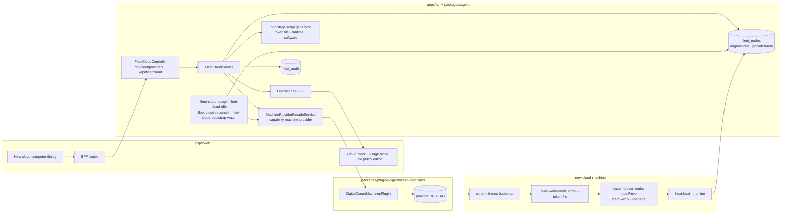

# FL-17 — Cloud computers · Implementation plan

> How [`spec.md`](./spec.md) gets built. Implementation detail belongs here (Constitution IX).
> Every path below was opened at the program's base commit (`origin/develop` `e4334baf7`).

**Epic ID:** `FL-17-cloud-computers`
**Spec:** [`./spec.md`](./spec.md) · **Tasks:** [`./tasks.md`](./tasks.md)
**Status:** `Draft`
**Created:** 2026-10-18
**Last updated:** 2026-10-18

---

## 1. Architecture summary

The platform talks to the provider only through the facade; the machine talks to the platform only
outbound (enrol, heartbeat, link). No component ever connects into the machine (README D2).

## 2. Current state in the codebase

| Piece                                                                                 | Where (verified at base)                                                                                                         | Reused as                                                   |
| ------------------------------------------------------------------------------------- | -------------------------------------------------------------------------------------------------------------------------------- | ----------------------------------------------------------- |
| Plugin categories (append-only tuple; `apps/web` maps are `Record<PluginCategory,…>`) | `packages/plugin/src/contracts/plugin-manifest.types.ts:5-134`; `apps/web/src/lib/utils/plugin-category-icons.ts:39,102,138-139` | `'machine-provider'` appended + icon/label entries          |
| Capability constants (append-only)                                                    | `packages/plugin/src/contracts/facade-capabilities.ts:1-160`                                                                     | `MACHINE_PROVIDER: 'machine-provider'` appended last        |
| Capability interface exports                                                          | `packages/plugin/src/contracts/capabilities/index.ts:1-137`                                                                      | `machine-provider.interface.ts` exported                    |
| A small read-only capability interface (shape template)                               | `packages/plugin/src/contracts/capabilities/metrics-provider.interface.ts:103-139`                                               | `IMachineProviderPlugin` + guard follow its style           |
| `IPlugin` (settingsSchema, validateConnection)                                        | `packages/plugin/src/contracts/plugin.interface.ts:27-85`                                                                        | plugin class skeleton                                       |
| Base facade: resolution by capability/scope, settings hierarchy                       | `packages/agent/src/facades/base.facade.ts:57-110`; `metrics.facade.ts:47-90`                                                    | `MachineProviderFacadeService extends BaseFacadeService`    |
| Deployment plugin with user-scope `x-secret` token and env-gated `oauth` capability   | `packages/plugins/vercel/src/vercel.plugin.ts:57-95`; `packages/plugins/vercel/package.json`                                     | manifest and settings pattern                               |
| `IOAuthPlugin`                                                                        | `packages/plugin/src/contracts/capabilities/oauth.interface.ts:31-41`; facade `packages/agent/src/facades/oauth.facade.ts:51-67` | P3 sign-in                                                  |
| Settings extensions (`x-secret`, `x-scope`, `x-envVar`, `x-adminOnly`)                | `packages/plugin/src/settings/json-schema.types.ts:15-41`                                                                        | settings schema                                             |
| Node row + token minting (`enrolling`)                                                | `packages/agent/src/fleet/fleet.service.ts:349-394`                                                                              | `createEnrollmentToken` extended with origin/provider input |
| `FleetNode` entity                                                                    | `packages/agent/src/entities/fleet-node.entity.ts:96-115`                                                                        | provider columns                                            |
| Delete registration route and web remove handler                                      | `apps/api/src/fleet/fleet.controller.ts:562-571`; `apps/web/src/components/settings/FleetSettings.tsx:257-271`                   | guard added (FR-19)                                         |
| Needs-a-look producer registry; health samples                                        | FL-03 (`packages/agent/src/fleet/health/`), C §4.6                                                                               | `cloud-idle` producer                                       |
| Node packaging: systemd template unit (`start --work`), `install.sh`                  | `apps/node/packaging/systemd/ever-works-node@.service:20`; `apps/node/packaging/README.md:32-56`                                 | bootstrap installs the unit with a `--manage` drop-in       |
| Trigger task registration                                                             | `packages/tasks/src/tasks/trigger/index.ts:25`                                                                                   | four new tasks                                              |
| Canonical plugin doc (105 plugins; category table)                                    | `docs/plugin-system/built-in-plugins.md:9-30`                                                                                    | +1 plugin, +1 category row                                  |

Does not exist: machine-provider category/capability/facade, any cloud-machine plugin, provider
columns, cost or idle logic for infrastructure, a Remove guard. FL-16's `enroll --token-file`
option is reused if it has landed; otherwise this epic ships it (same task text).

## 3. Tech choices

| Concern                | Choice                                                                                                                                                                               | Why                                                                                           |
| ---------------------- | ------------------------------------------------------------------------------------------------------------------------------------------------------------------------------------ | --------------------------------------------------------------------------------------------- |
| Provider integration   | Plugin `digitalocean-machines`, category `machine-provider`, capability `machine-provider` (+ `oauth` env-gated)                                                                     | Constitution I/II; R-15                                                                       |
| Provider HTTP          | Native `fetch` with timeouts, no SDK                                                                                                                                                 | Zero-dependency plugin; the API is small (regions, sizes, droplets, actions, balance)         |
| Bootstrap              | `#cloud-config` user-data generated in the agent package, provider-neutral; plugin only wraps it                                                                                     | One generator for every provider; the token never reaches plugin code paths that log          |
| Machine credential     | Throwaway ed25519 keypair generated per create, public half sent, private half dropped                                                                                               | Prevents the provider from emailing a root password without the platform keeping a key (FR-9) |
| Runtime on the machine | Node 26 + `ever-works-node@<pinned>` as `ever-works-node@ever.service` with a drop-in `start --work --manage`                                                                        | Reuses the shipped systemd template; D3                                                       |
| Cost model             | Pure function over `providerMeta` (rate, createdAt, powerTimeline, destroyedAt) with per-second accrual capped at the monthly price                                                  | Deterministic, testable; provider figure shown beside it when readable                        |
| Idle detection         | Pure function over FL-03 health samples + Sessions + jobs                                                                                                                            | Same evidence the hub already shows                                                           |
| Background work        | Four job-runtime tasks via dispatcher symbols                                                                                                                                        | Constitution IV                                                                               |
| Remove guard           | Service-level refusal in `FleetService.deleteForUser` (R-36) + UI disables the action with the reason by `origin`                                                                    | Additive; server is the authority                                                             |
| Confirmation           | C §2.2 request fields (`confirm`, `confirmName`); 409 `confirmation_required` with `details: { class, summary, preview? }` — the price sentence is the summary for Create; no tokens | One mechanism for the web, tools, MCP and CLI                                                 |

## 4. Data model

### 4.1 `FleetNode` additions (C §4.1) — `packages/agent/src/entities/fleet-node.entity.ts`

| Column               | Type                             | Notes                                                                                                                                                                                                                                                                                                                                                                                                                                                                             |
| -------------------- | -------------------------------- | --------------------------------------------------------------------------------------------------------------------------------------------------------------------------------------------------------------------------------------------------------------------------------------------------------------------------------------------------------------------------------------------------------------------------------------------------------------------------------- |
| `origin`             | `varchar(16)` default `enrolled` | owned by FL-16's slot (R-35); added here too, guarded with `findColumnByName`, when this slot lands first                                                                                                                                                                                                                                                                                                                                                                         |
| `providerPluginId`   | `varchar(64)` null               |                                                                                                                                                                                                                                                                                                                                                                                                                                                                                   |
| `providerMachineRef` | `varchar(128)` null              | provider's own id; unique index `(providerPluginId, providerMachineRef)` where not null                                                                                                                                                                                                                                                                                                                                                                                           |
| `providerMeta`       | `simple-json` null               | `{ regionId, regionLabel, sizeId, sizeLabel, vcpus, memoryMiB, diskGiB, hourlyRateCents, monthlyPriceCents, billsWhileOff, createdAt, powerState: 'running'\|'off'\|'gone'\|'unknown', powerTimeline: [{ state, at }] (≤ 200 entries), idlePolicy: { mode, afterHours }, idleSince?, cost: { monthToDateCents, sinceCreatedCents, projectedMonthCents, providerMonthToDateCents?, computedAt }, destroyedAt?, finalCostCents?, software: string[], tags: string[] }` — no secrets |

`providerMeta` is `simple-json` text (CONTRACTS §4 preamble). C §4.1 lists its minimum content
(region, size, hourly rate, created at — no secrets); this epic also keeps the power timeline, idle
policy and cost snapshot in it because they are facts about the same provider machine and no other
epic reads them — recorded for the CONTRACTS maintainer in the audit report.

### 4.2 Migration — slot 00 (C §13)

`apps/api/src/migrations/1796170000000-AddFleetNodeProviderFields.ts`: `origin` and the three
provider columns, every `ADD COLUMN` guarded with `findColumnByName` (R-35), one partial unique
index. `down` drops the index and the three provider columns; it drops `origin` only when FL-16's
columns are absent (`findColumnByName` on `hostNodeId`).

### 4.3 Contracts

- `packages/plugin/src/contracts/capabilities/machine-provider.interface.ts`:
  `MachineProviderRegion { id, label, available }`, `MachineProviderSize { id, label, vcpus,
memoryMiB, diskGiB, priceHourlyCents, priceMonthlyCents, regions: string[] }`,
  `MachineProviderSoftware { id: 'docker'|'node'|'claude-code'|'codex'|'overlay-vpn', default }`,
  `MachineProviderOptions { regions, sizes, software, billsWhileOff: boolean, account: { label } }`,
  `MachineProviderCreateInput { name, regionId, sizeId, bootstrapScript, publicKey?, tags }`,
  `MachineProviderCreateResult { machineRef, state, meta }`, `MachineProviderMachine { machineRef,
state: 'provisioning'|'running'|'off'|'gone', ipv4? }`, `MachineProviderUsage {
providerMonthToDateCents?: number, source: 'provider' }`, `IMachineProviderPlugin extends IPlugin
{ providerName; listOptions(settings); create(input, settings); power(ref, 'on'|'off', settings);
destroy(ref, settings); usage(refs, settings); getMachine(ref, settings); listTagged(tag, settings) }`,
  `isMachineProviderPlugin`. Exported from `capabilities/index.ts`.
- `facade-capabilities.ts`: `MACHINE_PROVIDER: 'machine-provider'` appended **last**.
- `plugin-manifest.types.ts`: `'machine-provider'` appended **last** to `PLUGIN_CATEGORIES`, in the same
  change as `CATEGORY_ICONS`/`CATEGORY_LABELS` entries (`Cloud` icon, "Machine Providers").
- `packages/contracts/src/fleet/fleet-cloud.types.ts`: `FleetCloudCreateRequest { providerPluginId,
name, regionId, sizeId, software[], acknowledgedPriceCents, vpnAuthKey? }`,
  `FleetCloudCreateResponse { nodeId, operationId }`, `FleetCloudIdlePolicy { mode:
'nothing'|'tell-me'|'power-off', afterHours: 1..72 }`, `FleetCloudUsageView`, `FleetCloudBlockView`,
  `FLEET_CLOUD_MAX_PER_OWNER = 10`, `FLEET_CLOUD_IDLE_CPU_PERCENT = 5`,
  `FLEET_CLOUD_UNENROLLED_AFTER_MIN = 10`; `FleetNodeView` gains optional `origin`, `providerPluginId`,
  `cloud?: FleetCloudBlockView`.
- `fleet-panic.types.ts`: `node.cloud.create|power|destroy` (C §7); the idle-policy change writes
  `node.policy.change` (C §7, added to the union by FL-01 plan §4) with `extra: { policy: 'idle',
from, to }`.

### 4.4 DTOs — `apps/api/src/fleet/dto/fleet-cloud.dto.ts`

class-validator DTOs; `vpnAuthKey` is `@Exclude()`d from every response and never logged.

## 5. API surface

New `apps/api/src/fleet/fleet-cloud.controller.ts`, authenticated, `FleetEnabledGuard` +
`FLEET_CLOUD_ENABLED`.

| Method | Path                                    | Body / query                       | Returns                                                                     | Auth / rate                     | Errors (C §8)                                                                                              |
| ------ | --------------------------------------- | ---------------------------------- | --------------------------------------------------------------------------- | ------------------------------- | ---------------------------------------------------------------------------------------------------------- |
| GET    | `/api/fleet/providers`                  | —                                  | `{ providers: [{ pluginId, name, configured, account?, oauthAvailable }] }` | authed; 60/min                  | —                                                                                                          |
| GET    | `/api/fleet/providers/:plugin/options`  | —                                  | `MachineProviderOptions` (cached 10 min per plugin+user)                    | authed; 30/min                  | `not_found`, `operation_failed` (provider error, hint = first message)                                     |
| GET    | `/api/fleet/cloud`                      | —                                  | `{ machines: FleetNodeView[], usage: FleetCloudUsageView }`                 | authed; 60/min                  | —                                                                                                          |
| POST   | `/api/fleet/cloud`                      | `FleetCloudCreateRequest`          | `202 FleetCloudCreateResponse`                                              | `machines` (owner grant); 5/min | `invalid` (name, price mismatch), `limit_exceeded`, `kill_switch`, `operation_failed`, `permission_denied` |
| GET    | `/api/fleet/cloud/:id`                  | —                                  | `FleetNodeView` with `cloud` block                                          | `view`; 60/min                  | `not_found`                                                                                                |
| POST   | `/api/fleet/cloud/:id/power`            | `{ action: 'on'\|'off', confirm }` | `202 { operationId }`                                                       | `machines`; 30/min              | `confirmation_required`, `kill_switch` (on only), `operation_failed`, `busy`                               |
| POST   | `/api/fleet/cloud/:id/destroy`          | `{ confirmName }`                  | `202 { operationId, costSoFarCents }`                                       | `machines`; 10/min              | `confirmation_required`, `busy` (live Run/Session), `operation_failed`                                     |
| GET    | `/api/fleet/cloud/:id/usage`            | —                                  | `FleetCloudUsageView` (one machine)                                         | `view`; 60/min                  | `not_found`                                                                                                |
| PUT    | `/api/fleet/cloud/:id/idle-policy`      | `FleetCloudIdlePolicy`             | `200`                                                                       | `machines`; 30/min              | `invalid`                                                                                                  |
| POST   | `/api/fleet/cloud/:id/retry-enrollment` | —                                  | `202 { operationId }`                                                       | `machines`; 5/min               | `busy`, `unsupported_on_node` (provider cannot replace user-data)                                          |

`POST /api/fleet/cloud` requires `confirm: true` and `acknowledgedPriceCents`; without `confirm` it
answers 409 `confirmation_required` whose `details.summary` is the price sentence (C §2.2).
`DELETE /api/fleet/nodes/:id` gains a guard in `FleetService.deleteForUser`: `origin === 'cloud'` and
`providerMeta.powerState !== 'gone'` and a machine ref exists → `unsupported_on_node` with the destroy
hint (R-36). `GET /api/fleet/usage` (FL-20) composes the `cloud` block from
`FleetCloudService.usageSummary`. Operation states are C §3.3's `running · done · failed · cancelled ·
interrupted`.

## 6. Node side

No node-side module. The machine runs the ordinary runtime. The **bootstrap** (generated in
`packages/agent/src/fleet/cloud/bootstrap-script.ts`) is a `#cloud-config`:

1. `users`: create `ever` (sudo for the bootstrap only — the node runs unprivileged); the throwaway
   public key goes to `ever` so the provider sends no root password.
2. `write_files`: `/run/ever-works/enroll-token` (0600, owner `ever`), the systemd drop-in
   `/etc/systemd/system/ever-works-node@.service.d/manage.conf` (`ExecStart=` reset then
   `ExecStart=/usr/bin/env ever-works-node start --work --manage`).
3. `runcmd`: install Docker (official repo) when chosen; install Node 26 (NodeSource or the official
   tarball); `npm i -g ever-works-node@<pinned> @anthropic-ai/claude-code @openai/codex` as chosen;
   install the overlay-VPN client and run its join with the one-time key when provided; copy the
   packaged systemd template from the npm package (`$(npm root -g)/ever-works-node/packaging/systemd`);
   `sudo -u ever ever-works-node enroll --api-url <apiUrl> --token-file /run/ever-works/enroll-token`;
   `systemctl enable --now ever-works-node@ever`; write `/var/lib/ever-works-node/bootstrap.done`.

OS matrix: Ubuntu 24.04 LTS image on the first provider (x86-64). macOS/Windows: not offered by the
first provider. Consents: `--work --manage` (`--attend` off; spec FR-8). Capability tags: whatever
the machine detects (`docker`, `claude-code`, `codex`, `managed`, …). Link: ordinary (FL-02); this
epic adds no channel vocabulary.

## 7. Plugin surface

`packages/plugins/digitalocean-machines/`:

- `package.json` — ESM, `tsup`, Vitest; `everworks.plugin`: `id: 'digitalocean-machines'`,
  `category: 'machine-provider'`, `capabilities: ['machine-provider']` (`oauth` added by a getter
  when `DIGITALOCEAN_OAUTH_CLIENT_ID/SECRET` exist, as the deployment plugin does), `visibility:
'public'`, `envVars` for the OAuth pair, `uiHints.setupLink` to the provider's token page.
- `src/digitalocean-machines.plugin.ts` — `settingsSchema`: `apiToken` (`x-secret`, `x-scope: user`),
  `oauthClientId` / `oauthClientSecret` (`x-adminOnly`, `x-scope: global`, `x-envVar`),
  `defaultRegion` (user); `validateConnection` = `GET /v2/account`; `listOptions` = `/v2/regions` +
  `/v2/sizes` (prices → cents, `billsWhileOff: true`); `create` = `POST /v2/droplets` with
  `image: 'ubuntu-24-04-x64'`, `user_data`, `ssh_keys` (throwaway key uploaded then deleted after
  create), `tags: ['ever-works', 'ever-works-node:<nodeId>']`, `monitoring: true`; `power` =
  `POST /v2/droplets/{id}/actions` (`power_off` after `shutdown` grace 60 s / `power_on`); `destroy`
  = `DELETE /v2/droplets/{id}` (idempotent on 404); `getMachine`; `listTagged`; `usage` =
  `GET /v2/customers/my/balance` → `month_to_date_usage` when the token has billing read.
- `src/digitalocean-api.ts` — fetch wrapper: 15 s timeout, retries on 429 with `Retry-After`, error
  mapping to `{ code, hint }`; never logs the token.
- `src/testing/fake-digitalocean-api.ts` — in-memory fake for tests and e2e.
- `docs/plugin-system/built-in-plugins.md` — plugin count 105 → 106; category table gains
  `machine-provider | 1 | digitalocean-machines`; a short section under a new `## Machine Providers`.

Facade: `packages/agent/src/facades/machine-provider.facade.ts` (`MachineProviderFacadeService
extends BaseFacadeService`, `CAPABILITY = PLUGIN_CAPABILITIES.MACHINE_PROVIDER`): `listProviders(opts)`,
`listOptions(pluginId, opts)`, `create`, `power`, `destroy`, `usage`, `getMachine`, `listTagged`;
usage recorded through `PluginUsageService` (units only). Registered in `facades.module.ts`.

## 8. Web surface

- FL-01's registry (`apps/web/src/components/fleet/registry.ts`) offers `registerHubTab`,
  `registerComputerTab` and `registerOverviewBlock` (C §11.1): the **Cloud** block registers with
  `registerOverviewBlock` (`kinds`/origin gate `cloud`); the idle-policy editor and the Usage-tab
  block mount inside the computer Settings tab and FL-20's Usage panel through their owners' slots.
  The registry has no entry point for the Add computer menu or the ⋯ menu, so **New cloud
  computer…** is added to FL-01's `FleetHubHeader.tsx` menu and the cloud actions (with Remove
  disabled) to FL-01's `computer/ComputerActionsMenu.tsx`, behind `FLEET_CLOUD_ENABLED` (a registry
  entry point is proposed to the CONTRACTS maintainer in the audit report).
- Components `apps/web/src/components/fleet/cloud/`: `NewCloudComputerDialog.tsx`,
  `CloudProviderPicker.tsx`, `CloudSizeRadioGroup.tsx`, `CloudPriceSentence.tsx`, `CloudBlock.tsx`,
  `CloudPowerDialog.tsx`, `DestroyCloudDialog.tsx`, `IdlePolicyEditor.tsx`, `CloudUsageBlock.tsx`,
  `cloud.shared.ts` (pure: price formatting, projection display, idle labels, remove-availability).
- Routes: no new page; the hub (`/fleet`), computer page (`/fleet/computers/[id]?tab=overview|settings`)
  and Usage tab (`/fleet/usage`, FL-20) host the blocks.
- BFF: `apps/web/src/app/api/fleet/providers/route.ts`, `.../providers/[plugin]/options/route.ts`,
  `.../cloud/route.ts`, `.../cloud/[id]/{power,destroy,usage,idle-policy}/route.ts`.
- `FleetSettings.tsx` / `FleetNodeDrawer.tsx` (moved under `components/fleet/computers/` by FL-01):
  disable Remove when `origin === 'cloud'` and `powerState !== 'gone'`, with the explanatory line
  (additive; R-36).
- Palette entries beside `settings.fleet` (`screens.ts:212`).
- i18n groups per spec §5.8 in `apps/web/messages/en.json`.
- Playwright: `apps/web/e2e/flow-fleet-cloud-computers.spec.ts` against the fake provider API.

## 9. Agent / MCP / CLI surface (C §11.3)

| Tool                      | Annotation                                                                                                                        | Maps to                                        |
| ------------------------- | --------------------------------------------------------------------------------------------------------------------------------- | ---------------------------------------------- |
| `fleet_cloud_list`        | `readOnly: true`                                                                                                                  | GET `/cloud`                                   |
| `fleet_cloud_options`     | `readOnly: true`                                                                                                                  | GET `/providers`, `/providers/:plugin/options` |
| `fleet_cloud_usage`       | `readOnly: true`                                                                                                                  | GET `/cloud/:id/usage`, `/cloud`               |
| `fleet_cloud_create`      | `destructive: true`, `confirmationClass: confirm`; args require `acknowledgedPriceCents`; confirmation text states size and price | POST `/cloud`                                  |
| `fleet_cloud_power`       | `destructive: true`, `confirmationClass: confirm`                                                                                 | POST `/cloud/:id/power`                        |
| `fleet_cloud_destroy`     | `destructive: true`, `confirmationClass: confirm-destructive`                                                                     | POST `/cloud/:id/destroy`                      |
| `fleet_cloud_idle_policy` | `destructive: false`, `confirmationClass: plain`                                                                                  | PUT `/cloud/:id/idle-policy`                   |

The family segment is `cloud` (the API path segment, C §11.2); FL-19's catalogue carries these rows
verbatim. Tools satisfy their class with `confirm` / `confirmName` (C §2.2); at the Ask rung the call
is held as an `agent_action_proposals` row (R-33) through FL-19's gate. Agent tools: `packages/agent/src/fleet/agent-fleet-cloud-tools.ts`; MCP whitelist entries in
`apps/mcp/src/openapi-tools/whitelist.ts`; CLI `apps/cli/src/commands/fleet/cloud.ts`
(`providers|options|list|create|power|destroy|usage|idle-policy [--json]`).

## 10. Background jobs

| Task                          | File (`packages/tasks/src/tasks/trigger/`) | Trigger             | What it does                                                                                                           | Idempotency                                             |
| ----------------------------- | ------------------------------------------ | ------------------- | ---------------------------------------------------------------------------------------------------------------------- | ------------------------------------------------------- |
| `fleet-cloud-usage`           | `fleet-cloud-usage.task.ts`                | cron `*/10 * * * *` | recompute `providerMeta.cost` per machine (pure model), read provider MTD where available, roll into the Usage summary | CAS on `providerMeta.cost.computedAt`                   |
| `fleet-cloud-idle`            | `fleet-cloud-idle.task.ts`                 | cron `5/10 * * * *` | evaluate idle per policy from samples + sessions + jobs; produce `cloud-idle`; power off when told                     | attention key per window; one Inbox item                |
| `fleet-cloud-reconcile`       | `fleet-cloud-reconcile.task.ts`            | cron `17 * * * *`   | `getMachine` per row → `gone` handling; `listTagged('ever-works')` → unclaimed items                                   | per-row CAS; one provider call per machine              |
| `fleet-cloud-bootstrap-watch` | `fleet-cloud-bootstrap-watch.task.ts`      | cron `*/1 * * * *`  | `enrolling` cloud rows older than 10 min without a heartbeat → needs-a-look item                                       | item deduped on `fleet-node:<id>:cloud-idle:unenrolled` |

Dispatchers in `packages/agent/src/fleet/cloud/*.dispatcher.ts` (`@Optional()` at injection sites);
registered in `packages/tasks/src/tasks/trigger/index.ts`.

## 11. Security & permissions

- **Who**: `view` reads; `machines` audience powers/destroys/sets policy; create is the caller's own
  act (no Node exists yet; the machine is owned by the caller). Agents pass FL-19's gate (C §2.1:
  kill switch → pauses → AW-15 grants → AW-24 ladder → caps → node audience): Ask/Draft holds the call
  as an `agent_action_proposals` row (R-33), Auto needs the C §2.2 fields.
- **Secrets**: provider token `x-secret` user scope; stripped by the settings serialiser; never in
  audit (`extra` carries ids and prices only); `vpnAuthKey` excluded from DTO responses and logs,
  used once in the bootstrap.
- **Machine credential**: none kept (FR-9); the throwaway key is generated in memory and never
  persisted; the provider-side key object is deleted after create.
- **Token in user-data**: the enrolment token is readable by the provider and by anyone with
  provider console access for its 15-minute single-use life — documented residual risk; TTL is not
  extended.
- **Threats**: orphaned billing (Remove guard + reconcile + bootstrap-watch); price spoofing by an
  Agent (`acknowledgedPriceCents` verified server-side against fresh options); SSRF via provider base
  URL (fixed base URL, no user-supplied hosts); runaway creates (5/min, 10 per owner); destroy of a
  busy machine (`busy` guard).
- **Kill switch**: create and power-on refuse `kill_switch`; power-off and destroy proceed (spec U4,
  CONTRACTS R-36). The cloud machine itself is a Node: its link receives `link.pause` like every
  node's (C §3.2) and its lease answers `[]`.
- **Audit**: one row per action, `family: machines`, `requestedBy` incl. `system:idle-policy`
  (C §2.3).

## 12. Observability

- Audit rows; operation progress (`asking provider · booting · installing · enrolling · online`).
- Metrics: `fleet_cloud_machines{provider,state}`, `fleet_cloud_estimated_hourly_cents{owner}`,
  `fleet_cloud_create_total{provider,outcome}`, `fleet_cloud_time_to_online_seconds`.
- Logs: provider error codes (never bodies with tokens); the idle job logs one line per decision.

## 13. Phased rollout

1. **P1** (`FLEET_CLOUD_ENABLED`, default off): category/capability/interface, facade, plugin (token
   path), migration, service, API, bootstrap generator, dialog, Cloud block, power/destroy, Remove
   guard, bootstrap-watch and reconcile (gone handling), tools, e2e.
2. **P2**: cost model + `fleet-cloud-usage`, Usage block, idle policy editor + `fleet-cloud-idle`,
   `cloud-idle` producer, `fleet_cloud_usage` / `fleet_cloud_idle_policy` tools.
3. **P3**: OAuth sign-in (env-gated `oauth`), VPN preset with one-time key, unclaimed-machine
   detection, contract review doc for a second provider, CLI.
4. **Default-on** after the acceptance list is green (D12).

## 14. Test plan

| Package                                  | Runner     | Specs                                                                                                                                                                                                                                                                                                                                                                                                                                                                                                                                                                                                                                                                                                     |
| ---------------------------------------- | ---------- | --------------------------------------------------------------------------------------------------------------------------------------------------------------------------------------------------------------------------------------------------------------------------------------------------------------------------------------------------------------------------------------------------------------------------------------------------------------------------------------------------------------------------------------------------------------------------------------------------------------------------------------------------------------------------------------------------------- |
| `packages/plugin`                        | Vitest     | `src/contracts/__tests__/machine-provider.interface.spec.ts` (guard; category appended last — extend the append-only pinning specs `app-dependency-capability.spec.ts`, `identity-provider.interface.spec.ts`)                                                                                                                                                                                                                                                                                                                                                                                                                                                                                            |
| `packages/plugins/digitalocean-machines` | Vitest     | `src/__tests__/digitalocean-machines.plugin.spec.ts` (options mapping to cents; create sends tags, user-data and the throwaway key; destroy idempotent on 404; power sequencing; token never logged; `oauth` only when env set); `digitalocean-api.spec.ts` (timeouts, 429 retry)                                                                                                                                                                                                                                                                                                                                                                                                                         |
| `packages/agent`                         | Jest       | `src/facades/__tests__/machine-provider.facade.spec.ts` (resolution; no plugin id in core — `grep -rn "digitalocean-machines" packages/agent apps` returns nothing outside the plugin); `src/fleet/cloud/__tests__/cost-model.spec.ts` (per-second accrual, monthly cap, MTD with destroyed, projection); `idle-policy.spec.ts` (truth table); `bootstrap-script.spec.ts` (token file 0600, `--token-file`, `--work --manage` drop-in, pinned runtime, VPN key only when given); `fleet-cloud.service.spec.ts` (row first, price verification, limit 10, kill switch matrix, Remove guard, busy guard, 409 `confirmation_required` preview carries the price sentence); `agent-fleet-cloud-tools.spec.ts` |
| `apps/api`                               | Jest       | `src/fleet/fleet-cloud.controller.spec.ts` (every status in §5; Remove guard via `fleet.controller.spec.ts` extension)                                                                                                                                                                                                                                                                                                                                                                                                                                                                                                                                                                                    |
| `packages/tasks`                         | Jest       | `src/__tests__/fleet-cloud-usage.task.spec.ts`, `fleet-cloud-idle.task.spec.ts` (one item per window; power-off path audits), `fleet-cloud-reconcile.task.spec.ts` (gone; unclaimed), `fleet-cloud-bootstrap-watch.task.spec.ts`                                                                                                                                                                                                                                                                                                                                                                                                                                                                          |
| `apps/web`                               | Vitest     | `components/fleet/cloud/cloud.shared.unit.spec.ts`, `NewCloudComputerDialog.unit.spec.tsx` (price sentence; Create label carries price; stale price state), `CloudBlock.unit.spec.tsx`, `IdlePolicyEditor.unit.spec.tsx` (clamp 1–72); `plugin-category-icons` type assertion compiles                                                                                                                                                                                                                                                                                                                                                                                                                    |
| `apps/web` e2e                           | Playwright | `e2e/flow-fleet-cloud-computers.spec.ts` (fake provider API: create → row → online via node contract fixture; power off text; destroy shows cost; Remove disabled with the reason; idle policy saved)                                                                                                                                                                                                                                                                                                                                                                                                                                                                                                     |

## 15. Risks

| Risk                                              | Likelihood        | Impact | Mitigation                                                                      |
| ------------------------------------------------- | ----------------- | ------ | ------------------------------------------------------------------------------- |
| Orphaned billing machine after a platform failure | low               | high   | row-first creation, Node-id tag, reconcile + bootstrap-watch, Remove guard      |
| Provider price list changes mid-dialog            | medium            | low    | acknowledged price verified; dialog reloads                                     |
| Token in user-data read by a third party          | low               | medium | 15-min single use; machine enrols within ~2 min; documented                     |
| Idle false positives (CPU noise)                  | medium            | low    | 5 % threshold over the whole window; default is "tell me", not "power off"      |
| Provider rate limits during reconcile             | medium            | low    | hourly cadence; `Retry-After` honoured; one call per machine                    |
| `apps/web` build break from a new category        | high if forgotten | high   | icon/label entries land in the same change (the tuple's own comment demands it) |

## 16. Constitution reconciliation

- **I** Standalone plugin, new category + capability, facade-only access. **II** Resolution by
  capability and scope; no plugin id in core (tested). **III** No content in DB. **IV** Four tasks
  via dispatcher symbols. **V** One additive migration, slot 00. **VI** Tests per §14. **VII**
  Token `x-secret`; no machine credential; audit redaction. **VIII** Canonical doc only. **IX**
  Spec has no code. **X** Appended category/capability; optional fields.

## 17. References

- Spec: [`./spec.md`](./spec.md) · Tasks: [`./tasks.md`](./tasks.md)
- [CONTRACTS](../CONTRACTS.md) R-4, R-15, R-20, R-23, R-24, R-33, R-35, R-36, §2, §3.2–3.3, §4, §4.1, §4.6, §7, §8, §9, §10, §11, §13
- Sibling plans: FL-01 (registry, Usage tab shell), FL-03 (health samples, producers), FL-16 (`origin`, `--token-file`), FL-20 (Usage tab)
- Code: paths in §2; `docs/plugin-system/creating-deployment-plugin.md` for the plugin authoring shape
