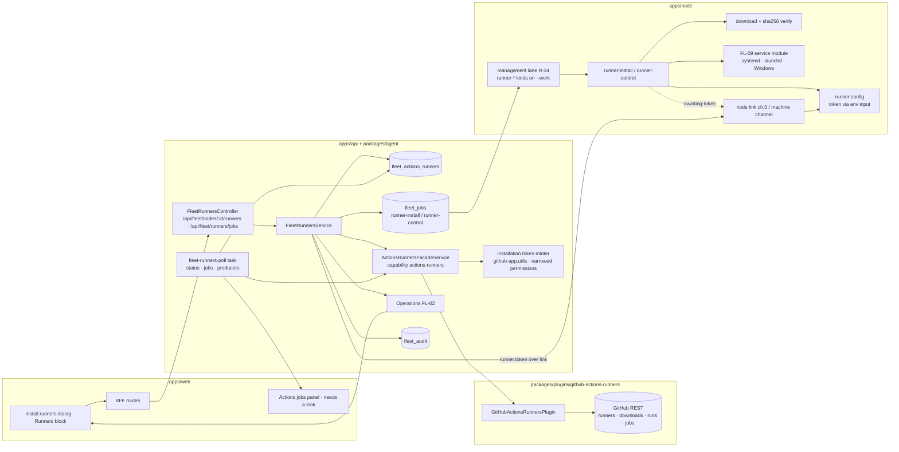

# FL-18 — Actions runners on computers · Implementation plan

> How [`spec.md`](./spec.md) gets built. Implementation detail belongs here (Constitution IX).
> Every path below was opened at the program's base commit (`origin/develop` `e4334baf7`).

**Epic ID:** `FL-18-actions-runners`
**Spec:** [`./spec.md`](./spec.md) · **Tasks:** [`./tasks.md`](./tasks.md)
**Status:** `Draft`
**Created:** 2026-10-18
**Last updated:** 2026-10-18

---

## 1. Architecture summary

Durable work (install, control) rides the job queue; the one secret (the registration token) is
minted at the node's `awaiting-token` phase and pushed over the node link; GitHub reads (runners,
jobs) are platform → plugin → GitHub. Nothing connects into the machine (README D2).

## 2. Current state in the codebase

| Piece                                                                          | Where (verified at base)                                                                                                     | Reused as                                                          |
| ------------------------------------------------------------------------------ | ---------------------------------------------------------------------------------------------------------------------------- | ------------------------------------------------------------------ |
| GitHub plugin (git-provider, oauth, connection-scopes); Actions service for secrets/workflows/dispatch | `packages/plugins/github/package.json:48-70`; `packages/plugins/github/src/github-actions.service.ts:1-215` | shape of a plugin method taking a token; **not** extended (runners are a separate plugin, R-14) |
| GitHub App JWT and narrowed installation tokens                                | `packages/agent/src/utils/github-app.utils.ts:31-49,79-130`                                                                 | the minter the facade uses                                         |
| App credentials/config, installation sync                                      | `apps/api/src/integrations/github-app/github-app.service.ts:69-83`; `github-app-sync.service.ts`                             | installation discovery for targets                                 |
| Installation entity (`installationId`, `accountLogin`, `targetType`, `createdByUserId`, suspended/deleted) and repos snapshot | `packages/agent/src/entities/github-app-installation.entity.ts:11-64`; `github-app-installation-repository.entity.ts` | targets list; ownership filter                              |
| Precedent: minting a one-permission token for a node-side act, fail-closed     | `apps/api/src/fleet/fleet-push-credential.service.ts:184-199,265-340`                                                       | `permissions: { administration: 'write' }` posture                 |
| Build plugin's runner-label selector                                           | `packages/plugins/github-actions-build/src/runner/runner-selector.ts`                                                        | read for label vocabulary only                                     |
| Job kinds union + queued-max-age record                                        | `packages/contracts/src/fleet/fleet-jobs.types.ts:117-125,239-248`                                                          | `runner-install`, `runner-control` appended                        |
| Capability detection                                                           | `apps/node/src/core/capabilities.ts:277-328`                                                                                 | `actions-runner` tag (`--work` + FL-09 service manager)            |
| Node's own service packaging (systemd template, Windows installer that refuses built-in accounts) | `apps/node/packaging/systemd/ever-works-node@.service`; `apps/node/packaging/windows/install-service.ps1`; `packaging/README.md:8-14,58-101` | FL-09's service module generalises these; FL-18 calls it |
| Executor registration; attended lane (the management lane's model)            | `apps/node/src/core/runtime.ts:739-953`, `1026-1070`                                                                         | executors on the management lane (R-34) when `actions-runner` is advertised |
| Needs-a-look producers, Inbox                                                  | FL-03 registry; C §4.6                                                                                                       | `runner-stopped`, `job-unassignable`                               |
| Facade base                                                                    | `packages/agent/src/facades/base.facade.ts:57-110`                                                                           | `ActionsRunnersFacadeService`                                      |
| MCP whitelist, Agent tool factory                                              | `apps/mcp/src/openapi-tools/whitelist.ts:475-530`; `packages/agent/src/fleet/agent-fleet-tools.ts:32-80`                      | new tools                                                          |
| Canonical plugin doc                                                           | `docs/plugin-system/built-in-plugins.md:9-30`                                                                                 | +1 plugin under `integration`                                      |

Does not exist: any runner concept, the plugin, the capability, the table, the job kinds, the panel.

## 3. Tech choices

| Concern                 | Choice                                                                                                                   | Why                                                                         |
| ----------------------- | ------------------------------------------------------------------------------------------------------------------------ | --------------------------------------------------------------------------- |
| GitHub access           | Plugin `github-actions-runners` (category `integration`, capability `actions-runners`) over native `fetch`; tokens passed per call by the facade | R-14; the plugin never holds the App private key                            |
| Token minting           | `requestGitHubAppInstallationAccessTokenDetails` with `permissions: { administration: 'write' }` + `repositoryIds` (repo) or `{ organization_self_hosted_runners: 'write' }` (org); reads use `administration: 'read'` / `actions: 'read'`; cancel uses `actions: 'write'` | Narrowest scope that works; existing minter                                 |
| Token transport         | Node reports `awaiting-token` on the operation → platform mints → `runner.token` JSON on the `machine` channel (C §3.3 `runner.*`) → node sets `ACTIONS_RUNNER_INPUT_TOKEN` for `config` and discards it | Never argv, never payload (spec FR-7)                                       |
| Runner download         | GitHub's published download list (os, arch, url, sha256) fetched by the platform and placed in the job payload; node verifies before extracting | Checksums come from GitHub, not from us                                     |
| Service install         | FL-09 service module: Linux `svc.sh install/start` under `sudo -n`; macOS `svc.sh` (launchd, no sudo); Windows `config.cmd --runasservice` (runs as service) | Per-OS rule; Windows service-only (spec FR-9)                               |
| Diagnosis               | Pure function over job labels × runner labels/scope/state                                                               | Testable truth table                                                        |
| Polling                 | Job-runtime task every 5 min; the web asks the API every 30 s while a page is open (API caches 30 s, conditional requests to GitHub) | Rate-limit friendly                                                         |
| Storage                 | `fleet_actions_runners` table (CONTRACTS §4.11 shape + the epic-local columns in §4.1)                                   | Runners outlive sessions and need audit targets                             |
| Confirmation            | C §2.2 request fields (`confirm`, `confirmName`); 409 `confirmation_required` with `details: { class, summary, preview? }`; no tokens | One mechanism for the web, tools, MCP and CLI                               |

## 4. Data model

### 4.1 `FleetActionsRunner` (new, table `fleet_actions_runners`) — CONTRACTS §4.11

Contract columns (C §4.11) are marked **C**; the rest are epic-local, additive to that shape, read
only by this epic, and listed for the CONTRACTS maintainer in the audit report. Structured values
are `simple-json` text and enums `varchar` validated in code (C §4 preamble).

| Column                  | Type                                                                            | Notes                                                 |
| ----------------------- | ------------------------------------------------------------------------------- | ----------------------------------------------------- |
| `id`                    | uuid PK                                                                         |                                                       |
| `nodeId` **C**          | uuid → `FleetNode` (raw column, index)                                           |                                                       |
| `userId`, `organizationId` | uuid, uuid null                                                              | owner scope as every fleet row                        |
| `installationEntityId`  | uuid → `github_app_installations.id`                                            | which installation registered it                      |
| `scope` **C**           | `varchar(8)` `org · repo`                                                        |                                                       |
| `target` **C**          | `varchar(200)`                                                                   | `owner/repo` or `org`                                 |
| `name` **C**            | `varchar(64)`                                                                    | unique `(nodeId, name)`                               |
| `labels` **C**          | `simple-json` text (`text[]` in C §4.11, stored per its §4 preamble)            | extra labels only                                     |
| `mode` **C**            | `varchar(16)` `service · docker`                                                 |                                                       |
| `githubRunnerId` **C**  | `bigint` null                                                                    | set after registration                                |
| `lastSeenAt` **C**      | PortableDate null                                                               | last time GitHub or the node reported it online       |
| `installedAt` **C**     | PortableDate                                                                    | when registration completed                           |
| `runnerVersion`         | `varchar(32)` null                                                               |                                                       |
| `serviceUnit`           | `varchar(200)` null                                                              | unit/label/service name on the node                   |
| `installDir`            | `varchar(400)`                                                                   | relative to the node data dir                         |
| `state` **C**           | `varchar(16)` `installing · idle · working · offline · removed · unknown` (C §4.11 exactly) | shown "stopped (by you)" = `offline` + `stoppedByOwner`; "failed" = `installing` + `lastError`; `removed` = soft-removed |
| `stateSource`           | `varchar(8)` `github · node`                                                     |                                                       |
| `stoppedByOwner`        | boolean default false                                                            | suppresses `runner-stopped`                           |
| `lastCheckAt`, `lastJobAt` | PortableDate null                                                             |                                                       |
| `currentJob`            | `simple-json` null `{ runId, jobId, name, url }`                                 |                                                       |
| `lastError`             | `varchar(512)` null                                                              | hint text only                                        |
| `createdAt`, `updatedAt`, `removedAt` | PortableDate                                                       | `removedAt` set with `state: removed`; kept 30 days   |

Indexes: `(nodeId)`, `(userId, state)`, `(installationEntityId)`.

### 4.2 Migration — slot 00 (C §13)

`apps/api/src/migrations/1796180000000-CreateFleetActionsRunners.ts`: one `CREATE TABLE`, three
indexes, one unique index; `down` drops the table. Authored from `apps/api/`.

### 4.3 Contracts

- `packages/plugin/src/contracts/capabilities/actions-runners.interface.ts`: `ActionsRunnerTarget {
  scope, target, installationId }`, `ActionsRunnerDownload { os, architecture, downloadUrl, filename,
  sha256 }`, `ActionsRunnerRemote { id, name, labels, status: 'online'|'offline', busy }`,
  `ActionsJob { repository, runId, runNumber, jobId, name, workflowName, labels, status:
  'queued'|'in_progress', runnerName?, startedAt?, queuedAt, url }`, `ActionsRunnersPermissionCheck
  { ok, missing?: string, grantUrl? }`, `IActionsRunnersPlugin extends IPlugin { providerName;
  listDownloads(target, token); mintRegistrationToken(target, token); mintRemoveToken(target,
  token); listRunners(target, token); deleteRunner(target, id, token); listJobs(target, token,
  etag?); cancelRun(repository, runId, token); checkPermission(target, token) }`, guard.
- `facade-capabilities.ts`: `ACTIONS_RUNNERS: 'actions-runners'` appended last; **no category change**
  (`integration` exists), as the `APPS_TIER` precedent notes.
- `packages/contracts/src/fleet/fleet-runners.types.ts`: `FleetActionsRunnerView`,
  `FleetRunnerInstallRequest { target: { scope, target }, count, names[], labels[], mode }`,
  `FleetRunnerInstallResponse { runnerIds[], operationId, jobId }`, `FleetRunnerControlAction =
  'start'|'stop'|'restart'|'remove'`, `FleetActionsJobView` with `diagnosis: 'offline-matching-runner'
  | 'missing-label' | 'wrong-scope' | 'all-busy' | null`, `FleetActionsJobsView { jobs, busyRunners,
  totalRunners, watched[], checkedAt, rateLimitedUntil? }`, job payloads `FleetRunnerInstallPayload
  { runnerId, name, labels, mode, target, downloads: ActionsRunnerDownload[], installDirRel }` (no
  token) and `FleetRunnerControlPayload { runnerId, action }`, `FLEET_RUNNERS_MAX_PER_NODE = 16`,
  `FLEET_RUNNER_STOPPED_AFTER_MIN = 5`, `FLEET_JOB_UNASSIGNABLE_AFTER_MIN = 5`.
- `fleet-jobs.types.ts`: `'runner-install' | 'runner-control'` in the union/list and the max-age
  record (`runner-install` 3600, `runner-control` 600); `FLEET_ACTIONS_RUNNER_CAPABILITY = 'actions-runner'`.
- `fleet-panic.types.ts`: `node.runner.install|start|stop|restart|remove` and `node.runner.job.cancel`
  (C §7).

## 5. API surface

New `apps/api/src/fleet/fleet-runners.controller.ts`, authenticated, `FleetEnabledGuard` +
`FLEET_ACTIONS_RUNNERS_ENABLED`.

| Method | Path                                             | Body / query                     | Returns                                 | Auth / rate         | Errors (C §8)                                                                 |
| ------ | ------------------------------------------------ | -------------------------------- | --------------------------------------- | ------------------- | ----------------------------------------------------------------------------- |
| GET    | `/api/fleet/nodes/:id/runners`                   | —                                | `{ runners: FleetActionsRunnerView[] }` | `view`; 60/min      | `not_found`                                                                   |
| GET    | `/api/fleet/nodes/:id/runners/options`           | —                                | `{ targets[], canHost, reason?, modes[] }` | `view`; 30/min   | `not_found`, `operation_failed` (GitHub)                                      |
| POST   | `/api/fleet/nodes/:id/runners`                   | `FleetRunnerInstallRequest`      | `202 FleetRunnerInstallResponse`        | `machines`; 10/min  | `invalid`, `limit_exceeded`, `unreachable`, `consent_missing`, `unsupported_on_node`, `root_required`, `permission_denied` (App/permission), `kill_switch` |
| POST   | `/api/fleet/nodes/:id/runners/:runnerId/:action` | `{ confirm?, confirmName? }` (`action ∈ start|stop|restart|remove`; stop/restart need `confirm: true`, remove needs `confirmName`) | `202 { operationId }` | `machines`; 30/min | `confirmation_required`, `busy` (remove while working), `unreachable`, `kill_switch` |
| GET    | `/api/fleet/runners/jobs`                        | `?targets=`                      | `FleetActionsJobsView`                  | `view`; 60/min (API caches 30 s) | `operation_failed`                                               |
| PUT    | `/api/fleet/runners/jobs/watched`                | `{ targets: [{ scope, target }] }` | `200`                                 | authed; 30/min      | `invalid`, `permission_denied` (App not covering)                             |
| POST   | `/api/fleet/runners/jobs/cancel`                 | `{ repository, runId, confirm: true }` | `202`                             | `machines`; 10/min  | `confirmation_required`, `permission_denied`, `kill_switch`                   |
| GET    | `/api/fleet/runners/jobs/permission`             | `?scope=org&target=acme`         | `ActionsRunnersPermissionCheck`         | authed; 30/min      | —                                                                             |

`/runners/jobs/*` are sub-resources of the C §11.2 root `/runners/jobs`; options is a sub-resource
of `/nodes/:id/runners`. Node-facing: no new HTTPS endpoint — the token rides the link (§6.4). A
call without its class field answers 409 `confirmation_required` with the preview (C §2.2);
operation states are C §3.3's `running · done · failed · cancelled · interrupted`.

## 6. Node side

### 6.1 Modules — `apps/node/src/core/link/modules/runners/` (R-40)

The module lives under FL-02's registry with one entry in `apps/node/src/core/link/modules/index.ts`
(its `runner.*` verbs); the two durable executors stay in `apps/node/src/core/executors/`.

| File                        | Responsibility                                                                                                                     |
| --------------------------- | ---------------------------------------------------------------------------------------------------------------------------------- |
| `runner-download.ts`        | pick the download for `os/arch` from the payload, stream to `<dataDir>/actions-runners/<name>/.download`, SHA-256 verify, extract (tar / zip), delete on mismatch |
| `runner-config.ts`          | spawn `config.sh` / `config.cmd` with `--unattended --url <https://github.com/owner/repo|org> --name --labels --work _work` (+ `--replace` only when GitHub lists the name for this node, + `--runasservice` on Windows), token via `ACTIONS_RUNNER_INPUT_TOKEN` in the child env only; refuse if the runner build rejects env input rather than fall back to argv |
| `runner-service.ts`         | FL-09 service module (`apps/node/src/core/link/modules/services/`) adapters: Linux `sudo -n ./svc.sh install <user> && sudo -n ./svc.sh start` (refuse with the exact command when `sudo -n true` fails); macOS `./svc.sh install && ./svc.sh start`; Windows: the runner registers its own service during `config.cmd --runasservice` (needs elevation → refuse with the exact command) |
| `runner-state.ts`           | `<installDir>/ever-works.json` (name, target, labels, mode, version, serviceUnit); `.runner` file read for the GitHub id             |
| `runner-logs.ts`            | FL-08 source `runner:<name>` → newest `_diag/Runner_*.log`                                                                          |
| `apps/node/src/core/executors/runner-install.ts` | phases `downloading · verifying · registering (awaiting-token) · installing service · starting`; progress via FL-02 operations      |
| `apps/node/src/core/executors/runner-control.ts` | `start|stop|restart` via the service module; `remove` = stop → `config remove` with a remove token (received like the registration token) or platform-side `deleteRunner` fallback → uninstall service → delete folder |

Both executors register on the **management lane** (CONTRACTS R-34: it leases `runner-install` /
`runner-control` on nodes started with `--work` and never competes with Agent work for
`--concurrency`; created by the first of FL-20 → FL-16 → FL-18 to land, FL-16 plan §6.2) only when
the node advertises `actions-runner`.

### 6.2 OS matrix

| OS      | Service manager | Runner mode             | Privilege needed                                   |
| ------- | --------------- | ----------------------- | -------------------------------------------------- |
| Linux   | systemd         | `svc.sh` unit           | passwordless `sudo -n` (refuse with exact command) |
| macOS   | launchd         | `svc.sh` LaunchAgent    | none                                               |
| Windows | Windows services | `config.cmd --runasservice` | elevation (refuse with exact command); service-only |
| Linux + `docker` (P3) | Docker  | container per runner    | none beyond Docker group                           |

### 6.3 Consents and tags

Runner jobs are **work** (C §1.1) → `--work`. `capabilities.ts` advertises `actions-runner` when
`--work` is on and FL-09 detected a service manager (or, P3, `docker` on Linux).

### 6.4 Link usage (C §3.3 `machine` family, `runner.*`; handlers in `link/modules/runners/index.ts`)

| Message                                   | Direction        | Purpose                                                                |
| ----------------------------------------- | ---------------- | ---------------------------------------------------------------------- |
| `operation.progress { phase: 'awaiting-token', runnerId }` | node → platform (ch. 0) | the node is ready to register                             |
| `runner.token { runnerId, kind: 'register'|'remove', token, expiresAt }` | platform → node | minted at that moment; node keeps it in memory only        |
| `runner.list`                             | platform → node  | node-side view of runners (service state, version) for reconciliation  |
| `runner.status { runnerId }`              | platform → node  | one runner's service state                                             |

If the link is down when the node reaches `awaiting-token`, the job heartbeats with that phase and
waits (up to the job's queued max age); the platform sends the token on reconnect.

## 7. Plugin surface

`packages/plugins/github-actions-runners/`: `package.json` (ESM, `tsup`, Vitest; `everworks.plugin`:
`id: 'github-actions-runners'`, `category: 'integration'`, `capabilities: ['actions-runners']`,
`systemPlugin: true`, `autoEnable: true`, `visibility: 'user-only'`, settings `watchedTargets`
(user scope, non-secret), no secrets of its own — the App key stays in the API config);
`src/github-actions-runners.plugin.ts` (methods per §4.3, every method takes a short-lived token);
`src/github-runners-api.ts` (fetch, `If-None-Match`, rate-limit headers → `rateLimitedUntil`);
`src/diagnose.ts` (pure `diagnoseJob(job, runners)`); `src/testing/fake-github-runners-api.ts`.

Facade `packages/agent/src/facades/actions-runners.facade.ts`: resolves the plugin by capability;
`mintToken(installation, scope)` through `requestGitHubAppInstallationAccessTokenDetails` with the
narrowest permission per operation (§3); `listTargets(userId)` from the installation and repository
snapshot tables with the ownership filter `fleet-push-credential.service.ts:379-382` uses; wraps the
plugin methods. Canonical doc: `docs/plugin-system/built-in-plugins.md` (`integration` row appears
for the first time; count +1).

## 8. Web surface

- Registry contributions (FL-01 `registerOverviewBlock`, C §11.1): the computer Overview **Actions
  runners** block (with its **Install runners** button — FL-01 has no header-action entry point) and
  the hub Overview **Actions jobs** panel (R-37: a panel, not a tab or route).
- Components `apps/web/src/components/fleet/runners/`: `InstallRunnersDialog.tsx`,
  `RunnersBlock.tsx`, `RunnerRow.tsx`, `RunnerActionsMenu.tsx`, `RemoveRunnerDialog.tsx`,
  `ActionsJobsPanel.tsx`, `ActionsJobRow.tsx`, `WatchedTargetsEditor.tsx`, `GrantAccessCard.tsx`,
  `runners.shared.ts` (pure: state glyphs, diagnosis strings, default names, mode availability per OS).
- BFF: `apps/web/src/app/api/fleet/nodes/[id]/runners/**`, `apps/web/src/app/api/fleet/runners/jobs/**`.
- Logs tab: FL-08's source list includes `runner:<name>` entries from the node.
- Palette entries beside `screens.ts:212`. i18n groups per spec §5.7.
- Playwright: `apps/web/e2e/flow-fleet-actions-runners.spec.ts`.

## 9. Agent / MCP / CLI surface (C §11.3)

| Tool                        | Annotation                                                          | Maps to                                  |
| --------------------------- | ------------------------------------------------------------------- | ---------------------------------------- |
| `fleet_runners_list`        | `readOnly: true`                                                    | GET `/nodes/:id/runners` (all nodes when omitted) |
| `fleet_runners_jobs`        | `readOnly: true`                                                    | GET `/runners/jobs`                      |
| `fleet_runners_install`     | `destructive: true`, `confirmationClass: confirm`, text per FR-30   | POST `/nodes/:id/runners`                |
| `fleet_runners_action`      | `destructive: true`, `confirmationClass: confirm` (stop/restart) / `plain` (start) | POST `/nodes/:id/runners/:runnerId/:action` |
| `fleet_runners_remove`      | `destructive: true`, `confirmationClass: confirm-destructive`       | POST `.../remove`                        |
| `fleet_runners_cancel_run`  | `destructive: true`, `confirmationClass: confirm`                   | POST `/runners/jobs/cancel`              |

Files: `packages/agent/src/fleet/agent-fleet-runners-tools.ts`; MCP whitelist entries; CLI
`apps/cli/src/commands/fleet/runners.ts` (`list|jobs|install|start|stop|restart|remove|cancel-run
[--json]`).

## 10. Background jobs

| Task                   | File (`packages/tasks/src/tasks/trigger/`) | Trigger          | What it does                                                                                                                  | Idempotency                        |
| ---------------------- | ------------------------------------------ | ---------------- | ----------------------------------------------------------------------------------------------------------------------------- | ---------------------------------- |
| `fleet-runners-poll`   | `fleet-runners-poll.task.ts`               | cron `*/5 * * * *` | per owner with runners: `listRunners` per target, `runner.list` per online node → merge states; `listJobs` per watched target → diagnosis; produce/clear `runner-stopped` and `job-unassignable` | per-row CAS on `lastCheckAt`; items keyed `fleet-runner:<id>:stopped` / `fleet-actions-job:<repo>:<jobId>:unassignable` |

The API's `GET /runners/jobs` and `GET /nodes/:id/runners` refresh on demand (30 s cache) while a
page is open. Dispatcher `FLEET_RUNNERS_POLL_DISPATCHER` in `packages/agent/src/fleet/runners/`.

## 11. Security & permissions

- **Who**: `view` reads; `machines` installs/controls/removes/cancels (C §2.1). Agents pass FL-19's
  gate (C §2.1): Ask/Draft holds the call as an `agent_action_proposals` row (R-33); Auto needs the
  C §2.2 fields.
- **Tokens**: installation tokens minted per operation with the narrowest permission and, for
  repositories, `repositoryIds` from the platform's own snapshot (never a caller-supplied name);
  registration/remove tokens exist in memory for one link message and one child env; never in
  `fleet_jobs.payload`, logs or audit (`extra` carries target, labels, mode, version).
- **Downloads**: URL and checksum come from GitHub's download list fetched server-side and pinned in
  the payload; the node refuses any other host; verification before extraction; owner-only folders;
  Windows ACL restricted to the runner account.
- **Node refusals**: no `--work` → `consent_missing`; no service manager → `unsupported_on_node`; no
  passwordless sudo / not elevated → `root_required` (C §8) with the exact command; a name GitHub
  lists for another machine → `invalid`.
- **Threats**: token on argv (prevented by env input; refused when unsupported); poisoned download
  (checksum); runner folder tampering (ACL); cancelling someone else's run (installation ownership
  filter + `machines` audience); runaway installs (10/min, 16 per node).
- **Kill switch**: install/control/cancel refuse `kill_switch`; lease answers `[]`; the node's link
  gets `link.pause` (C §3.2), so no `runner.token` is sent while it holds; running runners
  untouched.

## 12. Observability

- Audit rows per action; operation progress; `fleet_runners{state}` gauge,
  `fleet_runner_install_total{os,outcome}`, `fleet_actions_jobs_unassignable` gauge, GitHub
  rate-limit remaining logged by the poll task.

## 13. Phased rollout

1. **P1** (`FLEET_ACTIONS_RUNNERS_ENABLED`, default off): capability, plugin (downloads, tokens,
   runners), facade, table + migration, service, API (nodes/:id/runners), node modules + executors,
   `actions-runner` tag, dialog + Runners block, logs source, `runner-stopped`, tools, e2e.
2. **P2**: jobs API, diagnosis, panel, watched targets, cancel workflow run, `job-unassignable`,
   organisation permission check + Grant access, `fleet_runners_jobs` / `fleet_runners_cancel_run`.
3. **P3**: Docker-isolated mode, version/update visibility, CLI.
4. **Default-on** after spec §9 is green (D12).

## 14. Test plan

| Package                                   | Runner     | Specs                                                                                                                                                                                                                 |
| ----------------------------------------- | ---------- | --------------------------------------------------------------------------------------------------------------------------------------------------------------------------------------------------------------------- |
| `packages/plugin`                         | Vitest     | `src/contracts/__tests__/actions-runners.interface.spec.ts` (guard; capability appended last — extend the append-only pins)                                                                                            |
| `packages/plugins/github-actions-runners` | Vitest     | `src/__tests__/github-actions-runners.plugin.spec.ts` (download list mapping incl. sha256; token endpoints per scope; 403 → permission check with grant URL; conditional requests; cancel); `diagnose.spec.ts` (truth table: offline-matching, missing-label, wrong-scope, all-busy, assignable) |
| `packages/agent`                          | Jest       | `src/facades/__tests__/actions-runners.facade.spec.ts` (narrowest permission per operation; `repositoryIds` from snapshot only; ownership filter; no plugin id in core); `src/fleet/runners/__tests__/fleet-runners.service.spec.ts` (limit 16; row-first; token never in payload; busy guard; stoppedByOwner suppresses the item; kill switch); `agent-fleet-runners-tools.spec.ts` |
| `apps/api`                                | Jest       | `src/fleet/fleet-runners.controller.spec.ts` (every status in §5; cancel hidden outside `machines`; watched targets validation)                                                                                       |
| `apps/node`                               | Vitest     | `src/core/link/modules/runners/runner-download.spec.ts` (mismatch deletes, nothing extracted; foreign host refused), `runner-config.spec.ts` (argv never contains the token; env input; `--replace` only when owned; `--runasservice` on win32), `runner-service.spec.ts` (sudo -n refusal text; launchd no sudo; Windows elevation refusal), `runner-logs.spec.ts`, `src/core/executors/runner-install.spec.ts` (phases; awaiting-token wait; resume after link drop), `runner-control.spec.ts`; extend `capabilities.spec.ts` (`actions-runner` only with `--work` + service manager), `runtime.spec.ts` (runner kinds on the management lane only with `--work`; never on the work lane) |
| `packages/tasks`                          | Jest       | `src/__tests__/fleet-runners-poll.task.spec.ts` (state merge GitHub-wins-when-fresh; `runner-stopped` after 5 min, cleared on recovery; `job-unassignable` after 5 min; rate-limit back-off; idempotent items)          |
| `apps/web`                                | Vitest     | `components/fleet/runners/runners.shared.unit.spec.ts` (mode availability per OS; diagnosis strings), `InstallRunnersDialog.unit.spec.tsx` (count clamp; default names; Windows service-only; cost sentence), `ActionsJobsPanel.unit.spec.tsx` |
| `apps/web` e2e                            | Playwright | `e2e/flow-fleet-actions-runners.spec.ts` (fake GitHub API + node contract fixture: install 2 → rows → idle; stop → stopped (by you), no item; remove typed name; P2: panel with an unassignable job and Cancel workflow run; Grant access card) |

## 15. Risks

| Risk                                                    | Likelihood | Impact | Mitigation                                                                              |
| ------------------------------------------------------- | ---------- | ------ | --------------------------------------------------------------------------------------- |
| Runner build stops honouring env input for the token    | low        | high   | node refuses rather than falling back to argv; test pins the behaviour                  |
| GitHub App lacks the runners permission on existing installs | high  | medium | permission check + Grant access card; manifest update is the owner question in spec §8b |
| Linux hosts without passwordless sudo                   | high       | medium | exact one-time command shown; macOS and Windows paths unaffected                        |
| GitHub rate limits with many watched targets            | medium     | low    | conditional requests; 5-min off-page cadence; back-off to reset                         |
| State disagreement GitHub vs node                       | medium     | low    | `unknown` with the reason; GitHub wins only when fresh                                  |
| Removing a runner that holds a job                      | medium     | medium | `busy` guard; stop lets the job finish                                                  |

## 16. Constitution reconciliation

- **I** GitHub access through a plugin; node work in a node module. **II** Capability resolution;
  no plugin id in core (tested). **III** Only names/ids stored. **IV** Poll task via dispatcher;
  install/control as node jobs. **V** One additive migration, slot 00. **VI** Tests per §14.
  **VII** Tokens never persisted/logged; narrowed; redaction tested. **VIII** Canonical doc only.
  **IX** Spec has no code. **X** Appended kinds/capability; new table; optional fields.

## 17. References

- Spec: [`./spec.md`](./spec.md) · Tasks: [`./tasks.md`](./tasks.md)
- [CONTRACTS](../CONTRACTS.md) R-14, R-23, R-24, R-33, R-34, R-37, R-40, §1, §2, §3.2–3.3, §4, §4.6, §4.11, §7, §8, §9, §10, §11, §12, §13
- Sibling plans: FL-02 (link, operations), FL-08 (log sources), FL-09 (service module), FL-01 (registry), FL-03 (producers)
- Code: paths in §2; `docs/plugin-system/creating-a-plugin.md` for the plugin shape
